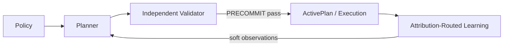
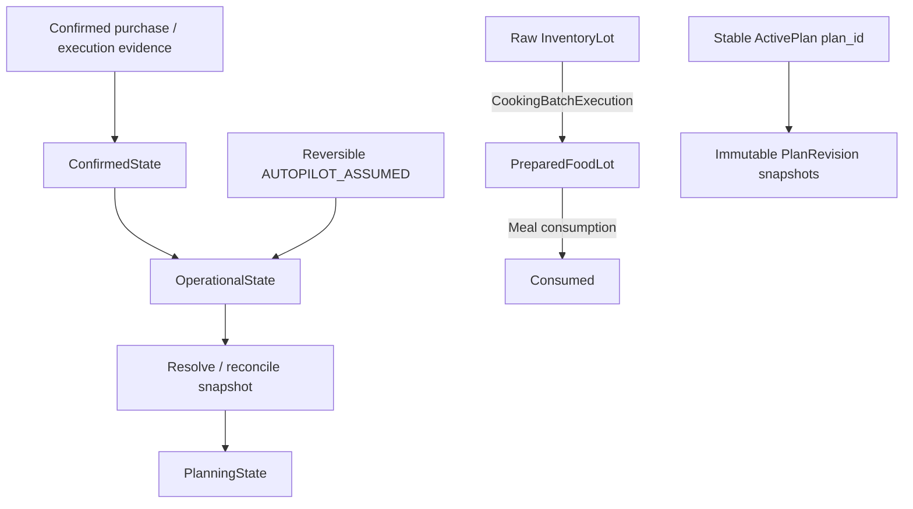

# Foundation kiến trúc V1.3

Nguồn chuẩn: spec V1.3 §8, §9, §16.4, §18–19; ADR-001..011; INV-001..030. Kiến trúc đã chốt, implementation closed loop chưa có.

## Closed loop

Validator kiểm correctness, không chứng minh optimality và không repair. POSTFACT tạo diagnostics sau khi ghi nhận reality. Root member safety, primitive recomputation và chronological replay có đường kiểm chứng độc lập với solver.

## Context và ownership

Spec §9 liệt kê 14 business contexts gốc; §16.4 bổ sung validation và learning thành 16 namespace. Hai namespace mới là ranh giới triển khai rõ ràng, không tự nhận rằng đã có service.

| Namespace | Trách nhiệm |
| --- | --- |
| identity | Account, consent, actor identity |
| households | Household ownership/membership; member biology/safety tách tài nguyên chung |
| nutrition | Member nutrition policies và root goal contracts |
| catalog | Ingredient, facts, units/basis/provenance |
| recipes | Authored RecipeVersion/variant rules |
| retail | Evidence, ProcurementClass, planning quotes/calibration |
| inventory | Raw/prepared household assets, movements, reservations |
| policy | Orthogonal user defaults/overrides → resolved policy snapshots |
| planning | Planner orchestration, stable ActivePlan intent và immutable revisions |
| cooking | Batch composition, production, allocation và execution transformation |
| shopping | Planned requirements vs quantitative confirmed fulfillment |
| execution | Evidence, operational assumptions, correction/repair và horizon bridge |
| validation | Immutable-subject root/arithmetic/temporal verification, side-effect-free |
| learning | Evidence classification, attribution, learned observations/exposure |
| preferences | Declared/member-owned preferences và profile contracts |
| assistant | Intent parsing và explanation ngoài trusted truth |

## State và lifecycle contracts — chưa triển khai

PlanRevisionHistory mô tả recommendation đổi thế nào; ExecutionLedger mô tả reality. Future intent được sửa atomically sau PRECOMMIT; materialized past không bị ghi đè. COOKED != CONSUMED; planned purchase chưa phải owned inventory. Mũi tên trong sơ đồ là data/lifecycle contract, không phải xác nhận code đã chạy.

## Năm seam handoff

1. CulinaryAdjustment đổi composition per serving; serving count chỉ đổi qua explicit tier/revision.
2. Revision SPEND_LIMIT = actual sunk spend + required stress spend của phần chưa fulfilled; không stress lại món đã mua hoặc quên overspend.
3. HorizonBridgeResolver chronologically project commitments tới T_start để nhận opening assets + provisional exposure, tránh đếm raw/prepared hai lần.
4. Shared meal hard safety kiểm từng participant trước utility; direct feedback chỉ cập nhật member có actor/explicit attribution.
5. Accepted relaxation/forced repair mang FORCED_CONFLICT_RESOLUTION; không trở thành voluntary taste/context preference.

## Import policy được CI kiểm

Cross-context imports chỉ qua contracts/public và allowlist trong tools/check_import_boundaries.py. Shared không import domain; backend không import synthetic benchmark.

Validation và learning chỉ đọc cross-context contracts, không gọi mutation/solver facades. Validation không import OR-Tools. Một domain contracts namespace cũng không được import domain internals/public để làm đường vòng; contracts chia sẻ facts, không chia sẻ enforcement. Planning/execution có thể gọi validation.public khi orchestrator được triển khai. Learning giữ observations, preferences giữ explicit/member-owned contracts.

Đây là static import enforcement; vẫn cần review transitive dependencies, runtime/SQL side effects và test correctness. Không biến shared thành business-policy god module.

## Toolchain và benchmark

FastAPI/React và lockfiles được giữ. PostgreSQL/SQLAlchemy/Alembic chưa có production schema/migration. Backend không expose synthetic solve endpoint. BenchmarkVerifier chỉ là arithmetic verifier cho micro-model; không phải ValidationOrchestrator, RootContractValidator hoặc full chronological replay theo ADR-010.
