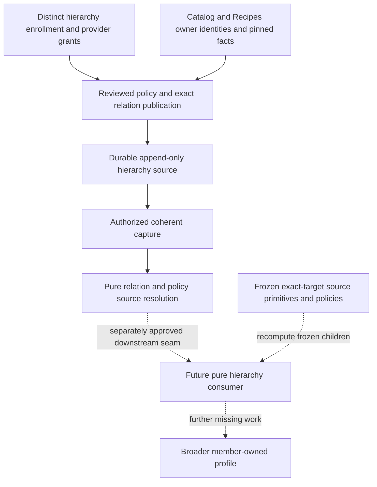

# Canonical Reviewed Hierarchical Preference Relation & Transfer-Policy Source Foundation

Status: **FROZEN / APPROVED — SOURCE FOUNDATION; CONSUMER IMPLEMENTATION NOT AUTHORIZED**.

Current status: the user froze the SOURCE at exact implementation merge
`ee8a4de1b1c71ccbd56ea565e111718660711fa8` after PR #104 approval and successful exact push
CI40432057006. [Canonical freeze receipt](HIERARCHICAL_PREFERENCE_RELATION_POLICY_SOURCE_FREEZE_RECEIPT.md) records
the implementation and regression receipts. The [post-freeze review](POST_HIERARCHY_SOURCE_FREEZE_DEPENDENCY_REVIEW.md)
assigns MTR-040C to the next bounded pure-consumer detailed DESIGN only; runtime is not authorized.
The source foundation itself remains unnumbered. Original design/delivery baseline and stop
statements below are historical; the receipt supersedes only current status. No approved semantic
requirement is changed. The correction supersedes only stricter finite-map semantics.

Prepared 2026-10-27. Milestone number **UNASSIGNED**; this is not MTR-040C.

## 1. Historical design baseline and authorization

| Item | Reviewed basis |
| --- | --- |
| Repository / exact canonical main | `thedusk4203/Menuto` / `73b3b0b3bbe6571ca5e70c09442d394701c5adf8` |
| Dependency review | [PR #101](https://github.com/thedusk4203/Menuto/pull/101), ten Markdown files; [review](POST_EXACT_TARGET_PRIOR_SHRINKAGE_DEPENDENCY_REVIEW.md) APPROVED by the user |
| Exact baseline push CI | [40365344734](https://github.com/thedusk4203/Menuto/actions/runs/40365344734), SUCCESS; python/web SUCCESS on that exact SHA |
| Runtime baseline | 2,597 tests; 318 exported definitions; Alembic0014 /78 domain tables |
| Frozen dependencies | 040A/B;041A–F;046A; reviewed exact-target prior source; PR #100 exact-target compatibility/shrinkage |
| Authorized now | Dedicated canonical hierarchy relation/transfer-policy SOURCE DESIGN; future pure consumer may be described only as a downstream seam |
| Not authorized | Source/consumer implementation; production relation corpus, directions or coefficients; MTR-040C; migration0015 or physical schema/permission enum reservation |

PR #101 used the broader descriptive name Hierarchical Preference Mapping & Derivation Foundation.
The user's architecture review narrows the next activity to this source design, **before** a pure
hierarchy consumer. At the original design delivery the source below was a proposal,
not yet an existing capability or approved design.
Merging this documentation does not approve its architecture or authorize implementation.

## 2. Problem, scope and selected design

046A can establish food classification; PR #100 can derive an exact-target value. Neither establishes
permission to transfer a member's preference to a different exact target. Equality of two scoped
numbers also establishes no such permission. The missing primitive is durable, reviewed source
truth describing **which exact directed relation is authorized, under which transfer policy**.

Select a **Preferences-owned, database-backed, independently authorized publication module** with:

- one explicitly selected provider and policy lineage; no provider/policy fallback;
- immutable reviewed policy revisions and exact directed relation revisions;
- a complete closed five-by-five direction matrix, initially deny everywhere;
- explicit finite coordinate mapping and independently authored attenuation;
- owner-verified classification/context support where claimed;
- append-only authority/publication history, coherent capture and pure source resolution;
- one-hop, single-parent downstream interpretation only; no recursive graph engine or aggregation.

The source stores global reference permission, not member preference, learned observations or
member profiles. Publication has no member/household author. A later result belongs to its exact
HouseholdMember and destination target. The source itself derives no member affinity.



## 3. Repository evidence and ownership

| Inspected owner/source | Consequence for this design |
| --- | --- |
| [ADR-011](../adr/ADR-011-behavioral-learning-loop.md), [INV-022–030](../ARCHITECTURE_INVARIANTS.md) | Member ownership, separate dimensions and evidence classes; no passive durable learning, cooked=liked, friction=taste or forced-tradeoff preference inference. Hierarchy remains a requirement, not permission. |
| `preferences/contracts.py`, `profile_capture.py`, `profile_derivation.py` | Five exact typed targets; current declaration head determines explicit affinity/ordinal strength; stable recipe identity capture deliberately selects no RecipeVersion. |
| `preferences/reference_prior_contracts.py`, `reference_priors.py`, `reference_prior_resolution.py`, [prior source design](PREFERENCE_PRIOR_SOURCE_FOUNDATION_DESIGN.md) and [freeze](PREFERENCE_PRIOR_SOURCE_FREEZE_RECEIPT.md) | Existing publication authentication, journal and capture discipline are useful precedent. All its capabilities, roles, storage and resolver remain prior-specific. |
| `preferences/prior_affinity_contracts.py`, `prior_affinity.py`, [PR #100 design](EXACT_TARGET_PRIOR_COMPATIBILITY_SHRINKAGE_DESIGN.md) and [freeze](EXACT_TARGET_PRIOR_SHRINKAGE_FREEZE_RECEIPT.md) | One exact target; descriptor includes kind and full compatibility-policy fingerprint, not target ID. Outer member/target identity must be preserved. Inheritance is NOT_PERFORMED. |
| `catalog/contracts.py`, `feature_repository.py`, `public.py` | Ingredient→PROTEIN reviewed associations and covered/positive universes; factual association is not taste permission. |
| `recipes/contracts.py`, `feature_repository.py`, `feature_resolution.py`, `public.py`; [046A design](MTR_046A_CULINARY_FEATURE_ASSIGNMENT_DESIGN.md) | METHOD context and FLAVOR/MAIN_PROTEIN applicability are version-specific; review history/support and unresolved/reviewed absence states matter. MAIN_PROTEIN uses PROTEIN vocabulary. |
| `planning/feature_capture.py`, `feature_preview.py`, `feature_exposure_capture.py` | Proposal/batch/version selection belongs to proposal-local capture. It cannot select hierarchy context for a stable recipe preference. |
| `learning/contracts.py`, `public.py`, `feature_repeat.py`;041A–F evidence | Repeat diagnostics, including `_inherited_result()`, are not member preference inheritance or global history. |
| Current backlog, status, blueprints, invariant coverage, source/schema metadata and CI workflow | Source/consumer absent; downstream blockers persist. Required CI remains python/web; current exports/migrations remain frozen. |

Graphify's existing 484-node graph provided orientation to ADR-011/spec§19.3/19.5. The 900-token
query returned16/124 nodes and was truncated; it is not evidence of current runtime completeness.
Current owner interfaces and canonical receipts establish the inventory above.

| Owner | Owns | Does not acquire |
| --- | --- | --- |
| Preferences hierarchy source | Transfer semantics, reviewed relation/policy lifecycle, publication/capture verification | Member declaration authorship, food classification curation, prior publication permissions |
| HouseholdMember | Later derived member preference information; existing declarations remain authoritative | Authority to publish global relations via SELF/AUTHORIZED_REPRESENTATIVE |
| Catalog / Recipes | Canonical endpoint identities and food/version/context facts | Permission to transfer member preference |
| Hierarchy internal curator | Provider-scoped, authenticated review/publication or retraction actions expressly granted here | Rights from a reviewer UUID, prior grant, provenance label or Catalog/Recipes curator status |
| Learning / Planning / Execution | No new authority in this slice | Source writes, TasteFit, ranking, safety or PRECOMMIT rights |

## 4. Small source interface and proposed contract responsibilities

Names in this section are conceptual design names, **not exported contracts or reserved wire enums**.

| Operation | Required behavior |
| --- | --- |
| Review and publish policy | Authenticate hierarchy publisher; review one complete immutable policy replacement; enforce provider/frontier and policy-head CAS; append revision/receipt atomically. |
| Review and publish relation | Authenticate hierarchy publisher; review exact endpoints, policy pin, support and rationale; verify canonical owner facts; check self-edge/cycle rules; append replacement under CAS. |
| Retract policy or relation | Authenticate hierarchy retractor; append a reasoned tombstone under CAS, without values/support replacement or history deletion. |
| Capture hierarchy source | Authenticate hierarchy reader; capture complete provider journal, authorities, policy/relation streams and owner support manifests in one clean read-only RR/SERIALIZABLE transaction. |
| Resolve hierarchy source | Purely reparse/revalidate/replay all primitives; resolve one selected policy lineage and requested exact destinations into source statuses/eligible relation descriptors. No member arithmetic or IO. |

Enrollment/provider registration/grant/revoke belongs to a separately privileged deployment interface.
The caller owns every transaction/commit/rollback; no hidden connection, commit or background worker.

| Proposed value | Required contents / trust rule |
| --- | --- |
| Exact relation identity | Provider, stable policy-lineage identity, typed exact source and destination, explicit context-binding identity when required. Reverse direction is a different stream. |
| Reviewed policy body | Policy ID/version, complete25-cell matrix, finite descriptor/value maps, attenuation, support modes, fixed precedence/source/traversal rules and full review rationale/provenance. |
| Policy/relation command | Full replacement or tombstone, predecessor/revision, expected provider mutation frontier, idempotency key; no caller actor/time/status authority fields. |
| Publication revision | Original command content/hash, server-derived principal and grant, policy/support pins, contiguous sequences, predecessors, review attestation and server time. |
| Source snapshot draft | Request, full provider registration/enrollment/authority/publication journal, head/frontier manifests, complete consumed owner source/support, reader proof, clocks and recomputed fingerprint. |
| Source resolution draft | Full source identity and request, per-destination source outcome/reason, exact selected relation/policy/support descriptors, diagnostic lineage and deterministic fingerprint; no inherited numeric affinity. |

Unknown fields, duplicate keys, unknown target kinds or unsupported versions fail closed. Reconstruct
primitive contents before validation; hashes, cached child results and construct/copy bypasses do not
replace revalidation. No mutable generic graph/policy engine is introduced.

## 5. Publication and capture authority

### 5.1 Separate trust root

Use dedicated PostgreSQL-authenticated internal hierarchy sessions and a **new hierarchy-specific
enrollment and grant ledger**. Bind immutable database OID/name and login role OID/name to an enrolled
hierarchy principal. Verify actual server-reported SCRAM authentication identity and session login;
reject unauthenticated/trust sessions, identity mismatch and unsupported methods. Remote connections
require verified TLS/server identity; the protected server guard and client verification must both pass.

These requirements follow the frozen prior source's demonstrated discipline, but its credentials,
enrollments and grants confer **zero hierarchy permission**. Provision separate hierarchy credentials
and owner/admin isolation. Do not extend its frozen capability union or write its tables/functions.
No physical role names, schema names, permission enum literals or deployment credentials are assigned.

Conceptual permissions are distinct: review-and-publish, retract, and capture, each provider-scoped.
An authorized publisher attests review in the publication action; a separate human reviewer is **not**
claimed or required in this bounded design. The authenticated principal supplies the attestation;
command-authored reviewer IDs cannot substitute. A service login identifies a service, not an invented
human. Publication proves authorized review attestation, not empirical truth or calibration.

Only a separately provisioned hierarchy enrollment administrator may register providers, enroll safe
logins and append grants/revocations. Publishers/readers cannot grant themselves rights, SET ROLE to
source owner/admin, administer roles or alter source code/relations. Empty enrollment means denied;
provider registration seeds no grants, directions, relations, mappings or numeric policy values.

### 5.2 Enforcement and revocation

Protected database mutation/capture functions must derive identity internally and enforce grants even
when called without Python. Revoke ordinary direct DML/TRUNCATE and default PUBLIC execution; isolate
non-login function owners, protected search paths and fully qualified dependencies. Reject unsafe
superuser/owner/admin or reachable privileged-role sessions through the ordinary interface. Caller
GUCs, actor UUIDs, hashes, REVIEWED_REFERENCE labels and membership roles are not credentials.

Owner facts needed by publication must be read through narrow **owner-controlled read adapters** in
the same transaction. The protected write path must independently reconstruct/check those facts
from canonical storage; an application-supplied support JSON/hash is insufficient. Future additive
Catalog/Recipes read adapters must expose only the required identity/review/context facts to the
protected hierarchy reader, without granting classification writes or modifying frozen contracts.
Python-only validation followed by a database function trusting caller support is rejected.

Authority changes and publications serialize on the same provider frontier. Current permission is
checked after the lock and **before idempotency receipt lookup**. Revocation therefore denies even
an old retry. It is prospective: old authorized publications remain historical facts until explicitly
retracted; old-cut replay does not reinterpret them using today's grants. A regrant is a new event.
Renamed/recreated credentials do not inherit enrollment; rotation requires new binding and grants.

Trusted provisioning/database roots remain trusted. Offline replay cannot prove canonical database
origin, possession of a credential, current grant, current applicability or absence of root tampering.
No snapshot/hash is a portable live authorization token. Production provenance comes from the verified
capture path and its deployment trust root, not from accepting a caller-authored policy object.

## 6. Exact relation identity, direction and applicability

Endpoints reuse the frozen **PreferenceTarget identity union only**:
INGREDIENT(ingredient_id), PROTEIN/METHOD/FLAVOR(feature_term_id), DIRECT_RECIPE(recipe_id).
Both identities/kinds must exist in their canonical owners; feature identities must be reviewed and
match dimension. Labels/aliases/name equality never substitute. MAIN_PROTEIN is not a sixth kind.

The closed matrix is directed; rows are source kind and columns are destination kind:

| From / to | INGREDIENT | PROTEIN | METHOD | FLAVOR | DIRECT_RECIPE |
| --- | --- | --- | --- | --- | --- |
| INGREDIENT | DENY | DENY | DENY | DENY | DENY |
| PROTEIN | DENY | DENY | DENY | DENY | DENY |
| METHOD | DENY | DENY | DENY | DENY | DENY |
| FLAVOR | DENY | DENY | DENY | DENY | DENY |
| DIRECT_RECIPE | DENY | DENY | DENY | DENY | DENY |

This is the **empty/default state**, not a production policy publication. Every reviewed policy
must explicitly author all25 cells as denied or enabled. An enabled cell only permits publication
of individually reviewed exact relations with the required mapping/support; it creates no edges.
Missing cells/unknown kinds are invalid, not wildcard permissions. No direction is enabled by this
design. Changing a cell requires a reviewed policy replacement and fresh relation policy pins.

Same kind/different ID is still an explicit relation; no alias, vocabulary expansion or automatic
sibling transfer. Exact self-edge (same kind and same ID) is rejected, even with an enabled cell.
Source/destination reversal is never inferred. Only the selected provider and policy lineage are
considered; callers cannot choose a convenient second provider/policy after an unavailable result.

### 6.1 Two closed support modes

**Reviewed exact pair:** curator explicitly attests a semantic transfer permission for these two
targets, with a review artifact and rationale. It asserts no food classification fact. It still
requires an enabled cell and finite mapping. Unreviewed citation text/provenance alone is insufficient.

**Classification-bound pair:** in addition to that semantic review, capture exact positive owner
facts supporting Ingredient↔PROTEIN or DIRECT_RECIPE↔METHOD/FLAVOR/PROTEIN. Other direction shapes
cannot claim this mode. Classification is an eligibility condition, never the transfer permission.
Partial coverage can support an exactly reviewed positive term; absence/out-of-universe cannot.

| Supporting fact | Mandatory pin / verification |
| --- | --- |
| Ingredient→PROTEIN | Ingredient/term identity, exact Catalog stream/review/revision/predecessor/frontier, covered/positive sets and positive membership for this term. |
| Recipe METHOD | Stable recipe identity plus explicitly selected immutable RecipeVersion owned by that recipe; exact RecipeMethodContextKey and complete matching review source; positive term. |
| Recipe FLAVOR | Same version ownership plus exact CulinaryFeaturePathKey/applicability and all required authored path grounding; exact review stream/revision and positive term. |
| Recipe MAIN_PROTEIN | Same context/path grounding; positive PROTEIN term plus every consumed MainProteinSupport requirement/ingredient/catalog_review_id and underlying Catalog review history. No dominant-protein heuristic. |

Recompute frozen discovery/resolution from complete pinned source rather than trust a claimed
PRESENT flag. Capture all streams needed to detect overlapping active scopes/SOURCE_CONFLICT,
not just the favorable row. Record retracted/unresolved/reviewed-absence diagnostics distinctly.
At new publication the chosen support must be canonical and applicable in the write snapshot;
serialization against later unrelated owner changes is not a claim of latest wall-clock truth.

### 6.2 Stable DIRECT_RECIPE versus version/context

**Every incident DIRECT_RECIPE relation, in either support mode, requires an explicit reviewed
RecipeVersion binding for each recipe endpoint.** Classification-bound edges additionally require
the keys/support above. An exact-pair relation between two recipes pins both version bindings;
it does not claim their versions are equivalent. The relation review itself expressly authorizes
the stable recipe preference's use **only under those bindings**, not for all versions/variants.

Context is part of relation applicability and retained on the downstream result. One stable recipe
ID cannot make the result recipe-global. No latest/current RecipeVersion, cooking-method string,
proposal/batch/candidate, default path, union/intersection across versions or automatic version
reconciliation selects a binding. The publisher must submit the exact intended version/key for
owner verification and attest its scope; capture follows that published binding. A new recipe
version neither switches nor invalidates an explicitly pinned immutable version by itself.
Correcting/withdrawing a classification supporting that binding does affect fresh eligibility.

If the required version/context cannot be canonically verified, publication fails. Fresh capture
exposes stale/unresolved support instead of searching for an alternative version. Multiple incoming
context-bound relations are handled by the ambiguity rule below, not by caller context selection.
This closes the identity seam without widening stable RecipePreferenceTarget or frozen046A contracts.

## 7. Explicit coordinate mapping and attenuation

Policy accepts only the frozen PR #100 descriptor family, including exact kind and complete
compatibility-policy fingerprint. It pins the expected explicit interpretation and compatibility
policy bodies/fingerprints. Those policy pins express replay semantics; they do not make caller
policies live production authority. Any future use requires verified hierarchy source publication.
Publication must revalidate those complete frozen policy bodies and independently recompute their
fingerprints/descriptors, rather than accept caller-provided fingerprint strings as policy content.

For each enabled direction, author a **finite exact lookup** keyed by full source descriptor and
canonical rational input. Each row maps to an authored rational in a new destination interpretation;
no interpolation, identity coercion, formula engine, nearest match or extrapolation. Unmapped values
are unavailable. An enabled cell requires a nonempty map and an expressly authored attenuation;
within one source descriptor, input keys are unique and mapped outputs strictly preserve input
ordering. Equal-valued keys cannot mean different mappings. Every row names the enabled direction's
destination kind; a mapping cannot redirect to a third kind or detached target.
A denied cell forbids maps/attenuation. All arithmetic parameters are reviewed policy data, without
production/default numeric examples in this design or any future migration seed.

Proposed downstream coordinate descriptor:

```text
coordinate_id = INHERITED_MEMBER_PREFERENCE
coordinate_version = 1
destination_target_kind
transfer_policy_semantic_fingerprint
unit = REVIEWED_TRANSFER_POLICY_UNITS
scope = ONE_TRANSFER_POLICY_ONE_DESTINATION_KIND_BOUND_EXACT_RELATION
```

It is distinct from040B explicit affinity, reference anchors and PR #100 MEMBER_PROFILE_AFFINITY.
The amount means an ordered, attenuated inherited suggestion under one reviewed transfer policy,
not a member declaration, probability, calibrated distance/utility or cross-target ranking score.
Negative/zero/positive denote negative/balanced/positive suggestions in that policy's destination
interpretation; endpoints bound that interpretation, without claiming calibrated intervals. The
reviewed map, rather than equality of fractions, specifies how the source scale enters it.
No conversion **back** to the destination's frozen direct coordinate is defined.

Mapping happens before attenuation. Attenuation is an exact authored rational satisfying
`0 < attenuation <= 1`; it cannot reverse sign or amplify the mapped magnitude. Zero attenuation
is rejected as a disguised disabled relation; an explicit mapped zero remains a real available
value. A disabled relation is not a zero amount. No recipe-repeat weight, prior-influence weight,
EvidenceStrength or default coefficient supplies attenuation.

Numeric inputs/maps are canonical reduced signed rationals in[-1,1], integer components only;
booleans/strings/floats/noncanonical zero are rejected. Authored components have the existing
31-bit resource bound; derived exact products use a128-bit component bound and fail on overflow,
without rounding/clamping. Source output components are validated before lookup/arithmetic.
Explicit bounds are `abs(numerator), denominator <= 2^31-1` for authored values and
`abs(numerator), denominator <= 2^128-1` for derived values; denominator is positive, gcd=1,
and zero has denominator1. Attenuation is a positive reduced rational under the authored bound.
These are representation limits, not production preference values or statistical claims.

Compute the policy semantic fingerprint from its full canonical authored body, including matrix,
mapping/attenuation, context/support requirements, fixed precedence/source rules and version.
Do not include a descriptor containing that same hash in its preimage: descriptors are constructed
after hashing. Revision receipt/authority/frontier hashes are provenance, separately retained.
Any semantic policy change changes coordinate identity; no silent comparability across revisions.

A future scoped value must carry its descriptor inseparably; the outer result additionally binds
member, exact source/destination and relation/context lineage. Matching descriptor+fraction permits
scoped numeric equality only. It permits no target equality, transfer, aggregation or planner ranking.
Mismatch rejects **before arithmetic**; attenuation never creates coordinate convertibility.

## 8. Lifecycle, effective time and atomicity

Maintain immutable policy streams keyed by provider/stable policy ID and relation streams keyed by
provider/policy lineage/exact endpoints/context-binding identity. A relation pins one exact active
policy revision/semantic fingerprint, never a moving latest-policy reference. Full replacement is a
new revision; changing identity/context starts a new stream and requires explicit retraction of an
old alternative if ambiguity is to be removed. No mutation deletes or edits old facts.

Initial expected revision is-1 with no predecessor; canonical revision starts at0. Replacement or
retraction must name current predecessor/revision and expected provider mutation generation/hash.
Context-binding identity contains immutable recipe versions/applicability keys, not mutable review
revisions, policy revision or numeric values; support corrections replace the existing stream head.
Policy versions are positive authored integers, strictly increasing on each reviewed replacement;
reusing a version with changed content is rejected. Retraction adds a revision, not a new value version.
Retraction requires an active head and rationale, carries no usable mapping/relation payload, and
produces a tombstone. Republish after withdrawal explicitly names the tombstone and repeats review.
Fresh repeated retractions/no-op authority changes are rejected, not new evidence or review votes.

All policy publications, relation publications and authority changes share one contiguous provider
mutation journal, separate publication/authority counters, exact predecessor hashes and a protected
frontier lock. Every mutation has exactly one typed child, with matching actor/time/sequence. Head
caches/frontiers must reconstruct from immutable history; missing/extra/duplicate events fail replay.
No publication can cite an arbitrarily older grant cut where the actor once had permission.

Write protocol: caller-owned SERIALIZABLE transaction; provider lock → current authentication/grant
check → canonical command hash/idempotency check → provider and stream CAS → owner/support/policy
and graph validation → append typed revision plus journal event → advance heads/frontier atomically.
Hierarchy authority changes follow the same lock/order. Serialization failures propagate and require
whole-transaction retry; a stale snapshot may not reuse old grants. Failed validation/rollback leaves
no streams, receipts or partially advanced frontier. Returned receipt is provisional until commit.

Idempotency is scoped to provider/authenticated principal/key across operation types. Same complete
command returns its original immutable receipt **after current authorization, before stale CAS**;
changed operation/payload/policy/support/expected head conflicts. An old receipt is not a new head or
fresh-support certificate. Hash preimage retains original command fields, not just its hash. Safe
admin registration/enrollment and grant/revoke require analogous explicit keys and authority CAS.

Immediate committed-source semantics: server-owned finite recorded_at, effective_at=recorded_at;
mutation/typed child share time. No backdate, scheduling, expiry, validity range or retrospective
deletion. Reject clock regression; equal times order by mutation sequence. Source observed times
cannot postdate publication. Time is not a commit certificate. Historical replay takes an old full
source cut, not today's rows filtered by an old timestamp. Sequence/revision exhaustion fails closed.

Policy replacement/retraction makes every relation pinned to an older head **POLICY_SUPERSEDED** or
**POLICY_RETRACTED** on fresh resolution; no automatic repin. New reviewed relation replacements are
required. This conservative global policy-lineage invalidation avoids mixing partially updated
mapping revisions; its operational cost is intentional. Old cuts retain their original eligibility.

## 9. Graph limits, ambiguity and missingness

One hop only. Source relations may fan out to several exact destinations, but no inherited output
can become another parent. No transitive closure, recursive propagation, path search, multi-hop
attenuation, family expansion or inherited evidence accumulation exists in this version.

Reject self-edges and any new/replaced relation that would form a directed cycle among active
non-tombstone heads in its provider/policy lineage. Graph vertices are exact typed target identities;
ignore context differences for this conservative cycle check. Include policy-superseded/support-stale
heads until retracted, so later repinning cannot reveal a hidden cycle. Cover same-kind/cross-kind
cycles, reverse pairs and disconnected cycles. Pure replay independently checks this invariant.

Capture the **complete incoming relation set** for every requested destination from the full
provider source. Count active relation heads in the selected policy lineage before filtering by
member values, mapping, support freshness or prior availability. Two or more means
MULTIPLE_INCOMING_RELATIONS, including duplicate source with different contexts, conflicting signs
and diamonds. Never pick strongest/newest/UUID-first or ignore an unresolved competing parent.
There is no averaging, sum, max, vote, automatic deduplication or double counting. Retracted heads
remain diagnostic history but do not count as active candidates. A diamond cannot contribute twice;
its merge fails this rule, and intermediate inherited values are ineligible parents anyway.

Structural forgery, invalid history, denied capture permission or missing canonical identity is a
contract/access failure, not an available numeric result. Valid source states remain explicit:

| State/reason | Meaning; no fake zero/neutral |
| --- | --- |
| NO_RELATION | No matching relation history for this destination/selected lineage. |
| RELATION_RETRACTED | Matching history exists, all relevant heads withdrawn. |
| DIRECTION_DENIED | Current policy denies this direction; no permission from classification alone. |
| POLICY_MISSING / POLICY_RETRACTED / POLICY_SUPERSEDED | No usable selected policy or relation pin not its current active head. |
| MULTIPLE_INCOMING_RELATIONS | More than one active incoming head; no aggregation/fallback. |
| SUPPORT_UNRESOLVED / SUPPORT_SUPERSEDED / SUPPORT_RETRACTED | Missing, changed, withdrawn, overlapping/conflicting or stale supporting classification; retain frozen child reason. |
| SUPPORT_REVIEWED_NONE / SUPPORT_REVIEWED_ABSENT | Canonical reviewed empty/negative coverage for the exact scope/term; distinct from unresolved and from member NEUTRAL. |
| INCOMPATIBLE_COORDINATE / SOURCE_VALUE_NOT_MAPPED | Downstream descriptor/value not covered by the published map; no relabeling. |
| ELIGIBLE_RELATION | Exactly one active relation, current policy pin, allowed direction, verified endpoints/context and qualifying support. Still no member affinity or strength. |

Resolution order: validate full history/identities; selected policy state; incoming-head count;
relation withdrawal/absence; current policy pin/direction; support state; then return eligibility.
Keep all per-head diagnostics even if the overall outcome is policy-unavailable or ambiguous.
Coordinate/value states belong to downstream evaluation of an otherwise eligible relation.

## 10. Capture, completeness and correction/replay

Capture requires a clean caller-owned read-only RR/SERIALIZABLE transaction and actual hierarchy
capture grant for the selected provider. Capture complete immutable provider enrollment/authority/
mutation history, all policy/relation streams and tombstones, canonical head/frontier manifests,
endpoint identities, and complete consumed owner review histories/contexts/support frontiers.
Capture checks permission at its coherent snapshot cut; it takes no write/frontier lock. A cut
preceding a concurrent revocation may complete with that recorded grant; a later cut must deny.
This is historical cut authorization, not a promise that the grant remains live at response time.
Use one database snapshot and connection; no lazy later reads, mixed sessions or favorable-row slice.
Recording a full provider set deliberately trades size for independently checkable completeness.
If resource limits prevent complete capture, fail explicitly; never silently truncate or rank/select.

Fresh capture follows published exact bindings and rechecks current owner support. It does not pick
new support reviews automatically. Retain both publication-pinned facts and fresh source cuts to
explain supersession; a relation review must explicitly replace an obsolete support pin. Resolve
frozen classification children from primitives, including overlaps/coverage, not asserted summaries.

Source fingerprint covers capture request/clocks, provider/principal/authority facts, full ordered
journal, original commands, head/frontier reconstruction and complete owner manifests/support.
It is **full capture/replay identity**, not merely a hash of visible eligible relation rows. Reparse,
recompute hashes/chains and derive all outcomes independently. Rehashed forged grants, changed
policy pins, omitted competing parents/support, wrong typed endpoints and edited cached children
must fail consistency checks when contradicted by retained primitives. A wholly fabricated coherent
source still cannot prove origin offline; verified capture supplies that trust seam.

| Change | Fresh downstream input/result | Old complete cut |
| --- | --- | --- |
| Member source declaration correction/retraction | Recompute frozen child; changed parent eligibility/value or suppression; no old inferred value reused. | Same old declaration replay; no claim of current preference. |
| Destination explicit declaration/retraction | Apply precedence below; never restore inheritance after retraction without a new explicit state change. | Same historical state. |
| Prior or shrinkage policy/source change | Frozen child provenance/input fingerprint changes; priors still cannot become inherited evidence in this version. | Frozen PR #100 replay stable. |
| Classification support correction/retraction | Exact old support pin becomes ineligible/stale on fresh capture; no latest-review substitution. | Same old owner cut/relation eligibility. |
| Relation correction/retraction | New head/tombstone/frontier changes selection and fingerprint. | Old relation history replays unchanged. |
| Transfer policy replacement/retraction | All old relation pins become ineligible until expressly reviewed/repinned; coordinate identity changes on semantic change. | Old policy/relation replay unchanged. |
| Hierarchy authority revocation | New writes/retries/capture denied as scoped; prior publication not retroactively erased. | Original authority-at-publication replay unchanged. |

This is source replay, not a profile-cache invalidator or live freshness certificate. Future composite
consumer inputs retain each explicit/prior/hierarchy/classification cut and policy fingerprint. Mixed
capture times may be replayed only as explicitly labeled immutable inputs; they prove no simultaneous
database state/current authority. A future canonical orchestration claim requires its own reviewed
capture design. This source must not widen frozen VERSIONED_CONSUMER_POLICY_REPLAY guarantees.

## 11. Downstream pure consumer seam — not an implementation authorization

The source returns eligibility and reviewed policy primitives. A future pure consumer must receive
that **complete captured source**, not a naked caller relation policy, together with the exact
member/source/destination frozen source primitives and pinned interpretation/compatibility/shrinkage
policies. Recompute frozen040B/PR #100 children and source resolution recursively. A constructed
ScopedMemberProfileAffinity or pre-resolved ELIGIBLE_RELATION is insufficient input authority.
Check the recomputed parent's outer typed target against the relation source, the requested outer
destination against the relation destination, and both kinds/context bindings against the policy
before lookup/arithmetic. A matching coordinate descriptor cannot supply any of those exact IDs.

Minimal interpretation decisions constraining this source version:

| Question | Selected downstream constraint |
| --- | --- |
| Which parent values? | Current explicit declaration only. For PR #100 EXPLICIT_ONLY or BLENDED_EXPLICIT_AND_PRIOR, use its recomputed **mapped_explicit** operand, never its blended effective value. PRIOR_ONLY_COLD_START is ineligible; prior truth must not be laundered into member inheritance. |
| Retraction/absence at parent | RETRACTED suppresses parent; UNDECLARED supplies no inheritable member evidence. No prior-only or inherited parent fallback. |
| Destination LIKE/DISLIKE/NEUTRAL | Active direct declaration wins, including explicit zero/NEUTRAL; inherited application suppressed, regardless of sign/magnitude. Frozen exact-target result stays unchanged. |
| Destination RETRACTED | Block inherited application as MEMBER_RETRACTED; no automatic re-inference or conversion to NEUTRAL. |
| Destination UNDECLARED | May expose the one-hop inherited suggestion as a **separate component** if all gates pass. A destination prior-only result remains its separate frozen result; this slice defines no blend/selection between it and inheritance. |
| Member identity | Parent and destination use the same exact household/member; global source has no member author. No cross-member/household transfer. |
| Strength | Inherited result has no writable/derived explicit EvidenceStrength. Retain parent ordinal strength only inside frozen child lineage; no minting, upgrade, count-based increase, probability or statistical-confidence claim. |
| Result | Member + exact typed endpoints + version/context/relation/policy/capture lineage + inseparable new scoped suggestion or explicit unavailable/suppressed reason. No global scalar profile/utility. |

DIRECT, CONTEXTUAL, INFERRED and PASSIVE remain distinct ADR-011 evidence classes. This suggestion
is explicitly inherited interpretation, not a new durable observation or DIRECT declaration. It
creates no feedback into source declarations, prior publications, strength or learned event history.
Frozen strength wire levels remain NONE / LOW / MEDIUM / HIGH; this source adds no alternative scale.
Consumer design/acceptance will need its own approval after this source design, then a separate
implementation authorization. No full consumer contracts, exports or tests are introduced here.

## 12. Why durable storage; migration expectation

Required truth survives process restarts: who was allowed to publish which policy/relation, the
exact ordered review/correction/withdrawal history, concurrent-head CAS, authorized idempotent retry,
complete incoming relations, revocation races and old-cut replay. A caller object/hash/file lacking
that managed publication/lifecycle source cannot establish those properties. A source-controlled
artifact could be made canonical only with a separately specified authenticated publication,
revocation and coherent completeness protocol; the repository currently has no such protocol.

Select database-backed durable source truth because existing owner facts and transaction/capture
infrastructure are in PostgreSQL, and joint source/authority ordering and owner-cut capture are
required. An in-memory store or mutable JSON policy cannot supply the accepted lifecycle. Reusing
frozen prior storage would conflate authorities and violate its source-specific meaning.

Logical durable responsibilities: provider/principal enrollment, grant history, immutable policy/
relation revisions with original commands, ordered mutation journal, and reconstructible heads/
frontiers. This is **not a physical table list, count, schema, role naming or permission enum**.
Do not persist member profiles, derived suggestions, snapshots, caches or event-learning records.

A new forward migration **after0014 is expected if this design and implementation are approved**.
Its number, physical layout, constraints/SQL adapters, privilege deployment and implementation plan
must be assigned in the later approved work. **0015 is NOT RESERVED / NOT AUTHORIZED.** Current
migrations0001–0014, schema0014 /78, exports318, frozen roles/capabilities/contracts remain unchanged.
No production directions, relations, principals, grants, numeric values or mappings are seeded.

## 13. Acceptance categories for later source implementation

These are reviewable requirements, not tests added by this docs PR.

| ID | Required independent/adversarial evidence |
| --- | --- |
| A01 Authentication | Real separate SCRAM/TLS connections; missing/wrong credential, trust login, identity/OID/name mismatch and unsafe privilege graphs denied. No superuser impersonation as proof. |
| A02 Authority separation | Member SELF/representative, household owner/editor, Catalog/Recipes curator and frozen prior grants/credentials alone cannot publish/retract/capture hierarchy. Each hierarchy permission/provider is isolated. |
| A03 Database enforcement | Raw protected calls obey same checks; direct DML/TRUNCATE, role escalation, function/search-path spoofing and caller support/actor/GUC forgery fail. |
| A04 Enrollment/revocation | Empty deny; verified admin enrollment, rotation and grant CAS; concurrent revoke/write ordered; unauthorized retry denied before receipt lookup; historical grants replay prospectively. |
| I01 Typed identity | All five kinds; same-kind different IDs; reverse relation; wrong kind/owner/missing target; self-edge rejection; no alias equivalence or MAIN_PROTEIN sixth kind. |
| I02 Direction matrix | All25 entries required, unknown/missing/duplicate cells rejected; all-deny empty state; enabled cell alone creates no relation; every enabled map explicitly authored. |
| I03 Classification | Positive partial/complete support versus absent/unresolved/retracted; stale Catalog support, overlapping recipe scopes and omission of unfavorable support cannot produce eligibility. |
| I04 Recipe binding | Explicit stable-ID/version ownership and METHOD/path keys; both endpoints when needed; reject latest/proposal/candidate/default-path selection, forged binding and cross-version substitution. |
| C01 Coordinates | Full kind/compatibility fingerprint checks before lookup/arithmetic; no naked scalar/relabeling or implied equality/aggregation across targets. Policy hash has no recursive self-reference. |
| C02 Mapping/attenuation | Exact finite lookup; unmapped value unavailable; denied cell payload rejected; canonical rational/type/resource bounds; no rounding, sign reversal, amplification or implicit prior/repeat weight. |
| L01 Lifecycle | Initial/replacement/retraction/republish; full command reconstruction; no tombstone value, mutation/deletion or placeholder streams on failure. |
| L02 Concurrency | Competing policy/relation/admin writes, stale CAS/predecessor, revocation and owner-support changes; atomic rollback, serializable retry and contiguous journals. |
| L03 Idempotency/time | Authorized exact retry identical/no new event; changed payload/CAS/operation conflicts; immediate server times, equal-time ordering, clock regression/exhaustion fail closed. |
| G01 Graph | Same/cross-kind cycles/reverse pairs, hidden stale-head cycles, self-edges; one-hop restriction; no inherited parent, recursion or graph traversal result. |
| G02 Ambiguity | Multiple parents, duplicate source/different contexts, opposite signs, diamonds and unresolved competing parent all fail aggregation; no UUID/newest/strongest winner. |
| R01 Capture/replay | Clean coherent transaction; complete provider history/head and owner cuts; reader grant proof, omission/duplicate/edited primitive detection, full-source fingerprints and deterministic old-cut replay. |
| R02 Corrections | Declaration/prior/classification/relation/policy changes affect fresh identities/outcomes as§10; no auto-repin/fallback or old inferred cache reuse; historical replay unchanged. |
| S01 State separation | No relation versus tombstone versus reviewed absence versus unresolved/denied/incompatible; zero is available only when explicitly mapped from eligible evidence. |
| S02 Frozen/soft semantics | 040A/B,041A–F,046A, prior source and PR #100 unchanged; strength ordinal/head-only; no durable/passive learning, safety/planner/TasteFit/Execution/PRECOMMIT authority. |

Later **consumer** acceptance must separately cover every destination/parent state, mapped-explicit
versus blended/prior-only selection, recursive child recomputation, mismatch-before-arithmetic,
exact attenuation, descriptor stripping, strength non-minting and zero IO. Source acceptance cannot
be used as evidence that the consumer or full profile is implemented.

## 14. Risks, alternatives and gates

The main semantic risk is treating reviewed food association as taste permission. Separate review,
matrix and exact relation publication address that. Other material traps are stable-recipe context
leakage, selecting a convenient parent after unresolved support, blending priors into inherited
member evidence, and stripping exact target/context from a scoped value. The conservative one-hop,
single-parent, mapped-explicit-only choices intentionally limit coverage instead of hiding ambiguity.

Trade-offs: complete provider/support capture may be expensive; serial provider writes favor
correctness over throughput; policy-head replacement requires deliberate relation repinning; finite
lookup leaves some values unavailable. Bound resource consumption and fail visibly rather than add
partial capture, implicit numeric conversion, multi-parent scoring or a generic policy engine.

Rejected alternatives: caller policy as production authority; Catalog/Recipes reviewer as hierarchy
publisher; reusing prior grants/storage; automatic latest version; matrix enablement as generated
relations; generic recursive propagation; learned confidence/strength from path length; default zero
or neutral for unavailable transfer. Multi-parent combination, broad prior propagation and recursive
hierarchy require separate future designs, not optional flags in this foundation.

Architecture review must approve these concrete authority, support/context, coordinate, lifecycle
and graph decisions before implementation is safe to authorize. Future implementation must also prove
real PostgreSQL privilege/capture behavior and owner-controlled read adapters. MTR-039 is not a
prerequisite for this bounded source design; it is not authorized by it.

| Work | Current status after this design proposal |
| --- | --- |
| Canonical hierarchy relation/transfer-policy source | DESIGN AUTHORIZED / proposal READY FOR REVIEW; architecture approval and implementation authorization pending |
| Pure hierarchy consumer | Downstream seam only; detailed design/implementation NOT APPROVED / NOT AUTHORIZED |
| MTR-040C | NOT ASSIGNED / NOT AUTHORIZED |
| Full MTR-040 | PARTIAL; frozen exact-target branch available; hierarchy source/consumer and broader attributed learned profile missing |
| Full MTR-041 | PARTIAL; A–F frozen proposal-local only; global/accepted/confirmed/cross-horizon/family history and novelty incomplete |
| Full MTR-046 | PARTIAL; A frozen classification; broader catalog/coverage/role/effort readiness incomplete |
| MTR-024 / MTR-020B / MTR-021 | BLOCKED; hierarchy source alone does not close utility, projection/aggregation, portfolio or feasibility dependencies |
| Execution / PRECOMMIT | NOT STARTED / FAIL-CLOSED |

No TasteFit, planner utility/weights/ranking, hard safety, candidate/household aggregation, learned
evidence routing, accepted/confirmed exposure, novelty, Execution or PRECOMMIT is designed here.
Future result remains `planner_ready=False`, `activation_ready=False`; no existing contract changes.

## 15. Documentation delivery and stop

This design is based on exact73b3b0b3bbe6571ca5e70c09442d394701c5adf8. The PR changes Markdown
only; runtime/contracts/tests/fixtures/exports/schema/migrations and canonical ADR/invariant wording
are untouched. Required existing checks and documentation links/scope are verified for this PR;
exact head/merge and CI receipts belong in its GitHub delivery record, not in a self-referential SHA.
Local verification: eight Markdown files,241 local links resolve; lint, canonical architecture
baseline/import checks,48 architecture tests, OpenAPI/domain snapshots,22 synthetic fixtures,
22/22 benchmark scenarios, client contracts/typecheck,10 client tests and web build passed.
Metadata independently remains318 definitions /0014 /78 domain tables. Full PostgreSQL regression
and real SCRAM/TLS smoke run through the unchanged required python/web GitHub checks; their
exact-head and post-merge receipts are recorded on the PR after completion.
Delivery follows the user's standing commit/merge authorization after green required checks.
Documentation merge is not architecture approval or implementation authorization.

**READY FOR HIERARCHICAL PREFERENCE RELATION/POLICY SOURCE**

**ARCHITECTURE REVIEW — IMPLEMENTATION NOT AUTHORIZED**
