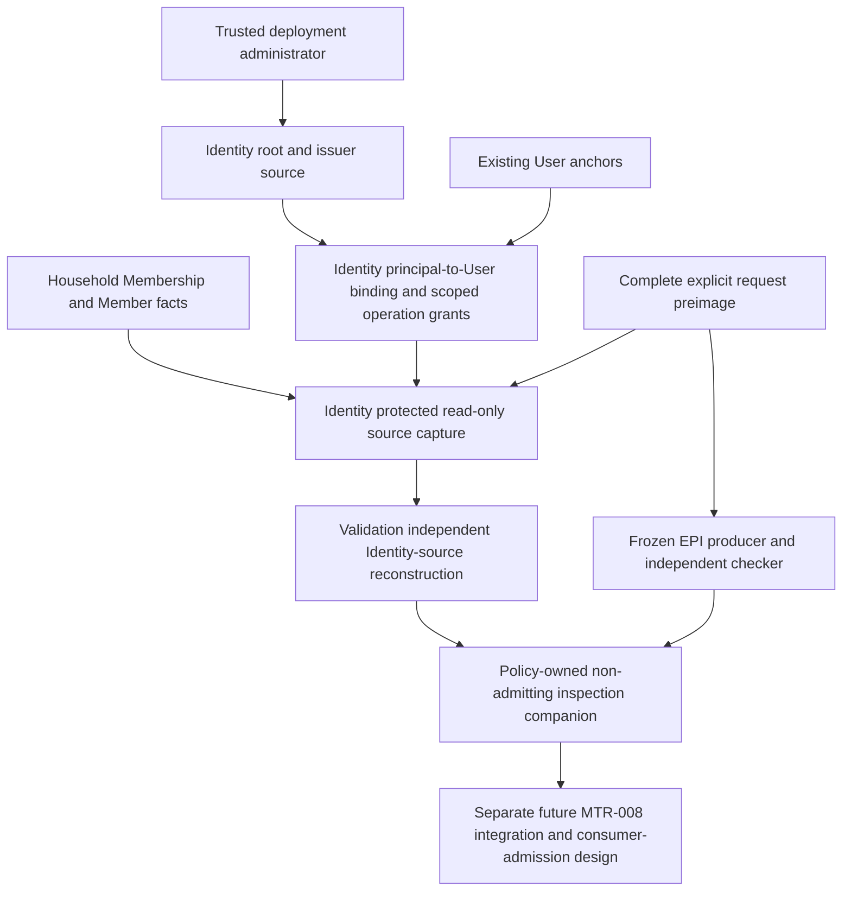

# Identity-owned principal-to-User enrollment — bounded detailed design

**STRUCTURAL / TEST_ONLY — DESIGN READY FOR INDEPENDENT IDENTITY/SECURITY REVIEW**

**IMPLEMENTATION NOT AUTHORIZED. PRODUCTION NUTRITION/CLINICAL GATE CLOSED.**

## 1. Authority decision, scope and baseline

The owner selected **Identity-owned principal-to-User enrollment** after the
[historical blocker report](MTR_008_AUTHENTICATED_SOURCE_TRUST_ROOT_BLOCKER_REPORT.md).
This authorization permits designing a new trust source; it does not claim that source already
exists or authorize creating roles, granting privileges, adding tables or installing credentials.
The historical report is retained byte-for-byte, including its earlier blocked disposition.
No completed PR #145 merge verification or dependency research is repeated.

Exact design base: **`cd8cbe175cf60e77e05a95cb30b0571d95819759`**, tree
`f1d43e9ea30a7873119465a341ec005906b5b660`. Retained
[completion 6733574997](https://github.com/thedusk4203/Menuto/pull/145#issuecomment-6733574997)
and [push CI 42567336877](https://github.com/thedusk4203/Menuto/actions/runs/42567336877)
record 4,611 passed/0 skips and all guards green. The design PR needs its own exact-head CI.
Current runtime/schema/export baseline stays **537 definitions / 0017 / 108 domain tables**.

This slice supplies an independently replayable Identity enrollment/operation source and
read-only inspection of an explicitly declared request's origin at a retained cut. It does not
finish authenticated MTR-008 composition, introduce a bearer token or authorize policy consumption.
Only one operation is supported: **CAPTURE_EXPLICIT_PLAN_INTENT** for one exact household/member.
Only existing User/Household/Member anchors are referenced; no accounts are created by this source.

The exact [19 proposed contracts](IDENTITY_PRINCIPAL_USER_ENROLLMENT_CONTRACTS.md) and
[96 acceptance obligations](IDENTITY_PRINCIPAL_USER_ENROLLMENT_ACCEPTANCE.md) are part of this design.
They are proposed future definitions/tests, not exports or tests added by this documentation PR.

## 2. Trust root and explicit threat model

The trust root is the owner-authorized deployment's **actual PostgreSQL administration**, which
provisions dedicated login credentials and explicitly initializes the Identity source. This is a
new Identity authority decision, not a borrowed Nutrition enrollment or a hypothetical existing IdP.

1. Trusted installer creates a private Identity object owner and the narrowly scoped entry-point
   groups in section7. The object owner has NOLOGIN; nobody ordinary may SET ROLE into it.
2. A separately controlled bootstrap login must be the actual database owner or superuser **and**
   have the dedicated Identity bootstrap group. Its real SCRAM/TLS session initializes a root and
   enrolls/revokes operational issuers through protected functions, with immutable source receipts.
   It is explicitly rejected by normal issuer/requester entry points.
3. An operational issuer has its own ordinary SCRAM login, actual DB/role OID/name binding and
   existing User identity attested by bootstrap. It may enroll requesters and exact operation grants;
   it cannot enroll issuers, provision SQL roles, create Users or mutate Membership.
4. A requester has a dedicated ordinary login. The issuer attests the exact existing User account
   represented by that login. A later real login proves possession of that principal's credential;
   enrollment metadata alone does not. The private source verifies both this identity binding and
   current exact-scope authorization before reporting an available source cut.

Credential provisioning/distribution is a controlled deployment action by the trusted administrator,
not a request argument, migration seed, test label, filename convention or issuer-created password.
User means an application account, not a medically qualified or uniquely identified physical human.
Different issuer/requester accounts are enforced; no claim of two independently verified humans is made.

Untrusted: request bytes, UUIDs, timestamps, role names in commands, histories/reports supplied on the
wire, hostile ordinary database clients, inherited-role escalation and copied source snapshots.
Trusted computing base: PostgreSQL and its catalogs, the installer/cluster/database administrators,
the protected object owner code and server-owned engine/configuration. A compromised superuser can
rewrite a database; this design does not claim cryptographic protection against that trusted root.
No shared application login may select an arbitrary actor_user_id to become a requester.

### Actual authentication versus execution role

V1 requires PostgreSQL18 (the repository CI currently pins18.4), TCP, SCRAM and TLS for **every**
source entry, including loopback test connections. The trusted client engine requires verify-full
and a deployment-controlled trust store; the server independently checks actual encrypted transport.
Server TLS observation alone cannot prove the client verified the hostname/certificate.

Protected functions reconstruct `system_user`, `session_user`, actual database/role OIDs/names,
client/server endpoint, backend PID and role graph. Require exact
`system_user == 'scram-sha-256:' || session_user`, non-null client address and `current_setting('role')='none'`.
Reject trust/password/unsupported methods, SET ROLE and changed SESSION AUTHORIZATION.
`current_user` inside SECURITY DEFINER is the intended object owner, **not** the authenticated actor.
These PostgreSQL meanings are documented in [session information](https://www.postgresql.org/docs/18/functions-info.html).
No sensitive password, SCRAM verifier, challenge response or connection URL with credentials is retained.

Actual role recreation, rename or database identity change invalidates the binding; matching names,
restored UUIDs or rehashed records cannot substitute for original OIDs and the selected root context.
The server-owned engine pins the expected root ID, database OID/name and endpoint trust configuration.
A root UUID/hash by itself proves neither endpoint nor database origin. Trusted administration must
revoke affected enrollment before role drop/rename, database relocation or restore. PostgreSQL OIDs
are scoped catalog identities, not globally unique eternal generation tokens; deliberate OID reuse
by the trusted administrator is not an ordinary-caller attack this source can cryptographically detect.

## 3. Ownership and acyclic interfaces

Identity owns enrollment truth, source lifecycle and authentication evidence; Households owns
membership/member facts. Policy owns EPI interpretation and the inspection companion; Planning
orchestrates capture. Validation independently reconstructs Identity source semantics and invokes its
frozen EPI checker on the retained primitive request. No Identity import of Policy producer or
Nutrition runtime, and no Validation import of Identity producer/replay/business helpers.

Proposed future modules: Identity contracts/models/source SQL interface/pure source replay;
Validation identity_source checker; Policy authenticated-source companion contracts; Planning
identity_source_inspection orchestration. Exact file registration/import exceptions require the
implementation compatibility preflight; this PR creates none of these modules.

## 4. Operation matrix and subject isolation

All rows also require actual safe login, appropriate EXECUTE group and active source authority.
Membership is an additional authorization fact, never the authentication source.

| Actor class | Root/issuer source | Requester binding/grant source | Capture explicit request | Other authority |
|---|---|---|---|---|
| Bootstrap administrator | INITIALIZE/RENEW/REVOKE root; ENROLL/RENEW/REVOKE issuer | Denied through ordinary issuer entry | Denied | Trusted deployment administration only |
| Active Identity issuer | Denied | ENROLL/RENEW/REVOKE binding; GRANT/RENEW/REVOKE exact operation scope | Denied | Cannot create roles/accounts, change membership, delegate issuer authority or publish clinical data |
| Active bound requester, OWNER/EDITOR | Denied | Denied | Exact granted household/member; own Membership must have a non-null linked actor member in that household | Household planning intent only, not another member's goal/physiology authorship |
| VIEWER, missing/unlinked/foreign membership | Denied | Denied | Non-success | No fallback or representative-authoring inference |
| Unbound/recreated/unsafe/shared actor principal | Denied | Denied | Capture failure; no private history disclosure | No UUID/hash/role-name authority |

A requester may select another member in the **same household** only with an explicit grant for
that exact member and OWNER/EDITOR planning access. The grant also pins actor Membership ID,
linked actor member ID and role at issuance; capture requires those exact facts still match.
No wildcard household/member, grant to all members or implicit target from a current/default member.
The source never interprets role as member-goal, clinical, spending-execution or safety authority.

Issuer User IDs may never also be requester User IDs within the root's history, including aliases
through other logins. One active binding per requester User and one permanently reserved role
OID/name per binding root; no rebinding a role to a different User. Source revocation is terminal
for that stream. A replacement requires a fresh dedicated login and explicit new enrollment/grants;
no old grant transfers. The source does not promise physical-human separation across different Users.

## 5. Authority lifecycle, concurrency and effective time

Four typed histories: root, issuer, principal binding and operation grant. INITIALIZE/ENROLL/GRANT creates a
stream. RENEW appends an explicit finite, non-overlapping next interval; gaps remain unavailable.
Future-effective renewal does not replace the currently valid interval early. REVOKE is immediate
at DB recorded_at and permanently tombstones the stream, including scheduled renewals. There is no
DELETE, retrospective grant, correction-in-place, implicit resurrection or automatic role reassignment.
Incorrect User/role binding is revoked and replaced, not edited.

Every non-REVOKE command chooses IMMEDIATE or SCHEDULED activation and supplies an explicit end. IMMEDIATE
uses DB recorded_at as its start; SCHEDULED requires a strictly future start. This server timestamp
is security sequencing, not a default for human policy. REVOKE has no effective interval and is
immediately terminal. Issuer authorization must cover both command recorded_at **and the entire new
authority interval**; the root interval must likewise contain each delegated issuer interval. Expired authority cannot issue a backdated renewal to repair an earlier action.

Mutation transactions are READ COMMITTED, read-write, caller-owned. Reject other isolation shapes
for writes in V1. Lock root then issuer, binding then operation frontier in canonical order. Re-read
current permission after locks and **before** idempotency lookup. CAS uses real source-stream revision
and predecessor, not EPI request_revision. Insert typed event, receipt and update frontier atomically.
Retries with an identical command may return the original receipt only while currently authorized;
revoked/expired issuers cannot recover it through retry. Different body under the same key is a conflict.

Root/issuer revocation disables all dependent fresh capture; stored dependent rows are not rewritten.
Password VALID UNTIL and source interval expiry are checked against actual DB operation time, even
for already connected sessions. A password reset alone does not revoke Identity enrollment or claim
that all existing sessions ended; source revocation is explicit. A caller cannot extend a source
interval by changing their password lifetime. Credential administration and emergency connection
termination remain deployment responsibilities. See [ALTER ROLE](https://www.postgresql.org/docs/18/sql-alterrole.html).

## 6. Source capture, completeness and independent reconstruction

`capture_request_source` accepts only the versioned request binding, never caller-provided sources,
positive witnesses or reports. It reads one actual ordinary connection in a clean, caller-owned,
read-only RR/SERIALIZABLE transaction; no dirty ORM cache, autoflush, multi-engine route or split
owner sessions. The complete explicit UTF-8 request is retained, not only its hash. Its context must
match authenticated User, exact household/member, request ID/revision and normalized horizon.
Declared_at and request_revision remain client declarations, not authentication time or CAS.

Identity parses structure/context and binds bytes; it does **not** interpret cost, effort, budget or
precision values. A genuinely authenticated malformed/invalid intent can have valid source evidence
while EPI rejects its semantics. The Policy inspection requires both checks; no positive policy follows
from source authentication alone. Frozen EPI children keep their original authority literals forever.

Retain the selected root's complete root/issuer directory histories, exact role binding history,
exact operation-grant history/frontiers, actual session/catalog primitives, necessary User existence
and own Membership/target-member witnesses. The issuer directory is authority metadata, not other
members' physiology/preferences; no display names, unrelated requester bindings or household histories
are returned. A zero frontier plus protected absence witness distinguishes absence from truncation.
Limits fail all-or-error; favorable-row selection, accepted-prefix hashing and source clipping are forbidden.

A safe original login with an immutable own binding may receive a faithful unavailable snapshot for
revoked/expired source authority or missing scope access; no target-member details are exposed when
access fails. An unbound/unsafe/recreated principal receives only a generic capture failure and no
sources. The independent checker can reconstruct faithful retained negatives, but cannot independently
prove the origin of a bare failure without primitive sources; such a claim is NOT_CHECKABLE.

Validation reconstructs source streams, all ancestor authority at recorded/effective time, role and
privilege closure, subject binding, completeness, request-preimage identity and outcome. It shares
immutable contracts/hash primitives only, never Identity's producer evaluator as its oracle.
Changing a digest or supplying CONSISTENT cannot repair invalid primitive authority history.
An entirely coherent forged source+claim may remain offline-consistent: all serialized results are
UNVERIFIED_TRANSPORT, not current authorization or proof of canonical DB origin.

The trusted Planning inspection interface always recaptures through the actual configured connection
and freshly calls the independent source and EPI checkers. It accepts no cached source/report argument.
It returns inspection evidence only, not an origin bearer token, lease, numerical admission or full
ResolvedPlanPolicy. Future consumers require a separately reviewed entry that performs fresh capture;
no PIV purpose/lease is reused or expanded.

### Snapshot versus current authority

Authority/Membership rows are observed at the retained MVCC cut. A revoke committed before a fresh
transaction's first snapshot must deny it. A transaction already holding an earlier repeatable cut
may faithfully see earlier authority; its report never certifies permission after that cut or over
the planning horizon. New privileged work cannot use that report; it needs fresh source capture.
Catalog safety is checked at capture start/end; changed DB/login/OID/privilege descriptors fail as
SOURCE_CUT_INCOHERENT. Superuser/catalog tampering is outside the TCB threat model, not hidden by
claims that PostgreSQL catalog state and application history provide an eternally current authorization.

Membership is mutable and has no history/version column. Grant pins detect observed changed role,
link or Membership ID; deletion/recreation fails the pin. If an unchanged row is changed and restored
between observations, V1 cannot claim to have witnessed that history. An explicit Identity REVOKE
remains terminal regardless of Membership restoration. No historical Membership journal is invented.

## 7. Proposed persistence and SQL privilege inventory

**New durable authority is required.** Proposal: six normalized source tables in private schema
`menuto_identity_source`, not an untyped generic JSON event table:

| Proposed table | Authority/history or projection |
|---|---|
| roots | Immutable deployment root commands, actual bootstrap actor evidence and lifecycle |
| issuers | Typed issuer enroll/renew/revoke histories and bootstrap lineage |
| principal_bindings | Typed DB/role/User binding histories; immutable subject and role reservation |
| operation_grants | Typed exact-operation/household/member grants and issuance Membership witness |
| frontiers | Mutable CAS projections and issuer-directory completeness seal; no authority by themselves |
| command_receipts | Immutable command/idempotency result records tied to actual author and event |

Typed columns enforce source-internal foreign keys, identities, bounds and sequence uniqueness; canonical authored
body and server-observed preimages are retained for replay. JSON transport does not replace those
distinct ownership/lifecycle constraints. Existing User/Household/Member IDs are retained observed
anchors, not new restrictive foreign keys that alter their frozen deletion semantics. Missing anchors
deny fresh use while historical source records remain replayable. Global recorded order may have gaps; each source stream
must have a complete contiguous revision chain. Frontiers/receipts are locked atomically with history.

Current schema stays0017/108. A future approved implementation would add six domain tables
(expected108+6=114), source indexes/constraints/triggers and protected functions. Actual next legal
migration revision must be re-determined then; **0018 is not reserved or created**. Do not edit old
migrations. Install leaves every source table empty: no root, issuer, requester, grant or production
actor/content seed. Downgrade refuses loss if any source history/receipt exists.

Proposed NOLOGIN groups: object owner, bootstrap, issuer and requester, all Identity-specific.
Dedicated LOGIN roles/credentials are provisioned out-of-band by the trusted administrator, never
by source commands/migration. Membership grants to entry groups use INHERIT TRUE, SET FALSE,
ADMIN FALSE; reject other reachable privileged/owner/source-admin groups and unsafe direct grants.
Issuer/requester has no superuser/CREATEROLE/CREATEDB/BYPASSRLS/replication/database ownership,
application-table DML/ownership, source direct SELECT/DML, sequence rights or schema CREATE.
The owner receives only the base User/Household/Member/Membership reads required by its functions.

Five protected entry points: bootstrap_root, change_issuer, change_binding, change_operation_grant,
capture_request_source. Only their exact entry groups get EXECUTE. All helpers, tables and sequences
are denied to PUBLIC and ordinary direct access. Functions have fixed
`search_path=pg_catalog,menuto_identity_source,pg_temp`; all public base tables are explicitly qualified.
Create functions and revoke PUBLIC execution in one installation transaction. No dynamic caller-
selected function, schema, relation, role SQL or arbitrary statement is allowed.
[PostgreSQL SECURITY DEFINER guidance](https://www.postgresql.org/docs/18/sql-createfunction.html)
requires care with writable search paths and default function permissions.

Private helpers cover actual session/safe-role/TLS, typed parsing/bounds, canonical hash, authority
state, frontier locking, atomic append/receipt and write guards. A new Identity-local TLS wrapper
may use the trusted PostgreSQL sslinfo primitive already installed by baseline migrations; it must
not call Nutrition's private helper or grant pg_read_all_stats. Catalog primitives are captured and
independently checked; no secret password/verifier is exported. A private source owner is not an
ordinary requester; bootstrap privileges never become a normal-call exception.

## 8. Failure ordering, resources and compatibility

Failure precedence: byte/encoding/structure -> authentication and role safety -> selected root/endpoint
-> binding/ancestor authority -> request/context -> operation grant and membership -> source cut/
completeness -> independent checks. Return the first fixed diagnostic, not leaked raw values/SQL.
All non-success has no usable authenticated-plan payload or numerical admission.

| Condition | Capture / independent treatment |
|---|---|
| Malformed/unsupported envelope or raw request structure | INVALID_INPUT / UNSUPPORTED, payload null |
| Unsafe login, wrong method/TLS, unbound/recreated principal | CAPTURE_REJECTED/AUTHENTICATION_FAILED or AUTHORIZATION_DENIED; no sources |
| Faithful retained expired/revoked root/issuer/binding/grant | UNAVAILABLE at retained cut; independent CONSISTENT/NOT_ADMITTED |
| Missing/wrong Membership/target/scope | UNAVAILABLE/AUTHORIZATION_DENIED; no target details; no implicit delegate |
| CAS/idempotency conflict | Command rejected atomically, no new event/frontier/receipt |
| Incoherent/partial/capped source | SOURCE_CUT_INCOHERENT / RESOURCE_EXCEEDED; no partial snapshot |
| Invalid history or forged positive relative to primitives | Independent INCONSISTENT/NOT_ADMITTED |
| Missing primitive source / bare fabricated report | NOT_CHECKABLE or INCONSISTENT, never source authority |
| Full coherent source+claim replacement | May be offline CONSISTENT; still UNVERIFIED_TRANSPORT; cannot enter live recapture as source |
| EPI semantic non-success | Preserve exact frozen child; inspection non-success, not nutrition conflict or solver infeasibility |

Server-owned V1 limits: command16KiB (capture envelope128KiB); raw EPI request49,152 bytes;
source8MiB;2048 total history facts,256 per stream,16 issuer streams; catalog4096 objects,
64 reachable roles/128 role edges; JSON depth8,200,000 source nodes,256-codepoint ordinary strings,
64-byte keys, signed63-bit integers and positive32-bit OIDs. Explicit preimage/evidence fields have
their declared larger byte caps. Reject overflow before parse/hash/allocation; no truncation.
SQL lock timeout1s, statement timeout5s; whole inspection15s with cancellation and deterministic
pure work bound500,000 steps. Cancellation makes no writes in read-only capture; caller rolls back
an aborted transaction. Restore local configuration, do not commit/rollback the caller's transaction
silently, and reject reuse after cancellation. These are structural security limits, not policy weights.
Public HTTP limits/endpoints remain outside this source gate.

Future exports: exact19-name manifest in the contract appendix; proposed556 =537 unchanged +19.
Current PR still exports537. Retain all515 legacy/503 historical hashes,53 frozen files,59 PIV pins,
EPI001–064 and4,611 baseline tests. Add a full537-body/hash baseline and independently authored19-name
manifest before future code. Historical count/name/import guards require their own exact file/block
preflight and owner authorization; no inherited metadata exception or fixture rewrite is allowed.

## 9. Approval requirements and disposition

No newly unavoidable external IdP/clinical prerequisite is needed for this chosen internal trust root.
Deployment must support PostgreSQL18, actual SCRAM/TLS and controlled administration; otherwise the
implementation fails closed rather than substitutes a fixture/shared actor. Those are explicit supported-
deployment prerequisites, not a request to operate a production database in this design task.

Independent review must approve: the TCB/bootstrap ownership, issuer/requester separation and role
matrix, six-table source strategy, proposed SQL privilege surface, exact19 contracts and96 obligations,
retained-cut limitations, and later implementation/migration/compatibility scope. None is already
installed, granted, scientifically qualified or authorized for implementation by this document.

Full MTR-006/007/008 INCOMPLETE; #5/#6/#7 OPEN; Root/NPS/NRE/MBA/PIV/EPI identities unchanged.
Production Nutrition/clinical gate CLOSED; planner_ready=False, activation_ready=False;
Execution NOT STARTED; PRECOMMIT FAIL-CLOSED. No numerical policy/default/week/override composition,
consumer admission, PIV extension, solver, endpoint, scientific conversion or production activation.

**IDENTITY TRUST-ROOT DESIGN READY FOR INDEPENDENT IDENTITY/SECURITY REVIEW / NO IMPLEMENTATION AUTHORIZED / PRODUCTION GATE CLOSED**
