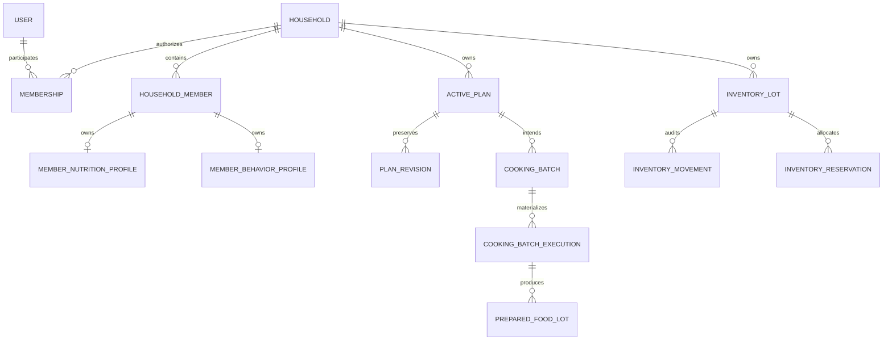
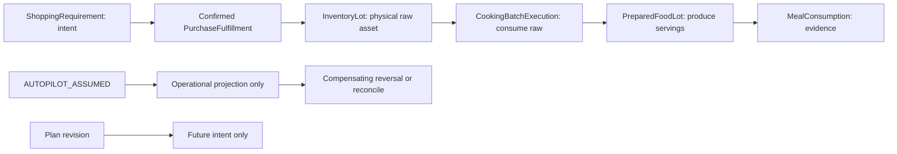

# Implementation Blueprint — Milestone 0/1

Ngày: 2026-10-22. Chuẩn kiến trúc: [Development Spec V1.3](../MENUTO_DEVELOPMENT_SPEC_V1_3.md), [INV-001..030](../ARCHITECTURE_INVARIANTS.md), [ADR-001..011](../adr/). V1.2 là lịch sử; số MTR trong V1.3 không ánh xạ trực tiếp sang số issue GitHub đã tạo cho V1.2.

## Phạm vi

Blueprint bao phủ thứ tự triển khai M0/M1. Đợt đầu triển khai nền tảng units, contracts, persistence và migration; chưa tuyên bố hoàn tất workflow M1, policy engine, planner, validator hay auth. Schema không đồng nghĩa authorization hoặc business service đã sẵn sàng.

## Quyết định nền tảng

| Chủ đề | Quyết định | Cách kiểm chứng |
| --- | --- | --- |
| Database | PostgreSQL 18, SQLAlchemy 2, Alembic; không `create_all` ở startup | Upgrade/downgrade/upgrade trên database kiểm thử riêng; autogenerate drift check |
| Identity | UUID do ứng dụng tạo; actor user tách owner household | FK và negative tests cho tham chiếu chéo household |
| Số học | Calculation Decimal 72/36 tách storage NUMERIC(18,6); explicit versioned quantization + signed residual; không chấp nhận float | Roundtrip, precision boundary, NaN/Infinity/float rejection |
| Material | `AP_G`, `EP_RAW_G`, `COOKED_G`, `SERVING`, `COUNT` | Không cộng/so sánh khác basis hoặc khác discrete item |
| Conversion | AP→EP bằng edible yield thuộc product mapping; EP→cooked bằng cooking yield có provenance riêng | Conversion tests có nguồn, không implicit conversion |
| Money | Số nguyên minor units + currency ISO code; VND exponent 0 trong application currency policy | Không cộng khác currency, không suy money từ gram |
| Time | UTC-aware timestamp, khoảng thời gian half-open `[start,end)`; timezone household lưu IANA name | Reject naive datetime và horizon rỗng/đảo chiều |
| Snapshot | Pydantic frozen + tuple/typed children, extra fields forbidden; canonical JSON hash SHA-256 | Roundtrip/hash deterministic, không container mutable trong snapshot |
| Ownership | Composite FK `(household_id, member_id/lot_id/plan_id)`; không chỉ FK UUID độc lập | SQL trực tiếp cũng không gắn tài sản/member từ household khác |
| Concurrency | Version integer cho materialized lot/active plan; write command có expected version + idempotency key | Hai session stale write; command retry không nhân đôi effect |
| Audit | Revision/event append-only; correction bằng entry bù | PostgreSQL trigger chặn UPDATE/DELETE, không chỉ ORM hook |
| Validation | Context riêng; chỉ import neutral domain primitives/contracts và contracts của source contexts | Dependency tests chặn internals, runtime facades, database và OR-Tools trong validation |

Không dùng density mặc định để đổi ml→g, không đổi count→gram nếu thiếu conversion evidence, không coi portion factor là nutrition target ratio. Giới hạn precision là giới hạn lưu trữ, không phải quy tắc dinh dưỡng.

## Ownership và vòng đời

Reservation không trừ physical quantity. Purchase chưa confirmed không tạo lot. Một household có thể có nhiều horizon không chồng nhau; overlap cần HorizonBridge, không tự cấm mọi plan thứ hai. Revision #0 là baseline; `plan_id` giữ nguyên. Prepared lot physical chỉ xuất hiện khi execution có evidence. Assumption không được ghi vào confirmed ledger.

## Tách module và bảng

| Context | Bảng/schema đích | Ràng buộc quan trọng |
| --- | --- | --- |
| identity / households | users, households, household_members, memberships | Membership là nơi duy nhất ánh xạ account→member; member không bắt buộc login; owner membership tách tracked nutrition role |
| nutrition / preferences | member_nutrition_profiles, member_safety_constraints, member_behavior_profiles | Member ownership; không lưu scalar adherence/taste chung |
| catalog | ingredients, nutrition_facts | Basis/provenance/reference amount rõ; reviewed data không tự là clinical policy |
| recipes | recipes, recipe_versions, recipe_ingredients, variant_rules, preparation_transformations | Cooking yield thuộc Recipe/Preparation; published version bất biến; authored envelope có version; recipe fork không sửa lịch sử |
| retail | retailers, store_regions, retail_products, packages, offers, price_observations, ingredient_product_maps, procurement_classes, planning_price_quotes, reference_price_books, retail_price_calibrations | Fixed/catch/loose khác nhau; edible yield thuộc Product→Ingredient map, tách price; fallback provenance rõ |
| inventory | inventory_lots, inventory_movements, inventory_reservations, inventory_policies | Positive physical quantity; projection riêng; version counter; audit append-only |
| planning | active_plans, plan_revision_snapshots, meal_slots, meal_participants | Tracked member cùng household; snapshot/hash + expected revision; không rewrite materialized past |
| cooking / execution | cooking_batches, batch_allocations, cooking_batch_executions, prepared_food_lots, execution_events | Raw/prepared conservation tách; COOKED != CONSUMED; reversal graph |
| shopping | shopping_requirements, purchase_fulfillments | Partial actual qty/price; sunk spend không stress lại |

Schema dùng typed columns cho identity, ownership, quantity, basis, lifecycle, provenance và concurrency. JSONB chỉ dành cho versioned immutable payload/envelope đã có Pydantic contract; không thay thế FK hay quantity constraints.

## Contracts cần khóa

1. `Quantity`/`StoredQuantity`, `CalculatedQuantity`, `QuantizationPolicy`, `Money`, `Provenance`, explicit yield/conversion: không ngầm suy basis; không quantize sau từng phép nhân. Nguồn có source_system, opaque external_record_id/version và tùy chọn URL/hash.
2. Household/member/participant contracts: input IDs + factor + role; canonical member safety đọc từ source, không nhận planner summary làm truth.
3. Nutrition fact: ingredient + reference amount/basis + kcal/protein/fat/carbohydrate + provenance.
4. Planner request/output draft: household/tracked member, half-open horizon, policy axes, budget, source versions/fingerprints, revision lock, structured outcome. Draft không phải solve endpoint.
5. `ValidationSubjectSnapshot` draft: canonical member safety, primitive facts, authored recipe bindings, typed raw/prepared opening assets, chronological events, policy/scenario versions, revision identity và hash. Không coi draft subset là validator-ready.
6. Execution commands/events: actor + evidence class + effective/recorded time + idempotency key + expected version + causal parent/reversal IDs. Confirmed và assumed là hai loại riêng.
7. `PRECOMMIT` report/commit guard: zero ERROR/FATAL, cùng subject hash và revision; `POSTFACT` là diagnostics.

Contract schema snapshot được export riêng trong `packages/contracts/domain.schema.json` vì chưa có business HTTP endpoints. OpenAPI chỉ mô tả API thật. Consumer không được coi domain schema draft là deployed planner API.

## Thứ tự và acceptance gates

| Lát triển khai | Kết quả review được | Gate |
| --- | --- | --- |
| A — Canonical baseline | Links V1.3, ADR registry, units/glossary, blueprint, dependency rules | Không song song hai canonical baselines; không auto-close issue V1.2 |
| B — Units/contracts | Exact values, basis/provenance, household/catalog contracts, planner/validation draft | Positive/negative tests, schema export drift check |
| C — Persistence đầu tiên | Identity/household/member safety/catalog, Alembic 0001 → 0002; atomic default household/member bootstrap | PostgreSQL real integration: ownership, numeric constraints, rollback/reapply, stale writes |
| D — Data catalog tiếp theo | Recipe versions, retail evidence/procurement/quotes/calibration | Source provenance, granularity constraints, AP→EP chain, reviewed authored envelope |
| E — Physical lifecycle | Lots/movements/reservations, quantitative fulfillment, cooking/prepared models | Conservation, chronological causality, idempotency/concurrency, assumption quarantine |
| F — Plan/revision foundation | Stable ActivePlan + immutable revisions + participants + execution draft | Atomic validation gate, locked past, immutable history, horizon bridge input contract |
| G — M0/M1 completion audit | Neutral mutation corpus, integration matrix và trạng thái bằng chứng | Không claim workflow/runtime ngoài bằng chứng; policy/solver/validator triển khai ở milestones sau |

MTR-002 synthetic fixture `synthetic-v2` hiện có được giữ nguyên để reproducible. Mutation fixture draft mô tả base subject + deterministic mutation + expected finding code; không claim validator bắt được mutation khi validator chưa triển khai.

## Transaction và migration

- Mỗi use case một transaction; service sở hữu commit/rollback, repository không tự commit.
- Bootstrap nội bộ nhận user đã tồn tại rồi tạo household + member + owner membership atomically; identity/auth credential/session flow làm ở lát riêng. Không public unauthenticated endpoint tạo user giả.
- Với lot, lock/CAS version rồi ghi movement + materialized quantity trong cùng transaction. Reservation check cần lock trên lot; SQL CHECK không thể kiểm tổng các rows khác.
- Activation/revision kiểm report subject/hash, expected revision và materialized boundary trong cùng transaction; append immutable revision, cập nhật working head. Không tin cached successful report nếu input đã đổi.
- Migration tạo schema rỗng; không port Smart Menu schema/data hàng loạt. Chỉ chọn lọc formulas/tests sau provenance review. Migration đã phát hành không import mutable ORM metadata; revision giữ DDL cố định.
- Test database phải là database riêng, không reset DB qua URL production. Upgrade/downgrade chỉ dùng database test do harness tạo, không tự downgrade dữ liệu người dùng.
- Production áp dụng expand→migrate→contract, backup/restore trước destructive migration. Initial schema rollback chỉ được kiểm trên dữ liệu test.

## Chưa được coi là hoàn tất

Auth/consent, clinical nutrition policies, real retailer ingestion, inventory business transactions, planner optimization, independent validator, learning router và consumer UI nằm ngoài phần nền tảng đầu tiên. Các constants về sức khỏe, freshness, stress, exploration không được tự đóng băng bằng synthetic fixtures.

## Kết quả đợt nền tảng đầu tiên

[Bảng kiểm chứng thực chạy](M0_M1_FOUNDATION_EVIDENCE.md) ghi môi trường, kết quả và giới hạn của đợt này.

- Đã triển khai `app/domain` với exact Decimal, measurement basis, money, evidence, explicit edible/cooking yields; household/participant/catalog/member source contracts. Planner request/output và validation subject/report mang version `m0-draft.2`, không thể cấp quyền activation. Mutation format cũng là draft vì chưa có production validator.
- Alembic `0001` được giữ nguyên trong lịch sử. `0002` gỡ bảng generic yield sau preflight, bỏ mapping user trùng lặp trên member, chuẩn hóa safety identity và provenance. Đợt Foundation đầu có **8 bảng**: users, households, household_members, memberships, member_nutrition_profiles, member_safety_constraints, ingredients, nutrition_facts. Diagram và bảng schema đích phía trên bao gồm cả phần tiếp theo, không phải danh sách bảng đã có.
- Composite FK chặn member links chéo household; profile có ORM version counter. Nutrition facts append-only bằng PostgreSQL trigger. Yield persistence sẽ thuộc Retail/Recipe, chưa tạo owner tables giả. Đây không phải authorization; SQL bulk update profile cần CAS ở use case sau.
- Trong đợt Foundation đầu chưa có retail/recipes/inventory/ActivePlan/execution persistence. Retail đã được bổ sung riêng ở M1.1 bên dưới. Behavior profile và đầy đủ nutrition goal/physiology schema vẫn ở lát sau. Bản `ValidationSubjectDraft` liệt kê rõ phần còn thiếu, chưa phải `ValidationSubjectSnapshot` đủ để kiểm một plan.
- OpenAPI tiếp tục chỉ có health endpoint. `domain.schema.json` phục vụ review/code generation sau này; Python validators vẫn là nơi kiểm các quan hệ giữa fields mà JSON Schema không biểu diễn hết.

Chi tiết thay đổi tương thích, precision và cách migration dừng an toàn nằm trong [Foundation Corrections](FOUNDATION_CORRECTIONS.md).

## M1.1 — Retail / Procurement Foundation

[Domain review A–G](M1_1_RETAIL_DOMAIN_REVIEW.md) cụ thể hóa V1.3/ADR-006; không thiết kế lại Foundation. [Evidence thực chạy](M1_1_RETAIL_PROCUREMENT_EVIDENCE.md) ghi kết quả local và trạng thái CI riêng.

- Thêm migration `0003` và 13 bảng Retail, đưa tổng domain tables lên 21. Không sửa 0001/0002; downgrade khóa tất cả bảng M1.1 và fail closed nếu có dữ liệu. Revision giữ DDL/trigger SQL riêng.
- Mapping versioned Product→Ingredient sở hữu edible yield AP_G→EP_RAW_G; review/basis/provenance được kiểm ở contracts và PostgreSQL. `ProductIngredientConversionFact` giữ primitive facts; inventory origin handoff riêng mang nhãn draft, không có ledger.
- Package fixed/catch/loose có trường và semantics tách biệt. Chỉ hỗ trợ AP mass; không ngầm đổi count/ml/package thành gram. RetailNumeric giữ miền StoredQuantity nhưng SQL không được tự ép scale/làm tròn.
- PriceObservation append-only khác PlanningPriceQuote. Origins RETAIL_OBSERVED/CALIBRATED/REFERENCE_BASELINE có FK nguồn, không có reference availability giả. Calibration có retailer × store/region × category/evidence metadata; chưa học/shrink hệ số.
- ProcurementClass accepted mappings, primary/backup options, substitution groups, package/source/promo primitives đã có. Không có optimizer scoring; toàn bộ planning handoffs DRAFT. Primary hoàn chỉnh được kiểm ở collection boundary; DB cho phép class draft đang xây dở.
- Kết quả local: 368 Python tests, gồm 138 PostgreSQL; migration/drift/import checks pass. Client/web và 22 benchmark scenarios pass. Remote CI của implementation `ed11639` đã PASS cả Python/PostgreSQL 18.4 và web: [run #14](https://github.com/thedusk4203/Menuto/actions/runs/39744442973), [draft PR #55](https://github.com/thedusk4203/Menuto/pull/55).
- Tiếp theo có thể review M1.2 Recipe/Preparation. Cooking yield, RecipeVersion persistence, inventory/ActivePlan/execution, Independent Validator và AI chưa được triển khai trong M1.1.

## Tài liệu kỹ thuật đối chiếu

- [PostgreSQL constraints](https://www.postgresql.org/docs/18/ddl-constraints.html): dùng FK/unique cho quan hệ giữa rows/tables, CHECK cho từng row.
- [SQLAlchemy version counter](https://docs.sqlalchemy.org/en/21/orm/versioning.html): version counter áp dụng ở ORM flush, không thay thế authorization hoặc bảo vệ bulk SQL.
- [Pydantic model immutability](https://docs.pydantic.dev/latest/concepts/models/#faux-immutability): frozen không tự làm dict/list bên trong bất biến; snapshot dùng typed children và tuple.
