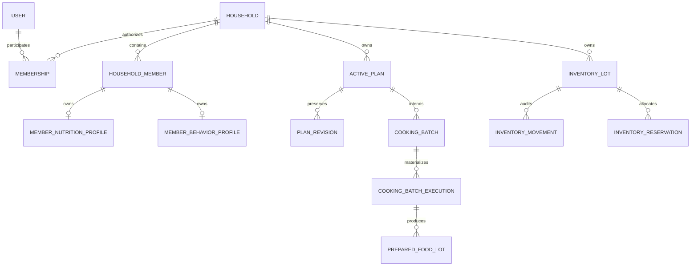
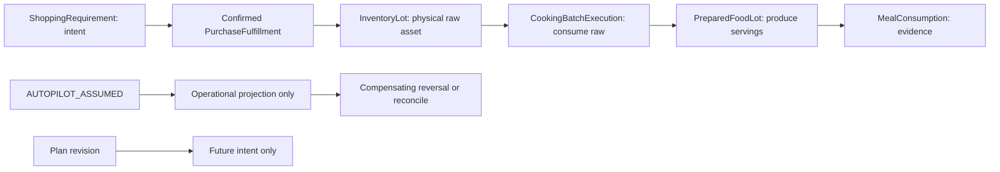

# Implementation Blueprint — Milestone 0/1

## MTR-040 — COMPLETE; issue #41 — CLOSED / COMPLETED

The separately approved closure gate has passed. [PR #108](https://github.com/thedusk4203/Menuto/pull/108)
merged reviewed head `d30f9f610af937f2e59fb4eea5962478037ff414` at
`959e7fa3488e0c379ab37044c25da74292c2d76b`; its tree exactly equals that head.
Exact post-merge push [CI 40486320021](https://github.com/thedusk4203/Menuto/actions/runs/40486320021)
SUCCESS, python/web SUCCESS; 2,978 tests; 358 exported definitions; schema **0015 / 85 domain tables**.
[Issue #41](https://github.com/thedusk4203/Menuto/issues/41) is CLOSED with state_reason=completed.
The [accepted parent review and closure receipt](POST_MTR_040C_PARENT_MTR_040_COMPLETION_REVIEW.md#12-approved-closure-receipt)
record canonical acceptance satisfied and the exact scope of completion.

Frozen 040A/B/C, reviewed prior source, PR #100 and hierarchy SOURCE semantics remain unchanged.
040C remains frozen at `69241affc2d85ee534ca682a0ff9a4d23a7c7862` (PR #107);
no new aggregate, persistence, migration 0016, source policy or production rows/defaults are added.
Member-owned typed sources and pure derived views satisfy this acceptance. MTR-039 remains a
separate requirement for broader attributed learning; no such event consumer is claimed complete.

Full 041/046 remain PARTIAL; 039 OPEN; 024/020B/021 BLOCKED; Execution NOT STARTED;
PRECOMMIT FAIL-CLOSED; planner_ready=False, activation_ready=False. The separately authorized
bounded candidate projection below grants no other downstream implementation.
Earlier delivery/review-stage statements are historical;
this closure receipt supersedes current-status wording only, never frozen behavior.

## Candidate-bound reviewed feature projection — FROZEN

[Design PR #111](https://github.com/thedusk4203/Menuto/pull/111) is APPROVED at
`04dbbb012041be80fc86914b582777812ed32e59` and merged at
`3efcd8c9594cbc0ae154d5bcac4e6315bf09d8f8`; exact post-merge push
[CI 40507097863](https://github.com/thedusk4203/Menuto/actions/runs/40507097863) SUCCESS, python/web green.
The separately reviewed [implementation PR #112](https://github.com/thedusk4203/Menuto/pull/112)
is **FROZEN** at `8fffd634cd6a9be809defa7e41c911c6dd1c254c`, exactly the reviewed head's tree.
Exact post-merge push [CI 40517159039](https://github.com/thedusk4203/Menuto/actions/runs/40517159039)
SUCCESS; python/web SUCCESS; **3,104 passed, 0 skips**; CFP01–CFP60 covered.
The [canonical freeze receipt](CANDIDATE_BOUND_REVIEWED_CULINARY_FEATURE_PROJECTION_FREEZE_RECEIPT.md)
binds design, implementation, review and verification identities; exports **362 = 358 + 4**,
schema **0015 / 85**, zero new persistence; planner_ready=False, activation_ready=False.
This bounded freeze does not complete full MTR-046. No new MTR suffix assigned. MTR-040 remains COMPLETE /
issue #41 CLOSED — COMPLETED; 039 OPEN; full 041/046 PARTIAL; 020B/021/024 BLOCKED;
Execution NOT STARTED; PRECOMMIT FAIL-CLOSED. That projection freeze authorizes no other downstream implementation.

## Candidate × Member TasteFit — FROZEN

The [approved design](CANDIDATE_MEMBER_TASTEFIT_FOUNDATION_DESIGN.md), PR #115 head
`676ff2aca51cf4c4870c15d830a2f8e9048d9f42`, remains unchanged. The separately reviewed
[implementation PR #116](https://github.com/thedusk4203/Menuto/pull/116) is **FROZEN**:
reviewed head `152dbe8a365790956d2f7bac1b40a09b7dbd9134`, actual merge / verified main
`7ac0547b3df621fb19c614c27edaca268a901169`; the merged tree exactly equals the reviewed head.
Exact post-merge push [CI40659094576](https://github.com/thedusk4203/Menuto/actions/runs/40659094576)
**SUCCESS**, python/web SUCCESS; **3,396 passed, 0 skips** = 3,104 retained +292 additive.
**TF01–TF132 covered**; **42 real PostgreSQL cases cover all35 required PG obligations**.
SCRAM/TLS16/16; benchmark22/22; client10/10; guards/contracts/typecheck/build green.
Exports **384 =362 retained unchanged +22 additive**; schema **0015 /85**, no0016;
**ZERO NEW PERSISTENCE**, no production seed/default coefficients or policy publication/selection authority.
The [canonical freeze receipt](CANDIDATE_MEMBER_TASTEFIT_FOUNDATION_FREEZE_RECEIPT.md)
binds the review, exact merge and push-CI identities; the
[implementation evidence](CANDIDATE_MEMBER_TASTEFIT_FOUNDATION_EVIDENCE.md) retains all acceptance mappings.
One canonical candidate × one participating member; structured exact-target fit under a required,
explicit versioned/body-pinned conditional interpretation policy. No aggregate, comparison/ranking,
shared-member reducer or global/current/default/production policy publication/selection authority.
Frozen 040A/B/C, prior/shrinkage, hierarchy SOURCE,041A–F,046A and candidate projection remain unchanged.
planner_ready=False; activation_ready=False. No MTR suffix assigned; MTR-040 COMPLETE /issue41 CLOSED — COMPLETED;
039 OPEN;full041/046 PARTIAL;024/020B/021 BLOCKED;Execution NOT STARTED;PRECOMMIT FAIL-CLOSED.
This freeze itself grants no downstream implementation authority. The separately authorized design gate follows.

## Shared-member exact-target TasteFit — FROZEN; Planner Convergence review

The [canonical freeze receipt](CANDIDATE_SHARED_MEMBER_EXACT_TARGET_TASTEFIT_AGGREGATION_FREEZE_RECEIPT.md)
records reviewed implementation head `ea77d0476ce95db1c349c652312de9883ec00824`,
actual PR #120 merge/main `dc7a964c4acecb0ee8995f1705f176b164e50221` (same reviewed tree),
and exact post-merge push [CI40800756796](https://github.com/thedusk4203/Menuto/actions/runs/40800756796)
**SUCCESS**, Python/web and all required guards SUCCESS; **3,638 passed /0 skips**
=3,396 retained +242 additive; SMTF01–SMTF120;44 actual PG executions /36 required obligations.
SCRAM/TLS16/16;benchmark22/22;client10/10. **403 exports =384 unchanged +19 additive**;
**schema0015 /85;no0016;ZERO NEW PERSISTENCE**. Formal freeze comment
[6485815770](https://github.com/thedusk4203/Menuto/pull/120#issuecomment-6485815770).

One canonical candidate × one exact typed target × entire canonical participant set.
Compatibility and complete numeric coverage precede EXACT_POSITIVE_WEIGHTED_MEAN with authored
positive exact rational weights; incomplete coverage withholds every new arithmetic field.
Direct dislike stays independently observable, without hard veto. Policy authority remains
EXPLICIT_INTERPRETATION_INPUT_ONLY; no production/default policy authority or rows.
Frozen child TasteFit/040/041/046 semantics remain unchanged; planner_ready=False;activation_ready=False.

This ends the current preference-abstraction branch. The separately requested
[Planner Convergence dependency review](POST_PR_120_PLANNER_CONVERGENCE_REVIEW.md) asks for the
shortest path to a non-activating Validated Plan Preview and recommends a bounded nutrition-root /
supported-eligibility design gate, not another TasteFit adapter. **REVIEW ONLY — awaiting approval**;
no detailed design, implementation, workflow change or downstream authorization in this PR.
MTR040 COMPLETE /issue41 CLOSED—COMPLETED;039 OPEN;full041/046 PARTIAL;
024/020B/021 remain BLOCKED;Execution NOT STARTED;PRECOMMIT FAIL-CLOSED.
Historical implementation-stage NOT FROZEN/open-PR wording is superseded only as to status.

Ngày: 2026-10-22. Chuẩn kiến trúc: [Development Spec V1.3](../MENUTO_DEVELOPMENT_SPEC_V1_3.md), [INV-001..030](../ARCHITECTURE_INVARIANTS.md), [ADR-001..011](../adr/). V1.2 là lịch sử; số MTR trong V1.3 không ánh xạ trực tiếp sang số issue GitHub đã tạo cho V1.2.

## Phạm vi

Blueprint bao phủ thứ tự triển khai M0/M1. Đợt đầu triển khai nền tảng units, contracts, persistence và migration; chưa tuyên bố hoàn tất workflow M1, policy engine, planner, validator hay auth. Schema không đồng nghĩa authorization hoặc business service đã sẵn sàng.

## Quyết định nền tảng

| Chủ đề | Quyết định | Cách kiểm chứng |
| --- | --- | --- |
| Database | PostgreSQL 18, SQLAlchemy 2, Alembic; không `create_all` ở startup | Upgrade/downgrade/upgrade trên database kiểm thử riêng; autogenerate drift check |
| Identity | UUID do ứng dụng tạo; actor user tách owner household | FK và negative tests cho tham chiếu chéo household |
| Số học | Calculation Decimal 72/36 tách storage NUMERIC(18,6); explicit versioned quantization + signed residual; không chấp nhận float | Roundtrip, precision boundary, NaN/Infinity/float rejection |
| Material | `AP_G`, `EP_RAW_G`, `COOKED_G`, `SERVING`, `COUNT` | Không cộng/so sánh khác basis hoặc khác discrete item |
| Conversion | AP→EP bằng edible yield thuộc product mapping; EP→cooked bằng cooking yield có provenance riêng | Conversion tests có nguồn, không implicit conversion |
| Money | Số nguyên minor units + currency ISO code; VND exponent 0 trong application currency policy | Không cộng khác currency, không suy money từ gram |
| Time | UTC-aware timestamp, khoảng thời gian half-open `[start,end)`; timezone household lưu IANA name | Reject naive datetime và horizon rỗng/đảo chiều |
| Snapshot | Pydantic frozen + tuple/typed children, extra fields forbidden; canonical JSON hash SHA-256 | Roundtrip/hash deterministic, không container mutable trong snapshot |
| Ownership | Composite FK `(household_id, member_id/lot_id/plan_id)`; không chỉ FK UUID độc lập | SQL trực tiếp cũng không gắn tài sản/member từ household khác |
| Concurrency | Version integer cho materialized lot/active plan; write command có expected version + idempotency key | Hai session stale write; command retry không nhân đôi effect |
| Audit | Revision/event append-only; correction bằng entry bù | PostgreSQL trigger chặn UPDATE/DELETE, không chỉ ORM hook |
| Validation | Context riêng; chỉ import neutral domain primitives/contracts và contracts của source contexts | Dependency tests chặn internals, runtime facades, database và OR-Tools trong validation |

Không dùng density mặc định để đổi ml→g, không đổi count→gram nếu thiếu conversion evidence, không coi portion factor là nutrition target ratio. Giới hạn precision là giới hạn lưu trữ, không phải quy tắc dinh dưỡng.

## Ownership và vòng đời

Reservation không trừ physical quantity. Purchase chưa confirmed không tạo lot. Một household có thể có nhiều horizon không chồng nhau; overlap cần HorizonBridge, không tự cấm mọi plan thứ hai. Revision #0 là baseline; `plan_id` giữ nguyên. Prepared lot physical chỉ xuất hiện khi execution có evidence. Assumption không được ghi vào confirmed ledger.

## Tách module và bảng

| Context | Bảng/schema đích | Ràng buộc quan trọng |
| --- | --- | --- |
| identity / households | users, households, household_members, memberships | Membership là nơi duy nhất ánh xạ account→member; member không bắt buộc login; owner membership tách tracked nutrition role |
| nutrition / preferences | member_nutrition_profiles, member_safety_constraints, member_behavior_profiles | Member ownership; không lưu scalar adherence/taste chung |
| catalog | ingredients, nutrition_facts | Basis/provenance/reference amount rõ; reviewed data không tự là clinical policy |
| recipes | recipes, recipe_versions, recipe_ingredients, variant_rules, preparation_transformations | Cooking yield thuộc Recipe/Preparation; published version bất biến; authored envelope có version; recipe fork không sửa lịch sử |
| retail | retailers, store_regions, retail_products, packages, offers, price_observations, ingredient_product_maps, procurement_classes, planning_price_quotes, reference_price_books, retail_price_calibrations | Fixed/catch/loose khác nhau; edible yield thuộc Product→Ingredient map, tách price; fallback provenance rõ |
| inventory | inventory_lots, inventory_movements, inventory_reservations, inventory_policies | Positive physical quantity; projection riêng; version counter; audit append-only |
| planning | active_plans, plan_revision_snapshots, meal_slots, meal_participants | Tracked member cùng household; snapshot/hash + expected revision; không rewrite materialized past |
| cooking / execution | cooking_batches, batch_allocations, cooking_batch_executions, prepared_food_lots, execution_events | Raw/prepared conservation tách; COOKED != CONSUMED; reversal graph |
| shopping | shopping_requirements, purchase_fulfillments | Partial actual qty/price; sunk spend không stress lại |

Schema dùng typed columns cho identity, ownership, quantity, basis, lifecycle, provenance và concurrency. JSONB chỉ dành cho versioned immutable payload/envelope đã có Pydantic contract; không thay thế FK hay quantity constraints.

## Contracts cần khóa

1. `Quantity`/`StoredQuantity`, `CalculatedQuantity`, `QuantizationPolicy`, `Money`, `Provenance`, explicit yield/conversion: không ngầm suy basis; không quantize sau từng phép nhân. Nguồn có source_system, opaque external_record_id/version và tùy chọn URL/hash.
2. Household/member/participant contracts: input IDs + factor + role; canonical member safety đọc từ source, không nhận planner summary làm truth.
3. Nutrition fact: ingredient + reference amount/basis + kcal/protein/fat/carbohydrate + provenance.
4. Planner request/output draft: household/tracked member, half-open horizon, policy axes, budget, source versions/fingerprints, revision lock, structured outcome. Draft không phải solve endpoint.
5. `ValidationSubjectSnapshot` draft: canonical member safety, primitive facts, authored recipe bindings, typed raw/prepared opening assets, chronological events, policy/scenario versions, revision identity và hash. Không coi draft subset là validator-ready.
6. Execution commands/events: actor + evidence class + effective/recorded time + idempotency key + expected version + causal parent/reversal IDs. Confirmed và assumed là hai loại riêng.
7. `PRECOMMIT` report/commit guard: zero ERROR/FATAL, cùng subject hash và revision; `POSTFACT` là diagnostics.

Contract schema snapshot được export riêng trong `packages/contracts/domain.schema.json` vì chưa có business HTTP endpoints. OpenAPI chỉ mô tả API thật. Consumer không được coi domain schema draft là deployed planner API.

## Thứ tự và acceptance gates

| Lát triển khai | Kết quả review được | Gate |
| --- | --- | --- |
| A — Canonical baseline | Links V1.3, ADR registry, units/glossary, blueprint, dependency rules | Không song song hai canonical baselines; không auto-close issue V1.2 |
| B — Units/contracts | Exact values, basis/provenance, household/catalog contracts, planner/validation draft | Positive/negative tests, schema export drift check |
| C — Persistence đầu tiên | Identity/household/member safety/catalog, Alembic 0001 → 0002; atomic default household/member bootstrap | PostgreSQL real integration: ownership, numeric constraints, rollback/reapply, stale writes |
| D — Data catalog tiếp theo | Recipe versions, retail evidence/procurement/quotes/calibration | Source provenance, granularity constraints, AP→EP chain, reviewed authored envelope |
| E — Physical lifecycle | Lots/movements/reservations, quantitative fulfillment, cooking/prepared models | Conservation, chronological causality, idempotency/concurrency, assumption quarantine |
| F — Plan/revision foundation | Stable ActivePlan + immutable revisions + participants + execution draft | Atomic validation gate, locked past, immutable history, horizon bridge input contract |
| G — M0/M1 completion audit | Neutral mutation corpus, integration matrix và trạng thái bằng chứng | Không claim workflow/runtime ngoài bằng chứng; policy/solver/validator triển khai ở milestones sau |

MTR-002 synthetic fixture `synthetic-v2` hiện có được giữ nguyên để reproducible. Mutation fixture draft mô tả base subject + deterministic mutation + expected finding code; không claim validator bắt được mutation khi validator chưa triển khai.

## Transaction và migration

- Mỗi use case một transaction; service sở hữu commit/rollback, repository không tự commit.
- Bootstrap nội bộ nhận user đã tồn tại rồi tạo household + member + owner membership atomically; identity/auth credential/session flow làm ở lát riêng. Không public unauthenticated endpoint tạo user giả.
- Với lot, lock/CAS version rồi ghi movement + materialized quantity trong cùng transaction. Reservation check cần lock trên lot; SQL CHECK không thể kiểm tổng các rows khác.
- Activation/revision kiểm report subject/hash, expected revision và materialized boundary trong cùng transaction; append immutable revision, cập nhật working head. Không tin cached successful report nếu input đã đổi.
- Migration tạo schema rỗng; không port Smart Menu schema/data hàng loạt. Chỉ chọn lọc formulas/tests sau provenance review. Migration đã phát hành không import mutable ORM metadata; revision giữ DDL cố định.
- Test database phải là database riêng, không reset DB qua URL production. Upgrade/downgrade chỉ dùng database test do harness tạo, không tự downgrade dữ liệu người dùng.
- Production áp dụng expand→migrate→contract, backup/restore trước destructive migration. Initial schema rollback chỉ được kiểm trên dữ liệu test.

## Chưa được coi là hoàn tất

Auth/consent, clinical nutrition policies, real retailer ingestion, inventory business transactions, planner optimization, independent validator, learning router và consumer UI nằm ngoài phần nền tảng đầu tiên. Các constants về sức khỏe, freshness, stress, exploration không được tự đóng băng bằng synthetic fixtures.

## Kết quả đợt nền tảng đầu tiên

[Bảng kiểm chứng thực chạy](M0_M1_FOUNDATION_EVIDENCE.md) ghi môi trường, kết quả và giới hạn của đợt này.

- Đã triển khai `app/domain` với exact Decimal, measurement basis, money, evidence, explicit edible/cooking yields; household/participant/catalog/member source contracts. Planner request/output và validation subject/report mang version `m0-draft.2`, không thể cấp quyền activation. Mutation format cũng là draft vì chưa có production validator.
- Alembic `0001` được giữ nguyên trong lịch sử. `0002` gỡ bảng generic yield sau preflight, bỏ mapping user trùng lặp trên member, chuẩn hóa safety identity và provenance. Đợt Foundation đầu có **8 bảng**: users, households, household_members, memberships, member_nutrition_profiles, member_safety_constraints, ingredients, nutrition_facts. Diagram và bảng schema đích phía trên bao gồm cả phần tiếp theo, không phải danh sách bảng đã có.
- Composite FK chặn member links chéo household; profile có ORM version counter. Nutrition facts append-only bằng PostgreSQL trigger. Yield persistence sẽ thuộc Retail/Recipe, chưa tạo owner tables giả. Đây không phải authorization; SQL bulk update profile cần CAS ở use case sau.
- Trong đợt Foundation đầu chưa có retail/recipes/inventory/ActivePlan/execution persistence. Retail đã được bổ sung riêng ở M1.1 bên dưới. Behavior profile và đầy đủ nutrition goal/physiology schema vẫn ở lát sau. Bản `ValidationSubjectDraft` liệt kê rõ phần còn thiếu, chưa phải `ValidationSubjectSnapshot` đủ để kiểm một plan.
- OpenAPI tiếp tục chỉ có health endpoint. `domain.schema.json` phục vụ review/code generation sau này; Python validators vẫn là nơi kiểm các quan hệ giữa fields mà JSON Schema không biểu diễn hết.

Chi tiết thay đổi tương thích, precision và cách migration dừng an toàn nằm trong [Foundation Corrections](FOUNDATION_CORRECTIONS.md).

## M1.1 — Retail / Procurement Foundation

[Domain review A–G](M1_1_RETAIL_DOMAIN_REVIEW.md) cụ thể hóa V1.3/ADR-006; không thiết kế lại Foundation. [Evidence thực chạy](M1_1_RETAIL_PROCUREMENT_EVIDENCE.md) ghi kết quả local và trạng thái CI riêng.

- 0003 thêm 13 bảng Retail; 0004 sửa semantic và thêm status history/legacy audit, tổng domain tables 23. Không sửa 0001–0003. Upgrade 0004 dừng nếu quote CALIBRATED cũ hoặc product chưa có đúng một ingredient; downgrade khóa bảng và fail closed khi có Retail data. [Correction evidence](M1_1_RETAIL_CORRECTIONS_EVIDENCE.md).
- Mapping versioned Product→Ingredient sở hữu edible yield AP_G→EP_RAW_G; review/basis/provenance được kiểm ở contracts và PostgreSQL. `ProductIngredientConversionFact` giữ primitive facts; inventory origin handoff riêng mang nhãn draft, không có ledger.
- Package fixed/catch/loose có trường và semantics tách biệt. Chỉ hỗ trợ AP mass; không ngầm đổi count/ml/package thành gram. RetailNumeric giữ miền StoredQuantity nhưng SQL không được tự ép scale/làm tròn.
- PriceObservation append-only khác PlanningPriceQuote. Origins RETAIL_OBSERVED/REFERENCE_BASELINE/CALIBRATED_REFERENCE có FK nguồn; calibration chỉ nhân reference và không tạo stock evidence. Quote expose reference_price_pair, SQL dùng reference_amount_minor/reference_ap_g; không phải purchase cost. Chưa có hierarchy/shrink estimator hoặc ProcurementCostEvaluator.
- ProcurementClass accepted mappings, primary/backup và substitution groups đã có; promotion derive từ observation, single-source derive từ snapshot coverage, brittleness có policy version/provenance. RetailerStatusFact thay state mà không đổi retailer ID. ProductVersion khóa một canonical ingredient. Không có optimizer scoring; planning handoffs vẫn DRAFT.
- Kết quả 0003 lịch sử: 368 Python tests/138 PostgreSQL và CI PASS của [PR #55](https://github.com/thedusk4203/Menuto/pull/55), đã merge. Kết quả corrected implementation ở [evidence 0004](M1_1_RETAIL_CORRECTIONS_EVIDENCE.md); CI xanh cũ không thay semantic review.
- Tiếp theo có thể review M1.2 Recipe/Preparation. Cooking yield, RecipeVersion persistence, inventory/ActivePlan/execution, Independent Validator và AI chưa được triển khai trong M1.1.

## M1.2 — Recipe / Preparation Foundation

M1.1 đã được user **APPROVED TO FREEZE** tại corrected main `f49e9b1`.
[Review A–H trước code](M1_2_RECIPE_DOMAIN_REVIEW.md) và
[evidence](M1_2_RECIPE_PREPARATION_EVIDENCE.md) giữ phạm vi riêng của slice.

- Migration `0005_recipe_preparation_foundation.py`: 10 bảng Recipe, tổng domain 33;
  không sửa 0001–0004. Frozen SQL/DDL, empty downgrade/upgrade được kiểm; populated
  downgrade fail closed. Seal bắt buộc và DB-controlled assembly transaction bảo vệ
  nội dung aggregate khỏi INSERT muộn, UPDATE/DELETE/TRUNCATE và stale transaction.
- Recipe stable identity; version có instructions, serving definition/base count,
  provenance và review. Ingredient slots có EP_RAW_G/COOKED_G/contextual COUNT;
  không AP_G, không count→gram magic. Cooking yield thuộc preparation context,
  không generic persisted conversion hoặc Retail edible yield copy.
- Contextual rules + exact approved combination membership, tier quantities đầy đủ,
  LINEAR/SUBLINEAR/FIXED/DISCRETE/TO_TASTE và NONE/SMALL/PORTIONABLE/DISCRETE adjustment.
  V1 chỉ chọn authored production tiers, chưa continuous interpolation. +gram không
  tự đổi servings. Substituted raw ingredient không tái dùng yield của ingredient cũ.
- Frozen `recipe-v1` snapshots và culinary binding draft có explicit reason/fingerprint/
  derivation evidence. Không có cached valid=true, nutrition totals hoặc solve-ready
  DishCandidate; downstream resolution và Independent Validator vẫn chưa triển khai.
- M1.3 Inventory Physical Ledger cần review riêng. Không tự tạo inventory, reservations,
  batch execution, ActivePlan, Planner hoặc AI workflow trong slice này.

M1.2 correction: [decisions/evidence](M1_2_CULINARY_BINDING_CORRECTIONS.md) siết substitution
V1 về mass-only, sửa transformation selection theo resolved path. `0006` thêm policy guard
tại seal và fail closed khi legacy COUNT substitutions tồn tại. Không thay schema/seal
architecture hoặc `0005`; net transformation và caller-authored draft reason vẫn có giới
hạn đã ghi rõ. Chưa bắt đầu M1.3.

## Tài liệu kỹ thuật đối chiếu

- [PostgreSQL constraints](https://www.postgresql.org/docs/18/ddl-constraints.html): dùng FK/unique cho quan hệ giữa rows/tables, CHECK cho từng row.
- [SQLAlchemy version counter](https://docs.sqlalchemy.org/en/21/orm/versioning.html): version counter áp dụng ở ORM flush, không thay thế authorization hoặc bảo vệ bulk SQL.
- [Pydantic model immutability](https://docs.pydantic.dev/latest/concepts/models/#faux-immutability): frozen không tự làm dict/list bên trong bất biến; snapshot dùng typed children và tuple.

## M1.3 — Inventory Physical Ledger Foundation

- Baseline M1.2 đã FROZEN tại 05382b6425a072433e38db99a1de101b577804a0.
- [Review A–J](M1_3_INVENTORY_DOMAIN_REVIEW.md), [evidence](M1_3_INVENTORY_PHYSICAL_LEDGER_EVIDENCE.md).
- 0007 thêm lots/balances/movements/reservations/releases; tổng 38 bảng. Không sửa 0001–0006.
- Physical confirmation và allocation intent tách riêng; balance được trigger bảo vệ,
  writers cập nhật row lock/revision, household advisory fence bảo vệ coherent snapshots.
- Chỉ nối lịch sử chronological; future/backdated material insertion bị reject. Reconciliation
  append correction; no-negative-stock ở cả competing READ COMMITTED và stale REPEATABLE READ.
- Reservation V1 giữ tới explicit release; không scheduled windows/partial fulfillment.
  Khi lot hết hạn, intent còn audit được nhưng allocatable=0; không tự biến thành consumption.
- Cooked dish có serving identity riêng; chưa có batch execution/conservation engine.
- Planning/validator snapshot và batch link DRAFT; không activation/execution readiness.
- M1.3 đã user APPROVED/FROZEN ngày 2026-10-23 tại `fef629965dd7401e27c98b5a0c523998a27017c4`:
  head0007, 38 bảng, 688 Python / 313 PostgreSQL-real tests, benchmark22/22, postmerge CI SUCCESS.

## F — Plan/revision foundation: implementation có activation guard

Canonical work item: **MTR-016 — ActivePlan + PlanRevision schema**; planned batch và
validation handoff là seams của MTR-023/MTR-025. Không tự đổi tên F thành M1.4.
[Review A–J và counterexamples](PLAN_REVISION_FOUNDATION_DOMAIN_REVIEW.md).

- Stable plan_id; full immutable relational revision graph + change metadata; Current
  Working Graph là head view, không duplicate mutable child truth.
- Draft proposals khác operational PlanRevision. Baseline0 chỉ được tạo khi activation
  thực sự qua PRECOMMIT; root active_revision_no absent trước activation.
- Materialized production/purchase/execution thuộc Household và không bị revision xóa.
- Orchestration phối hợp contexts qua public/contracts; inventory fence → plan lock → lot
  balance locks, expected revision/hash và idempotency result trước stale-head check.
- Reservation thay đổi bằng full release/reacquire atomically theo M1.3, không physical movement.
- Chưa có independent PRECOMMIT capability/full resolved subject: operational activation
  fail-closed. Architecture review không giả boolean PASS hoặc mở activation endpoint.
- `0008` thêm 13 bảng (51 tổng), contracts và service/public boundaries; full relational
  immutable proposals, revision/head và reservation transaction được kiểm PostgreSQL thật.
- [Evidence implementation](PLAN_REVISION_FOUNDATION_EVIDENCE.md): successful publish tests
  dùng synthetic authorization trong isolated DB-owner fixture; không có production bypass.
- Default RecipeVersion/tier binding; substitutions, actual PurchaseFulfillment/price, full
  execution, production authority và full resolved validation subject vẫn deferred.
  Không claim MTR-016 hoàn tất hoặc tự freeze. READY FOR ARCHITECTURE/FREEZE REVIEW.

Correction MTR-016 `0009`: [scope/cut-line evidence](PLAN_REVISION_SEMANTIC_CORRECTIONS.md).
Thêm typed quantitative shopping contributions, enforce SINGLE_MEAL dependency closure
và freeze advice theo scheduled_at/planned_at/need_by. Schema hiện0009, **52 bảng**;
0001–0008 giữ nguyên. Legacy v1 giữ hash, graph v2 explicit; PRECOMMIT vẫn fail-closed.
Trạng thái **READY FOR ARCHITECTURE/FREEZE REVIEW**, chưa tự FROZEN hoặc đóng MTR-016.

## After frozen MTR-016: source/validation foundation

MTR-016 user APPROVED/FROZEN at751a40e (0009,52 tables). G above is a completion audit,
not a dependency shortcut to execution. [Review A–G](VALIDATION_SUBJECT_FOUNDATION_REVIEW.md)
selects canonical MTR-025, with a source-supported MTR-026 subset. Read-only coherent source
capture precedes immutable subject → independent primitive checks; full root/policy/grounding/
scenario/bridge coverage and PRECOMMIT authority must precede execution. [Evidence](VALIDATION_SUBJECT_FOUNDATION_EVIDENCE.md)
separates implemented/structurally supported/deferred capabilities. No new table/migration;
source contracts/export version independently advance, production activation stays blocked.

## After approved MTR-026 dependency review: MTR-019A

[Review A–J](MTR_019A_CULINARY_BINDING_REVIEW.md) implements durable explicit culinary intent,
not an ephemeral validation-only payload.0010 adds header/requirement relations; graph v3 binds
full fingerprint and semantic batch signature to immutable proposal/revision history. Independent
RecipeGroundingValidator consumes read-only captured companion primitives. Legacy plan/subject
versions keep their own hashes. [Evidence](MTR_019A_CULINARY_BINDING_EVIDENCE.md). Production gate
stays shut; policy/scenarios/material/batch/assumption/bridge prerequisites remain separate.

## After frozen MTR-019A: MTR-019B

User approved MTR-019A at `4a6207ac52bc5ba0ce95de2df54c0c949f36066e`,0010 /54 tables.
RecipeGroundingValidator is accepted as a completed MTR-026 sub-capability; both parent
MTR-019/MTR-026 remain incomplete. [MTR-019B review](MTR_019B_VARIANT_GENERATOR_REVIEW.md)
adds pure Recipe-owned demand expansion with explicit limits and canonical candidate identity.
Planning selects a candidate through a recomputing adapter into the frozen binding model;
existing seal/capture/independent validation still apply. No migration or physical mutation.
[Evidence](MTR_019B_VARIANT_GENERATOR_EVIDENCE.md) distinguishes culinary drafts from full
grounding. No ranking/shortlist/solver, nutrition/procurement/inventory allocation, execution,
post-selection refinement or production authority. Submit MTR-019B for architecture review only.

## After frozen MTR-019B: MTR-019C

MTR-019B user FROZEN at23dd0b3. [Candidate Grounding A–J](MTR_019C_CANDIDATE_GROUNDING_REVIEW.md)
defines shortlist-input primitive completeness separately from global feasibility/production acceptance.
Public capture reads canonical source IDs in read-only RR/SERIALIZABLE; owner-domain resolvers
produce nutrition input composition, distinct cooking/edible-yield facts, conditional procurement
coefficients and unallocated confirmed inventory possibilities. Planning assembles immutable nested
GroundedDishCandidate facts. Missing/unsupported facts fail closed; no invented price/nutrition.
[Evidence](MTR_019C_CANDIDATE_GROUNDING_EVIDENCE.md). No migration;54 domain tables/head0010.
Not MTR-020, solver, execution or PRECOMMIT authority. Full MTR-019/026 remain PARTIAL; submit
MTR-019C for review only. Original A/B contracts/hashes remain frozen and compatible.

## After user-frozen MTR-019C: MTR-020A

MTR-019C user FROZEN atffaa009, head0010 /54 tables. [Dependency review](MTR_020A_PARETO_SHORTLIST_REVIEW.md)
selects conservative supply-coverage Pareto foundation under canonical MTR-020. Remaining COUNT,
classification, quality policy and evidence-backed reasons are not guessed into comparison metrics.
Only otherwise identical candidate contexts can dominate by exact source/path set containment;
all distinct alternatives remain. Canonical read-only grounding adapter precedes a pure core.
No input/output wire flag/hash is authority. Explicit resource overflow exposes no arbitrary subset.
[Evidence](MTR_020A_PARETO_SHORTLIST_EVIDENCE.md). No migration or persistence. This is not full
MTR-020 role-aware portfolio, MTR-021 feasibility, optimization, execution or production validation.
Submit for architecture/freeze review; do not self-freeze or start a following slice.

## After frozen MTR-020A: corrected preference/exposure critical path

User froze020A at87278ed. [Dependency review](POST_MTR_020A_DEPENDENCY_REVIEW.md) was approved
with required ordering correction: **MTR-040A explicit member preference → MTR-041 exposure
→ MTR-024 separable utility inputs → MTR-020B three-role portfolio → MTR-021 feasibility**.
MTR-019D inventory-match signals may support STRUCTURAL_CHAMPION later/in parallel, but do not
unblock EXPLOIT/EXPLORE and are not the next prerequisite.
[MTR-040A design](MTR_040A_EXPLICIT_MEMBER_PREFERENCE_REVIEW.md) defines durable member-owned
ingredient/protein/method/flavor/direct-recipe assertions, source provenance and append-only
correction/retraction. User approved design with correction: raw declarations have no caller
EvidenceStrength; derived MemberBehaviorProfile owns it later.
[040A evidence](MTR_040A_EXPLICIT_MEMBER_PREFERENCE_EVIDENCE.md): forward0011 /58 tables,
typed targets, member frontier, immutable lineage and SQL-protected CAS/idempotency. No learned
inference/profile strength, exposure, scalar TasteFit, Execution or solver. Submit review only.

040A review found an inverse authorship guard gap. [Correction evidence](MTR_040A_AUTHORSHIP_CORRECTION_EVIDENCE.md)
advances to `0012` /58 tables, changing only application/SQL enforcement, not old declarations.
SELF iff actor membership links to subject; representative iff distinct (NULL allowed); OWNER/EDITOR
only, wrong caller label rejected. 0001–0011 immutable; MTR-040A NOT FROZEN, MTR-041 not started.

## MTR-041A — recent exposure source foundation / proposal-preview subset

User froze040A at06dc1dc (0012 /58). The [041A architecture review](MTR_041A_RECENT_EXPOSURE_DOMAIN_REVIEW.md)
finds no confirmed-consumption/attribution source or production accepted-plan producer. Implement
only read-only current-proposal previews, explicit member participation and stable recipe identity;
Learning consumes captured immutable contracts, no DB/Execution runtime. Versioned explicit-window
policy and overlap dedup are evidence primitives, not cooldown/novelty/utility. No durable history
table or migration. [Evidence](MTR_041A_RECENT_EXPOSURE_EVIDENCE.md). Full041/040 incomplete;
MTR-024/020B/021 remain blocked, Execution not started, PRECOMMIT fail-closed.
User **FROZEN / APPROVED MTR-041A** at `774405ebe51f126fec10ce61c4dd41b9d229230a` (PR #73,0012 /58 tables),
proposal-preview subset only. This certifies proposed scheduled exposure, not accepted commitment,
cooking/consumption/taste evidence or durable history. Full041 is incomplete; **do not start
MTR-024** until its remaining source/policy dependencies are satisfied and implementation authorized.

## Post-MTR-041A dependency review — proposed next subset

[Dependency review](POST_MTR_041A_DEPENDENCY_REVIEW.md) recommends a narrowly scoped
**MTR-041B RECIPE_ID cooldown assessment within one current proposal**, using explicit policy,
target-relative witnesses and self-exclusion. This adds policy interpretation beyond041A
window counts; it supplies no accepted/confirmed history, decay, novelty or final utility.
Full041 remains incomplete;024/020B/021 remain blocked, Execution not started, PRECOMMIT
fail-closed. No new persistence/migration is needed for the proposed subset. This review
does not authorize implementation; stop for architecture approval.

## MTR-041B — FROZEN / APPROVED

User subsequently approved the041B subset. [Review](MTR_041B_RECIPE_COOLDOWN_REVIEW.md) and
[evidence](MTR_041B_RECIPE_COOLDOWN_EVIDENCE.md): exact target-relative cooldown assessment
within one current proposal using explicit policy, positive provisional witnesses and no
self-repeat. Five additive contracts; frozen041A unchanged. Schema0012 /58, no migration.
Invalid/missing/unsupported inputs reject rather than imply zero penalty. Accepted/confirmed
history, decay, novelty, TasteFit and RepeatPenalty remain UNAVAILABLE; full041 not complete.
No024/020B/021/Execution/authority or automatic following milestone.
User froze041B at `43192c7303e42c7bac321728edecaa8421a58e9a` (PR #77,0012 /58 tables), with
post-merge CI40073675503 SUCCESS. [Post041B review](POST_MTR_041B_DEPENDENCY_REVIEW.md)
proposes a separate, pure, explicit decay-policy evidence subset under041C. No implementation
of that proposal starts here; it does not unblock024 or complete041. No correction to041B.

## MTR-041C — approved as-of-capture decay trace subset

User approved041C; [review](MTR_041C_DECAY_TRACE_REVIEW.md) /
[evidence](MTR_041C_DECAY_TRACE_EVIDENCE.md). Learning interprets only frozen041B's eligible
proposal-local Recipe-ID witnesses with explicit contiguous ordered age bands and exact reduced
rational retention. One trace entry per witness, including explicit zero retention; no aggregate
or RepeatPenalty. AS_OF_CAPTURE only; no rule that future full decay horizon equals cooldown.
Six additive contracts (bundle18);186 old definitions unchanged. No migration/schema change,
new source producer, Execution or authority;0012 /58 tables. Full041/024/020B/021 blocked.
User froze041C at `338566c84197196dae12bbefd9e1ef0c96958f2f` (PR #79), with exact-merge
CI40076805477 SUCCESS. No correction or new implementation follows automatically.
[Post041C dependency review](POST_MTR_041C_DEPENDENCY_REVIEW.md) proposes a separate041D
proposal-local RepeatPenalty policy subset, subsequently approved by the user. Implementation
is tracked below; full041/024/020B/021 source/policy blockers remain.

## MTR-041D — proposal-local RepeatPenalty interpretation / FROZEN

User-approved implementation after PR #80, baseline59cc0a48b52addc5c7d612fae6b81b0681e90a00.
[Review](MTR_041D_REPEAT_PENALTY_REVIEW.md) / [evidence](MTR_041D_REPEAT_PENALTY_EVIDENCE.md).
Pure Learning interpretation fully reparses frozen041C/source/041B. Explicit versioned policy,
SUM_RETAINED_OCCURRENCES only; positive explicit unit penalty, exact reduced nonnegative
rational contributions/total in POLICY_REPEAT_PENALTY_UNITS, unbounded above. Empty evidence
returns scoped NO_MATCH/None; zero-retained witnesses yield explicit0 with provenance retained.
No production parameter default. AS_OF_CAPTURE only; activation_ready=False. Global history,
RepeatPenalty, novelty, TasteFit, authority and final utility remain unavailable.
Five additive contracts (bundle19);192 old definitions unchanged. No persistence/migration:
0012 /58 tables;0001–0012 unchanged. Frozen040A/041A/B/C unchanged. Full040/041 incomplete,
024/020B/021 BLOCKED; Execution NOT STARTED; PRECOMMIT fail-closed. User freeze recorded below.

## User freeze decision — MTR-041D

User **FROZEN / APPROVED MTR-041D** at `091daa81ae9bc67b536fec4956ba1f52780fe9c9`
(PR #81). Exact post-merge [CI40088853692](https://github.com/thedusk4203/Menuto/actions/runs/40088853692)
SUCCESS, Python and web;1626 Python /645 PostgreSQL-real,1540 prior regressions retained,
86 additive tests, benchmark22/22, client10/10. Schema0012 /58; no migration,0001–0012 unchanged.
Acceptance is only proposal-local Recipe-ID RepeatPenalty interpretation. Full040/041 remain
incomplete;024/020B/021 BLOCKED, Execution NOT STARTED, PRECOMMIT fail-closed. No correction PR.
[Post041D dependency review](POST_MTR_041D_DEPENDENCY_REVIEW.md) recommends a separately
approved046A reviewed culinary feature assignment source design, not an041E arithmetic wrapper.
No next implementation is authorized or started by recording this freeze.

## MTR-046A — Reviewed Culinary Feature Assignment / FROZEN

User authorized implementation from `c1dcf48907fa4dcb1acc210acd15ceba670345f0` after approving
PR #84's corrected [design](MTR_046A_CULINARY_FEATURE_ASSIGNMENT_DESIGN.md).
[Implementation evidence](MTR_046A_IMPLEMENTATION_EVIDENCE.md) records actual gates and limits.
Forward migration **0013** adds **13 relational tables**, actual metadata total **71**;
released0001–0012 remain unchanged. Catalog owns Ingredient→PROTEIN; Recipes owns invariant
METHOD cooking contexts and authored FLAVOR/MAIN_PROTEIN path scopes. Review coverage is separate
from positive assignment. Append-only replacements/retractions preserve complete lineage,
provider identity, reviewer/provenance, CAS/idempotency, database-protected heads/frontiers and
transactional aggregate closure. No Recipe seals are redesigned.

Dimension-only Planning capture is coherent read-only RR/SERIALIZABLE. Pure discovery needs no
term IDs; optional pure term queries reuse the same subject. METHOD/FLAVOR neither read/lock/hash
nor CAS the Catalog association generation. MAIN_PROTEIN pins current Catalog support; later
association changes make fresh results STALE_ASSOCIATION, preserving old captured replay.
SQL/Python key/command identity parity and direct SQL/concurrency/migration tests cover this seam.
Captured outputs remain PROPOSAL_PREVIEW / activation_ready=False.

User **FROZEN / APPROVED MTR-046A** at `428b992892ac2aeebdbedb8bb3fd5e436e76415c`
(PR #85). Exact post-merge [CI40172577535](https://github.com/thedusk4203/Menuto/actions/runs/40172577535)
SUCCESS, Python and web. Schema0013 /71 tables;0001–0013 are now immutable.
Full040/041/046 are incomplete;
024/020B/021 remain BLOCKED. No multi-fingerprint exposure integration, profile derivation,
TasteFit, novelty, safety inference, Execution or PRECOMMIT authority. PRECOMMIT stays fail-closed.

## Proposed next source integration — DESIGN ONLY

[Post046A review](POST_MTR_046A_DEPENDENCY_REVIEW.md) maps existing041A and046A primitives
to a coordinated single-proposal member/meal feature exposure source. METHOD stays cooking-context
invariant; FLAVOR/MAIN_PROTEIN use exact selected paths; Catalog fences MAIN_PROTEIN only.
Event identity is member×meal×dimension×term with household/plan ownership, independent of batch
support multiplicity. Positive proofs, finite reviewed-none coverage and unresolved diagnostics
remain distinct. Proposed **MTR-041E — Proposal-local Reviewed Feature Exposure Sources** requires
architecture approval, including suffix. No implementation is authorized here and no migration
is expected. Full040/041/046 incomplete;024/020B/021 BLOCKED. Execution NOT STARTED and PRECOMMIT
fail-closed; this design is not a feature-policy, profile or utility implementation.

The user subsequently approved the041E name/design and implementation from c609d3bf (PR #86
merge). [Evidence](MTR_041E_FEATURE_EXPOSURE_EVIDENCE.md): **MTR-041E IMPLEMENTED, NOT FROZEN**.
One read-only RR/SERIALIZABLE source cut; additive immutable contracts; pure exact-source join;
machine-readable scoped absence; fully recomputed diagnostic cut digests. Eleven definitions
additive,226 prior definitions unchanged. No migration;0013 /71. Source-only provisional feature
exposure is not a feature cooldown/decay/penalty policy or full041 completion. Full040/041/046
incomplete;024/020B/021 BLOCKED, Execution NOT STARTED, PRECOMMIT fail-closed. No next slice starts.

## User freeze041E / next dependency review

User **FROZEN / APPROVED041E** at `146c7cee9915c91593c4ec7518615e065d7abf53`, PR #87;
no correction PR, schema0013 /71;1860 Python /755 real-PG, benchmark22/22/client10/10 and
exact post-merge CI40183397009 SUCCESS. Original NOT FROZEN entries above are historical delivery.
[Post041E review](POST_MTR_041E_DEPENDENCY_REVIEW.md) identifies remaining040 exact-target profile
policy/contract design as the recommended next branch. Proposed040B is design-only pending approval,
not another implementation authorized here. No migration is required for this review; no table
is justified merely by the conceptual MemberBehaviorProfile box. Full040/041/046 remain incomplete;
024/020B/021 BLOCKED, Execution NOT STARTED, PRECOMMIT fail-closed.

## MTR-040B exact-target explicit interpretation — historical design stage

User-requested [detailed040B design](MTR_040B_EXPLICIT_TARGET_AFFINITY_DESIGN.md), baseline
b3d381966126822d7fd9544034c9bb3bf1bab92d. Member ownership and derivation semantics stay Preferences-owned.
Existing040A source is captured with exact canonical target identity in one read-only RR/SERIALIZABLE
transaction; pure interpretation consumes immutable captured input and a complete policy.
Current head only, separate affinity/strength, explicit unavailable prior/shrinkage and draft
scope. No auto-learning/generalization/utility/Execution. No migration or profile table;0013 /71.
This is a proposed implementation boundary/test plan, not code, approval or full040 completion.

## MTR-040B frozen implementation boundary

The user's approval supersedes the design-only authorization wording above.
[040B implementation evidence](MTR_040B_EXPLICIT_TARGET_AFFINITY_EVIDENCE.md) records the additive
Preferences capture/derive facades, canonical owner identity reads and versioned explicit policy.
One clean read-only RR/SERIALIZABLE transaction captures identities and the complete frozen040A
source. Pure replay validates every primitive and recomputes all rows/identities. Canonical
undeclared targets require owner proof; empty requests remain empty. Policy coordinates use
exact rationals, and strength depends only on the current assertion's explicit authorship rule.
No production mappings or prior source are installed. No migration/profile store;0013 /71 unchanged.
**FROZEN**, user architecture/freeze review APPROVED2026-10-26. Canonical PR #90 head
`6ef6b8f9d64a6b1c45fce570857d3cd0568385c6`, merge
`08ddeb87604b8913175ae3852a32ce6f4b8d1273`;
[post-merge CI40215578850](https://github.com/thedusk4203/Menuto/actions/runs/40215578850) SUCCESS,
2015 tests. The [freeze receipt](MTR_040B_EXPLICIT_TARGET_AFFINITY_EVIDENCE.md) preserves exact
scope, invariants and unavailable evidence/prior/shrinkage. Cross-target inference and candidate
aggregation remain NOT_PERFORMED; planner_ready=False and activation_ready=False.
No MTR-040C/downstream implementation, TasteFit, Execution or PRECOMMIT authority is authorized.

## MTR-041F — FROZEN / APPROVED

[Approved design](MTR_041F_FEATURE_REPEAT_POLICY_DESIGN.md), implemented additively from
`9e9dfc0f9cf234a8e0c32082652318becce38bfd`; [verification evidence](MTR_041F_FEATURE_REPEAT_POLICY_EVIDENCE.md).
Learning public APIs assess_feature_cooldown, trace_feature_decay and interpret_feature_repeat_penalty
consume full041E source/preview and exact per-term policies. Recursive contract validators independently
reconstruct all cells, term resolutions (via frozen046A), occurrences, ages, bands and contributions.
The repository's contract independence rule keeps these pure validators inside learning.contracts;
learning.feature_repeat contains the three public entry points. Existing Planning read-only capture
is reused, without a new adapter/store/HTTP endpoint. The real graph.horizon and source window must
contain the lookback, and all policies obey the minimum actually consumed child capture clock.
Unresolved potential occurrences withhold totals, even in zero bands; no prior witnesses means
unavailable, while complete nonempty zero-retention evidence yields AVAILABLE0/1.
Frozen Recipe-ID041B/C/D and040A/B/041A–E/046A semantics/hashes remain unchanged;276 definitions
include all256 old shapes plus20 additive contracts. Schema0013 /71; no migration/persistence.
040C design NOT READY;024/020B/021 BLOCKED. No novelty, TasteFit, profile change, accepted/confirmed/
global/family history, Execution or PRECOMMIT authority. User FROZEN / APPROVED at
`63e6b9f7dff3f061657fa96680a69cfc6fd1ae06`; exact push
[CI40257089579](https://github.com/thedusk4203/Menuto/actions/runs/40257089579) SUCCESS for python/web.

[Post-041F dependency review](POST_MTR_041F_DEPENDENCY_REVIEW.md): proposal-local feature repeat
is complete within F's frozen scope, not global history or a prior source. No additional local041
slice must precede profile work. Next proposed implementation target is a canonical reviewed
exact-target prior source; dedicated source design approval is required first. Prior-backed,
hierarchical and learned profile derivation remain blocked; full040/041/046 remain incomplete.
No next milestone implementation, migration or planner/Execution/PRECOMMIT authority is authorized.

## Canonical reviewed preference-prior source — implementation pending freeze review

After user approval of PR #95's dependency selection, the
[dedicated source design](PREFERENCE_PRIOR_SOURCE_FOUNDATION_DESIGN.md) is authorized from
`0a6abb4b004e9a1fa82e3aac8905a2a0fc9d3e47`. It proposes a Preferences-owned global reference source,
not member-authored preference data: provider-scoped enrolled internal publication authority,
versioned reference anchor coordinate distinct from040B, explicit exact provider/target applicability,
atomic reviewed revisions/tombstones and complete authority/publication replay.
The later user approval of this design authorized source implementation from577f32a (PR #96).
The [additive implementation/evidence](PREFERENCE_PRIOR_SOURCE_FOUNDATION_EVIDENCE.md) is
IMPLEMENTED / NOT FROZEN.0014 adds7 source tables,78 total, with protected SCRAM authority,
typed immutable history and complete capture/replay. No production source records are seeded;
276 old definitions remain unchanged,23 additive,299 total. No milestone number is assigned.
040B prior/shrinkage stay UNAVAILABLE; mapping/shrinkage/040C are not authorized. Full040/041/046
remain incomplete;024/020B/021 BLOCKED, Execution NOT STARTED, PRECOMMIT FAIL-CLOSED.

## Exact-target compatibility/shrinkage — FROZEN; hierarchy design gate

The source is now [FROZEN](PREFERENCE_PRIOR_SOURCE_FREEZE_RECEIPT.md); historical pre-freeze status
above is superseded only as to that status. After approved/merged design PR #99, the user separately
authorized the [pure consumer implementation](EXACT_TARGET_PRIOR_COMPATIBILITY_SHRINKAGE_EVIDENCE.md)
from12048de. It is now **FROZEN / APPROVED** at5728411 after PR #100 and exact push CI40351934792
SUCCESS (2597 tests); see [canonical receipt](EXACT_TARGET_PRIOR_SHRINKAGE_FREEZE_RECEIPT.md).
Historical delivery wording is superseded only as to current status. One typed target/member/provider; complete
mapping-policy/kind coordinate descriptors; exact lookup, explicit state matrix and convex rational
blend.299 old definitions retained +19 additive =318. No IO/persistence, schema0014 /78 unchanged,
no0015 and no production/default policy values. Frozen040B's unavailable fields stay unchanged.
At that historical PR #100 freeze, MTR-040C was NOT ASSIGNED / NOT AUTHORIZED.
Current040C design assignment is recorded in the post-hierarchy-source review above.
Full040/041/046 remain incomplete;024/020B/021 BLOCKED;
Execution NOT STARTED; PRECOMMIT FAIL-CLOSED.
[Next dependency review](POST_EXACT_TARGET_PRIOR_SHRINKAGE_DEPENDENCY_REVIEW.md) is APPROVED at73b3b0b
(PR #101; exact push CI40365344734 SUCCESS). The authorized dedicated DESIGN is narrowed to
[Canonical Reviewed Hierarchical Preference Relation & Transfer-Policy Source Foundation](HIERARCHICAL_PREFERENCE_RELATION_POLICY_SOURCE_DESIGN.md),
DESIGN PROPOSAL / READY FOR ARCHITECTURE REVIEW. Preferences transfer semantics/publication remain
separate from member authorship, prior grants and classification curation. Source comes first;
pure consumer is only a downstream seam. Source/consumer implementation,039/040C and downstream
work remain unauthorized. No production direction/coefficient, physical table, permission enum
or migration0015 is reserved/authorized; documentation merge is not architecture approval.
