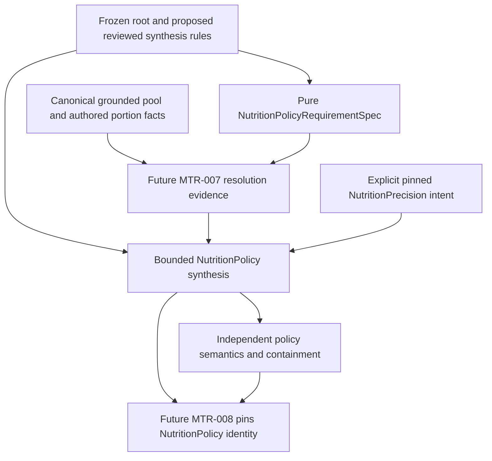

# MTR-006 Source-Bound NutritionPolicy Synthesis & Containment — bounded detailed design

**DESIGN PROPOSAL — READY FOR ARCHITECTURE REVIEW.**
**IMPLEMENTATION NOT AUTHORIZED.**
**PRODUCTION NUTRITION/CLINICAL CONTENT GATE — CLOSED.**

## 1. Canonical entry gate and scope

| Evidence | Exact identity |
| --- | --- |
| Approved main / this design's base | `4a7ddac883a777270cfd1d2460f9b953332b6673` |
| Dependency review | [PR #125](https://github.com/thedusk4203/Menuto/pull/125), reviewed head `74e9fe56158b51689c18bad3ef991cdbb6590680` |
| Architecture approval | [6630817744](https://github.com/thedusk4203/Menuto/pull/125#issuecomment-6630817744) |
| Exact merged-main push CI | [41831629205 — SUCCESS](https://github.com/thedusk4203/Menuto/actions/runs/41831629205), on the base above |
| Completion receipt | [6631661206](https://github.com/thedusk4203/Menuto/pull/125#issuecomment-6631661206) |
| Retained baseline | 3,782 passed / 0 skips; 447 exports; migration 0016 / 98 domain tables; no 0017 |
| Nutrition Root structural foundation | [FROZEN](NUTRITION_ROOT_CONTRACT_SUPPORTED_ELIGIBILITY_FREEZE_RECEIPT.md); NRC01–NRC80; 66 PostgreSQL executions / 32 obligations |

This is a proposed design, not an approval of its own choices. The source of the gate is the
[approved dependency review](POST_NUTRITION_ROOT_PLANNER_CONVERGENCE_REVIEW.md),
[V1.3 §9.2 and §10.3–10.4](../MENUTO_DEVELOPMENT_SPEC_V1_3.md),
[ADR-002](../adr/ADR-002-nutrition-policy-engine.md),
[ADR-003](../adr/ADR-003-plan-policy-resolution.md),
[ADR-010](../adr/ADR-010-independent-validator.md), and
[INV-001–030](../ARCHITECTURE_INVARIANTS.md).
The existing [root design](NUTRITION_ROOT_CONTRACT_SUPPORTED_ELIGIBILITY_DESIGN.md),
[root contracts](../../apps/backend/app/modules/nutrition/root_contracts.py),
[root resolver](../../apps/backend/app/modules/nutrition/root_resolution.py),
[root capture](../../apps/backend/app/modules/nutrition/root_sources.py), and
[independent root checker](../../apps/backend/app/modules/validation/nutrition_roots.py)
are compatibility constraints, not editable starting points.

Design exactly one Nutrition-owned module that turns pinned, authoritative root and rule inputs
into an immutable member-owned NutritionPolicy and a separately checked containment/semantic
report. The first consumer has **one tracked nutrition member**. Every participant's independent
allergy/diet safety survives; other members do not receive invented nutrition targets.

No full MTR-006 completion, MTR-007 estimator implementation, MTR-008 resolver, planner,
candidate selection, utility, API, plan validation, Execution or PRECOMMIT work is included.
No clinical formula, numerical target, percentage, safety floor, population definition,
qualification, provider, protocol, seed or default is supplied by this design.

## 2. Decisions and ownership

| Truth / responsibility | Owner | Explicit exclusion |
| --- | --- | --- |
| Guideline, physiological observations, eligibility and goal journals | Frozen Nutrition Root source; goal belongs to the member | A synthesis rule cannot rewrite these journals or attest eligibility |
| Synthesis-rule meaning, evidence, applicability and publication | Nutrition; proposed dedicated rule-source journal below | Guideline publication, member authorship and Git access do not imply rule-publication authority |
| Derived hard protection, goal, comfort and temporal claims | NutritionPolicy synthesis | A derived claim is not a new guideline root or medical certification |
| Discrete catalog/portion facts and their estimator semantics | MTR-007, within Nutrition, using grounded Catalog/Recipes inputs | Retail package size and data confidence cannot manufacture resolution |
| Explicit NutritionPrecision selection and future precedence | Policy/MTR-008; authenticated planning intent | No physiological, guideline, goal or scientific-rule authorship |
| Independent source, direction, arithmetic and containment checks | Validation | No call to producer synthesis or its business validator |

**Select durable, append-only PostgreSQL publication for synthesis rules.** Repository files,
external papers and artifacts may be retained evidence, but a commit/hash/label cannot publish a
rule. Reusing arbitrary guideline evidence as an executable rule would enlarge frozen source
semantics; reusing Preferences/prior/hierarchy authority would cross owners. Both are rejected.
No generic policy registry, coordinate adapter, plugin engine or arbitrary expression language
is proposed. The final NutritionPolicy is the Nutrition-owned planner-facing contract; MTR-008
pins it rather than mapping it into another nutrition coordinate.

This choice means a future approved implementation requires **new durable rule-source authority**.
It is not ZERO NEW PERSISTENCE. The derived policy itself remains pure and unpersisted in this
slice; no member aggregate/cache or plan persistence is proposed. This document adds none of it.

## 3. Rule-source authority and lifecycle

### 3.1 Separate credentials and capabilities

Propose a dedicated `menuto_nutrition_synthesis` protected SQL namespace with a NOLOGIN owner,
separate privileged registrar path, independently enrolled provider/principal identities, and
finite capabilities `SYNTHESIS_RULE_REVIEW`, `SYNTHESIS_RULE_PUBLISH`,
`SYNTHESIS_RULE_WITHDRAW`, `SYNTHESIS_SOURCE_READ`, `SYNTHESIS_VALIDATOR_READ`.
These are **new proposed contracts**, not additions to frozen `NrcCapability` or its SQL schema.
The frozen eight root capabilities keep their exact meaning and bodies.

Provider enrollment pins remit, environment and retained authority evidence. Principal enrollment
pins the actual database OID/name, SCRAM-authenticated login OID/name, verified human identity
or service identity, and registrar evidence. Grant scope pins provider/family, rule purpose,
approved reference/protocol applicability and validity. Reviewer/publisher qualification for the
exact rule remit must have separately approved evidence. No actual qualification is asserted here.
Service readers cannot review/publish; household OWNER/EDITOR, member SELF/delegation and ordinary
deployment privileges confer none of these capabilities. Registration is never an ordinary command.

Publication requires a complete current review over the exact immutable rule body, evidence,
reference bindings, applicability, output manifest and environment. Reviewer and publisher must be
different **verified humans**, not merely different logins. Different credentials for one human
fail separation of duties. A semantic edit, including coefficient, calendar, comparator,
requiredness or evidence change, invalidates the old review. Registering a principal/grant does
not certify scientific qualification or open the production-content gate.

### 3.2 Logical durable records

| Record | Required retained truth |
| --- | --- |
| Rule provider/principal enrollment revisions | Actual credential/endpoint binding, remit, environment, identity/qualification evidence, registrar, replacement lineage |
| Rule-local grant journal | Exact principal/scope/capability, valid interval, grant/revoke, generation and predecessor |
| Immutable rule revision | Complete typed body, authored version, body/evidence hash, reference/protocol pins, calendar/coverage manifest, environment |
| Rule review | Exact revision/body/evidence binding, verified reviewer, authority generation and qualification evidence |
| Rule publication journal | PUBLISH/SUPERSEDE/RETIRE/RETRACT, effective boundary, predecessor, exact review and publisher identity |
| Frontiers and command receipts | Contiguous recorded sequence, CAS expected head/generation, full command hash and principal-bound idempotency |
| Evidence retention | Complete immutable evidence preimages, unique identities and hashes; conflicting same-ID bodies reject |

These are normalized logical obligations, not a reserved physical table count or a generic JSON
event store. A future implementation must propose the smallest faithful physical schema and
inventory all protected functions/roles. The next legal forward migration must be determined then;
**do not reserve 0017** or edit migrations 0001–0016. New tables install empty: no provider,
principal enrollment, qualification, grant, rule, numeric coefficient, publication or default.

All authoritative writes use protected PostgreSQL paths with fixed trusted `search_path`, no
PUBLIC execute/direct runtime table access, and no runtime ownership. Reject trust/shared-login
spoofing, SET ROLE authorship, superuser/db-owner/source-owner actors and unsafe privilege graphs.
The sequence is authenticate → fixed-order provider/grant/frontier locks → current authorization
and exact review checks → receipt lookup → CAS → atomic event/frontier/receipt commit. Revocation
therefore affects old-command retries; a receipt is not authority. Reused key with another body,
actor, subject or scope rejects. Concurrent publication/withdrawal must serialize.

Recorded transaction order and valid/effective time are distinct. Supersession names the exact
predecessor and does not resurrect it after withdrawal. Future-effective replacement preserves
current coverage until its boundary. Historical retained cuts keep what they knew; retrospective
correction does not rewrite them. A fresh capture sees withdrawal/revocation. Offline replay does
not claim present authorization, present publication, DB origin or scientific correctness.

### 3.3 Deterministic selection

The request pins one rule provider, family, publication/revision ID, body/evidence fingerprint,
language version and explicit selection-policy version. Applicability must match the exact root
provider/family/guideline revision/body, protocol/scope, subject, goal type/direction, environment,
metric/unit, horizon, temporal/calendar identity and requested layer/coverage manifest.
Subject applicability is explicit: a published population-scoped rule does not become member-owned
truth; the request binds its use to the one exact member whose frozen eligibility covers that scope.

Replay the **complete selected family history**, authority/review history and absence/frontier
witnesses. Exactly one applicable published case must match each required output slot. No match
is unavailable; overlap is ambiguity. Pinning a case cannot hide another conflicting applicable
case in the same required selection space. No latest/current/default provider, second provider,
fallback revision, arbitrary clinical override or favorable-row selection is allowed. Cross-version
horizon stitching is unsupported. Selection is checked independently by Validation.

## 4. Proposed immutable interface

Names here describe future additive contracts, not exports added by this PR.

| Contract | Minimum content |
| --- | --- |
| `NutritionSynthesisRequest` | Exact subject; one complete frozen root; root/source/result pins; exact rule selection; explicit precision selection/provenance; horizon/calendar; required coverage; optional exact resolution input |
| `NutritionSynthesisRuleBody` | Identity/version/language; full reviewed evidence; applicability; finite cases/operators/coefficients; reference-role bindings; complete output/requiredness manifest; validity; environment |
| `NutritionSynthesisSourceSnapshot` | Full root retained sources plus rule enrollment/grant/review/publication/evidence prefixes, frontiers/absence, common capture frame, request and fingerprints |
| `NutritionPolicyRequirementSpec` | Pure pre-resolution projection of exact root/rule/request coverage and catalog/portion facts needed; no comfort widening or numeric policy synthesis |
| `NutritionResolutionInput` | Exact requirement-spec pin, canonical complete pool/portion/recipe-version facts, estimator version, evidence scope/availability, environment; no cached result authority |
| `NutritionPolicy` | Versioned outcome; full retained input identity; untouched root clauses; separately typed protected goal, daily protection, comfort, weekly centering, resolution and precision claims; mandatory coverage map; derivation trace; environment; reasons and result fingerprint |
| `NutritionPolicyValidationInput/Report` | Primitive/source inputs plus claimed policy, independent expected coverage, findings by layer/period, checked identities, authority/non-authority declarations |

Proposed module interface: `capture_nutrition_synthesis_inputs(session, request)`,
`derive_nutrition_policy(retained_inputs)`, `validate_nutrition_policy(claimed_result)`.
The last is producer self-consistency, not independent correctness. Separate registrar/publication
administration is not exported through the ordinary consumer interface. Validation exposes its own
`validate_nutrition_policy_independently(input)` in the Validation context.

No unscoped number carries policy authority. Each bound/center retains subject, metric, unit,
measurement/interpretation basis, root or explicitly derived temporal identity, scope/protocol,
rule body/case/operation and evidence refs. Equal rationals with different descriptors are not
interchangeable. Before arithmetic, revalidate all descriptors and exact dependency identities.
No food-basis, unit, member or temporal conversion is implicit.

The policy's coverage key is `(subject, layer, metric, basis, temporal-frame, interpretation)`;
its dependency set names exact root keys and rule operation IDs. Canonical arrays are unique and
sorted by those typed keys. A rule-body hash covers its complete authored content and excludes
only its own hash field; review/publication IDs are separate binding records, avoiding recursive
self-hashing. Policy identity includes contract/algorithm/language/selection versions, full retained
source and root hashes, rule publication/body/evidence, precision/resolution and calendar pins,
claim values/roles/requiredness and trace. Explicitly versioned hash domains and the repository's
canonical exact-rational serialization apply. Equal output numbers from different inputs do not
have the same policy identity. No current time or execution duration enters semantic identity.

## 5. Finite rule language and computation

V1 supports only closed, nonrecursive reviewed instruction records:

1. **COPY_REFERENCE**: bind an exact root clause endpoint/center to an explicitly reviewed role.
   A TARGET is not automatically a maintenance reference or a safety interval.
2. **AFFINE_SAME_UNIT**: an exact authored dimensionless rational coefficient times one bound/
   center, plus an explicitly authored same-unit rational offset. Every operand/reference and
   coefficient/offset is in the published body. This is an algebra carrier, not a supplied clinical
   formula. Missing fields do not become mathematical identity defaults.
3. **MAKE_CONSTRAINT / CHECK_SUBSET**: construct RANGE/MINIMUM/MAXIMUM/TARGET from explicitly
   bound operands; check the required protected set relations. A failed check does not clip output.
4. **FINITE_PERIOD_SUM / REVIEWED_PERIOD_PROJECTION**: finite declared cells and explicit
   coefficients/authority as constrained in §7. No guessed division by day count.
5. **CHECK_DIRECTION / SELECT_PRECISION_CASE**: explicit reviewed reference, comparator,
   direction/precision case and applicability; no inference from goal text alone.

These records are a finite typed sequence with unique operation IDs and backward-only references,
not Python/SQL callbacks, arbitrary AST, scripts, recursion, data-dependent loops or an extensible
formula plugin. Unknown operations, nonlinear/metabolic models or additional measurement kinds
are UNSUPPORTED pending separately reviewed design/content. V1 does not calculate BMR/TDEE or
derive an energy reference from body mass/height. Such observations remain source evidence, not
an implicit formula input. A missing authorized reference cannot be replaced with a heuristic.

All arithmetic uses canonical reduced exact rationals. Amounts remain nonnegative; internal affine
offsets/coefficients may be signed only where explicitly typed and authored. Reject negative final
nutrition amounts, denominator zero, float/bool/string coercion, arithmetic overflow/oversize and
noncanonical rationals. A real explicitly authored zero remains a value, never missingness.
No intermediate rounding changes a hard/protected bound. A future solver may separately compile
units/scales with independently checked conservative equivalence; that is not designed here.

This design supplies **no coefficient or offset values**, production expressions, goal rates or
numeric test fixtures. Any later examples must have explicit TEST_ONLY evidence and cannot be
installed by a migration. A source publication request carrying scientific content still requires
the separately closed content/evidence/qualification gate; structural SQL acceptance is insufficient.

## 6. Derivation order, coverage and missingness

1. Enforce server-owned structural bounds before expensive decoding/canonicalization, including
   bytes, record/history/case/operation/cell counts, rational bit lengths, nesting and total budget.
   Exact operational limits must be reviewed in future implementation; they are not nutrition data.
   A caller cannot enlarge them. Overflow is all-or-error, never truncation or favorable partial data.
2. Reconstruct the frozen root from its retained primitive sources through the unchanged public
   root interface. Compare the supplied complete result; reject cached/model-constructed tampering.
   Admission requires AVAILABLE, SUPPORTED, PRESENT goal and no source reasons. Do not mutate
   the root's `policy_synthesis=NOT_PERFORMED` or `numeric_goal_protection=NOT_SYNTHESIZED` literals.
3. Replay rule publication/authority at the common retained cut, verify evidence/application,
   environment and exact rule-case selection. The accepted coverage manifest comes from the
   published applicable rule purpose, not from a caller deleting inconvenient required claims.
4. Copy all frozen hard/reference clauses without changing value, role or temporal interpretation.
   Derive separately tagged goal/daily protection and required direction/reference checks.
5. Validate resolution evidence and temporal assembly; then derive comfort and centering under
   exact reviewed rules. Apply explicit NutritionPrecision to comfort only.
6. Validate every mandatory slot, descriptor, subset/direction and cross-period invariant. Sort
   traces/reasons canonically and hash complete semantic inputs/results with versioned domains.
   Producer semantic validation reconstructs a fresh complete result from primitive retained input.

V1 has one usable purpose, `BOUNDED_COMPLETE_POLICY_V1`. Its structural minimum is unchanged
guideline coverage, member ENERGY goal protection, daily-protection coverage for the exact
applicable scope, comfort, explicit precision, resolution and declared temporal coverage.
A root without required ENERGY/reference authority cannot synthesize that goal purpose.
The exact nutrient-specific daily/comfort manifest is reviewed scope/rule content, never an
architecture-invented clinical nutrient set. That manifest and its evidence are themselves
mandatory. Weekly scopes require explicit weekly goal/centering coverage; an exact DAY scope
may mark weekly coverage NOT_APPLICABLE only under the reviewed temporal profile, not by omitting
it. Neither caller nor publisher may lower these structural layer minima within this purpose.
A different diagnostic purpose cannot be relabeled a complete policy or preview. Validation
checks the fixed minima as well as the full reviewed scope manifest and requested coverage.

| Outcome | Meaning / payload |
| --- | --- |
| AVAILABLE | Every mandatory claim for the declared exact coverage exists and passes; complete immutable policy payload |
| UNAVAILABLE | Verified absence, expired authority/source, missing required reference/rule/resolution or unsupported admission; no usable policy payload |
| UNSUPPORTED | Unimplemented type/operator/basis/temporal assembly/stitching; no usable policy payload |
| CONFLICT | Contradictory authoritative required constraints or ambiguous rule selection; no usable policy payload |
| INVALID_INPUT | Malformed, forged, incoherent or semantically inconsistent retained input; reject, never a source-absence witness |

Distinct reason codes include ROOT_UNAVAILABLE, ELIGIBILITY_UNKNOWN, MEMBER_UNSUPPORTED,
MEMBER_INELIGIBLE, GOAL_ABSENT, GOAL_RETRACTED, GOAL_AMBIGUOUS, SOURCE_STALE,
RULE_UNAVAILABLE, RULE_AUTHORITY_UNAVAILABLE, RULE_AMBIGUOUS, RULE_NOT_APPLICABLE,
REFERENCE_UNAVAILABLE, UNIT_OR_BASIS_MISMATCH, TEMPORAL_COVERAGE_MISSING,
DAILY_PROTECTION_AUTHORITY_MISSING, UNSUPPORTED_OPERATOR, RESOLUTION_UNAVAILABLE,
RESOLUTION_INSUFFICIENT, PRECISION_SOURCE_UNAVAILABLE, REQUIRED_CLAIM_MISSING,
HARD_CONTAINMENT_FAILED, GOAL_DIRECTION_CONFLICT, ENVIRONMENT_MISMATCH and SOURCE_CUT_INCOHERENT.
Keep the root's more precise reasons as named dependencies rather than flattening them.

No non-AVAILABLE result exposes a numeric policy as a usable fallback. It may retain immutable
source facts and explicitly non-consumable diagnostic traces. Declared optional centering may be
NOT_APPLICABLE only when the authoritative rule purpose explicitly says so. Mandatory goal,
hard/daily safety, comfort or resolution cannot be disabled by request to obtain AVAILABLE.
This slice does not claim a complete feasible meal plan: policy consistency is not plan feasibility.

## 7. Layer semantics

Required **claim coverage** is separate from plan enforcement:

| Claim | Enforcement meaning for a later planner |
| --- | --- |
| Frozen GUIDELINE_HARD and derived daily/goal protection | Hard conjunction; cannot be traded for cost, comfort or utility |
| COMFORT | Soft deviation band used by later Stage1; its declared band must itself be inside protection |
| WEEKLY_CENTER / reference TARGET | Soft centering reference, never an inferred hard interval |
| Published protected weekly GOAL envelope | Hard goal-protection conjunction when required by the applicable rule purpose |
| RESOLUTION / precision source | Evidence and interpretation, not a constraint that can override hard protection |

Requiring a comfort/centering claim to exist does not require a plan to achieve that soft band.
An AVAILABLE policy is neither a feasible menu nor a successful optimization result.

### 7.1 Guideline and hard-root preservation

Retain the exact root and mandatory hard-root manifest. RANGE contains both closed bounds;
MINIMUM has no invented upper bound; MAXIMUM has no invented lower bound; TARGET remains a
reference center. A degenerate closed range is not empty. Root missingness, absence and zero
remain distinct. No second guideline provider or arbitrary clinical-root merge is admitted.
Frozen duplicate `(metric, temporal, interpretation)` rejection stays unchanged.

For matching subject/descriptors, protected/comfort RANGE endpoints must stay inside hard RANGE;
MINIMUM protection may only preserve/raise its lower bound; MAXIMUM protection may only
preserve/lower its upper bound. Added finite bounds require explicit rule authority and remain
derived claims. A center must be inside every applicable protected range; a TARGET cannot replace
required interval coverage. One-sided incompatibility and empty intersections produce CONFLICT.
Do not average, clip, silently intersect a badly authored claim into acceptability or resurrect a
previous guideline/rule/goal. Returning conflict is not permission to weaken protection.

### 7.2 Member goal protection

CUT/MAINTAIN/GAIN are the frozen member intent labels, not rates or numeric prescriptions.
A rule must bind the exact current member goal revision and an independently authorized reference
role. The published direction comparator and its evidence must explicitly explain the relation
of the protected goal envelope to that reference. No generic comparator table is scientific
authority by itself. Missing reference/comparator/evidence blocks the requested goal policy.

The finite checker supports explicitly authored upper-vs-reference, lower-vs-reference and
reference-contained predicates with stated strict/non-strict comparison. Their use for a direction
requires the reviewed case's exact meaning; the producer cannot choose another case to make a
contradictory direction pass. Validation checks both the published mapping and the numeric relation.
No direction-preserving automatic clipping/fallback is authorized. Goal claims must already fit
all applicable hard protection. No goal absent → MAINTAIN, no retraction → previous goal, and no
cross-member reference/goal copying. Cost, budget, effort, convenience and TasteFit are not operands.

### 7.3 Daily and weekly temporal protection

One frozen root has one exact requested temporal frame: the current resolver requires each clause
descriptor to equal that frame. Do not pretend it already supplies separate DAY and WEEK roots.
V1 consumes **one complete root**, one guideline version and one rule publication covering the full
requested horizon. It does not stitch daily root snapshots, publication versions or member cuts.

Daily/weekly claims are **derived policy claims**, with their own explicit temporal descriptor and
reviewed transformation provenance; they never overwrite the original root descriptor. An authored
temporal rule must bind the source frame, exact target cells, measurement basis, calendar/timezone,
effective coverage, complete reference roles and evidence authorizing each transformation.
If these cannot be proved from the single root plus independently reviewed rule content, that
scope is UNSUPPORTED/UNAVAILABLE. This deliberately allows bounded exact-period structural work
without pretending that arbitrary multi-day planning is ready.

- Every applicable source-authored daily hard constraint holds on its exact day. Any additional
  daily protective bound derived from a wider-period reference requires separately reviewed
  **daily-protection rule content**; WEEK identity alone does not authorize it. A weekly-only root
  plus no such daily authority yields DAILY_PROTECTION_AUTHORITY_MISSING, not an invented floor.
- A DAY root cannot be copied to uncovered days. A week requested beyond the root's effective
  frame is unsupported even if a coefficient or fixture calendar looks convenient.
- Weekly goal/centering is a separate authorized aggregate claim. It never overrides daily hard
  protection. Do not divide by a presumed week/day count, assume equal days, convert totals to
  averages or scale a partial week without an explicit reviewed operation and matching units.
- A finite period sum binds an ordered, disjoint, gap-free partition of the exact aggregate
  interval, cell boundaries, included days and coefficients. The rule publication retains the
  calendar definition/version and resolved UTC boundaries needed to verify that partition.
  No wall-clock/tzdb/environment lookup is permitted in replay. DST/partial-week scope must be
  explicitly covered by that publication or rejected; missing cells are not zero intake.
- Check algebraic consistency of all applicable interval claims and finite-sum bounds using exact
  arithmetic. An impossible protected daily/weekly combination is CONFLICT. That interval check
  does not prove a catalog/meal plan exists. Do not expand tolerance to hide a conflict.

For an explicitly reviewed sum map `S = Σ a_i x_i`, every `a_i` is explicitly authored, positive,
dimensionless and bound to its cell; no implicit coefficients exist. The source and aggregate
unit/basis must agree. For independent protected cell intervals `[l_i,u_i]`, the reachable sum
interval is `[Σ a_i l_i, Σ a_i u_i]`; missing one-sided endpoints remain symbolic unboundedness,
not zero or an invented clinical bound. It must intersect each required aggregate hard/goal
interval, and all constraints on that same aggregate must have a nonempty joint intersection.
Retain the original aggregate hard interval as a conjunct even when daily intervals are wider.
Do not claim that all daily combinations satisfy the weekly envelope, or demand that every soft
comfort combination does so. Arbitrary overlapping/rolling aggregates or coupled period systems
outside this disjoint single-aggregate model are UNSUPPORTED, not solved by a hidden optimizer.

Any proposed future new physiological DAY root belongs to the guideline source, not to rule
publication. Reviewed daily *derived protection* is explicitly distinguished above and must retain
its authority/evidence; it cannot be relabeled as a frozen source root or general safety knowledge.

### 7.4 Resolution and NutritionPrecision

Comfort is a separately tagged soft band inside applicable hard and goal protection, not a new
safety range. The exact RELAXED/STANDARD/PRECISION cases and any width/centering arithmetic must
be published rule data. All three cases are explicitly authored; no standard/default width,
percentage, coefficient or implicit fallback exists. For comparable cases, require nested comfort
sets PRECISION ⊆ STANDARD ⊆ RELAXED, all inside hard/goal protection; an inconsistent mapping rejects.

Resolution describes discrete grounded portion/candidate possibilities, not clinical truth or
permission to widen. If requested comfort cannot be supported at the evidenced resolution,
return RESOLUTION_INSUFFICIENT with diagnostics/advisor requirement; preserve hard/goal claims
without returning a complete usable policy. No iterative widen-until-feasible loop, package-size
resolution heuristic or double-counted DataConfidence band inflation is admitted.

NutritionPrecision selection is explicit and version-pinned. An authenticated request may declare
one value for the exact household/subject; proposed planning-intent authorization uses the existing
household planning actor relationship, not goal-writing or clinical publication authority.
Source capture must retain that authorization evidence. Future profile/default/week precedence
belongs to MTR-008. Until that source/precedence is approved, a missing explicit request selection
is PRECISION_SOURCE_UNAVAILABLE; no hard-coded STANDARD and no fabricated default receipt.

## 8. Authenticated capture, retained replay and TEST_ONLY isolation

Use one actual caller-owned clean read-only REPEATABLE READ/SERIALIZABLE connection to the same
database. An adapter calls unchanged frozen root capture and proposed rule capture in that
transaction. The same ordinary login is independently enrolled for the required root and rule
reader purposes; neither grant implies the other. It is not a rule/root administrator or owner.
Retain and compare actual endpoint/database/login OID/name, backend PID, MVCC snapshot, isolation,
read-only status, capture interval and both authority/frontier manifests. Do not equate independent
generation numbers. A normal reader with execute-only protected access is compatible with the
frozen root privilege-graph rules; prove this with real PostgreSQL tests before implementation review.

Both complete captures must succeed or no synthesis input is returned. No direct table reads,
unrelated members, favorable prefixes, truncation, source-cut splicing or multi-session common-MVCC
fiction. If deployment cannot support this one-connection cut without changing frozen semantics,
return UNSUPPORTED and request architecture review; do not relax frozen root capture.

Pure derive/replay performs zero DB, network, filesystem, wall-clock, mutable global or environment
lookup. It replays the complete retained histories and effective-time state. Full-source and rule
fingerprints bind all retained inputs, absence and frontiers, not only visible output clauses.
Producer result fingerprints are versioned semantic identity; request transport caches and Pydantic
constructed results are never trusted. Historical replay needs no current login or current grant.

Keep `NrcEnvironment = TEST_ONLY | REVIEWED_PRODUCTION`; do not extend the frozen enum. Every root,
rule body, evidence/qualification, request, resolution and precision source must have compatible
environment/provenance. Mixed source environments reject rather than laundering an input. Any
explicitly supported research assembly containing TEST_ONLY remains TEST_ONLY end-to-end, through
NutritionPolicy, MTR-008, preview subject and report. Production admission must reject it.

REVIEWED_PRODUCTION is necessary labeling, not scientific approval. Until the independent content/
evidence/qualification gate is explicitly opened, no production rule/provider/qualification or
numeric source may be enrolled/published by this work. A future structural implementation may use
isolated TEST_ONLY source credentials/fixtures only. A pure offline report cannot prove canonical
DB origin, current permission/publication, clinical soundness or an approved production preview.
Fresh application ingress must use trusted capture; serialized retained inputs are replay material,
not a way for an external caller to mint source authority.

## 9. MTR-007 and MTR-008 handoffs without a dependency cycle

**MTR-007:** requirement projection precedes final synthesis and asks for exact metric/unit/basis,
finite candidate/portion source completeness, portion steps, discrete ingredient units, estimator
version and granularity facts. It does not require an already computed comfort band. The response
pins that requirement spec and full canonical primitive/source identity. A self-authored estimate,
package count or cached fingerprint is not evidence. Future production use requires the approved
MTR-007 capture/estimation/verifier interface; its absence remains a real implementation dependency.
Isolated TEST_ONLY estimator fixtures may exercise this proposed contract without claiming MTR-007
exists. They must retain primitive preimages and an independent expected result, not just a number.
No estimator algorithm, production catalog scan or 020A pool capture is implemented by this PR.

**MTR-008:** Policy owns explicit intent/default/week/override precedence independently from
Nutrition truth. It supplies a pinned NutritionPrecision selection; synthesis returns a pinned
NutritionPolicy bound to that selection. Later ResolvedPlanPolicy references the full policy,
root/rule/source identities, required coverage, environment and independent report identity.
Changing precision requires a new NutritionPolicy identity, not editing a compiled band. Cost,
effort, BudgetContract and BudgetPressure compile independently and cannot be synthesis operands.
No synthetic ResolvedPlanPolicy, raw PlanningMode or consumer-generated nutrition adapter is added.

In this gate, both handoffs are **contract proposals only**. They do not complete MTR-007/008,
settle all user-default persistence or imply that a real preview is available.

## 10. Independent Validation

Propose an additive `SYNTHESIS_SOURCE_AND_POLICY_SEMANTICS` companion with explicit required
coverage. Existing ROOT_SOURCE_CONSISTENCY_ONLY / ROOT_AND_DERIVED_CONTAINMENT and frozen
MTR-025/026 literals, bodies and hashes remain untouched. A root containment report alone cannot
fulfill the new companion, nor can a new companion become a full preview/PRECOMMIT pass.

Validation independently:

1. Uses the unchanged independent root checker for root-source reconstruction and explicitly
   checks AVAILABLE/SUPPORTED/PRESENT admission; CONSISTENT on an unavailable root is insufficient.
2. Reconstructs rule enrollment, grant/review/publication lifecycle, common-cut identity, selection,
   evidence/environment, effective coverage and case applicability from primitive retained input.
3. Computes expected mandatory output slots from the independently verified published purpose,
   not the producer's claimed coverage list. Missing goal/daily/weekly/comfort/resolution claims
   required by that purpose cannot pass vacuously. Optional/not-applicable status is itself checked.
4. Checks unchanged root clauses and independently evaluates finite algebraic rule relations,
   exact references/coefficients, direction, hard/goal/comfort subset relations, precision nesting,
   complete temporal cells/sums, resolution pins and all claimed numeric values.
5. Compares complete expected policy identity/trace/coverage against the claimed policy, including
   policy/rule/precision versions, subject, source/environment, horizon and fingerprints.

It must not import/call Nutrition producer derivation, its rule selector/evaluator, semantic
validator, NutritionPolicyEngine, PlanPolicyResolver or planner/solver internals. Shared immutable
contracts, canonical hashing and primitive exact measurements are allowed; shared business
selection, temporal assembly, interpretation or containment code is not its correctness oracle.
The checker verifies the finite published relations independently; it does not copy a full future
clinical synthesis engine or certify the medical evidence underlying a publication (ADR-010).

Report CONSISTENT / INCONSISTENT / UNSUPPORTED with separate authority, root, rule, goal,
temporal, resolution, precision, containment and completeness coverage. CONSISTENT means only
that all named policy-semantic obligations passed for the exact retained purpose. It carries
scientific_correctness=NOT_CERTIFIED, canonical_database_origin=NOT_PROVED_OFFLINE,
current_authorization=NOT_CLAIMED, planner_ready=False, activation_ready=False.
An all-forged but internally coherent offline source set cannot be ruled out by hashes alone;
trusted capture is the fresh-admission trust boundary. Mutation tests must state this limit.

## 11. Compatibility, implementation inventory and readiness

Future implementation locations are proposed as Nutrition synthesis contracts/source/derivation
files plus a Validation policy companion. New protected rule SQL and a forward migration would
implement §3 only after separate authorization. No public HTTP route, production source roster,
numerical rule pack, cache or planner objective is included. No old module is genericized.

Preserve all 447 current exported bodies/hashes, 130 frozen-file pins in the current compatibility
fixture, old migrations 0001–0016, NRC01–NRC80, every retained 3,782 test identity and earlier
Preferences/prior/shrinkage/hierarchy/TasteFit/041A–F/046A/grounding/inventory semantics.
New exports must be additive; exact count/delta is determined by the future implementation,
not guessed here. Existing root flags still describe root-only behavior; new policy status is a
distinct contract. Keep the frozen no-clinical-policy coverage definition, deferred full-plan
validation and PRECOMMIT semantics unchanged. Run full required exact-head CI, not targeted tests
as a replacement; this PR changes no workflows or regression coverage.

| Gate / dependency | Decision in this design | Remaining approval / evidence |
| --- | --- | --- |
| Rule source vs artifact ownership | Dedicated PostgreSQL append-only authority; repository artifacts are evidence only | Architecture approval of this proposal; later implementation/migration authorization |
| Numeric/reference/rule content and qualifications | No production content supplied | Separate external evidence/clinical qualification and content-publication approval; gate CLOSED |
| Rule algebra and policy semantics | Finite carriers and required guards above | Architecture review; actual rule applicability/reference values must not be guessed |
| MTR-007 resolution producer and verifier | Acyclic requirement-spec handoff | Separate bounded MTR-007 design/implementation before real required-resolution coverage |
| Precision default/week precedence | MTR-008-owned; no default in this module | Separate authorized source/precedence design; explicit TEST_ONLY request path is not production completion |
| Same-connection protected capture | Required, no fallback | Real PostgreSQL execution/privilege-graph evidence in a future implementation |
| Full Validated Plan Preview | Not claimed | Policy resolution, sources/safety/economics/flow, feasibility/solve, full independent subject/validator/API remain missing |

There is no unresolved need to invent a number to describe these contracts. Real scientific rule
content, qualification and the two future handoff producers are **implementation/production
prerequisites**, not fabricated capabilities. If architecture review finds the source strategy or
finite semantics insufficient, revise this design; do not implement around the missing decision.
No migration number/table count/production deployment actor is reserved by this document.

## 12. Acceptance matrix — proposed future tests, not executed evidence

Namespace **NPS001–NPS120**, 120 mandatory cases. **NPS001–NPS032 are 32 required real PostgreSQL
authority/integration obligations**; the rest are pure, interface, adversarial or compatibility
obligations. Parameterization may increase eventual execution count. No NPS test exists or was
executed by this docs PR; current CI verifies only the retained baseline. Mocks/collection-only
checks cannot satisfy a PG obligation. Every future evidence row must identify executed test IDs,
actual PG counts and exact final-head CI, and retain all baseline tests with zero skips.

| Case | Layer | Required assertion / adversarial input |
| --- | --- | --- |
| NPS001 | PG | Fresh migration installs empty rule authority/content; baseline 0016 objects unchanged |
| NPS002 | PG | Provider enrollment requires separate privileged registrar |
| NPS003 | PG | Ordinary command cannot become provider/principal/admin enrollment |
| NPS004 | PG | Actual database and login OID/name binding rejects spoof/recreated identity |
| NPS005 | PG | Trust/shared-login actor spoofing and SET ROLE cannot author |
| NPS006 | PG | Superuser, db-owner, source-owner and unsafe inherited privilege actors reject |
| NPS007 | PG | Direct SELECT/DML/ownership and PUBLIC execute paths cannot bypass protected scope |
| NPS008 | PG | Fixed search_path defeats writable schema/temp shadowing |
| NPS009 | PG | Frozen root grants do not authorize synthesis rule operations |
| NPS010 | PG | Preference/prior/hierarchy and household/member grants do not authorize rule publication |
| NPS011 | PG | Exact rule-local remit/capability/environment grants enforced |
| NPS012 | PG | Review cannot publish; publish cannot manufacture a review |
| NPS013 | PG | Different logins for the same verified human fail separation of duties |
| NPS014 | PG | Changed coefficient/body/evidence/calendar/requiredness needs fresh exact review |
| NPS015 | PG | Qualification/enrollment labels alone cannot bypass required retained review evidence |
| NPS016 | PG | Revoked authority is checked before old-command idempotency receipt lookup |
| NPS017 | PG | CAS races produce one committed event/frontier/receipt without partial writes |
| NPS018 | PG | Same key/body/actor retry is stable; changed command/actor/scope rejects |
| NPS019 | PG | PUBLISH/SUPERSEDE/RETIRE/RETRACT remain append-only; predecessor does not resurrect |
| NPS020 | PG | Future-effective replacement preserves current state; correction retains old cuts |
| NPS021 | PG | Overlapping applicable publication/case ambiguity cannot be hidden by a pin |
| NPS022 | PG | Two concurrent publishers/withdrawal serialize through authority/frontier locks |
| NPS023 | PG | One independently enrolled execute-only reader captures root and rules under frozen guards |
| NPS024 | PG | READ COMMITTED, writable/dirty transaction and mixed connection cuts reject |
| NPS025 | PG | Endpoint/role/backend/MVCC/frame mismatch rejects even when body hashes match |
| NPS026 | PG | Full history/frontier/absence capture; no favorable row selection or truncation |
| NPS027 | PG | Capture is exact-subject scoped; unrelated member data is not returned |
| NPS028 | PG | Server-owned bytes/rows/depth/integer/time limits fail all-or-error for direct SQL callers |
| NPS029 | PG | Concurrent revocation/publication cut yields coherent old or new state, never a splice |
| NPS030 | PG | Duplicate evidence identity with conflicting body rejects |
| NPS031 | PG | TEST_ONLY fixtures/enrollment do not survive as production install seeds/defaults |
| NPS032 | PG | Loss-refusal downgrade and transaction rollback preserve reviewed source history |
| NPS033 | Pure | Unchanged AVAILABLE/SUPPORTED/PRESENT root admits structurally valid input |
| NPS034 | Pure | Root UNAVAILABLE cannot become usable numeric policy |
| NPS035 | Pure | UNKNOWN, UNSUPPORTED and INELIGIBLE remain distinct reasons |
| NPS036 | Pure | Absent goal does not become MAINTAIN |
| NPS037 | Pure | Retracted goal does not resurrect prior goal |
| NPS038 | Pure | Ambiguous/foreign member goal fails exact-subject binding |
| NPS039 | Pure | Cached/model-constructed root replays from primitive sources and tampering rejects |
| NPS040 | Pure | Frozen root non-synthesis/non-activation literals remain unchanged |
| NPS041 | Pure | Exact rule provider/revision/body/evidence and language pins required |
| NPS042 | Pure | No rule/provider/version fallback or latest selector |
| NPS043 | Pure | Missing and ambiguous rule cases fail distinctly |
| NPS044 | Pure | Wrong guideline/protocol/scope/environment/subject rule applicability rejects |
| NPS045 | Pure | Retired/retracted/out-of-effective-range rule blocks fresh applicability |
| NPS046 | Pure | Historical replay preserves retained authority/publication knowledge |
| NPS047 | Pure | Rule and source full-history fingerprints cover absence/frontiers/evidence |
| NPS048 | Pure | Fingerprint/REVIEWED_PRODUCTION alone cannot mint publication or qualification |
| NPS049 | Pure | Unknown language/operator/nonlinear/metabolic model is UNSUPPORTED |
| NPS050 | Pure | Duplicate IDs, forward references, recursion and scripts reject |
| NPS051 | Pure | Reduced exact rationals only; no float/bool/string coercion |
| NPS052 | Pure | Zero is an explicit value; missing coefficient/offset is not identity/zero |
| NPS053 | Pure | Oversized integers/denominator zero/negative final amount fail before unsafe work |
| NPS054 | Pure | Descriptor/unit/basis/subject mismatch rejects before arithmetic |
| NPS055 | Pure | Untouched complete hard-root manifest and clause identities survive synthesis |
| NPS056 | Pure | RANGE both bounds, including equal-endpoint range, retain exact closed semantics |
| NPS057 | Pure | MINIMUM has no invented upper; MAXIMUM has no invented lower |
| NPS058 | Pure | TARGET stays reference; cannot become a hard safety interval |
| NPS059 | Pure | Duplicate frozen metric/temporal/role or second guideline remains unsupported |
| NPS060 | Pure | Protected RANGE stays within matching hard RANGE |
| NPS061 | Pure | One-sided protection never weakens root endpoint |
| NPS062 | Pure | Empty/conflicting constraints fail; no averaging/clipping/automatic intersection repair |
| NPS063 | Pure | Missing authorized maintenance/reference role blocks goal synthesis |
| NPS064 | Pure | CUT case requires exact reviewed comparator/reference evidence |
| NPS065 | Pure | MAINTAIN case does not infer a center from absent content |
| NPS066 | Pure | GAIN case cannot choose another direction's mapping |
| NPS067 | Pure | Numeric direction relation inconsistent with published case fails |
| NPS068 | Pure | Goal envelope outside hard protection fails without direction-preserving fallback |
| NPS069 | Pure | No cross-member physiology/reference/goal aggregation or transfer |
| NPS070 | Pure | Physiological observations do not implicitly select BMR/TDEE or safety formula |
| NPS071 | Pure | Exact root temporal frame is retained; no claim root already has mixed DAY/WEEK clauses |
| NPS072 | Pure | Wider-period daily derived protection needs separately reviewed transformation authority |
| NPS073 | Pure | WEEK-only source with no required daily authority fails; no default floor |
| NPS074 | Pure | DAY root cannot be repeated outside its exact covered interval |
| NPS075 | Pure | Weekly centering never overrides daily hard protection |
| NPS076 | Pure | No implicit day count, scaling, averaging or partial-week extension |
| NPS077 | Pure | Period cells have exact ordered/disjoint/gap-free horizon coverage |
| NPS078 | Pure | Calendar/timezone/version/DST mismatch or absent retained mapping rejects |
| NPS079 | Pure | Cross-publication/root-cut/horizon stitching remains unsupported |
| NPS080 | Pure | Contradictory daily/weekly interval sums conflict; no fake meal-plan feasibility |
| NPS081 | Pure | Explicit precision case selected; missing explicit selection is unavailable |
| NPS082 | Pure | PRECISION ⊆ STANDARD ⊆ RELAXED for comparable authored cases |
| NPS083 | Pure | Every comfort set remains within hard and goal protection |
| NPS084 | Pure | Coarse resolution returns insufficiency, never widen-until-feasible |
| NPS085 | Pure | Package size and DataConfidence cannot inflate bands or mint granularity |
| NPS086 | Handoff | Requirement-spec projection does not need final comfort output; no MTR-007 cycle |
| NPS087 | Handoff | Resolution pins complete pool/portion primitives, requirement identity and estimator version |
| NPS088 | Handoff | Cached/caller-authored resolution number without primitive authority rejects |
| NPS089 | Handoff | Missing required estimator coverage blocks; TEST_ONLY fixture not MTR-007 completion |
| NPS090 | Handoff | MTR-008 pins full policy/root/rule/report/precision identity; no consumer band edits |
| NPS091 | Handoff | Unapproved default/week precedence cannot fabricate STANDARD or a default receipt |
| NPS092 | Handoff | CostPreference cannot weaken or enter physiological/goal arithmetic |
| NPS093 | Handoff | BudgetContract/BudgetPressure cannot weaken or enter root synthesis |
| NPS094 | Handoff | KitchenEffort/convenience cannot weaken root/goal protection |
| NPS095 | Handoff | TasteFit/shared aggregation cannot supply utility-as-nutrition or physiology |
| NPS096 | Handoff | NutritionPrecision changes comfort only; new selection changes policy identity |
| NPS097 | Validation | Independent root reconstruction required; CONSISTENT unavailable root cannot admit |
| NPS098 | Validation | No import/call to producer selector/evaluator/validator, policy resolver or solver |
| NPS099 | Validation | Rule authority/selection and complete mandatory manifest independently recomputed |
| NPS100 | Validation | Omitted required goal/comfort/daily/weekly/resolution claim never passes vacuously |
| NPS101 | Validation | Forged optional/not-applicable downgrade is rejected |
| NPS102 | Validation | Rehashed mutated bounds/coefficients/reference/direction caught against retained publication |
| NPS103 | Validation | Rehashed temporal cell, calendar, unit or subject mutation caught independently |
| NPS104 | Validation | Full expected trace/policy identity checked, not just final numeric equality |
| NPS105 | Validation | Root containment alone cannot stand in for complete policy-semantic coverage |
| NPS106 | Validation | Offline all-forged self-consistency is not claimed as DB/scientific/current-authority proof |
| NPS107 | Isolation | TEST_ONLY taint propagates to policy/ResolvedPlanPolicy/preview/report contracts |
| NPS108 | Isolation | Mixed environment substitution rejects; production admission rejects TEST_ONLY |
| NPS109 | Isolation | No environment lookup, global registry, DB/network/filesystem/wall-clock in replay |
| NPS110 | Compatibility | All 447 export bodies/hashes retained; new exports additive only |
| NPS111 | Compatibility | All frozen source/runtime/migration pins and 3,782 baseline test identities retained |
| NPS112 | Compatibility | NRC01–NRC80 and 66/32 real-PG evidence remain valid; no frozen root weakening |
| NPS113 | Compatibility | No changes to frozen 040/TasteFit/041A–F/046A/grounding/inventory semantics |
| NPS114 | Compatibility | Frozen MTR-025/026 and no-clinical-policy definition retain literals/hashes |
| NPS115 | Isolation | No production clinical values, formulas, populations, protocols or qualification fixtures |
| NPS116 | Isolation | No enrolled production provider/default policy/seed or content gate auto-opening |
| NPS117 | Interface | Canonical ordering/replay produces deterministic fingerprints and scoped equality |
| NPS118 | Interface | Non-AVAILABLE result carries no consumable numeric fallback; diagnostics stay labeled |
| NPS119 | Interface | Resource overflow/time budget is all-or-error; no truncated favorable result |
| NPS120 | Governance | No planner/API/activation/Execution/PRECOMMIT or parent completion authority |

Adversarial strategy: mutate each identity, evidence/case/reference, bound, coverage flag,
temporal cell and environment independently, then recompute superficial result hashes. Cross-check
producer and independent checker using separately authored expected outcomes, not one another's
output as the sole oracle. Exercise concurrency/revocation and hostile credentials on real
PostgreSQL. No test is evidence of clinical correctness or of a production source roster.

## 13. Design verdict and stop

**MTR-006 SOURCE-BOUND NUTRITIONPOLICY SYNTHESIS & CONTAINMENT — BOUNDED DETAILED DESIGN**

**DESIGN READY FOR ARCHITECTURE REVIEW — NOT APPROVED / NOT IMPLEMENTED.**

**IMPLEMENTATION NOT AUTHORIZED. PRODUCTION NUTRITION/CLINICAL CONTENT GATE — CLOSED.**

The proposed durable rule source, finite language, temporal projection semantics and handoffs
require architecture review. They are not implementation instructions approved by this PR.
No clinical content approval is requested or implied. Full MTR-006/007/008 remain incomplete;
MTR-040 COMPLETE; MTR-039 OPEN; full MTR-041/046 PARTIAL; MTR-020B/021/024 BLOCKED;
Execution NOT STARTED; PRECOMMIT FAIL-CLOSED; planner_ready=False; activation_ready=False.

Keep the design PR OPEN with auto-merge OFF. Exact-head CI verifies the unchanged regression
baseline, not execution of NPS001–NPS120. Stop after reporting that PR and CI; no self-approval,
merge, implementation, migration, production publication or next milestone begins.
