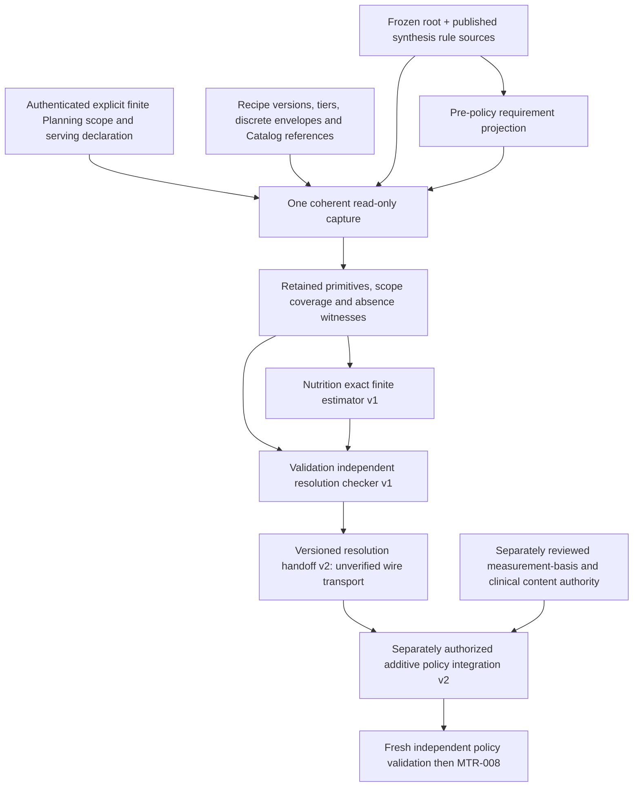

# MTR-007 — Source-Bound NutritionResolutionEstimator: Bounded Detailed Design

**DESIGN READY FOR INDEPENDENT ARCHITECTURE REVIEW — NOT APPROVED.**
**IMPLEMENTATION, MIGRATION, PRODUCTION CONTENT AND DOWNSTREAM WORK NOT AUTHORIZED.**

## 1. Canonical entry and decision requested

| Item | Exact baseline / limit |
| --- | --- |
| Main / design base | `8b148bada6747aae823a0e843390d114258d243a` |
| Approved dependency review | [PR #128](https://github.com/thedusk4203/Menuto/pull/128), [architecture PASS 6652121048](https://github.com/thedusk4203/Menuto/pull/128#issuecomment-6652121048) |
| Merge verification | [completion 6653072598](https://github.com/thedusk4203/Menuto/pull/128#issuecomment-6653072598), [push CI 41987606796 — SUCCESS](https://github.com/thedusk4203/Menuto/actions/runs/41987606796) on the exact base |
| Retained regression | 3,912 passed / 0 skips; 1,285 PostgreSQL cases; SCRAM/TLS 16/16; benchmark 22/22; client 10/10 |
| Compatibility | 480 frozen exported definitions/hashes; migration `0017` / 108 domain tables; no `0018` |
| Frozen foundations | Nutrition Root and bounded MTR-006 source-bound synthesis/containment remain FROZEN |
| Production content | **PRODUCTION NUTRITION/CLINICAL CONTENT GATE — CLOSED** |

This PR proposes contracts and algorithms only. The baseline test receipt does not mean any
acceptance case proposed below already exists. Exact-head design-PR regression is recorded in
the PR description after CI, without claiming implementation evidence.

Approve or reject one small Nutrition-owned estimator and one Validation-owned independent
checker, fed by a Planning-owned canonical read-only capture. The estimator reports exactly
reachable planned ingredient-input nutrient contributions in a declared finite scope. It does
not manufacture an intake model, physiological policy, allocation engine or feasible plan.

Canonical requirements: [Development Spec V1.3 §§8.1, 10.3–10.4, 13](../MENUTO_DEVELOPMENT_SPEC_V1_3.md),
[ADR-002](../adr/ADR-002-nutrition-policy-engine.md),
[ADR-003](../adr/ADR-003-plan-policy-resolution.md),
[ADR-005](../adr/ADR-005-grounded-recipe-variants.md),
[ADR-010](../adr/ADR-010-independent-validator.md),
[INV-001..030](../ARCHITECTURE_INVARIANTS.md),
[glossary](GLOSSARY.md), [approved dependency review](POST_MTR_006_SYNTHESIS_RESOLUTION_PLAN_POLICY_DEPENDENCY_REVIEW.md),
and [MTR-006 design](MTR_006_SOURCE_BOUND_NUTRITION_POLICY_SYNTHESIS_CONTAINMENT_DESIGN.md).
Source links below describe inspected behavior at the exact base, not new capabilities.

## 2. Existing capability and the actual gap

| Actual frozen source | Already supplies | Does not supply |
| --- | --- | --- |
| [Nutrition requirement projection](../../apps/backend/app/modules/nutrition/synthesis.py) | `nutrition_policy_requirements()` projects a member/root/rule/case-bound requirement before final policy synthesis | It does not authenticate a submitted requirement hash or prove candidate completeness |
| [Catalog contracts](../../apps/backend/app/modules/catalog/contracts.py), [public reads](../../apps/backend/app/modules/catalog/public.py) | Exact ingredient and nutrition-reference IDs, reference amount/basis, four nutrient values, review status and provenance | COUNT nutrition conversion, nutrient retention, clinical applicability or reference effective intervals that are not in the source |
| [Recipe contracts](../../apps/backend/app/modules/recipes/contracts.py), [repository](../../apps/backend/app/modules/recipes/repository.py) | Sealed authored RecipeVersions, tier quantities, serving definitions, finite DISCRETE adjustments, rule combinations and transformations | Serving allocation to a member, a complete nutrient-reachability report or continuous-envelope discretization authority |
| [Variant generation](../../apps/backend/app/modules/recipes/generation.py) | Demand-driven canonical zero-adjustment candidates; explicit resource errors | Exhaustive arbitrary culinary search or nonzero-adjusted MTR-019B candidate ingress |
| [Grounding capture](../../apps/backend/app/modules/planning/grounding_capture.py) | Clean read-only REPEATABLE READ/SERIALIZABLE canonical recipe/catalog/member/other source reads | Exhaustive universe discovery, authenticated serving allocation or a cross-session common-cut proof |
| [MTR-020A capture](../../apps/backend/app/modules/planning/shortlist_capture.py) / [shortlist](../../apps/backend/app/modules/planning/shortlist.py) | Trusted local capture ingress and deterministic bounded frontier | A wire `complete_pool` flag as authority; global catalog completeness |
| [Ingredient nutrition arithmetic](../../apps/backend/app/modules/nutrition/resolution.py) | Compatible same-basis reference scaling and ingredient-input sums | Tracked intake, complete finite resolution, comfort feasibility or a full NutritionPolicy |
| [Member/participant contracts](../../apps/backend/app/modules/households/contracts.py) | Household/member identities, TRACKED/SHARED roles and portion factors | Portion factor as a component-wise nutrient allocation; confirmed consumption |
| [Frozen policy checker](../../apps/backend/app/modules/validation/nutrition_policy.py) | Independent rule/root/policy replay and fresh consumer reference checking | Acceptance of canonical MTR-007 evidence through its fixture-only v1 protocol |

The new result terminates the estimator chain: **retained primitive scope → exact reachable
vectors + witnesses → fresh independent verification**. No new generic coordinate/mapping
framework is needed. Policy synthesis, safety, economics, history and utility remain separate.

## 3. Bounded scope and dependency DAG

V1 admits one exact household and tracked member, a finite explicitly listed planning horizon,
one root/rule/requirement selection, and a closed declared set of planned serving slots. Each
slot has a finite explicit alternative set. A choice supplies **one entire authored tier's
ingredient composition to the tracked member as a planned offered portion**. The declaration
must explicitly say this; it is never inferred from `tier.servings`, attendance or portion factor.

This deliberately supports neither splitting a batch among people nor shared diners. A tier
can contain more than one authored serving: the member must explicitly be assigned the whole
tier. The estimator does not infer that the member will eat it, that the amount is appropriate,
or that it is nutritionally safe. Missing mapping, partial-tier allocation, another participant,
leftovers, carryover or prepared-food allocation returns UNSUPPORTED. No implicit divide by
serving count or attendance scale is admitted.

The only numerical basis is `PLANNED_INGREDIENT_INPUT_V1`: food quantities in the candidate's
declared edible raw or cooked reference basis, attributed to a planned slot. It is **not** cooked
yield-adjusted intake, absorption, confirmed consumption or automatically comparable to an
intake-based physiological root. Matching metric and unit alone does not establish that bridge.

Frozen MTR-006 v1 remains on its existing TEST_ONLY fixture path. There is **no runtime edge
from this estimator to frozen v1**. Section 10 defines the new seam and its authorization stop.
The requirement projection, not a completed ResolvedPlanPolicy, is upstream of the estimator.
Explicit precision selection remains a separate Policy-owned intent input; full MTR-008 default,
week/override precedence is not designed here.

Non-goals: solver/optimizer, complete meal allocation, daily food recommendation, goal targets,
clinical content, safety classification, actual consumption, MTR-008, MTR-020B pruning, Execution,
PRECOMMIT, TasteFit, learned events, repeat/novelty, procurement or a validated plan preview.

## 4. Source ownership, authority and declared completeness

| Truth / operation | Owner | Required authority / capture evidence | Explicit exclusion |
| --- | --- | --- | --- |
| Household/member and request actor | Households / Identity | Trusted authenticated actor context plus canonical read-only membership/subject witness | A request UUID is not authentication; household membership is not clinical/goal publication authority |
| Planned scope, slot list and whole-tier assignment | Planning | Request-explicit planning intent; existing canonical household planning-write permission (OWNER/EDITOR), bound actor/subject/request/body/time | Does not write a member goal, physiological fact, actual consumption or legal delegation |
| Recipe culinary permission | Recipes | Exact immutable sealed RecipeVersion, all children, tier/combination/adjustment facts and source body/version | Estimator cannot author substitutions, invent tiers or refine frozen candidates in place |
| Ingredient and composition references | Catalog | Complete owner-read rows for the declared ingredient closure, exact selected reference IDs and full provenance | REVIEWED label/hash is not scientific or publication credential; no latest/fallback reference |
| Nutrition root and synthesis rule | Nutrition | Unchanged authenticated root/rule capture, complete selected histories, independent grants, applicability and frontiers | Catalog or Planning cannot publish root/rule truth |
| Requirement interpretation / finite resolution | Nutrition | Re-derived requirement and retained owner facts | No recipe/Planning repository imports from the pure Nutrition estimator |
| Resolution correctness and consumer admission | Validation | Fresh primitive recomputation under exact checker protocol | No submitted CONSISTENT report or producer validator is an oracle |
| Server resource profile / environment | Trusted deployment and application adapter | Server-selected immutable version/body and verified source environment | Request-owned limits, labels and fingerprints cannot raise authority |

### 4.1 Request-explicit universe, not undiscovered global catalog

V1 scope kind is `EXACT_DECLARED_RECIPE_VERSION_SET_V1`. A request enumerates all RecipeVersion
IDs, explicit tier IDs, exact rule-selection sets, slot alternatives, reference choices and the
single-member whole-tier serving assignments. These are **selection keys**, never precomputed
ingredient/nutrient summaries. Request permissions are checked before capture; VIEWER cannot
author the planning scope. Existing Planning authorization is reused for intent, not for
publishing shared nutrition facts or another member's goal.

No query such as "all suitable recipes" or "latest versions" is supported. Completeness means
all declared IDs and all states implied by their explicit tier/rule selections and authored
discrete envelopes were captured/enumerated. It does not mean every recipe in the database,
all 020A survivors unless separately evidenced, all plausible food intake, or all feasible plans.
Omitted versions outside this declared set are outside the claim, never proof of infeasibility.

The manifest includes canonical request preimage, unique sorted identities, exact counts,
per-selection outcome, all required child collections, all compatible reference candidates,
selected IDs and missing/absence outcomes. Duplicate semantic selections normalize deterministically;
duplicate identities with unequal content reject. A missing declared item, unsupported configuration,
incomplete read or resource overflow blocks the **whole scope**; no favorable surviving subset is
returned as complete. A zero-sized universe/slot alternative set is UNAVAILABLE, not a zero diet.

V1 does not reduce by 020A dominance and does not depend on full MTR-020B. A future scope claiming
an exact 020A survivor set needs the full canonical input and all survivor/dominance/failure
receipts; passing an arbitrary shortlist array cannot establish that scope. No such extension is
authorized here.

### 4.2 Serving evidence is planning intent, not physiology

The new request declaration binds actor, household/member, slot ID, exact interval, RecipeVersion,
tier, serving-definition identity, complete ingredient composition selection and
`WHOLE_TIER_TO_SINGLE_TRACKED_MEMBER_V1`. The capture retains canonical actor membership/role,
member identity, request body and capture-time authorization. A declaration cannot move between
members or slots by rehashing it. Role changes require fresh authorization for a fresh capture.

Every slot is planned offered food; no declaration asserts ingestion. `portion_factor` and
`tier.servings` remain retained context only, not multipliers. Mixing in even one SHARED diner or
claiming a fractional allocation is unsupported. This removes the need to invent homogeneous
mixing, plated component allocation, leftovers or a complete allocation engine. Those would need
a separately reviewed serving-source contract, not a relaxed estimator flag.

## 5. Coherent capture, time and historical identity

Planning owns an additive capture adapter because existing Nutrition dependencies allow
Households/Catalog, not Recipes/Planning runtime imports. Owner-specific public capture functions
return immutable contracts; Nutrition does not read foreign ORM tables. Validation only consumes
retained immutable contracts. New exact companion-module allowlists, if implementation is later
authorized, must be narrowly reviewed; no broadening of existing import grants is implied.

V1 requires one actual reader connection to one PostgreSQL endpoint/database, in a caller-owned
clean transaction: read-only and REPEATABLE READ or SERIALIZABLE. Do not commit, change isolation,
flush ORM state or start an independent transaction inside capture. Reuse frozen root and rule
capture unchanged in that same cut. The login must independently satisfy their exact enrolled
reader purposes **and** the existing Catalog/Recipes/Households access paths. No source-owner,
administrator, superuser, DB-owner, SET ROLE or caller-supplied actor impersonation is accepted
as an ordinary source reader. V1 requires the reader's existing enrolled verified-human/user
binding to equal the request actor, as reconstructed by the frozen source path; user IDs in the
payload do not establish it. A service-only principal cannot author this V1 planning declaration.
Future delegated service-to-user capture needs a separately reviewed authenticated binding.

Capture frame retains endpoint/database OID/name, login/role/service identity, actor binding,
isolation/read-only evidence, capture start/end, root/rule authority generations and stream
frontiers, source query keys/outcomes, and the server resource/environment profiles. Capture all
the selected root/rule histories and ingredient-reference candidates, not just favorable rows.
Recipe children/seals must reproduce the complete authored aggregate. Source types without a
native journal frontier retain full row preimages and an explicit `NO_NATIVE_FRONTIER` marker;
do not invent a Catalog/Recipe journal or claim the row hash is one.

Inspected `0016` safe_role rejects direct rights on the thirteen nutrition-source tables;
`0017` rejects direct rights on synthesis-source tables/sequence. Neither rejects narrowly
scoped SELECT on canonical Catalog/Recipes/Households rows. Proposed reader provisioning may
therefore grant only the exact existing owner-read relations needed, plus execute on the
unchanged protected root/rule capture functions. No broad pg_read_all_data, source-table SELECT,
ownership, writable schema or DML grant is proposed. Real PG tests must prove this composed
ordinary role is admitted; the design does not assert those tests already exist.

If frozen source privilege guards cannot admit this same ordinary reader, or deployment needs
multiple sessions without a proved common MVCC cut, return `SOURCE_CUT_UNSUPPORTED` and stop
implementation for architecture review. Independent timestamps or equal hashes do not prove a
common cut. Partial successful capture and truncation are forbidden. Capture absence explicitly.

Time has three separate meanings:

- **Capture knowledge:** the DB cut and retained source histories/preimages that were observed.
- **Source observation/version:** `Provenance.observed_at`, exact source version and review state.
- **Requested planning time:** slot intervals, rule calendar and root/rule effective coverage.

Root/rule validity must cover the requested interval under their frozen rules. Recipe/Catalog
facts currently do not supply general effective-from/until or withdrawal journals. Retain this
limitation: they are exact **as-captured/observed references**, not a claim of clinical freshness
through a future horizon. Require observed_at no later than capture; when an explicit applicability
profile also requires observed_at <= requested source-as-of, enforce that pin. Never invent a
TTL or a historical version from current rows. A request requiring unrepresented effective-time
or freshness truth is UNAVAILABLE. Recipe lifecycle or scientific freshness expansion needs its
own source approval. No cross-publication or cross-capture horizon stitching.

Historical replay uses the retained cut without DB/network/clock/filesystem/environment access.
Later source edits or grants cannot rewrite old evidence; fresh use requires fresh capture.
A rehashed, internally consistent offline package still does not prove DB origin, current
authority, current publication or scientific correctness. Only the trusted capture boundary can
establish what it actually read. The pure checker reports retained consistency, not origin proof.

## 6. Proposed immutable contracts and small interface

Names are proposals, not exports created by this design. Transport is immutable, extra-forbid,
strictly typed and revalidated even after model_construct/model_copy. Exact reduced rationals
have positive denominator; signed adjustment deltas are separate from nonnegative quantities.
Reject floats, booleans-as-integers, NaN/infinity, noncanonical rationals and oversized integers
before expensive construction. Domain-separated hashes retain canonical preimages; semantic
sets sort by typed identity, ordered slot/time and derivation sequences preserve their meaning.

| Proposed contract | Required content |
| --- | --- |
| `NutritionResolutionScopeV1` | Exact subject, authenticated request binding, root/rule selection, requirement pin, finite horizon/calendar, scope kind, full recipe/tier/rule/reference selectors and slot alternatives, serving declarations, environment and server profile identity |
| `NutritionResolutionSourcesV1` | Scope preimage, frozen root/rule sources, fresh requirement projection, complete owner rows/seals/preimages, actor/subject witness, reference-selection/absence outcomes, common capture frame and full-source fingerprint |
| `ResolutionConfigurationV1` | RecipeVersion/source hash, tier/rule selection, exact per-slot adjustment vector, serving declaration, primitive reference IDs, canonical quantity and measurement identities, deterministic configuration key |
| `ResolutionMeasurementV1` | Requirement root_key and complete root descriptor plus explicit `PLANNED_INGREDIENT_INPUT_V1` basis, slot/period, subject and source-scope identity; equal metric/unit alone is not equal measurement |
| `NutritionResolutionEstimateV1` | Estimator protocol/version, source/scope/requirement pins, availability/reasons, exact joint reachable vectors and witnesses, marginal projections/gaps/coverage, retained limits/work counters and false readiness flags |
| `NutritionResolutionCheckV1` | Checker version, retained-consistency decision, primitive/selection/universe/serving/arithmetic/temporal coverage, independently reconstructed result fingerprint, findings; serialized report always untrusted |
| `NutritionResolutionHandoffV2` | Distinct protocol `CANONICAL_FINITE_RESOLUTION_V2`, full sources + estimate, all scoped identities, `UNVERIFIED_TRANSPORT`, no caller-proof field; not the frozen `NutritionResolutionInput` |

Proposed public operations:

1. Planning `capture_nutrition_resolution_sources(session, authenticated_context, scope)`:
   authenticated canonical all-or-error capture; no estimator values supplied by caller.
2. Nutrition `estimate_nutrition_resolution(sources)`:
   pure deterministic estimate; rebuild requirements/source semantics from primitive inputs;
   never trust a cached root, requirement, ingredient total or producer fingerprint alone.
3. Validation `check_nutrition_resolution_independently(sources, claimed_estimate)`:
   pure fresh independent reconstruction; compare all semantic claims, not only outer hashes.
4. Validation `check_nutrition_resolution_handoff_independently(handoff)`:
   reparses transport and invokes its own fresh checker; caller-authored CONSISTENT is irrelevant.

Requirements must be reproducible from the exact frozen root/rule source selection. Nutrition
may call the unchanged owner projection; Validation independently checks the published comfort
manifest, case, descriptors and requiredness rather than using that projection as its oracle.
For an unavailable root, unselected case or absent goal there is no usable requirement projection.
Independent root checking may use the existing Validation-owned root companion; neither producer
root validation nor producer rule replay is its correctness oracle.

## 7. Exact finite estimation semantics

### 7.1 Culinary states and ingredient discreteness

For every explicit `(RecipeVersion, tier, authorized rule-selection)` in every slot alternative:

1. Reconstruct ingredient identities and tier quantities from the sealed authored aggregate.
   Validate same-version rule membership, per-slot uniqueness and exact authored combination
   permissions. Never form new structural substitution combinations by Cartesian inference.
2. For ingredient i, exact selected quantity is `q_i = tier_quantity_i * substitution_factor_i + delta_i`.
   The factor must come from the selected authored rule. No inferred linear scaling between tiers.
3. NONE adjustment admits only delta 0. DISCRETE admits every authored `k * step` between
   min_delta and max_delta inclusive, with exact integer k and no rounding. Check positivity,
   quantity basis/context and any authored DISCRETE scaling quantum after adjustment.
4. SMALL/PORTIONABLE continuous envelopes and TO_TASTE semantics are UNSUPPORTED in V1;
   storage precision is not permission to discretize them. SUBLINEAR/FIXED/LINEAR mean only the
   supplied reviewed tier points; no interpolation/extrapolation. DISCRETE mass quanta are
   supported; COUNT may be structurally checked, but lacks an existing Catalog nutrient mass
   bridge and therefore blocks a numerical result (`COUNT_NUTRITION_SOURCE_UNAVAILABLE`).
5. Enumerate the finite product of **authorized per-ingredient discrete deltas**, within the
   declared selections and server bounds. This is an analytical `ResolutionConfigurationV1`,
   not a modified frozen MTR-019B zero-adjustment `CulinaryCandidateDraft`. It cannot be passed
   to planner ingress as a canonical adjusted candidate. Later candidate use must independently
   ground the exact culinary binding under a separately authorized integration.

Any unsupported selection within the declared scope blocks complete estimation. The caller may
submit a different explicitly narrower scope, but it obtains a different scope identity and no
claim about the original scope. The estimator cannot quietly shrink it.

### 7.2 Reference selection and arithmetic

For each actual selected ingredient, require exactly the explicitly pinned REVIEWED compatible
Catalog reference. Retain all alternative reference rows and their statuses in the selected
ingredient closure; an unpinned/absent/foreign/basis-mismatched selection is non-success. Multiple
rows do not trigger "latest" selection. A selected exact ID disambiguates source choice, never
clinical authority. Review status alone is insufficient if required source truth is missing.

With exact compatible edible mass q, reference mass r > 0 and nutrient value n >= 0:

    ingredient_input_nutrient = q * n / r
    whole_tier_planned_input = sum(ingredient_input_nutrient for all required ingredients)

Convert retained finite Decimal strings to reduced rational numbers exactly; do not round to DB
scale or binary float. Nonterminating decimal quotients are valid rationals within integer/work
bounds. Zero nutrient is a real value, not absent evidence. Missing ingredient/reference/value
never becomes zero. A positive reference amount and valid compatible quantity are mandatory.

No AP-to-EP, EP_RAW-to-COOKED, COUNT-to-mass, yield/retention/absorption, package-size or implicit
daily-to-weekly conversion is performed. A Recipe mass-yield factor is not a nutrient-retention
factor. EP_RAW quantities use EP_RAW references; COOKED quantities use COOKED references.
The numerical output remains planned **ingredient-input** composition even if the recipe has
preparation facts. Requests for cooked output or intake semantics without independent approved
transformation authority fail closed, rather than reusing these totals under another label.

### 7.3 Exact reachable sets, gaps and temporal scope

Retain the full nutrient vector for each configuration; never combine the minimum energy from
one configuration with the maximum protein from another and call it attainable. Configuration
identity includes all quantities, primitive sources and member/slot bindings even when vectors
coincide. Numeric deduplication may retain one sorted value/vector with **all** configuration
witness identities; it never removes coverage evidence.

For a declared period P, the slot manifest explicitly identifies every planned contribution in
that period. Each slot chooses one whole-tier configuration. Enumerate their exact vector sums:

    reachable_vectors(P) = {sum(vector(choice_s)) : one choice per declared slot s in P}

These are all declared planned contributions, not proof of complete actual intake or a globally
feasible menu. No slot may be reused across unrelated periods or fractionally attributed across
an interval boundary. Exact source calendar cells must match published requirement descriptors;
slot intervals must be fully contained in their assigned cells. A parent WEEK projection may sum
explicitly complete DAY cells only as addition of the same declared planned contributions, never
as a physiological daily/weekly conversion. Root temporal safety and goal semantics remain in
the independently reviewed Nutrition rule. Missing required cells, an unassigned slot, inconsistent
parent mapping or cross-version horizon are non-success. Empty/missing cells do not imply zero.

For each exact `(root_key, descriptor, input-basis, subject, scope, period)` project the sorted
distinct reachable values `v_0 < ... < v_n`. Report each adjacent gap `v_(j+1) - v_j`, its endpoint
configuration witnesses and the maximum gap if one exists. A singleton has
`NO_ADJACENT_STEP`, **not zero granularity**; an empty set is UNAVAILABLE. No GCD interpolation,
continuous hull, smallest-difference shortcut or average is an attainable-value certificate.

Gaps describe this finite set only. A maximum gap exceeding a comfort width is a coarseness
diagnostic, **not by itself proof of no reachable point in the comfort band**. Retain endpoints
and the actual set so a later consumer can check exact band intersection. A marginal hit is not
a jointly attainable all-metric/all-period plan: preserve vector witnesses and keep joint
hard/comfort/goal feasibility `NOT_EVALUATED` in this slice.

## 8. Result states and security boundary

| Estimator availability / reason examples | Meaning / permitted consequence |
| --- | --- |
| AVAILABLE | Complete declared primitive scope and exact reachable contribution vectors; not NutritionPolicy, intake/safety proof or feasibility |
| UNAVAILABLE: SOURCE_MISSING, REQUIREMENT_UNAVAILABLE, REFERENCE_MISSING, SERVING_SCOPE_MISSING | Required truth is absent; no consumable numeric result |
| UNSUPPORTED: SOURCE_CUT_UNSUPPORTED, CONTINUOUS_ENVELOPE, COUNT_NUTRITION_SOURCE_UNAVAILABLE, SERVING_MAPPING_UNSUPPORTED, MEASUREMENT_BASIS_UNSUPPORTED, TEMPORAL_MAPPING_UNSUPPORTED | Requested semantics exceed finite supported scope; do not approximate |
| REJECTED: AUTHORIZATION_DENIED, IDENTITY_MISMATCH, FORGED_SOURCE, ENVIRONMENT_MISMATCH, INVALID_SCOPE | Invalid/unauthorized transport or incompatible identity; never accept a ready flag |
| RESOURCE_EXCEEDED: bytes/rows/configurations/vectors/integer/work/deadline | Whole operation failed; no truncated successful values |

An independent checker can report CONSISTENT on a faithfully unavailable result; this **does
not** admit numerical use. Consumer requires both fresh CONSISTENT coverage and AVAILABLE.
All results retain `planner_ready=False`, `activation_ready=False`,
`policy_synthesis=NOT_PERFORMED`, `hard_policy_feasibility=NOT_EVALUATED`,
`solver_infeasibility=NOT_PROVEN`, `consumption=NOT_ASSERTED`.

Keep four different findings distinct:

- **Resolution insufficiency:** a later basis-compatible consumer finds no attainable value
  in a required soft band within this exact complete declared scope. Not global infeasibility.
- **Comfort violation:** a selected plan contribution is outside a soft comfort band; this
  needs plan/policy context and is not inferred from source availability or a large gap.
- **Hard-policy conflict:** contradictory authoritative hard/goal constraints, diagnosed by
  Nutrition/Validation under approved policy semantics, never by relaxing a serving quantum.
- **Solver-proven infeasibility:** a separately bounded complete model/proof over all relevant
  nutrition/material/safety constraints; MTR-007 cannot emit this claim.

### 8.1 Server-owned absolute limits

Propose the following server-owned versioned profile `NRE_STRUCTURAL_LIMITS_V1`. These are
structural ceilings, not nutrition values or scientific policy. They may only be changed by
an explicitly reviewed new profile version; implementation must benchmark them before review.
All unchanged root/rule per-operation limits also apply; the stricter applicable limit wins.

| Resource | Proposed absolute V1 ceiling |
| --- | --- |
| Encoded scope request / complete retained package | 256 KiB / 16 MiB UTF-8 bytes |
| Declared RecipeVersions / ingredient-reference rows / total owner rows | 32 / 512 / 8,192 |
| Ingredients per recipe / selected tiers per version / explicit rule-selection sets per version | 32 / 16 / 16 |
| Slots / alternatives per slot / distinct required temporal cells | 14 / 64 / 32 |
| Discrete delta choices per ingredient | 64 |
| Complete configuration product / complete period-choice product | 16,384 each, checked before expansion |
| Distinct vectors / retained witness links / exact scalar arithmetic operations | 16,384 / 65,536 / 1,000,000 |
| Numerator or denominator / nested transport depth / individual string | 256 bits / 32 / 100,000 characters (also bounded by encoded bytes) |
| Each DB statement / complete capture and validation request | 15 seconds / 60 seconds outside pure replay; frozen smaller source budgets stay unchanged |

Preflight cardinality with checked arithmetic before allocation/enumeration; enforce limits
during every intermediate sum/product and before parsing huge integers. Caller budgets may
lower a bound, never raise it. Resource profile body/version is retained for deterministic replay.
Same valid input/profile yields the same estimate; operational timeout is a non-success outside
pure numeric semantics, never a source of partial values. Pure replay has no wall-clock calls.
Public HTTP body/rate/tenant concurrency/absolute ingress controls remain an eventual Planner
API obligation; semantic limits and trusted local capture seals are not a hostile-code sandbox.

### 8.2 TEST_ONLY isolation

No new production clinical values, formulas, protocols, supported populations, qualified actors,
guideline/rule providers, publications, defaults or seeds are authorized. Root/rule environment
and evidence must agree; every TEST_ONLY dependency taints the entire result and handoff.

Catalog/Recipe facts lack a general clinical environment field. A request cannot simply label
them REVIEWED_PRODUCTION or TEST_ONLY. Test fixtures must be explicitly TEST_ONLY in an isolated
test database/source namespace with a retained server-owned fixture manifest binding every row
identity/body. Never install it in production or treat synthetic values as scientific evidence.
Unclassifiable or mixed provenance rejects admission, not "production by default".

Structural code may capture canonical food-composition facts, but a REVIEWED food reference does
not approve a clinical root, intake transformation or production policy. Production nutrition
policy admission stays rejected while the content gate is CLOSED, even for an arithmetically
consistent report labeled REVIEWED_PRODUCTION. Offline fingerprints do not open the gate.

## 9. Independent verification specification

Validation implements its own bounded traversal of retained primitive facts and authored
relations. It may share immutable types, canonical serialization, reduced-rational primitives
and the existing independent root checker. It must not import/call the estimator, Planning
capture/grounding/shortlist producer, Recipe generation/resolution business functions, Nutrition
requirement projector/synthesis/self-validator, solver or a producer-derived cached result.

The checker independently:

1. Revalidates all strict transports, server limits, scope/subject/environment/source identities
   and absence/coverage manifests, including rehashed model-constructed adversarial objects.
2. Reconstructs root/rule authority, selected case/requiredness and the requirement descriptors
   from retained source evidence under unchanged semantics; requires complete supported root/goal.
3. Checks authenticated capture binding as retained evidence, without claiming to prove DB
   origin offline; fresh consumer origin requires trusted live capture/retained trusted storage.
4. Enumerates exact tier/rule/discrete selections independently, checks their culinary permission,
   selected reference IDs/status/bases and the whole-tier exact-member serving declaration.
5. Recomputes ingredient rational contributions, complete per-configuration vectors, slot sums,
   temporal projections, exact attainable sets and every gap/endpoint witness.
6. Compares the complete semantic estimate including failure coverage, not just equal public hashes,
   `expected_step`, a count or a claimed complete_pool boolean. Missing unfavorable selections,
   rehashed favorable subsets, invented singleton-zero gaps and false marginal-joint claims reject.
7. Produces distinct retained consistency, completeness and non-authority findings. A typed
   unavailability is reproducible; an unavailable result may never expose admitted numeric payload.

No producer report, caller CONSISTENT report or hash is proof of validation. Every consumer
boundary invokes fresh Validation-owned checking on primitive retained inputs. The frozen
R-127-01 correction and UNVERIFIED_TRANSPORT semantics remain unchanged. Mutation tests must
include forged matching hashes/reports and bugs that producer and independent tests do not share.

## 10. Separately versioned MTR-006/MTR-008 integration seam

Frozen `synthesis.py::_resolution()` and the independent v1 checker explicitly require
`TEST_ONLY_RESOLUTION_FIXTURE_V1` / `TEST_ONLY_fixture_v1`, positive fixture portion_step and
fixture width checks. Preserve those bodies, tests, definitions and behavior. New exact finite
sets, NO_ADJACENT_STEP and basis-qualified planned composition are not that protocol.

`NutritionResolutionHandoffV2` is a **new terminal estimator input contract**, not a cast,
subclass masquerading as v1, fixture wrapper, authenticated certificate or generic adapter.
It always retains complete sources and semantic version, subject/root/rule/requirement pins,
declared universe, serving/measurement/temporal scope and the untrusted estimate. No v1
`portion_step` or `expected_step` is synthesized from its values or gaps.

A future separately authorized additive **policy-resolution integration v2 companion** must:

- consume this contract explicitly through a new versioned entry point and independent checker;
  frozen v1 stays fixture-only and rejects it;
- retain the existing finite rule language and root/goal/temporal/precision semantics, without
  widening hard/goal bounds or inventing a standard resolution threshold;
- require independently reviewed **measurement-basis applicability** before comparing planned
  input contribution sets with root/derived intake constraints; current root descriptors and
  v1 rule bodies contain no such approved bridge. Exact metric/unit equality is insufficient;
- check actual finite band intersection with endpoint/vector witnesses for supported comparable
  scope, retaining diagnostic-only max gaps; no GCD or max-gap-to-v1-step conversion;
- leave joint safety/goal/plan feasibility to the correct downstream complete model/validator;
- require fresh independent resolution **and** policy reconstruction at consumption, under
  the new protocol; serialized reports/references remain UNVERIFIED_TRANSPORT;
- keep source/authority and scientific content gates closed unless separately approved.

This design specifies the versioned handoff and admission obligations; it does **not** authorize
or claim a new policy producer/checker implementation. Its separately scoped review is a real
integration gate, not an assumption of frozen compatibility. No new clinical or basis-conversion
rule is supplied here. TEST_ONLY symbolic basis carriers can exercise a future v2 interface,
but cannot become source authority or be translated into accepted v1 fixture evidence.

MTR-008 may later pin a freshly independently verified v2 policy reference. Upstream explicit
NutritionPrecision intent and downstream ResolvedPlanPolicy compilation stay distinct. Cost,
budget/BudgetPressure, KitchenEffort, convenience, TasteFit and DataConfidence cannot enter
estimator arithmetic, grant clinical authority or widen hard/goal protection. No policy resolver,
ranking or planner activation is implemented or declared complete here.

## 11. Acceptance matrix — proposed future implementation obligations

**NRE001–NRE096: 96 mandatory cases; none is claimed implemented by this documentation PR.**
PG means execution against real PostgreSQL owner/protected read paths, not mocks or collection.
The first **20 cases are mandatory future real PostgreSQL obligations**; parameterization may
increase execution count. Pure includes independent-verifier, handoff and compatibility tests.
No new authority mutations are proposed; PG verifies reused authentication/source access and
coherent capture. Full existing 3,912 baseline tests must remain passing with zero skips.

| ID | Kind | Required assertion / independently expected outcome |
| --- | --- | --- |
| NRE001 | PG | Authenticated ordinary reader captures exact declared source IDs, full children and empty/absence outcomes |
| NRE002 | PG | Payload actor UUID cannot spoof a user; canonical service/user binding is required |
| NRE003 | PG | VIEWER/nonmember/foreign-household intent authorship rejects; OWNER/EDITOR planning scope is not goal authority |
| NRE004 | PG | Root and synthesis reader enrollments are independently required; unrelated grants do not suffice |
| NRE005 | PG | Superuser, source-owner, DB-owner, SET ROLE or unsafe privilege graph cannot stand in for an ordinary source actor |
| NRE006 | PG | Read-write or READ COMMITTED transaction is rejected before a usable capture |
| NRE007 | PG | Dirty ORM/new/deleted state rejects; capture never flushes, commits or changes caller isolation |
| NRE008 | PG | Concurrent Recipe/Catalog change yields one common snapshot, not favorable mixed rows |
| NRE009 | PG | Concurrent root/rule publication/grant change follows frozen coherent-cut/authority rules |
| NRE010 | PG | Multiple sessions/endpoints without common MVCC proof return SOURCE_CUT_UNSUPPORTED |
| NRE011 | PG | Missing requested version/tier/reference/member is retained as absence; no partial success |
| NRE012 | PG | Complete selected ingredient-reference rows are read, including unselected/ambiguous candidates |
| NRE013 | PG | Recipe seal/child completeness and exact body/version are reconstructed from owner reads |
| NRE014 | PG | Cross-member/slot substitution of retained serving/actor witnesses rejects |
| NRE015 | PG | Fresh capture observes revoked membership/reader grant; old retained replay makes no current-authority claim |
| NRE016 | PG | Exact endpoint/database/login identity and root/rule generations/frontiers survive capture |
| NRE017 | PG | Required root/rule interval mismatch and source observed-after-cut cannot admit usable evidence |
| NRE018 | PG | Server row/byte/deadline overflow rolls back/all-errors; no truncated valid manifest |
| NRE019 | PG | Capture performs no domain writes, frontier movement, durable cache or new serving-goal event |
| NRE020 | PG | Fresh install remains 0017/108 with zero production content/default/fixture/provider/qualification additions |
| NRE021 | Pure | Primitive replay reproduces exact root/rule/requirement pins; copied forged requirement hash is insufficient |
| NRE022 | Pure | Wrong case/root key/metric/unit/protocol/scope rejects before arithmetic |
| NRE023 | Pure | Missing supported root, eligibility or goal yields no usable requirement projection |
| NRE024 | Pure | Exact declared-version universe covers every requested item, never global catalog discovery |
| NRE025 | Pure | favorable subset with recomputed outer hashes fails original scope coverage |
| NRE026 | Pure | Duplicate equal selections normalize deterministically; duplicate conflicting source identity rejects |
| NRE027 | Pure | Empty universe or alternative set is unavailable, not zero or solver infeasibility |
| NRE028 | Pure | Unknown/unsupported selection blocks entire scope; narrower resubmission has a different identity |
| NRE029 | Pure | Wire complete_pool/ready/seal/hash cannot mint canonical capture authority |
| NRE030 | Pure | Arbitrary 020A output cannot claim complete original pool; no unproved dominance reduction |
| NRE031 | Pure | Same recipe/tier/rules with foreign source body/version rejects |
| NRE032 | Pure | Missing child tier quantity or unauthorized rule combination rejects |
| NRE033 | Pure | Tier-only LINEAR/SUBLINEAR/FIXED semantics do not interpolate new quantities |
| NRE034 | Pure | NONE envelope has delta 0 only; finite DISCRETE includes both authored endpoints |
| NRE035 | Pure | Negative aligned delta is valid only within envelope and with positive final quantity |
| NRE036 | Pure | DISCRETE quantum remains aligned after authored substitution and adjustment |
| NRE037 | Pure | SMALL/PORTIONABLE/TO_TASTE does not become a grid from storage decimal scale |
| NRE038 | Pure | COUNT identity/quantum can be checked but missing mass/nutrition bridge blocks numeric result |
| NRE039 | Pure | Analytical nonzero configuration is not a modified frozen zero-adjustment candidate |
| NRE040 | Pure | Explicit pinned REVIEWED reference matches exact selected ingredient and basis |
| NRE041 | Pure | Missing/DRAFT/foreign selected reference cannot fall back to latest or another provider |
| NRE042 | Pure | Equal metric/unit with EP_RAW/COOKED mismatch rejects; no silent conversion |
| NRE043 | Pure | Recipe yield cannot serve as nutrient-retention or intake authority |
| NRE044 | Pure | Exact nonterminating rational quotient retained without Decimal/float rounding |
| NRE045 | Pure | Zero nutrient is available; absent nutrient/reference is not zero |
| NRE046 | Pure | Nonpositive denominator/reference, bool/int coercion, NaN, infinity and float reject |
| NRE047 | Pure | Reduced canonical ratios and signed-delta/nonnegative-result distinctions enforced |
| NRE048 | Pure | All required ingredients contribute; favorable omitted ingredient fails recomputation |
| NRE049 | Pure | Whole-tier single-member explicit serving assignment is retained and bound |
| NRE050 | Pure | Missing assignment cannot be inferred from TRACKED role or tier serving count |
| NRE051 | Pure | Portion factor/attendance scale never multiply or divide nutrient composition |
| NRE052 | Pure | Partial tier, second member, SHARED diner, leftovers or carryover returns unsupported |
| NRE053 | Pure | Same rational under different member/slot/serving-definition has different scoped identity |
| NRE054 | Pure | Offered planned composition never asserts cooked/consumed/accepted exposure |
| NRE055 | Pure | Full joint nutrient vectors retain correlation; independent marginal extrema do not form a vector |
| NRE056 | Pure | Every reachable vector retains all equivalent configuration witnesses |
| NRE057 | Pure | Exact per-slot alternative product and period sum match independently enumerated small fixtures |
| NRE058 | Pure | Holes in a finite set remain holes despite a small GCD or minimum gap |
| NRE059 | Pure | Adjacent gap/endpoints/max gap are exact and bound to the same complete projection |
| NRE060 | Pure | Singleton yields NO_ADJACENT_STEP, never zero; empty coverage unavailable |
| NRE061 | Pure | Large gap elsewhere does not falsely prove no comfort-band intersection |
| NRE062 | Pure | Marginal hit does not imply joint multi-metric/hard/goal plan feasibility |
| NRE063 | Pure | Exact slot/period/calendar/timezone interval matching; no proportional boundary splitting |
| NRE064 | Pure | Required empty/missing cell is unavailable, not implicit zero contribution |
| NRE065 | Pure | Parent period adds only declared same-basis contributions; no implicit daily/weekly clinical conversion |
| NRE066 | Pure | Root publication horizon/version stitching remains unsupported |
| NRE067 | Pure | As-observed source has no invented effective interval/TTL; unavailable freshness truth stays missing |
| NRE068 | Pure | Historical replay is stable after newer source edits without asserting present authorization |
| NRE069 | Pure | Server absolute resource profile applies before parsing oversized payload integers |
| NRE070 | Pure | Checked Cartesian cardinality fails before large allocation/enumeration |
| NRE071 | Pure | Intermediate rational/vector/witness/work overflow is all-or-error, not a favorable partial set |
| NRE072 | Pure | Caller limits may tighten but cannot raise absolute limits |
| NRE073 | Pure | Deterministic numeric replay has no DB/network/filesystem/clock/global/environment reads |
| NRE074 | Pure | Operational timeout is separate non-success, never random partial estimate |
| NRE075 | Pure | TEST_ONLY fixture manifest and isolated source environment are mandatory, not a payload label |
| NRE076 | Pure | Any mixed/unclassifiable environment rejects; TEST_ONLY taint persists transitively |
| NRE077 | Pure | REVIEWED Catalog source, correct hash or TEST_ONLY test pass cannot open clinical content gate |
| NRE078 | Pure | Producer estimate with modified source quantities and matching forged summary hashes fails checker |
| NRE079 | Pure | Caller CONSISTENT report with matching public fingerprints cannot admit a forged estimate |
| NRE080 | Pure | model_construct/model_copy bypasses and omitted error/absence witnesses reject independently |
| NRE081 | Pure | Independent checker derives requirements/selection/coverage without producer business calls |
| NRE082 | Pure | Independent arithmetic detects wrong quotient, missing delta and serving-scale mutations |
| NRE083 | Pure | Rehashed slot/calendar/reference/basis/source-version mutation is detected |
| NRE084 | Pure | Faithful unavailable result may be CONSISTENT but never numerically admitted |
| NRE085 | Pure | Offline consistent replacement of all sources does not claim DB origin/current publication |
| NRE086 | Pure | New canonical handoff cannot be relabeled TEST_ONLY_RESOLUTION_FIXTURE_V1 or cast to v1 |
| NRE087 | Pure | Frozen producer and independent v1 checker remain fixture-only with unchanged accepted behavior |
| NRE088 | Pure | V2 requires complete retained evidence and fresh checker, not a supplied report or expected_step |
| NRE089 | Pure | Planned-input/physiological-intake mismatch blocks policy comparison absent approved basis authority |
| NRE090 | Pure | Resolution insufficiency, selected soft violation, hard-policy conflict and solver infeasibility remain distinct |
| NRE091 | Pure | No resolution/package/DataConfidence path widens hard or goal protection |
| NRE092 | Pure | Cost/budget/effort/TasteFit cannot change resolution/root; NutritionPrecision creates no source truth |
| NRE093 | Pure | MTR-008 handoff remains future policy/reference admission, never a precondition on completed ResolvedPlanPolicy |
| NRE094 | Pure | All 480 frozen export bodies/hashes, old source contracts and migrations are unchanged |
| NRE095 | Pure | Full 3,912 baseline/0 skips and existing PG/SCRAM/TLS/benchmark/client/web guards remain passing |
| NRE096 | Pure | No production content/defaults/new persistence/planner/activation/Execution/PRECOMMIT authority |

Adversarial fixtures must have independently authored expected outcomes, including a finite
set with holes, a real numeric zero, singleton, incompatible basis, conflicting duplicate,
same visible rows with a changed full scope, missing unfavorable reference, cross-member
mapping and forged matching CONSISTENT/hash report. Mutation/property tests should reference
INV-001,003..006,015..020; existing tests for all 30 invariants remain unchanged. PG tests must
exercise genuine owner reads/privilege guards and a second connection for concurrent commits;
pure mocks do not meet the first 20 obligations. No future execution count is claimed yet.

## 12. Persistence, compatibility, remaining prerequisites and stop

**No new durable source or migration is proposed for this bounded design.** Recipe/Catalog rows
remain owner truth; root/rule authority uses existing journals. The only new serving statement
is authenticated request-explicit **planning intent**, not a durable physiological/goal/consumption
fact. Its immutable captured preimage/witness travels with the result, as other retained planning
input does; this gate adds no cache, new publication authority or storage service. Historical
replay requires the caller to retain that complete package. Durable profile/default allocation,
cross-member delegation or a new source lifecycle would require separate design authorization.

Migration stays `0017` / 108 tables; do not reserve `0018`. All 480 existing exported definition
hashes, old migrations, frozen Root/NPS producer and independent checker semantics, preference/
prior/hierarchy/TasteFit/shared-target, 041A–F, 046A, inventory and grounding semantics remain
unchanged. Future new contracts are additive only. If protected source access requires a schema
or authority change, stop for design review rather than granting broad runtime rights.

| Prerequisite / question | Design disposition / implementation stop |
| --- | --- |
| Exact source universe and serving mapping | Decided: request-explicit declared IDs, whole-tier single-member offered scope; no shared/fractional allocation |
| Common reader access | Exact compatible source-role restrictions inspected; execution proof still mandatory in NRE001–020. Failure of frozen reader privilege guards blocks implementation, not permission to weaken them |
| Finite authored data availability | Unsupported or incomplete recipes return typed non-success; fixture/data selection cannot hide failures under an original broader scope |
| Server structural limits | Proposed exact V1 profile in §8.1; implementation must benchmark/enforce it before review. No caller-owned defaults or unbounded product |
| MTR-006 v1 protocol incompatibility | Decided: no direct edge. New V2 terminal handoff; separate additive policy producer/checker integration authorization required |
| Planned input versus intake basis | Explicit unresolved **content/source prerequisite for policy admission**, not supplied by this estimator; independently reviewed applicability/measurement-basis evidence required, gate CLOSED |
| Production clinical/qualification/population/rule approval | Separate CLOSED content gate; no scientific content is a prerequisite to TEST_ONLY structural implementation, but required before production nutrition policy use |
| Full shared serving, COUNT bridge, transformations/continuous envelopes | Unsupported; each needs a separate bounded source/design gate if later needed |
| Full MTR-008/default/week precedence, solver and preview | Outside this gate, not marked satisfied by estimator evidence |

The design is sufficient to request independent review of a TEST_ONLY structural estimator,
coherent capture and independent resolution checker. It does not claim that frozen v1 can now
use estimator output, that production basis applicability exists or that a complete policy/plan
is available. No unresolved clinical decision is replaced by a structural formula. Approval of
this document would still require a separate implementation authorization and any separately
scoped policy-integration/content approvals described above.

Full MTR-006/007/008 remain INCOMPLETE, issues #5/#6/#7 OPEN. MTR-040 COMPLETE; MTR-039 OPEN;
full MTR-041/046 PARTIAL; MTR-020B/021/024 BLOCKED. Execution NOT STARTED; PRECOMMIT FAIL-CLOSED;
`planner_ready=False`, `activation_ready=False`. Production Nutrition/clinical content gate CLOSED.

**MTR-007 SOURCE-BOUND NUTRITION RESOLUTION ESTIMATOR — BOUNDED DETAILED DESIGN**

**DESIGN READY FOR INDEPENDENT ARCHITECTURE REVIEW**

**IMPLEMENTATION NOT AUTHORIZED — STOP FOR INDEPENDENT REVIEW.**
