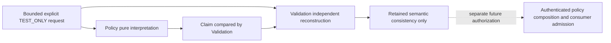

# MTR-008 — Explicit-request orthogonal plan-intent resolution

**BOUNDED DETAILED DESIGN / STRUCTURAL / TEST_ONLY**

**DESIGN READY FOR INDEPENDENT ARCHITECTURE REVIEW — IMPLEMENTATION NOT AUTHORIZED**

This is a proposed implementation-ready design, not implemented contracts or completed tests.
The owner selected **pure-only, fully explicit request interpretation and independent checking**.
It is a bounded prerequisite of MTR-008, not complete PlanPolicyResolver or ResolvedPlanPolicy.

## 1. Verified baseline, authority and evidence

- Exact design base/main: `6df908d4295d2b96260eb633e936e35e49c2285d`.
- Base tree: `700dbaccbeb2d6cb074cdd5135cdf4ae02f7851f`.
- [PR #140](https://github.com/thedusk4203/Menuto/pull/140), reviewed head
  `35588590238cb949d4a3f3cfbe626297e3f6eb5e`, merged with that identical tree.
- [Independent architecture/scope PASS 6717220960](https://github.com/thedusk4203/Menuto/pull/140#issuecomment-6717220960).
- [Post-merge receipt 6718064942](https://github.com/thedusk4203/Menuto/pull/140#issuecomment-6718064942).
- Exact base [push CI 42449622472](https://github.com/thedusk4203/Menuto/actions/runs/42449622472):
  SUCCESS, Python/web and every step green; **4,369 passed / 0 skips**, 6 retained warnings,
  SCRAM/TLS **16/16**, benchmark **22/22**, client **10/10**.
- Frozen PIV implementation remains merge `45bb2677d3eb657dcf36aaf9fc5b9e146e8bf8fa`,
  tree `19c97149aeaaf108894e7a3d01afd0db4558e9e9`; a design/docs commit never replaces it.

Direct inspection: [ADR-003](../adr/ADR-003-plan-policy-resolution.md),
[ADR-002](../adr/ADR-002-nutrition-policy-engine.md),
[ADR-010](../adr/ADR-010-independent-validator.md),
[V1.3](../MENUTO_DEVELOPMENT_SPEC_V1_3.md) §8.1/8.3/10.3–10.11/18,
[invariants](../ARCHITECTURE_INVARIANTS.md),
[dependency review](POST_MTR_006_POLICY_INTEGRATION_V2_DEPENDENCY_REVIEW.md),
[live MTR-008 acceptance](https://github.com/thedusk4203/Menuto/issues/7),
[draft request](../../apps/backend/app/domain/snapshots.py),
[Money](../../apps/backend/app/domain/units.py),
[Policy contracts](../../apps/backend/app/modules/policy/contracts.py),
[precision selection](../../apps/backend/app/modules/nutrition/synthesis_contracts.py),
[PIV contracts](../../apps/backend/app/modules/nutrition/policy_v2_contracts.py),
[PIV public facade](../../apps/backend/app/modules/nutrition/policy_v2_public.py),
and the existing import/export/compatibility guards.
The older graph was used only as a navigation aid; no graph was rebuilt.

The base CI is executed baseline evidence. Every EPI obligation below is **future work**;
neither these tests nor the proposed types exist merely because this design PR passes CI.

## 2. Scope and stopping point

Interpret exactly one declared request and preserve its independently authored four axes:

| Axis | Closed input vocabulary | Result meaning in this slice |
| --- | --- | --- |
| NutritionPrecision | RELAXED / STANDARD / PRECISION | Exact explicit comfort-precision intent; no nutritional bounds generated |
| CostPreference | LOW / NORMAL / HIGH | Preserve canonical declared preference label; no weights, tolerance or pressure generated |
| KitchenEffort | MINIMAL / NORMAL / FLEXIBLE | Exact declared effort intent; no duration, schedule or equipment feasibility generated |
| BudgetContract | NONE / TARGET / SPEND_LIMIT | Preserve typed money and requested soft-target/hard-limit distinction; no spend calculation |

STANDARD/NORMAL are values only when explicitly declared. Enum order has no numeric meaning.
No PlanningMode, preset expansion, natural-language parsing, default, profile, week context,
override merge, precedence hierarchy, learned evidence, fallback or normalization of intent.
No DailyAvailability, BudgetPressure, economic/kitchen numerical policy, full ResolvedPlanPolicy,
clinical policy, PIV admission, planner consumer or production HTTP endpoint in this slice.

AVAILABLE_TEST_ONLY means **this retained explicit declaration is structurally complete and
has been interpreted without changing its meaning**. It does not mean authorized user intent,
member goal authorship, feasible budget, safe nutrition, valid plan or permission to activate.



There is no runtime dependency on Nutrition, Planning, Households, a database or any source
publisher. Policy owns intent semantics; Validation owns independent enforcement. Nutrition
remains the owner of numeric nutrition synthesis. This graph has no Policy/Nutrition cycle.

## 3. Ownership and proposed file boundary

These are future file/module names for independent review, not edits made by this PR.

| Proposed file | Responsibility / allowed imports |
| --- | --- |
| `app/modules/policy/explicit_intent_contracts.py` | Immutable wire types below; domain contracts/units only; no resolver, checker or I/O |
| `app/modules/policy/explicit_intent.py` | Producer input validation and deterministic interpretation; own contracts, domain primitives, standard library |
| `app/modules/policy/explicit_intent_public.py` | Narrow pure producer entry point; no report-based admission/reference facade |
| `app/modules/validation/explicit_plan_intent.py` | Independent input reconstruction and claim checking; immutable companion contracts/domain primitives only |
| `tests/explicit_plan_intent_fixtures.py` | TEST_ONLY test builders; never imported by production runtime |
| `tests/test_explicit_plan_intent.py` | EPI acceptance and differential/adversarial tests |
| `tests/test_explicit_plan_intent_architecture.py` | Purity, imports, exact exports/bodies, non-authority and frozen-file guards |
| `tests/fixtures/explicit_plan_intent_compatibility.json` | New additive manifest pinned to the exact approved implementation baseline |
| `tests/fixtures/explicit_plan_intent_export_names.json` | Independently authored exact nine-name registration manifest |
| `tools/export_domain_contracts.py` | Future additive registration only, after implementation authorization |
| `tools/check_import_boundaries.py` | If required, exact contract-only companion allowance and producer/checker purity rules; no broad exemptions |

All app/test paths above are relative to `apps/backend/`. No edits to frozen
`policy/contracts.py`, `domain/snapshots.py`, `domain/units.py`, Nutrition or PIV files.
Validation must not import Policy resolver/public/limit helpers. Policy must not import
Validation. Shared immutable shapes and domain canonical serialization are allowed; shared
budget interpretation, result assembly, status selection or expected-result helpers are not.
Producer and checker maintain independently enforced resource guards with matching documented
limits. Static import/AST checks cover direct and indirect producer reachability.

## 4. Exact proposed immutable contracts

All records are frozen, `extra=forbid`, with no implicit defaults for request fields.
Literal fields and nullable fields are required keys. Integers reject bool/float/string
coercion. UUIDs accept UUID objects in model form or canonical UUID strings on the wire;
timestamps must carry an offset and canonicalize to UTC. No arbitrary Python objects.
No custom `model_construct` result is trusted: both entries reconstruct from primitive fields.

The exact proposed **nine new exported definitions** are:

| Definition | Fields / constraints |
| --- | --- |
| ExplicitPlanIntentContextV1 | `request_id: UUID`, `request_revision: strict int [0, 2^63-1]`, `household_id: UUID`, `actor_user_id: UUID`, `tracked_member_id: UUID`, `horizon: existing Horizon`, `declared_at: AwareTime` |
| ExplicitPlanIntentBudgetV1 | `constraint: NONE/TARGET/SPEND_LIMIT`, `amount: existing Money or null`; cross-field semantics in §5 |
| ExplicitPlanIntentRequestV1 | `contract_version='explicit-plan-intent-request.v1'`, `source='REQUEST_EXPLICIT'`, `environment='TEST_ONLY'`, `context: ExplicitPlanIntentContextV1`, `nutrition_precision: RELAXED/STANDARD/PRECISION or null`, `cost_preference: LOW/NORMAL/HIGH or null`, `kitchen_effort: MINIMAL/NORMAL/FLEXIBLE or null`, `budget: ExplicitPlanIntentBudgetV1 or null` |
| ExplicitPlanIntentValuesV1 | The three non-null axis literals and non-null budget; no additional semantic/numeric fields |
| PlanIntentAxisEvidenceV1 | `axis: NUTRITION_PRECISION/COST_PREFERENCE/KITCHEN_EFFORT/BUDGET`, `source='REQUEST_EXPLICIT'`, `input_fingerprint: Sha256`, `context_fingerprint: Sha256`, `value_fingerprint: Sha256`, `interpretation_version='EXPLICIT_IDENTITY_V1'` |
| ResolvedExplicitPlanIntentV1 | `contract_version='resolved-explicit-plan-intent.v1'`, `context`, `values`, `axis_evidence: tuple[PlanIntentAxisEvidenceV1,...]` exactly four in fixed order, `semantic_fingerprint: Sha256`, `environment='TEST_ONLY'` |
| PlanIntentDiagnosticV1 | `code` from §8, `path: bounded string` (canonical field path or `$`); no arbitrary source value or stack trace |
| PlanIntentResolutionV1 | `contract_version='plan-intent-resolution.v1'`, `interpretation_version='EXPLICIT_IDENTITY_V1'`, `outcome` from §8, `payload: ResolvedExplicitPlanIntentV1 or null`, `input_fingerprint: Sha256 or null`, `diagnostics: tuple[PlanIntentDiagnosticV1,...]`, `result_fingerprint: Sha256`, and fixed non-authority fields below |
| PlanIntentCheckV1 | `contract_version='plan-intent-check.v1'`, `decision: CONSISTENT/INCONSISTENT/NOT_CHECKABLE`, `reconstructed_outcome: §8 outcome or null`, `source_fingerprint: Sha256 or null`, `claim_fingerprint: Sha256 or null`, `diagnostics`, `check_fingerprint: Sha256`, and fixed non-authority fields below |

No new exported enum/base/helper models: use Literal/aliases for the finite vocabularies.
`context`, `values` and evidence record fields refer to the exact types in this table.
Reuse of frozen Horizon/Money is shape reuse only; their bodies must remain identical.

Both Resolution and Check have required fixed fields:

```text
environment = TEST_ONLY
source_authority = UNAUTHENTICATED_DECLARATION
validation_authority = UNVERIFIED_TRANSPORT
numerical_use = NOT_ADMITTED
production_admission = CLOSED
resolved_plan_policy_ready = False
planner_ready = False
activation_ready = False
```

These constants cannot be caller-promoted. A successful Check is an offline semantic report,
not an authenticated token. There is deliberately no type called ResolvedPlanPolicy and no
conversion into frozen NutritionPrecisionSelection or NutritionPolicyHandoffV2.

## 5. Budget semantics and exact money

| Declaration | Required amount | Interpretation | Explicitly not established |
| --- | --- | --- | --- |
| NONE | null | No budget cap or target declared in this request | CostPreference absent, zero budget, zero spend or no economic objective |
| TARGET | Money, including zero | Authored soft spend target | Hard guarantee, tolerance, penalty coefficient or purchasing power |
| SPEND_LIMIT | Money, including zero | Authored hard spend-limit intent for later enforcement | Any candidate/plan meets the limit; scenario set, procurement resilience or feasibility |

Money is exact `amount_minor: int [0, 9223372036854775807]`, `currency: [A-Z]{3}`.
It is a declared currency token and minor-unit integer, not proof of supported settlement
currency. No ISO registry lookup, guessed exponent, decimal-major-unit conversion, exchange
rate or case conversion. Existing Money wire meaning is retained.
Every three-uppercase-letter token is structurally retained; future economics decides which
currencies it can handle and must reject unsupported ones. The result claims no such support.

NONE plus any amount (even zero), TARGET/SPEND_LIMIT plus null, negative/float/bool/string
amount, lowercase/malformed currency, extra money fields or mixed currency structures fail.
An explicitly authored zero TARGET or SPEND_LIMIT remains zero with its original type/currency;
it is never converted to NONE, missing or division-by-zero pressure. No division occurs here.

Changing budget type does not change amount/currency when both types require money. It never
changes NutritionPrecision, CostPreference or KitchenEffort. The resolver does not compare
spend with a limit. A future relaxed alternative cannot inherit a hard-feasible label; this
slice exposes no feasibility labels at all (INV-010).

## 6. Identity, semantic independence and canonical fingerprints

Context IDs are **declared correlation values**, not verified principals, membership,
delegation, nutrition eligibility, goal authorship or database source identity.
Horizon is nonempty half-open `[start,end)`; it scopes intended use, not recurring defaults,
temporal nutrient synthesis or proof of current validity. `declared_at` is retained metadata:
no wall-clock freshness, authenticity or permission is inferred, including future timestamps.
Revision is an opaque declared sequence, not CAS, uniqueness enforcement or idempotency storage.

Define hashes using existing domain `canonical_json/canonical_hash` encoding, with distinct
`domain` tags and explicit bodies. No business derivation is shared with Validation:

| Hash | Exact preimage excluding the hash itself |
| --- | --- |
| input | `{domain: 'menuto.explicit-intent.input.v1', body: complete valid primitive request}` |
| context | `{domain: 'menuto.explicit-intent.context.v1', body: complete normalized context}` |
| per-axis value | `{domain: 'menuto.explicit-intent.axis.v1', axis: exact axis key, value: normalized explicit value}` |
| semantic | `{domain: 'menuto.explicit-intent.semantic.v1', interpretation_version: 'EXPLICIT_IDENTITY_V1', values: complete values}` |
| result | `{domain: 'menuto.explicit-intent.result.v1', body: complete resolution excluding result_fingerprint}` |
| claim | `{domain: 'menuto.explicit-intent.claim.v1', body: complete strictly parsed claimed resolution including its result_fingerprint}` |
| check | `{domain: 'menuto.explicit-intent.check.v1', body: complete check excluding check_fingerprint}` |

All objects have exact keys. For a structurally valid request with null axis, the input hash
exists; for malformed/missing-required-field/unsupported-version input, it is null. Resource
failure occurs before input hashing. Invalid budget relationships also have null input hash.
Claims cannot supply authoritative input hashes: producer and checker compute them anew.
Check source_fingerprint is the independently reconstructed input hash; claim_fingerprint is
null when the claim is not safely parseable, otherwise the claim hash above. Neither is an
endorsement of the claim. reconstructed_outcome is null only when safe reconstruction fails.
Non-success results have null payload and one deterministic diagnostic, not partial values.

Semantic equality ignores context/provenance changes and compares exact values under the same
interpretation version. Result/input identity includes context and all four declared axes.
Changing one axis changes that axis value hash and semantic hash; other axis value hashes stay
identical. Every evidence input hash changes because the complete request changed. This is
expected provenance propagation, not semantic coupling. Changing actor/revision/time changes
context/input/result/evidence hashes but not unchanged axis value/semantic hashes.
Changing currency is a semantic change even when amount_minor matches. No cross-currency order.

The four axis evidence entries must be unique and in the fixed order shown in §4. Existing
canonical hashing sorts arrays, so **array order/duplicates are validated independently before
hashing**; a matching digest cannot excuse reordered/missing/duplicate evidence. Diagnostics
are exactly one for non-success, zero for success. Raw JSON spelling/key order/whitespace is
not source identity; normalized retained semantics are. No raw request logging or audit store.

Fingerprints establish retained identity/tamper detection, not authorship. If an attacker replaces
both source and claim with a coherent alternative, offline checking can find it CONSISTENT;
it still has no authority/admission. Detecting replacement needs a separately authenticated
source boundary. This limitation must not be hidden behind a hash, UUID or TEST_ONLY label.

## 7. Producer algorithm and resource contract

Proposed signatures (future implementation, not new runtime in this PR):

```text
Policy.resolve_explicit_plan_intent_v1(source: bytes | plain-dict | ExplicitPlanIntentRequestV1)
    -> PlanIntentResolutionV1
Validation.check_explicit_plan_intent_v1(source, claimed_resolution)
    -> PlanIntentCheckV1
```

No optional report/check argument, reference-minting function, reader connection, service
callback, ambient configuration, current time, randomness, filesystem or network access.
Retain the original primitive source for checking; a result hash alone is insufficient.
No implicit PlannerRequestDraft adapter: callers of future code construct this versioned
input explicitly; any authenticated application adapter needs separate design authorization.

Producer phases, in this exact order:

1. Apply absolute limits to the source before canonicalization/model construction. For bytes,
   bounded UTF-8 JSON scanning checks depth, token/number/string limits and duplicate keys
   before ordinary recursive decoding; do not decode an unbounded nested document first.
2. Extract only supported primitive shapes. Detect missing required keys, unsupported
   contract/source/environment and malformed types as ordered below. For a model instance,
   inspect bounded field primitives and then reconstruct; never trust cached properties,
   subclass callbacks, injected extras or model validation having happened elsewhere.
3. Validate exact context, four declarations and budget shape/relationships. Axis null means
   explicit insufficiency; it cannot produce a partial successful payload. Wrong type/value
   remains invalid, not missing. Unknown fields never become optional ignored configuration.
4. Copy the three axis literals and typed budget into immutable Values without arithmetic,
   lookup or cross-axis influence. Recompute evidence and all domain-separated hashes.
5. Return AVAILABLE_TEST_ONLY with complete payload/zero diagnostics, otherwise null payload
   with the single earliest reason. Non-authority fields remain fixed for all outcomes.

Absolute implementation-owned V1 structural limits (not caller-authored budgets):

| Bound | Value / enforcement |
| --- | --- |
| Encoded input/claim independently | 49,152 UTF-8 bytes each; total source+claim at most 98,304 bytes |
| Structure | Depth at most 8; at most 2,048 primitive/container nodes per object; container at most 32 entries |
| Strings/keys | String at most 256 Unicode code points and 1,024 encoded bytes; key at most 64 ASCII bytes |
| Integers | Budget/revision at most signed-64-bit nonnegative range; pre-parser at most 19 decimal digits, then exact bound check |
| Traversal work | At most 4,096 charged visits per entry over bounded source/claim including reconstruction; no uncharged retry/recursion |
| Output | One diagnostic or exactly four evidence entries; never a source echo or arbitrarily large trace |

Integer signs/leading zeros follow strict JSON syntax; JSON floats/exponents/NaN/Infinity and
duplicate keys are rejected. Dict/model entry refuses Decimal, floats, bool-as-int, sets,
generators, cyclic structures, arbitrary mapping subclasses or objects with custom serializers.
Legitimate boolean fixed fields are allowed only in typed output claims. Wire timestamps/UUID
strings are normalized explicitly; no general string-to-enum/integer coercion or case folding.
The resource scanner accepts only exact built-in containers/primitives or exact supported
contract classes, never executes arbitrary object's conversion hooks, and detects cycles.
For contract instances it must inspect primitive stored fields with bounded traversal before
dumping; bypassed/private/extras fields cannot disappear silently through model_dump.

Limit failure is all-or-error; never truncate input, drop an axis, clip a number, omit evidence
or hash an accepted prefix. A work-count failure terminates deterministically with null payload.
Budget enum/type/metadata checks precede all hypothetical numerical operations; there are none.
These are pure structural limits, not an HTTP/hostile-ingress security boundary. Public ingress
and wall-clock execution deadlines remain a later API gate; no wall-clock lookup in this code.

## 8. Exact failure and checker semantics

Return the first diagnostic using this deterministic precedence: resource; malformed encoding /
shape / duplicate / unknown field; unsupported version/source/environment; missing required key;
context type/interval; invalid axis type/value; invalid budget relationship; null axis.
Within a phase inspect fixed field order: header, context, nutrition_precision, cost_preference,
kitchen_effort, budget; nested fields follow §4 table order. Missing keys are distinguished
from explicit null values; both are insufficiency except null context/header is invalid shape.
For a missing required key use MISSING_INPUT even though the request model cannot be built.
An oversized unknown field remains RESOURCE_EXCEEDED before unknown-field validation.

| Producer outcome | Diagnostic codes | Payload |
| --- | --- | --- |
| AVAILABLE_TEST_ONLY | none | complete scoped result |
| MISSING_INPUT | MISSING_FIELD, AXIS_UNDECLARED | null |
| INVALID_INPUT | MALFORMED_ENCODING, MALFORMED_SHAPE, DUPLICATE_KEY, UNKNOWN_FIELD, CONTEXT_INVALID, AXIS_INVALID, BUDGET_INVALID | null |
| UNSUPPORTED | VERSION_UNSUPPORTED, SOURCE_UNSUPPORTED, ENVIRONMENT_UNSUPPORTED | null |
| RESOURCE_EXCEEDED | STRUCTURE_LIMIT | null |

Additional **checker-only** diagnostic codes: CLAIM_INVALID, CLAIM_MISMATCH,
SOURCE_NOT_CHECKABLE, CHECK_RESOURCE_LIMIT. Same PlanIntentDiagnosticV1 type with the exact
union above. No diagnostic text changes the authority constants.

Validation entry bounds source and claim separately, reconstructs strict primitive input,
independently classifies non-success, independently copies axis values and verifies the
meaning/coverage of all evidence and identity fields. It independently rebuilds expected
resolution and compares the **complete body**, including outcome, nullness, context, four-axis
values, provenance, taint, fixed flags and hashes. It never accepts the claimed result/check
as an oracle and never imports/calls Policy business logic. It need not optimize anything.

| Retained source and claim | Check decision / reconstruction | Numerical use |
| --- | --- | --- |
| Complete valid source, faithful positive | CONSISTENT / AVAILABLE_TEST_ONLY | NOT_ADMITTED |
| Valid source, null axis and faithful negative | CONSISTENT / MISSING_INPUT | NOT_ADMITTED |
| Unsupported header/source/environment or invalid semantics, faithful reconstructible negative | CONSISTENT / matching non-success | NOT_ADMITTED |
| Bounded malformed bytes, faithful negative | CONSISTENT if checker independently reconstructs exact failure | NOT_ADMITTED |
| Oversized/cyclic/unsafe source cannot be safely reconstructed within check limits | NOT_CHECKABLE / null, SOURCE_NOT_CHECKABLE or CHECK_RESOURCE_LIMIT | NOT_ADMITTED |
| Valid source, wrong/missing/fully rehashed positive or negative claim | INCONSISTENT / independently reconstructed outcome, CLAIM_MISMATCH | NOT_ADMITTED |
| Malformed/tampered claim including a report masquerading as result | INCONSISTENT / reconstruct outcome if safely possible, CLAIM_INVALID | NOT_ADMITTED |

Checker resource failure has highest precedence and gives NOT_CHECKABLE, never positive
consistency. Missing retained source is NOT_CHECKABLE; a caller report cannot replace it.
Report fields are informative only. A forged CONSISTENT report is not an argument accepted by
the checker, producer or any admission facade. If passed as the resolution it fails schema
checking. No serialized report grants trusted checking or production/numerical use.

Non-success is not nutrition resolution insufficiency, hard physiological conflict, comfort
violation or solver-proven infeasibility. These domains remain distinct and are not emitted
as PlanIntent outcomes. A valid SPEND_LIMIT with zero money is available symbolic intent, not
an infeasible plan. No automatic relaxation, repair or stored mutation happens on any failure.

## 9. Compatibility, TEST_ONLY and integration boundaries

TEST_ONLY is explicit throughout request/payload/result/check and result hashes. Removing or
changing it is rejected; reconstructing a coherent new TEST_ONLY input never creates production
authority. There is no production admit API in this slice and no production source publication.
No clinical/reference content, providers, qualifications, coefficients or default rows exist here.

The result is not an input accepted by frozen PIV capture/consumer under a new purpose. It
does not mint NutritionSourceEvidence, membership witnesses, NutritionPrecisionSelection,
PolicyV2Use or leases. `STRUCTURAL_TEST_ONLY_INSPECTION` remains the only frozen purpose.
Freshly checking this result cannot expand that purpose. Future integration must freshly
authenticate explicit intent and independently check numerical sources under a separately
reviewed consumer contract. Never relabel these declared IDs as DB-observed principal truth.

No persistence, SQL, roles, privileges, HTTP endpoints or migration are needed for this pure
slice. Schema remains **0017/108**; no 0018 proposed/reserved. Rollback of future unmerged
implementation means discarding that isolated branch only; no source-history downgrade.
After any future merge, reverting an additive feature requires normal separately authorized
review; existing frozen semantics cannot be changed to accommodate it.

The current design PR changes documentation only and retains **528 exports**. Proposed future
registration adds precisely the nine §4 definitions: **528 unchanged + 9 = 537**, provided
approved implementation/schema generation confirms no accidental extra definitions.
This is a proposed manifest, not authorization to edit historical assertions now.

Future additive compatibility proof must pin all **528** existing definition bodies/hashes
from the approved base, test exact old-name survival and exact nine-name set difference, and
retain every older 515/503 hash proof and all historical frozen files (53 historical/59 full
PIV manifest pins, plus any older manifest not included in those counts). Compare bodies,
not only names/counts. Independently author the nine-name manifest; never infer expected names
by subtracting actual output. Pin all 4,369 retained test identities; no skip/xfail/deletion.

Actual baseline guards already pin 528, prior name sets and historical test preimages. Before
implementation updates exports, separately inventory all affected guards (including PIV-D31
and its approved seven-file preimage rules) and obtain explicit **narrow owner authorization**
for exact count/name metadata and adjacent comments. Prior exceptions do not carry forward.
No historical fixture/hash baseline, behavior assertion or frozen-file pin may be rewritten.
If additive registration cannot pass without broader changes, STOP for compatibility review.

## 10. Acceptance matrix — EPI001–EPI064

All 64 obligations are **future pure/adversarial/architecture tests**, not tests executed in
this docs PR. Each row requires a named test mapping and actual execution evidence in the
future implementation receipt. Parameterization may yield more executions; do not add separate
runs together and call them a full suite. Producer and checker are both exercised where relevant.

| ID | Mandatory proof |
| --- | --- |
| EPI001 | Every combination of the three three-value axes and three budget kinds resolves independently; 81 semantic combinations, explicit valid money where required |
| EPI002 | Change only precision: other values/budget and their value hashes unchanged |
| EPI003 | Change only cost preference: precision/effort/budget unchanged |
| EPI004 | Change only effort: precision/cost/budget unchanged |
| EPI005 | Change only budget type/money: other three values unchanged |
| EPI006 | No enum ordinal/weights/tolerances/minutes/pressure or clinical numbers generated |
| EPI007 | NONE requires null amount; no implied zero/target/cost preference |
| EPI008 | TARGET requires money; retains soft-target kind without hard guarantee |
| EPI009 | SPEND_LIMIT requires money; retains hard-intent kind without feasibility label |
| EPI010 | Zero TARGET available and distinct from NONE and missing |
| EPI011 | Zero SPEND_LIMIT available; no pressure division or infeasibility |
| EPI012 | NONE with money, including zero, invalid in producer and checker |
| EPI013 | TARGET/SPEND_LIMIT with null amount invalid, no fallback |
| EPI014 | Exact maximum signed-64-bit money accepted; overflow rejected |
| EPI015 | Negative/bool/float/exponent/string money rejected, no conversion |
| EPI016 | Uppercase three-letter currency retained exactly; malformed/lowercase rejected |
| EPI017 | Different currency changes semantic identity; no FX/exponent guessing/support claim |
| EPI018 | Null axis gives faithful MISSING_INPUT/null payload; no partial success |
| EPI019 | Missing required key gives MISSING_FIELD; no STANDARD/NORMAL/NONE default |
| EPI020 | Wrong type/unknown enum differs from missing; case folding forbidden |
| EPI021 | Null/malformed context, invalid UUID/revision, naive time rejected |
| EPI022 | Horizon nonempty half-open; offset-equivalent times normalize identically |
| EPI023 | Change actor/subject/household/request/revision/horizon: correct identity/hash changes |
| EPI024 | Declared/future timestamps and UUIDs never establish authentication/freshness |
| EPI025 | Context/provenance change preserves unchanged semantic/axis-value identity |
| EPI026 | Complete input includes all four axes; evidence full-source hashes recomputed |
| EPI027 | Exactly four unique evidence entries in fixed order, even with matching hash |
| EPI028 | Identical source replay deterministic across time/env/locale/process hash seed |
| EPI029 | JSON key order/whitespace and equivalent UTC spelling do not change normalized identity |
| EPI030 | No self-hashing recursion; domain tags/context and full result body pinned |
| EPI031 | Duplicate JSON keys/malformed UTF-8/NaN/Infinity rejected before permissive decode |
| EPI032 | Extra fields, PlanningMode/presets/defaults/week/overrides/learned values rejected |
| EPI033 | Unsupported contract/source/environment returns explicit UNSUPPORTED/null payload |
| EPI034 | Strict parsing repeats for model_construct/model_copy tampering/injected extras |
| EPI035 | Unknown subclass/custom serializer/mapping/generator/cyclic input cannot execute hooks |
| EPI036 | Exact byte-boundary success where shape permits; overflow fails before hashing |
| EPI037 | Depth/node/container/string/key limits and integer pre-parser enforced early |
| EPI038 | Deterministic work limit, no truncation/clipping/accepted-prefix hash or partial payload |
| EPI039 | Input/claim independent limits and combined cap; checker overflow NOT_CHECKABLE |
| EPI040 | Fixed deterministic phase/field diagnostic order for multiple faults |
| EPI041 | Valid positive independently reconstructed CONSISTENT/NOT_ADMITTED |
| EPI042 | Faithful missing/invalid/unsupported negatives independently CONSISTENT/NOT_ADMITTED |
| EPI043 | Fully rehashed changed axis result with original source INCONSISTENT |
| EPI044 | Fully rehashed budget kind/amount/currency substitution INCONSISTENT |
| EPI045 | Forged context/request/actor/revision/provenance/evidence INCONSISTENT |
| EPI046 | Missing/duplicate/reordered evidence or tampered hashes INCONSISTENT |
| EPI047 | Forged positive for missing/invalid input INCONSISTENT; no payload admission |
| EPI048 | Forged negative for valid input INCONSISTENT; no silent suppression |
| EPI049 | Forged CONSISTENT report with matching public hashes rejected as result; no report-proof argument |
| EPI050 | Full coherent source+claim replacement can be offline consistent but remains unauthenticated/non-authorizing |
| EPI051 | Missing primitive source cannot be replaced by hashes/reports; NOT_CHECKABLE |
| EPI052 | Checker detects producer-mutated return body while producer resolver is unavailable/monkeypatched to fail; no oracle call |
| EPI053 | Static direct/transitive import checks bar producer/public/semantic-helper reuse and I/O in pure paths |
| EPI054 | TEST_ONLY strip/promotion, readiness flip or production gate flip rejected even when rehashed |
| EPI055 | Result/check cannot mint frozen PIV lease, new purpose, NutritionPrecisionSelection or numeric policy |
| EPI056 | No hard-root/goal/comfort/weekly/measurement-basis or NutritionPrecision safety synthesis |
| EPI057 | No relaxation, solver infeasibility/optimality, plan safety or activation claim |
| EPI058 | No environment-selected defaults, wall-clock/global policy, DB/network/filesystem callback |
| EPI059 | Exact nine additive export names; all 528 baseline bodies/hashes and older manifests preserved |
| EPI060 | Frozen files/migrations/runtime unchanged; 0017/108, zero new SQL/roles/privileges/persistence |
| EPI061 | Retained 4,369 test identities and behavior; historical metadata edits only under new exact authorization |
| EPI062 | No consumption, scientific equivalence, clinical content/provider/qualification/default installation |
| EPI063 | Full parent issues stay OPEN/incomplete; planning/activation false, PRECOMMIT fail-closed |
| EPI064 | Future module/public inventory limited to §3; no implicit draft adapter/downstream call or new admission facade |

**New PostgreSQL obligations: zero.** No database actor/source/authority is implemented or
claimed by this pure-only gate. Existing complete real-PG regression and SCRAM/TLS remain
mandatory; tests using mocks cannot be presented as new source-authentication evidence.
Any request to add authenticated capture triggers a separate design/authorization gate with
real PG principal/household/membership/snapshot/revocation/completeness/privilege cases.

## 11. Invariant and specification traceability

| Requirement | Design enforcement / future proof |
| --- | --- |
| ADR-003, V1.3 §8.1 | Four orthogonal explicit axes, no PlanningMode/default/precedence; EPI001–006/018–020/032 |
| ADR-002, INV-001 | Precision only intent, no physiological weakening/synthesis; EPI006/055–056 |
| INV-002 | CostPreference, BudgetContract and absent pressure distinct; EPI005–017 |
| INV-010, V1.3 §10.9 | Hard-limit intent not a feasible/relaxed plan; EPI009/011/057 |
| ADR-010, INV-016/017 | Independent primitive reconstruction, no resolver oracle/report authority; EPI041–053 |
| INV-018 | Exact currency/measurement meaning retained; no implicit numeric conversion; EPI014–017/056 |
| INV-019 | Chronological physical feasibility not performed or claimed; EPI057/064; deferred |
| INV-020 | No root summary safety claim or modification to canonical nutrition truth; EPI055–056 |
| INV-028 | No learning/default promotion rewrites explicit intent; EPI032/058 |
| V1.3 §8.3 | Exact request/version/horizon identity; this output is not an activated snapshot or permission to rewrite one; EPI023–030 |

## 12. Deferred dependency and authorization register

| Gate / prerequisite | Disposition and reason |
| --- | --- |
| Pure explicit semantics and independent checking | This detailed design; implementation requires independent architecture PASS and separate owner authorization |
| Exact additive export/guard metadata scope | Implementation prerequisite; separate narrow permission, no inherited seven-file exception |
| Authenticated request capture and actor/member authorization | DEFERRED; pure IDs/hashes are not DB origin or authorship; real PG design required |
| Defaults/week/context/override source lifecycle and precedence | DEFERRED to separately bounded MTR-008 source design; no absence fallback now |
| NutritionPrecision authenticated binding and numerical consumer | DEFERRED; frozen PIV purpose unchanged; no direct cast/adapter from this result |
| Economic tolerance/pressure/scenarios; kitchen numerical limits/availability | DEFERRED separate versioned policies/source authority; labels supply none |
| Complete ResolvedPlanPolicy and activation snapshot | DEFERRED; requires all enabled policy axes, source identity and consumer admission |
| Clinical content, qualifications, applicability conversions | BLOCKED / production gate CLOSED; no fixture or engineering review supplies scientific authority |
| Feasibility, solver, Stage2 utility, preview API, Execution/PRECOMMIT | OUT OF SCOPE; separate downstream authorization and validation coverage |

No unresolved scientific content is needed to implement the **symbolic pure** scope. The
remaining review decisions are acceptance of the exact proposed contracts/statuses/limits,
nine-name manifest and independent-checking specification. They are review gates, not an
excuse to implement broader authority. Production clinical evidence is not required to copy
an explicit label but is still required before producing an actual production NutritionPolicy.

Suggested future implementation phases after separate authorization: (1) approved immutable
companions and import/compatibility proofs, (2) pure producer with negative tests, (3) separately
implemented checker with differential forgeries, (4) all 64 obligations plus complete regression,
(5) OPEN implementation PR and independent review. No implementation phase starts in this task.
Stop if frozen semantics must change, a new source/privilege/persistence need appears, report
trust/admission is required, clinical values are needed or compatibility exceeds narrow approval.

## 13. Documentation PR verification and final disposition

This design plus current notices in four status documents are the only proposed changes.
Historical design/research/implementation evidence remains intact. Verify relative links,
the exact 64 unique acceptance IDs and nine contract names, notice consistency, historical
tails, docs-only diff and original 19-file worktree hashes. Run existing Ruff, architecture,
import, OpenAPI/domain export, fixtures and benchmark guards; exact-head CI must execute the
complete **4,369-test** regression, real PG, SCRAM/TLS, client/typecheck/web build. PR receipt
records exact head/run/results; this document does not preclaim them.

Preserve **528 current exports / 503 historical hashes / 53 historical frozen files** (59 full
PIV pins), schema **0017/108**, zero new persistence/privileges. Nutrition Root, NPS v1, NRE,
MBA and PIV v2 remain FROZEN with their original identities. Full MTR-006/007/008 INCOMPLETE;
issues #5/#6/#7 OPEN. Production Nutrition/clinical gate CLOSED; planner_ready=False;
activation_ready=False; Execution NOT STARTED; PRECOMMIT FAIL-CLOSED.

**MTR-008 EXPLICIT-REQUEST ORTHOGONAL PLAN-INTENT RESOLUTION — STRUCTURAL / TEST_ONLY**

**DESIGN READY FOR INDEPENDENT ARCHITECTURE REVIEW / NO IMPLEMENTATION AUTHORIZED**

Leave the design PR OPEN / auto-merge OFF. No self-approval, merge, freeze, implementation,
production content, source capture or downstream work is authorized by this document.
