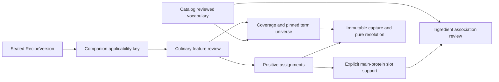

# MTR-046A — Reviewed Culinary Feature Assignment Foundation

Status: **DESIGN PROPOSAL — implementation NOT AUTHORIZED; NOT FROZEN**.
The user approved dependency selection after PR #82, not runtime implementation.
Reviewed fetched main: `b55353ca2d6f7f3461ad19bcd0f40ec15d4e54b4`.
Current schema: **0012 /58 domain tables**. No migration, runtime contract, model or export
changes in this task. All persistence/contracts below are proposals for architecture review.

## 1. Canonical basis and current facts

References: [spec§14,§19,§21](../MENUTO_DEVELOPMENT_SPEC_V1_3.md),
[ADR-005](../adr/ADR-005-grounded-recipe-variants.md),
[ADR-011](../adr/ADR-011-behavioral-learning-loop.md),
[ADR-009](../adr/ADR-009-execution-state-machine.md),
[ADR-010](../adr/ADR-010-independent-validator.md),
[invariants](../ARCHITECTURE_INVARIANTS.md), [dependency review](POST_MTR_041D_DEPENDENCY_REVIEW.md),
[040A vocabulary/source design](MTR_040A_EXPLICIT_MEMBER_PREFERENCE_REVIEW.md).

Inspected current apps/backend sources:

| Source | What exists /why it matters |
| --- | --- |
| `app/modules/catalog/contracts.py`: AffinityFeatureTermFact; `catalog/models.py` | Immutable vocabulary id/kind/code/version/definition/status/provenance, PROTEIN/METHOD/FLAVOR. No semantic source assignments. |
| `recipes/contracts.py`: RecipeFact, RecipeVersionSnapshot, RecipeVariantRuleFact | Stable Recipe, sealed authored version, slot/rule IDs, structural flags/approved combinations, tiers and adjustment envelopes. cooking_method is Identifier, not a METHOD term FK. |
| `recipes/contracts.py`: resolve_culinary_binding | Per-slot selected ingredient, exact basis/delta/quantity, path-specific net transformation. COUNT substitution rejects; no count-to-mass conversion. |
| `recipes/contracts.py`: GroundedRecipeVariantDraft.expected_fingerprint, CulinaryCandidateDraft.expected_fingerprint | Exact identities include tier/resolved quantities/transformations. These are not semantic applicability keys. |
| `planning/culinary.py`: author_binding; frozen planning contracts | Exact selected path/binding can be independently checked by accepted RecipeGroundingValidator. It does not classify features. |
| `planning/exposure_capture.py`; `learning/contracts.py` | Frozen041A captures Recipe-ID proposal evidence; frozen041B/C/D remain Recipe-ID only. No live feature lookup may be inserted into those contracts. |
| `recipes/models.py`, migrations0005/0006/0010 | Existing sealed RecipeVersion/plan binding aggregates must stay untouched. New source facts are companions, not late children of old aggregates. |
| `preferences/contracts.py` | Raw explicit member declarations, no profile derivation or caller-authored EvidenceStrength. Feature assignments are not preferences. |

Graphify is orientation only; current code and registered metadata establish the baseline.
No concrete contradiction with frozen contracts/ADRs was found.

## 2. Ownership, semantics and trade-offs

Catalog owns reusable **Ingredient→PROTEIN association**, not dish main-protein designation.
Recipes owns **RecipeVersion/applicability→METHOD, FLAVOR, MAIN_PROTEIN** source facts.
Reuse Catalog AffinityFeatureTerm identity; dimension MAIN_PROTEIN references kind PROTEIN.
An ingredient association supplies supporting evidence, never an automatic dish label.
Multiple explicitly designated co-main-protein terms are permitted; no winner/weight is inferred.

Both sources are curated global culinary data, as existing Ingredient/Recipe sources are.
They are not household/member/plan-owned. A later capture envelope is household/plan-bound;
it must not add household ownership to global culinary truth or copy one member's preference.



Write foundation is trusted internal curation, no new HTTP/auth/curator-role workflow. Canonical
service receives actor_user_id from trusted application context, never a command-authored actor.
Record actor FK to User; USER or REVIEWED_REFERENCE provenance only, separate review action.
Existing household OWNER/EDITOR roles do not grant global catalog curation authority.
SQL integrity proves shape/lineage, not that an authorized curator's culinary opinion is true.
Do not advertise production authoring authorization; a production curation UI/permission source
would require its own approved boundary. No inference/import/AI pipeline creates reviewed facts.

Choose full immutable review replacements plus stable stream/head and source frontier caches.
This costs more rows than mutable tags, but preserves correction/negative coverage/provenance.
No generic cross-domain classification table, polymorphic target UUID, dynamic expression DSL
or persisted JSON payload. Exact typed tables are proposed in§7; no additional tables merely
for behavior profiles, capture persistence or optimizer metadata.

## 3. Typed applicability key — distinct from candidate identity

Proposed frozen extra-forbid `CulinaryFeatureApplicabilityKey`:

| Field | Exact proposed type /meaning |
| --- | --- |
| contract_version | literal `culinary-feature-applicability.v1` |
| recipe_version_id | UUID of one sealed REVIEWED RecipeVersion; no latest-version reference |
| dimension | METHOD /FLAVOR /MAIN_PROTEIN |
| scope | EXACT_PATH /REVIEWED_SCOPE, with shape equivalence below |
| tier_ids | Nonempty unique tuple of same-version authored tier UUIDs; explicit finite whitelist |
| slots | Nonempty tuple of FeatureSlotApplicability, exactly one per RecipeIngredient requirement |

Each `FeatureSlotApplicability` contains these required typed controls; no defaults:

| Control | Closed union and primitive identity |
| --- | --- |
| requirement_id | Same-version authored requirement UUID, not slot name matching |
| choice | BASE (no rule ID); RULE (selected_rule_id UUID for that requirement); ANY_AUTHORED_CHOICE (no rule ID) |
| preparation | NONE; TRANSFORMATION (transformation_id UUID for that requirement); ANY_AUTHORED_PATH_CONTEXT |
| adjustment | ZERO_ONLY; AUTHORED_ENVELOPE |

BASE means the actual base ingredient; RULE means the replacement from that exact frozen rule.
ANY_AUTHORED_CHOICE explicitly asserts feature invariance across all valid authored choices
for that slot, including non-structural substitutions. It cannot authorize a new choice or
combination. NONE is explicit no selected transformation, not a wildcard. TRANSFORMATION
must be the exact selected path's net transformation. ANY_AUTHORED_PATH_CONTEXT explicitly
reviews the existing finite alternatives under this immutable Recipe cooking context.

ZERO_ONLY requires adjustment_delta=0 for that requirement. AUTHORED_ENVELOPE explicitly
accepts every valid authored delta, including existing step semantics; it introduces no wider
envelope. Actual quantities/bases still revalidate under the frozen culinary binding. No count,
mass, serving or yield conversion is performed by matching an applicability key.

EXACT_PATH iff exactly one tier, every choice is BASE/RULE, every preparation is NONE/TRANSFORMATION,
and every adjustment is ZERO_ONLY. Otherwise scope must be REVIEWED_SCOPE. This is not caller
marketing: both directions of the shape equivalence must validate. No empty/wildcard tier list.

### Feature dependencies are explicit, not uniform

| Dimension | Required context /conditional dependence |
| --- | --- |
| METHOD | Exact RecipeVersion includes immutable Recipe.cooking_method. Assignment row supplies reviewed METHOD identity, never string equality. Reviewer chooses which substitutions/preparations affect it through slot controls; other authored choices may be explicitly invariant. No alternate cooking method can be created. |
| FLAVOR | Authored multi-label property of the selected path. Reviewer specifies relevant choices, preparations, tiers and envelopes; no “spicy” name/ingredient inference. Broad invariance is an explicit review claim retained in evidence. |
| MAIN_PROTEIN | Explicit contextual designation with positive ingredient-slot support (§5). Each supporting slot must use BASE/RULE, never ANY_AUTHORED_CHOICE. Non-support slots still have explicit controls. Preparation/tier/adjustment applicability is reviewed separately; quantity is not a ranking rule. |

Thus METHOD may ignore a reviewed garnish substitution while FLAVOR distinguishes it; two
tiers may share an explicitly reviewed flavor scope while a one-tier review cannot cover both.
No dimension defaults to depending on everything or on nothing. Changes to the key require
a new applicability identity; changes to labels/coverage inside a key append a review revision.

The key never contains GroundedRecipeVariantDraft.fingerprint, candidate fingerprint, plan,
member, exact quantity amount, utility or behavioral evidence. RecipeVersion/rule/slot/tier/
transformation identities plus authored scope establish applicability. Exact candidate hashes
remain useful for capture/audit binding, not for assigning semantics or inferring family identity.

### Matching and ambiguity

Revalidate exact culinary input/source first. Match same recipe version and dimension, tier
membership, per-slot choices/preparation IDs and adjustment mode. Enforce valid structural
combination independently of scope matching: <=1 structural substitution unless the **exact**
selected rule set is an approved combination. No scope bypasses frozen COUNT substitution rules.
Registration must describe at least one legal authored path: reject impossible rule/preparation
choices or an unsatisfiable fixed combination. Check finite per-slot authored alternatives and
approved combination lists; do not enumerate an unconstrained cross-product or call a solver.
A broad scope only applies to valid authored selections inside it, never to otherwise invalid
combinations that happen to pass each local slot predicate.

For one recipe version/dimension, prohibit overlapping **active** scopes; no “first row wins”,
specificity rank, latest unrelated profile, union or silent override. A source head RETRACT makes
that scope inactive. A stale dependency does not implicitly retire a scope.

Proposed DB overlap test is conservative: tiers must intersect and each slot's allowed
(choice,derived preparation) sets must intersect. Those finite sets are derived from sealed
authored rules/transformations, never a cross-product candidate generator. ZERO_ONLY and
AUTHORED_ENVELOPE always intersect at0. If every slot can intersect, reject overlap even if
cross-slot structural combination rules would make that apparent intersection unreachable.
This deliberate false-positive may require narrower authored scopes; it cannot permit ambiguous
truth. It avoids exponential enumeration. Semantic capture rejects multiple matches as
SOURCE_CONFLICT even if DB protection is bypassed; it never chooses a preferred row.

## 4. Assignment and coverage are separate facts

Every immutable review revision carries:

- coverage: PARTIAL /COMPLETE, or absent on RETRACT;
- a nonempty explicit `covered_term_ids` universe of exact reviewed term UUIDs of one kind;
- a separate unique positive assignment set, a subset of that universe;
- review action, correction lineage, provenance/actor/time and source sequence.

**COMPLETE is relative to the pinned finite universe, not all current/future terms of a kind.**
No canonical vocabulary-release manifest currently exists.046A therefore requires the consumer
to name the term universe it asks about; it cannot invent a global latest vocabulary version.
New term/version IDs outside the reviewed universe remain unknown. Reviewing a wider universe
requires a new full review revision. No implicit aliases between term versions.

| Current evidence | Assignment state | Coverage /per-term conclusion |
| --- | --- | --- |
| No stream/matching scope, RETRACT head, or stale supporting dependency | UNRESOLVED | No negative conclusion; reason retained |
| PARTIAL with positive labels | ASSIGNED | Known positives only; every other term, including unassigned covered terms, remains unresolved |
| PARTIAL with no positive labels | UNRESOLVED | Incomplete review, not reviewed-none |
| COMPLETE with positive labels | ASSIGNED | Exact positive set only within covered universe; covered-but-unassigned terms are reviewed absent |
| COMPLETE with no positive labels | REVIEWED_NONE | Reviewed absence within covered universe only |
| Any requested term outside covered universe | UNRESOLVED for that term | No conversion of out-of-scope absence to false/zero |

NOT_APPLICABLE is intentionally not introduced in V1: it is too easy to conflate “not reviewed”,
“no term in this universe applies” and “dimension irrelevant”. REVIEWED_NONE suffices for the
supported negative claim. Classification absence is not dietary safety, novelty or penalty0.

Coverage must survive independently of positive assignments. FLAVOR.spicy with PARTIAL coverage
does not say sweet/sour are absent. A COMPLETE universe {spicy,sweet} with only spicy assigned
does establish reviewed absence of sweet; a later umami term is still unresolved. A downstream
consumer needing a full category set must supply/verify the required universe and completeness.

## 5. Ingredient associations and contextual MAIN_PROTEIN support

One Catalog stream per Ingredient, independent of Recipe/Household, stores full reviewed
PROTEIN association snapshots and the same coverage rules. No protein nutrient thresholds,
ingredient-name parsing, dominant-mass calculation or new ingredient equivalence.

Each Recipe MAIN_PROTEIN assignment requires >=1 `MainProteinSupport`:

`recipe review + assigned PROTEIN term + requirement_id + resolved ingredient_id
 + exact Catalog association review_id + association term`.

The term must be positively assigned in that Catalog review, the review must be its current
unretracted head at publication, and the resolved ingredient must come from the supporting
slot's exact BASE/RULE path. Support itself is an authored **designation**, not an automatic
promotion of every associated ingredient. No support is permitted on METHOD/FLAVOR reviews.
Every positive MAIN_PROTEIN term needs support; all support rows must back positive assignments.

For every allowed tier of a supporting slot, tier quantity×selected rule factor+minimum allowed
delta must be strictly positive; ZERO_ONLY uses0, AUTHORED_ENVELOPE uses the authored minimum.
Compute exactly with existing quantity boundaries. Conservative rejection at <=0 is intentional:
an envelope that can remove the designated ingredient must be narrowed/reviewed separately.
Positive COUNT support is semantic ingredient evidence only, never a count-to-mass conversion.

If a pinned Catalog association head later changes/retracts, do not rewrite the Recipe review.
Fresh capture marks its MAIN_PROTEIN result UNRESOLVED/STALE_ASSOCIATION until explicit re-review
pins current support, even if a new association head retained that term. This conservative
dependency rule is auditable; old captured evidence remains reproducible as-of its capture.
METHOD/FLAVOR facts do not acquire an invented dependency on Ingredient→PROTEIN history.

## 6. Exact proposed wire contracts and commands

All proposed models inherit frozen extra-forbid Contract. UUIDs, Identifier, AwareTime,
Sha256 and existing Quantity/CalculatedQuantity/RecipeVersionSnapshot/Provenance are reused.
No float, JSON-any payload, implicit quantization or new generic persisted conversion.
Every standalone aggregate/command has its own literal version; nested values are owned by it.

| Proposed contract | Required fields /closed semantics |
| --- | --- |
| FeatureSlotApplicability | requirement_id, choice closed union, preparation closed union, adjustment enum (§3); nullable IDs only in their explicit union cases |
| CulinaryFeatureApplicabilityKey | `culinary-feature-applicability.v1`, fields of§3; full source validation required, not just UUID shape |
| IngredientProteinCoverageFact | `ingredient-protein-coverage.v1`, review_id/stream_id/ingredient_id, term_kind=PROTEIN, coverage PARTIAL/COMPLETE, nonempty covered_term_ids; not a validity boolean |
| CulinaryFeatureCoverageFact | `culinary-feature-coverage.v1`, review_id/applicability_id/recipe_version_id/dimension, exact term_kind, coverage PARTIAL/COMPLETE, nonempty covered_term_ids; ownership cannot cross to a Catalog review |
| IngredientProteinAssociationFact | review_id, ingredient_id, term_id, term_kind literal PROTEIN |
| CulinaryFeatureAssignmentFact | review_id, applicability_id, recipe_version_id, dimension, term_id, term_kind; dimension↔kind equivalence enforced |
| MainProteinSupport | review_id, applicability_id, recipe_version_id, term_id, requirement_id, ingredient_id, catalog_review_id; exact ownership chain in§5/§7 |
| IngredientProteinReviewFact | `ingredient-protein-review.v1`, id/stream_id/ingredient_id, revision_no, predecessor_id, source_sequence, action REPLACE/RETRACT, coverage or null, association tuple, reviewer_user_id, provenance, recorded_at, correction_reason |
| CulinaryFeatureReviewFact | `culinary-feature-review.v1`, id/applicability_id/recipe_version_id/dimension, revision_no/predecessor_id/source_sequence/action, coverage or null, assignment/support tuples, reviewer_user_id/provenance/recorded_at/correction_reason |
| IngredientProteinWriteReceipt | `ingredient-protein-write-receipt.v1`, ingredient_id/stream_id/review_id, applied source_sequence, canonical command hash, strict replayed bool; not current-state or authority |
| CulinaryFeatureWriteReceipt | `culinary-feature-write-receipt.v1`, recipe_version_id/applicability_id/dimension/review_id, applied source_sequence, canonical command hash, strict replayed bool; no polymorphic bare target UUID |
| FeatureTermQuery | dimension, nonempty unique term_ids of its exact vocabulary kind; one query per dimension |
| CulinaryFeatureCaptureRequest | `culinary-feature-capture-request.v1`, household_id, plan_id, exact proposal_id/proposal_hash, batch_node_id, nonempty unique FeatureTermQuery tuple; no member preference or free context_ref; authenticated actor supplied outside wire |
| CapturedCulinaryFeatureSubjectDraft | `culinary-feature-subject.v1-draft`, activation_ready=False, source_kind=PROPOSAL_PREVIEW, coverage=SELECTED_PROPOSAL_CLASSIFICATION_ONLY, captured_at, exact owner/proposal/batch/path and RecipeVersion facts, requested universes, immutable applicability/review/term/association facts, explicit missing/stale markers, source frontiers and fingerprint |
| CulinaryFeatureResolutionDraft | `culinary-feature-resolution.v1-draft`, activation_ready=False, subject, deterministic per-dimension/per-term states and proof references; rederive output from full captured primitives, no cached valid=true |

Per-term resolution is PRESENT /REVIEWED_ABSENT /UNRESOLVED. Per-request status is RESOLVED
iff every requested term has a known conclusion; PARTIAL iff some do; otherwise UNRESOLVED.
This does not upgrade PARTIAL source coverage to COMPLETE: a partial source can prove one
requested positive while saying nothing about the rest of the vocabulary. Dimension assignment
state in§4 describes the review's entire positive set within its universe, not global completeness.
Unresolved reasons are closed: NO_SOURCE /NO_MATCHING_SCOPE /RETRACTED /PARTIAL_COVERAGE /
OUTSIDE_REVIEWED_UNIVERSE /STALE_ASSOCIATION. Malformed, foreign,
ambiguous or forged facts reject with structured errors, never a numeric/boolean default.

Review facts retain source_system/external_record_id/source_version, optional URI/content_hash,
observed_at and USER/REVIEWED_REFERENCE kind via Provenance. Review action/status is separate.
Require observed_at<=recorded_at<=captured_at for captured facts; future-dated source review rejects.
Correction_reason is a nonblank Label on replacement-after-initial and retraction.
Every revision fact also carries predecessor_revision_no: null exactly for revision0, otherwise
revision_no-1. Revision numbers/child counts are strict bounded signed32 integers (nonnegative);
frontiers/source sequences are strict signed64 (frontier>=0, assigned source_sequence>0).
No bool-as-integer or numeric strings are accepted for these integer fields.
Expected revision in a first-write command alone may be-1; persisted review revisions start0.
Nested coverage/assignment/support facts are not independently sufficient source truth: their
IDs/context must match the enclosing complete review and captured source manifest.

Proposed commands (no endpoints in046A):

| Command /version | Required input and behavior |
| --- | --- |
| ReplaceIngredientProteinReviewCommand /ingredient-protein-write.v1 | ingredient_id, expected_revision_no (-1 for absent), expected_catalog_frontier, predecessor_id (null initially), coverage, covered_term_ids, positive term_ids, provenance, correction_reason when required, source_system-scoped idempotency_key |
| RetractIngredientProteinReviewCommand /ingredient-protein-retract.v1 | Same owner/CAS/predecessor/idempotency/provenance; no coverage/assignments; requires an active prior REPLACE |
| RegisterCulinaryFeatureScopeCommand /culinary-feature-register.v1 | Complete key + initial REPLACE review data, expected_catalog_frontier/expected_recipe_frontier, idempotency_key; registration and initial review atomic, no empty registry commit |
| ReplaceCulinaryFeatureReviewCommand /culinary-feature-write.v1 | applicability_id + exact recipe_version_id/dimension, expected_revision_no, expected_catalog_frontier/expected_recipe_frontier, predecessor_id, coverage/terms/assignments/support, provenance/reason/idempotency; supporting Catalog head checks as§5 |
| RetractCulinaryFeatureReviewCommand /culinary-feature-retract.v1 | Exact owner/expected_revision_no/expected_catalog_frontier/expected_recipe_frontier/predecessor_id/idempotency/provenance, no review children; cannot retract an absent/already retracted head |

No command accepts caller-authored actor, recorded_at, source_sequence, head pointer, reviewed
availability/utility output or inferred labels. On retry compare canonical requested facts with
the retained command identity **before CAS**; identical replay returns original receipt without
new version/frontier increment. Different payload under the same key rejects IDEMPOTENCY_CONFLICT.
Do not claim a replayed old review is still current. Missing facts never default to NEUTRAL/0.
Canonical command identity binds the trusted actor_user_id and explicit command_kind as well as
the wire request, so another actor cannot reuse a key as their own authored review. Persist
command_kind. Record the DB-checked Catalog frontier on every Recipe review as
catalog_frontier_at_write; expected own frontier is reconstructable as source_sequence-1 and
expected prior revision as revision_no-1. These primitive audit fields make SQL recomputation
of the original command hash possible; do not hash an unreconstructable transient request.
Register hashes the supplied semantic key, not its server-generated applicability UUID.
Registering an already known key under a new command fails SCOPE_EXISTS; explicit replacement
of that identity requires its head/CAS, never an automatic upsert.

## 7. Proposed relational model and SQL integrity

**Proposal:13 new tables**, current58→prospective71 if approved without revisions. This count is
not frozen, not an implementation claim, and not a reason to retain unnecessary abstractions.
Typed assignment and coverage membership are deliberately separate. Global frontier rows are
source-owned caches, not a generic cross-domain revision registry. No stored JSONB is proposed.

| Proposed table | Owner /principal fields and relational keys |
| --- | --- |
| ingredient_protein_frontier | Catalog; singleton source key, generation bigint>=0; DB-controlled, created at0 by future migration |
| ingredient_protein_streams | Catalog; id UUID PK, ingredient_id FK UNIQUE, head_revision_no/head_review_id caches; identity immutable |
| ingredient_protein_reviews | Catalog; id, stream_id, ingredient_id, revision_no, predecessor_id, source_sequence, action/coverage, actor/provenance/time/reason, idempotency identity, assembly_xid, declared covered/assigned counts and command hash |
| ingredient_protein_review_terms | Catalog; (review_id,ingredient_id,term_id,term_kind=PROTEIN); finite review universe; composite FK to review owner and(term_id,kind) vocabulary |
| ingredient_protein_assignments | Catalog; (review_id,ingredient_id,term_id,term_kind); positive subset FK to review_terms, never a free protein label |
| culinary_feature_frontier | Recipes; singleton source key/generation bigint>=0; records new scope registrations through first review, replacements and retractions |
| culinary_feature_applicabilities | Recipes; id, recipe_version_id FK, dimension/scope/key_hash, assembly_xid, declared tier count, head_revision_no/head_review_id; UNIQUE(recipe_version_id,dimension,key_hash), UNIQUE(id,recipe_version_id,dimension) |
| culinary_feature_applicability_slots | Recipes; (applicability_id,recipe_version_id,requirement_id), choice/preparation/adjustment typed controls plus conditional rule/transformation UUIDs |
| culinary_feature_applicability_tiers | Recipes; (applicability_id,recipe_version_id,tier_id), exact same-version authored tier FKs |
| culinary_feature_reviews | Recipes; id/applicability_id/recipe_version_id/dimension, revision/prev/source_sequence, action/coverage, actor/provenance/time/reason, idempotency/hash, assembly_xid and declared term/assignment/support counts |
| culinary_feature_review_terms | Recipes; (review_id,applicability_id,recipe_version_id,dimension,term_id,term_kind); finite review universe and typed vocabulary FK |
| culinary_feature_assignments | Recipes; same review/context/term key, positive subset FK to review_terms |
| culinary_feature_main_protein_support | Recipes; review/context/term/requirement/ingredient/catalog_review IDs; FK to exact positive culinary assignment, exact slot owner and exact Catalog positive association |

All FKs RESTRICT. Use redundant key columns only to enforce ownership via composite FK,
not as independent semantic values. Requirements/tiers/rules/transformations use the existing
same-version identity keys; no frozen table/key change. Rule↔requirement and transformation↔
resolved ingredient/path consistency are checked against immutable parents in database closure
guards when not expressible by existing composite unique keys alone. Child records cannot
escape to another recipe version, scope, review, ingredient or vocabulary kind.

Review UNIQUEs: (stream_id,revision_no) or(applicability_id,revision_no), unique source_sequence
within its owner, unique(source_system,idempotency_key) per owner's review table, and
unique(source_system,external_record_id,source_version) per owner's review table. Provider
identity participates: two providers' same external_record_id do not collide. Exact source
identity reuse with different facts rejects. Cross-owner source IDs do not pretend to be one event.

Composite predecessor FK binds the exact same stream/context and prior revision_no. First
revision0 is REPLACE with null predecessor; next revision=head+1 with exact predecessor.
RETRACT requires prior active REPLACE, zero child counts, null coverage. REPLACE pins a nonempty
reviewed term universe; PARTIAL/COMPLETE shapes follow§4. All assigned terms must be REVIEWED,
observed no later than review time. Kind mapping is METHOD→METHOD, FLAVOR→FLAVOR,
MAIN_PROTEIN→PROTEIN; NULL/wrong-kind/missing target cannot bypass a check.
Mode/kind/action/context columns are NOT NULL. Conditional UUID checks explicitly require
RULE→rule_id IS NOT NULL, BASE/ANY→rule_id IS NULL; TRANSFORMATION→transformation_id IS NOT NULL,
NONE/ANY→transformation_id IS NULL. Avoid a CHECK whose NULL result accidentally permits an
incomplete union. Coverage nullability is equivalent to RETRACT, not merely a one-way implication.
The predecessor FK uses stored predecessor_revision_no, with CHECK(revision_no=prior+1),
targeting a UNIQUE(id,stream/context,revision_no). It is not an impossible FK on an expression.
Head FKs bind owner/context and head_revision_no too, not just head_review_id. Stream/context
identity caches start at(-1,NULL) only during initial assembly; committed heads always reference
a real review. Source/provenance numeric/time/string checks reuse the foundation semantics,
including finite timestamps and credential-free HTTP(S) URI when present.

### Closure and immutability without changing old seals

For these **new companions only**, propose transactional assembly with immutable declared counts/
hash rather than three additional seal tables. This is a new source design choice, not a change
to frozen RecipeVersion/plan seal semantics.

- All identity/review/child facts reject UPDATE/DELETE/TRUNCATE; only named frontier/head cache
  fields may change through protected append triggers. No generic mutable status on facts.
- BEFORE INSERT sets assembly_xid from pg_current_xact_id(), never trusts caller value. Child
  INSERT requires its new parent's assembly_xid=current xid. Another transaction can never add
  children to committed review/scope; REPEATABLE READ stale insertion also rejects.
- Immediate child limits/unique keys reject excess/duplicate children. Immutable declared counts
  plus deferred closure at commit require the full actual child sets, all authored recipe slots,
  nonempty tier whitelist, all positive subsets/support and recomputed canonical key/command hash.
  Adding a child after a complete append exceeds a count; cannot enlarge counts or delete/replace
  children. A partially assembled aggregate cannot commit or be returned as a finalized capture.
- Source append triggers bind owner/revision/CAS, advance head/frontier atomically and lock the
  owning frontier until transaction end. Deferred checks require registration's initial review,
  correct head and complete lineage. Half-assembled direct SQL rolls back on COMMIT.
- Guards protect cache changes via the defined trigger path (including ownership/monotonic-step
  checks); a spoofable session GUC is not authorization. Superusers disabling triggers are
  outside the same threat model as existing foundation. No arbitrary service-only enforcement.

This is immutable **committed** source history. No source fact/receipt is advertised as finalized
before commit; capture runs in a separate clean read-only transaction. Full implementation must
prove the count/hash/late-insert protocol below. If it cannot, stop for design correction rather
than weaken the guards or silently introduce a different sealing representation.

## 8. Concurrency, frontiers, correction and time

Two monotonic owner frontiers: Catalog association generation and Recipes classification generation.
One successful review fact consumes exactly one owner source_sequence. The first scope review
also accounts for its new key, so registering a key cannot be invisible to existing captures.
No empty stream/applicability commits. Term rows are existing immutable source identities;
there is no invented global “latest vocabulary” frontier. Capture names exact requested IDs.

Canonical classification writes use READ COMMITTED only in V1. SQL guards reject other write
isolation modes; read-only capture uses RR/SERIALIZABLE. This deliberate restriction avoids
stale read predicates in scope-overlap/dependency checks. Unsupported direct-SQL isolation fails
closed rather than depending on service convention.

Lock order: Catalog frontier first, then Recipes frontier when needed; stream/context rows in
canonical UUID order. Catalog-only writes take Catalog frontier; Recipe writes take both so
association head checks and overlap publication cannot race. Expected owner frontier/head CAS
rejects stale writes; PostgreSQL locks serialize recheck+append+head update. A global curation
write fence is acceptable initially; performance is secondary to deterministic truth.

Counterexamples: concurrent reviews at revision4 cannot both commit5; concurrent broad/narrow
scope creation must reject the second overlap; concurrent association retraction versus main-
protein publication is ordered by the Catalog fence. Retraction after publication makes fresh
capture stale without rewriting the old review. No lock on inventory/reservations is needed.

Key fields are immutable. Scope changes require explicit old-scope RETRACT plus new-key initial
REPLACE in **one transaction**, with two distinct idempotency keys. A bounded service operation
executes that pair atomically; retry recognizes both retained identities before stale-CAS checks.
A conflicting/only-part-present retry rejects, never silently repairs a half-transition. No
overlap-specific ranking is introduced. Label/coverage corrections within the same key are full
REPLACE snapshots, not deltas/union with previous assignments. Retraction never means NONE.

recorded_at is DB time, source_sequence is authoritative append order. observed_at is evidence
time, not permission to backdate current selection. Current means greatest committed revision
for that stream/key, not max(observed_at), UUID order or caller status. Later source correction
does not rewrite old captures. Retrospective scoring/effective-future classifications are deferred.

## 9. Canonical identity and deterministic capture

Applicability key hash uses a separate byte grammar, not candidate fingerprint or PostgreSQL's
noncanonical jsonb::text. UTF-8/ASCII, LF separators, final LF, lowercase canonical UUIDs:

```text
menuto.culinary-feature-key.v1
version=<recipe_version_uuid>
dimension=<METHOD|FLAVOR|MAIN_PROTEIN>
scope=<EXACT_PATH|REVIEWED_SCOPE>
tiers=<comma-joined sorted tier UUIDs>
slot=<requirement_uuid>|<choice_mode>|<rule_uuid_or_->|<preparation_mode>|<transformation_uuid_or_->|<adjustment_mode>
```

Repeat slot records sorted by requirement UUID. Enum spelling is exact; no fields/defaults
omitted; '-' is only the absent conditional UUID marker. All values are fixed enums/UUIDs;
no culinary name/string enters the grammar. SHA-256 of these bytes is key_hash; storage also
retains every typed primitive, and matching checks those primitives, not hash equality alone.
PostgreSQL frozen SQL must independently rebuild bytes/hash from rows; parity tests required.

Other proposed aggregates use canonical JSON: lexically sorted object keys, compact separators,
UTF-8, no NaN/float, sorted unordered identity sets, decimal strings through existing exact types,
UUIDs lowercase, and aware timestamps normalized to UTC. The new canonical encoder explicitly
emits its new timestamp fields with six fractional digits and Z; nested frozen contracts keep
their own canonical serialization/fingerprints, not a replacement encoding of those contracts.
Command hash includes command_kind, trusted actor and all caller-authored facts/provenance/
expected versions, not generated record IDs or recorded_at/xid/source_sequence. A frozen SQL
canonical serializer must use the same typed
normalizations and bytewise key order; do not compare native jsonb text to Python JSON bytes.
Source/snapshot identity includes DB facts, requested coverage universes and captured frontiers.

Unordered: scope slots/tiers, review term/assignment sets, main-protein supports, source manifests.
Ordered: revision/source_sequence history; exact authored RecipeVersion arrays keep existing
ordinal semantics/encoding. Future preparation steps require explicit ordinal/dependency fields,
never generic sorting. Equivalent spelling of a valid scope produces one key; adding an explicitly
allowed tier/choice/envelope changes it. Candidate quantity changes may preserve a reviewed key
only because its applicability explicitly allows them, not because hashes are loosely compared.

### Capture and pure consumer boundary

Proposed adapter in Planning orchestration coordinates Recipes/Catalog public read APIs. A clean
read-only RR/SERIALIZABLE transaction obtains current proposal/batch/RecipeVersion and exact
culinary binding; caller supplies identities/requested dimensions/term universes, not assignments.
Resolve the canonical latest selected proposal, then compare requested proposal_id/hash; do not
let the caller select a retired proposal as current. Old immutable captures remain replayable
as-of-capture, but fresh capture must bind its own current proposal and exact batch binding.
No household-proposal mismatch, absent exact binding or unsupported legacy plan path is guessed.
If exact culinary input is unavailable, fail capture with structured input-resolution error
CULINARY_BINDING_UNAVAILABLE and emit no CapturedCulinaryFeatureSubjectDraft. Do not derive
features from Recipe-ID-only041A source. Candidate-only capture may later reuse the same source
facts under a separately typed envelope; no generic plan/candidate context_ref is introduced.

Capture one coherent source cut including:

1. Exact Household/plan/proposal/batch identities, proposal hash, frozen RecipeVersion/binding facts.
2. Both owner frontiers plus current relevant heads; explicit NO_MATCH/RETRACTED/STALE markers.
3. The complete registered scope set for this RecipeVersion/requested dimensions, including
   nonmatching/retracted scopes, and each scope's contiguous review history0..head. Recompute
   matching/overlap/head/negative decisions from this manifest, not a free selected-review list.
4. Exact referenced reviewed vocabulary records and requested term IDs, including known terms
   outside coverage (UNRESOLVED), not just positive labels.
5. Main-protein support association streams, contiguous history0..current head, pinned historical
   review where needed, current heads, provenance/time. Do not omit a new retraction to make an
   obsolete positive support look current.

Global source_sequence may have gaps in a per-context captured subset because unrelated
contexts are not captured; revision_no within every captured stream cannot. The adapter obtains
the complete relevant registry/heads from canonical sources in one read transaction. The pure
core can verify the captured manifest/lineage but a self-consistent hash is not cryptographic
proof that no live DB row was omitted or changed. Future authorization must own trusted capture
selection/completeness and the full-frontier recheck. No validity/authority claim follows here.

Unknown/foreign term IDs or kind mismatches reject; known-but-uncovered IDs stay unresolved.
The pure matcher revalidates the complete captured primitive chain and recomputes per-term states.
No free witness/assignment array, DB calls, candidate ranking, repaired facts or cached is_valid.
No match is an explicit captured absence decision under the owner frontiers, not global absence.

Catalog continues not to import Recipes. Recipe contracts may read Catalog contracts; read/write
repositories stay in their owning modules. Planning adapter may orchestrate their public readers.
Proposed implementation placement: additive owner contracts in catalog/contracts.py and
recipes/contracts.py, owner persistence services behind their public surfaces, pure classification
matching in recipes/feature_resolution.py, and read-only adapter in planning/feature_capture.py.
The pure Recipes matcher is source-owned applicability enforcement, not a Learning preference
model or an Independent Validator. Future import tests must explicitly guard that new pure
module against DB/network/optimizer IO, in addition to existing Learning/Validation guards.
Existing frozen class/function bodies and schemas stay unchanged; none of these modules is
added or edited during this design task.
Learning receives only immutable contracts; no DB/Recipe runtime/Preferences mutation/optimizer.
Independent Validator remains independent: later classification validation must derive from
captured source/ingredient/participant primitives, never a planner safety/feature summary.046A
does not add that validator or production authority. Existing RecipeGroundingValidator still
checks exact authored culinary binding; it does not become an affinity/safety taxonomy validator.

Future TOCTOU: capture → pure validation → locked recheck of proposal/recipe/assignment/association
source frontiers plus exact immutable requested vocabulary identities/hashes in commit boundary
→ authorize only if all required production
capabilities exist and identities still match. A changed association/classification generation
invalidates applicability of the validated capture.046A hashes are not authorization receipts;
PRECOMMIT remains fail-closed. POSTFACT remains diagnostic, no history rewriting.
No nonexistent global vocabulary counter is assumed. If future consumers choose a mutable
current vocabulary release instead of pinned IDs, that selection needs its own source/frontier.

## 10. Forward migration proposal /rollback

After explicit implementation approval only: `0013_culinary_feature_assignments` or next available
revision, PostgreSQL18/SQLAlchemy2/Alembic. Deterministic frozen DDL/functions, no mutable ORM
metadata imports. Add proposed tables/constraints/functions/triggers only; no edits0001–0012.
Initialize two empty owner frontier rows at0. No feature defaults, term aliases, curated claims,
synthetic production labels, recipe seal changes or classification backfill from strings.

Empty up/down/up must be lossless. Downgrade locks the new tables/frontiers, preflights **all**
durable registry/review/coverage/assignment/support data and nonzero frontiers; any history,
including retracted reviews or a retired scope, aborts before dropping anything. Only migration-
created zero frontiers with no source data are removable. No lossy “all current labels empty”
exception. Existing source data remains untouched when the new slice is empty. Test current
0012→0013→0012→0013, existing populated foundation with empty new slice, and refusal with
populated/retracted classification history. Proposed total71 is subject to design approval.

## 11. Adversarial acceptance plan — future implementation tests

These are requirements, not tests implemented by this documentation task.

| Scenario | Required result /enforcement |
| --- | --- |
| METHOD code equals cooking_method string | No row-based reviewed assignment →UNRESOLVED, never auto-map. |
| Chicken-named ingredient/recipe, high protein grams, first/heaviest ingredient | No inferred association/main-protein/flavor or planner tag. |
| Ingredient→PROTEIN assigned, no recipe designation | Reusable association only, no MAIN_PROTEIN result. |
| Base chicken path vs selected tofu replacement | Exact old key does not match; broad support cannot silently retarget; new support pins tofu association. |
| Non-structural substitution changes flavor | Exact choice detects it; ANY requires explicit reviewed invariance, structural flag cannot make it invisible. |
| >1 structural rules without approved exact combination | Rejected before matching, regardless of broad applicability. |
| Key describes no legal authored path | Reject registration, not a dead scope that appears reviewed but can never apply. |
| Method change/newRecipeVersion | Old key never inherited; source assignment does not invent method or recipe equivalence. |
| NONE versus path transformation; alternate raw/cooked paths | Distinct explicit preparation semantics; no base/substitute yield reuse. |
| Different quantities in one declared envelope vs outside it | Inside may match same semantic key while candidate hash differs; outside authored envelope rejects. |
| Tier changed without explicit whitelist entry | No match; empty tier list is invalid, never any-tier default. |
| Positive COUNT ingredient support | Allowed semantically; COUNT substitution/count-to-mass/COUNT nutrition remain unsupported. |
| Supporting ingredient can reach0 in allowed scope | Reject broad MAIN_PROTEIN review; require narrower scope. |
| FLAVOR partial positive set /COMPLETE empty set /missing review | ASSIGNED partial /REVIEWED_NONE scoped /UNRESOLVED, distinct bytes/outcomes. |
| Add new term version outside reviewed universe | UNRESOLVED; no automatic alias or extension of COMPLETE coverage. |
| Caller omits/forges coverage, assignment/support, universe or cached outcome | Full capture revalidation rejects; missing never defaults to false/zero. |
| Wrong term kind, DRAFT term, cross-recipe/requirement/tier/transform/catalog proof | Pydantic and SQL FK/closure checks reject, including direct SQL at COMMIT. |
| Two overlapping scopes /simultaneous registrations | Second write rejects under source fence; pure capture also rejects ambiguity. |
| Same-transaction late child after append; next-transaction late child | Count/hash mismatch or xid guard rejects; old facts/head/frontier cannot be tampered. |
| Concurrent revision4 writes, stale CAS, wrong retry payload | One revision5, stale conflict; identical retry no extra fact/frontier; key reuse rejects. |
| Catalog support changed concurrently /after capture | Ordered write check or fresh STALE_ASSOCIATION; old immutable capture replays without IO. |
| Retraction /replacement /scope rekey | Append-only complete replacement or explicit atomic retire+register; no DELETE/UPDATE old facts. |
| SQL cache UPDATE/DELETE/TRUNCATE, assembly field override, bad child counts/hash | Database rejects under ordinary foundation threat model, no API-only correctness. |
| ProviderA/B share external ID; duplicate same provider/version | Different providers coexist; duplicate source identity rejects. |
| Unicode/provenance/timezone spelling; permuted set order | Canonical byte/hash parity SQL/Python; authored ordered arrays not generic-sorted. |
| Write RR/SERIALIZABLE; capture READ COMMITTED or dirty/read-write session | Unsupported transaction mode rejects; supported RC writer and clean RO RR capture pass. |
| New source facts during capture | Old RR snapshot coherent; fresh capture sees new heads/frontier; no authority from old hash. |
| Lossy populated downgrade /drift /frozen regressions | Fail-closed downgrade; metadata drift/export checks and all prior tests pass. |

Implementation also needs pure zero-IO/no-side-effect tests, real PostgreSQL concurrency/direct-
SQL tests, frozen contract/schema definition comparisons, full Python/PG regression, benchmark
22/22 HARNESS_SMOKE_NOT_PLANNER_V4, client/typecheck/web and PR/exact-merge CI. No old test may
be deleted/weakened, and no new migration is written in this design phase.

## 12. Scope, risks and review decision requested

Deferred: family identity, allergen/diet classification, quick/high-protein tags, RecipeStyle/
broader role coverage, TasteFit/profile derivation, RepeatPenalty/novelty/Stage-2 utility,
accepted/confirmed/member history, Execution, full026 and production PRECOMMIT. Main protein
does not imply allergy/diet eligibility. Retail AP→EP and Recipe cooking yields stay separate;
no physical inventory/reservation side effect. Full040/041/046 remain incomplete,024/020B/021 blocked.

Main trade-offs for approval: explicit finite vocabulary universes rather than invented global
releases; conservative no-overlap rather than implicit precedence; full per-slot applicability
rather than candidate fingerprints; pinned current association support; two low-volume source
write fences;13 relational tables; transactional immutable closure instead of new seal tables.
These are proposed decisions, not frozen semantics. A future defect in the protocol requires
reviewed correction, not a convenient weakening or modifications to frozen RecipeVersion.

Relevant invariants:005/006 authored possibilities,009 no probability claim,012/013 proposal vs
reality,015–021 independent primitive validation/gating,022–029 separable member behavior,
030 remains incomplete. No learning or source classification is fabricated inside a validator.

Local documentation verification: **405 existing tests passed in5.82s**, covering exposure,
cooldown/decay/penalty, explicit preferences, validation foundation/canonical review and
architecture. Architecture baseline (30 invariants/11 ADRs/50 linked tasks),16-context import
boundaries, ruff, domain/OpenAPI exports, changed-document links and whitespace checks PASS.
Diff is seven product documents only; runtime/contracts/tests/migrations/exports unchanged.
No local PostgreSQL rerun or test of these proposed contracts/SQL is claimed. Current inspected
schema remains0012 /58. Approved baseline post-merge CI40155603324 was SUCCESS (1626 Python,
645 PG,22/22 benchmark,10/10 client); task PR/exact-merge CI are verified separately at delivery.

**READY FOR MTR-046A ARCHITECTURE/DESIGN REVIEW**
