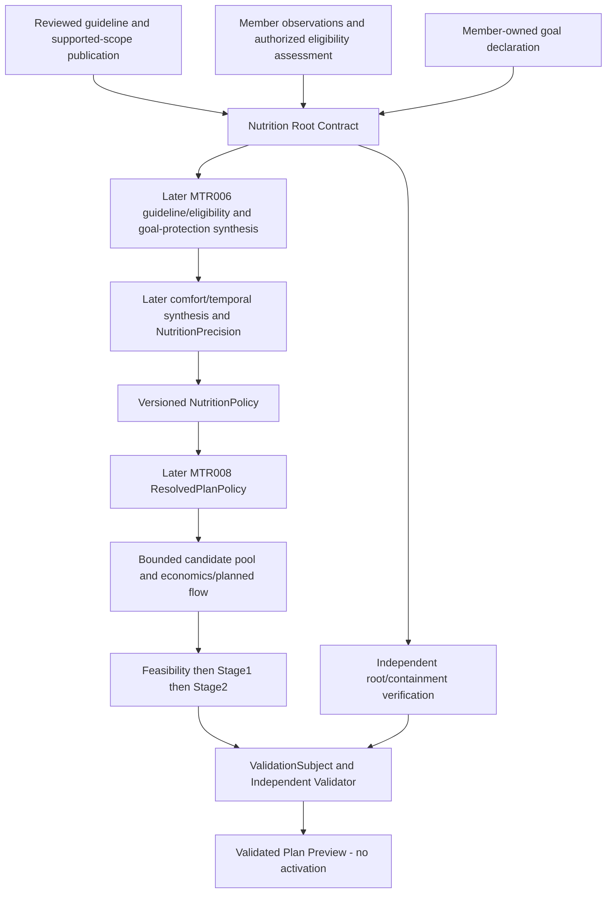

# Nutrition Root Contract & Supported-Eligibility Foundation

**DESIGN PROPOSAL — READY FOR ARCHITECTURE REVIEW. IMPLEMENTATION NOT AUTHORIZED.**

## 1. Authorized entry and exact baseline

The [approved Planner Convergence review](POST_PR_120_PLANNER_CONVERGENCE_REVIEW.md)
selected this bounded entry to MTR-006; it did not authorize implementation or nutrition content.

| Gate | Verified receipt |
| --- | --- |
| Approved PR #121 head / base | `fb81de8942cc681f8efa4ab358d8528749c3465b` / `dc7a964c4acecb0ee8995f1705f176b164e50221` |
| Formal architecture review | [6487151566 — PASS / detailed design authorized](https://github.com/thedusk4203/Menuto/pull/121#issuecomment-6487151566) |
| Pre-merge revalidation | OPEN, MERGEABLE, same exact head/base, one commit, six Markdown files, no unresolved technical thread, auto-merge OFF; exact-head CI40808154800 SUCCESS |
| Actual merge / design base | `d4167537a7347b686b1edc273b5ac9d4f5145d62` |
| Actual tree | `6b991335bc6b23f7d8f6a6ded88f04986243c577`, identical to reviewed head; parents are the exact approved base/head; six Markdown files only |
| Exact post-merge push | [40812998898](https://github.com/thedusk4203/Menuto/actions/runs/40812998898), exact SHA above, **SUCCESS**, Python/web and every required step SUCCESS |
| Execution / guards | **3,638 passed /0 skips**,5 warnings,2648.07s; SCRAM/TLS16/16;benchmark22/22;client10/10; architecture/import/export/fixtures/contracts/typecheck/build green |
| Compatibility | **403 exports;0015 /85 domain tables;no0016;ZERO NEW PERSISTENCE** for that merge.384 old definition hashes and120 frozen runtime/migration hashes retained |
| Shared-target TasteFit | Remains [FROZEN](CANDIDATE_SHARED_MEMBER_EXACT_TARGET_TASTEFIT_AGGREGATION_FREEZE_RECEIPT.md), formal receipt6485815770; no changed implementation |

Design began only after the successful exact post-merge gate. This PR changes documentation
only. The **future source implementation requires new durable authority**; zero new persistence
is a property of this docs PR/base, not an assumption about that implementation. No migration
number, physical table count, deployment role, numeric guideline or production row is reserved.

## 2. Scope, evidence and ownership

Deliver exactly the authoritative inputs and their semantic interpretation:

```text
reviewed guideline bundle + reviewed supported-scope/eligibility evidence
                         + member physiological observations + member goal declaration
        -> authenticated capture -> immutable retained sources
        -> pure Nutrition Root Contract resolution -> semantic validation
```

No four-layer NutritionPolicyEngine, comfort synthesis, TDEE/BMR calculator, nutrition optimizer,
PlanPolicyResolver implementation, medical advice, clinical knowledge base or production HTTP
endpoint. No preference/TasteFit dependency. No new milestone suffix is assigned.

Requirements: [ADR002](../adr/ADR-002-nutrition-policy-engine.md),
[ADR003](../adr/ADR-003-plan-policy-resolution.md), [ADR004](../adr/ADR-004-household-first-model.md),
[ADR010](../adr/ADR-010-independent-validator.md), [INV001–004/015–021/028](../ARCHITECTURE_INVARIANTS.md),
[Spec V1.3](../MENUTO_DEVELOPMENT_SPEC_V1_3.md) §10.3–10.4,18.1–18.3,21,24.3.
Source inspection: [Nutrition contracts](../../apps/backend/app/modules/nutrition/contracts.py),
[models](../../apps/backend/app/modules/nutrition/models.py),
[public](../../apps/backend/app/modules/nutrition/public.py),
[resolution](../../apps/backend/app/modules/nutrition/resolution.py),
[Household identity/access](../../apps/backend/app/modules/households/public.py),
[Policy coverage contract](../../apps/backend/app/modules/policy/contracts.py),
[frozen validator contracts](../../apps/backend/app/modules/validation/contracts.py).
Current mass/height/profile row_version are not guideline/goal/eligibility history;
`FOUNDATION_NO_CLINICAL_POLICY` is not a root policy. The existing graphify index was queried
for navigation only (0 extraction tokens); current source files establish these facts.

| Truth / proposed owner | Who may author it | What it cannot authorize |
| --- | --- | --- |
| Guideline bundle and supported-scope definition — Nutrition reference publication | Independently enrolled, provider-scoped guideline reviewer and publisher | Member goal authorship, member physiology or eligibility of a particular member |
| Physiological observation — subject HouseholdMember, housed in Nutrition | Authenticated self or explicitly delegated physiological-source author | Population membership, clinical clearance or guideline publication |
| Eligibility assessment evidence — member-scoped Nutrition source | Separately qualified/enrolled assessor for the exact reviewed scope/protocol | General clinical authority, member goal change, universal healthy status |
| Goal declaration — subject HouseholdMember | Authenticated self or explicitly authorized goal representative | Physiological floor, reviewed guideline, numeric goal envelope or another member's goal |
| Derived root view — Nutrition | No independent author; deterministic replay from the above | New source truth, complete nutrition policy, safety certification or plan activation |
| Independent checking — Validation | Read-only trusted capture/retained source consumer | Publishing/correcting sources, synthesis or planner authorization |
| Orthogonal policy axes — Policy/MTR008 | Future authenticated defaults/override path | Owning or publishing guideline, physiology, eligibility or goal truth |

## 3. Selected persistence/source strategy

**Select PostgreSQL-owned canonical append-only publication/member journals.** Versioned repository
artifacts, scientific documents and externally reviewed references are retained evidence for a
publication, not an alternative live source/provider/fallback. A Git commit, URI or artifact hash
cannot publish a guideline. This avoids split authority between deployment files and source rows.

Proposed durable **logical records**, not a physical schema/table allocation:

| Logical record | Need, lifecycle and concurrency |
| --- | --- |
| Nutrition reference provider, enrolled principal and source-local authority journal | Independent trust root, actual credential binding, provider remit; append grant/revoke events with generation CAS; retain enrollment/rotation history |
| Guideline draft body, content-review receipt and publication journal | Exact identity/version, complete metric/applicability/protocol content, provenance and evidence manifest; review binds whole body; immutable PUBLISH/SUPERSEDE/RETIRE/RETRACT events, provider/family frontier CAS |
| Member source delegation journal | Explicit subject, author, operation scope, effective interval, issuer/evidence and grant/revoke lineage; subject-scoped generation CAS, never inferred from household role |
| Member physiological observation journal | Append measured/declared value, unit, observed/effective interval, author and correction/retraction; member/fact stream CAS. Existing mutable profile cannot reconstruct lost historical observations |
| Member eligibility assessment journal | Scope/protocol/version, assessor, exact physiological evidence IDs/versions, outcome and evidence-completeness manifest; replacement/retraction/expiry, member/scope stream CAS |
| Member goal journal | Goal identity/type/direction, author/subject, interval, replacement/correction/retraction; member/goal-type frontier CAS |
| Command receipts / stream frontiers | Exact idempotency, full command binding, contiguous journal sequence and atomic event/frontier/receipt commit; no receipt as an independent authority token |

All ownership remains member-scoped or reference-scoped as above. No guideline row contains a
member's mass/height/goal. No root-view cache/materialized aggregate, global adherence score,
published NutritionPolicy, candidate utility or clinical registry beyond these bounded sources.

The existing `MemberNutritionProfile` remains unchanged. Its row can be retained as a legacy
context snapshot with ID/row_version/full values, but created_at is not measurement time.
Legacy values acquire no invented effective history. Use a newly authored observation with
explicit provenance/measurement interval when the reviewed eligibility protocol requires it;
do not silently import/backfill legacy values as verified observations. This journal is an
additive member observation source, not a change to old profile writer semantics or a second
global copy. Only new journal observations satisfy this gate's required observation slots.

Every observation also retains an exact current legacy-profile anchor (ID/row_version/full
body hash and preimage, or protected absence witness). A non-null legacy value for the same fact
must agree with a new observation; mismatch requires explicit member-source reconciliation through
the existing profile path followed by a new attestation, not an automatic winner. A later profile
change invalidates the dependent observation/assessment for fresh root resolution until re-attested.
Thus old profile updates cannot be silently ignored or overwrite retained observation history.
No claim is made that an uncaptured past version of the mutable profile can be reconstructed;
historical guarantees apply to complete retained input, with unavailable fresh past capture
reported explicitly rather than invented from current values.

A future forward migration is expected for the selected durable journals/protected interfaces.
**Do not reserve0016 or a table count.** No old migration may be edited. Empty source/grant/content
state is the installation default. Migration does not seed providers, qualifications, grants,
eligible members, goals or numeric policy. Future downgrade must refuse loss of authoritative
history; restore/role recreation requires explicit binding re-enrollment, not ID/name reuse.

## 4. Authentication, grants and publication authority

### 4.1 Independent credential root

Use a separately provisioned Nutrition source enrollment administrator and protected source
schema, not prior/hierarchy/Preferences grants. Dedicated non-superuser PostgreSQL logins are
enrolled with actual database OID/name, role OID/name and authenticated identity. Require
server-observed SCRAM authentication, TLS for remote connections and client server verification.
Reject trust/unauthenticated sessions, superuser/source-owner/db-owner or reachable administration/
direct-DML privilege graphs at the ordinary Interface. Recheck the privilege graph on each call;
enrollment is not a permanent exemption. SET ROLE on a shared login is not actor authentication.

PostgreSQL distinguishes authenticated `system_user`, `session_user` and effective `current_user`;
the last changes under SECURITY DEFINER. See the primary
[session identity documentation](https://www.postgresql.org/docs/18/functions-info.html) and
[SCRAM documentation](https://www.postgresql.org/docs/18/auth-password.html). These mechanics
support the selected design; existing credentials are not assumed already suitable.

The administrator provisions principals/grants through a separate audited enrollment path.
It cannot supply a caller-claimed administrator identity. Human principals bind a verified
user/curator identity at enrollment; member commands derive their actor from that binding.
Service readers have service identities and cannot masquerade as member authors. Pooling must
preserve authenticated identity; no client actor UUID, role name, session variable or author label
can select a different principal. Recreated/renamed roles do not inherit old enrollment.
The DB can enforce observed TLS/authentication; certificate/server-name verification belongs
to the trusted client Adapter configuration and its connection tests. A retained DB frame does
not prove that an arbitrary external client verified the server certificate.

### 4.2 Finite source-local capabilities

| Capability | Scope / independent authorization |
| --- | --- |
| GUIDELINE_REVIEW | Provider plus exact approved remit; may record content review of a complete immutable draft |
| GUIDELINE_PUBLISH | Same provider/remit; requires a still-valid exact-body review receipt by a different verified human, not merely a second login |
| GUIDELINE_WITHDRAW | Provider/family; may retire/retract, not publish replacements |
| ELIGIBILITY_ATTEST | Exact population-scope/protocol/version; enrolled qualification/authority basis must have separately approved evidence; no generic clinical privilege |
| MEMBER_OBSERVATION_WRITE | Exact subject/fact scope through self binding or physiological-source delegation |
| MEMBER_GOAL_WRITE | Exact subject/goal type through self binding or goal-specific delegation |
| ROOT_SOURCE_READ | Provider/family plus exact household/member read scope; read does not confer any write |
| VALIDATOR_SOURCE_READ | Purpose-scoped provider/member capture by separately enrolled read-only consumer; no authoring or activation authority |

Source-local enrollment/delegation administration is separate from the capabilities above.
Household membership/OWNER/EDITOR is necessary access context for ordinary member writes, not
sufficient representative authority. Self requires the authenticated actor's canonical membership
to link the exact subject. A representative requires a distinct actor and active exact-subject,
exact-operation delegation, issued by the linked subject or by a separately enrolled delegation
registrar acting on verified retained authorization evidence. This is not an inference of legal
guardianship. Unlinked diners without such evidence cannot acquire a goal by owner convenience.
Goal delegation does not grant observation writes, eligibility attestation or guideline publication.

Assessor enrollment requires a reviewed scope/protocol and independently verified authority/
qualification evidence. Deployment permission alone does not prove scientific qualification;
the content/qualification approval stop in §15 applies. No actual qualified person/provider is
asserted or enrolled by this design. Household participation or absence of diagnoses never grants
ELIGIBILITY_ATTEST. A guideline publisher needs a separate grant to act as an assessor.

### 4.3 Publication protocol

1. Retain a complete draft under a provider/family with immutable body fingerprint, evidence
   artifact manifest, provenance, remit, supported-scope/protocol descriptor and exact validity.
2. A credential-verified reviewer with current REVIEW grant appends an exact-body content review.
   Scientific/numeric evidence approval is recorded explicitly; structural contract acceptance is
   not numeric approval. A reviewer UUID/REVIEWED_REFERENCE label cannot substitute for this event.
3. A different verified human with current PUBLISH grant publishes that exact reviewed body and
   exact evidence/protocol versions after frontier lock. Any body/applicability/unit/evidence change
   needs a new review. Cancelled reviews, same-person aliases and mismatched hashes are rejected.
4. Withdrawal and replacement append events. Removing an author's capability does not silently
   rewrite past published truth; withdrawing erroneous content needs a RETRACT/RETIRE event.
   Retries still require current authorization before an old idempotency receipt may be returned.

Protected SQL functions own authoritative writes: fixed function names/search_path, no ordinary
direct INSERT/UPDATE/DELETE/TRUNCATE or writable-table ownership, and no PUBLIC execute grant.
Install privileges atomically; exclude writable schemas/temporary-object shadowing as described
in [PostgreSQL SECURITY DEFINER guidance](https://www.postgresql.org/docs/18/sql-createfunction.html#SQL-CREATEFUNCTION-SECURITY).
DB checks identity, grants, target ownership, body/schema semantics, review binding, CAS and
lifecycle even if Python validation is bypassed. Python-only enforcement is insufficient.
Trusted deployment superusers remain outside this hostile-caller guarantee and need audited
operational control; retained hashes are not protection against a compromised trust root.

## 5. Finite immutable source contracts

These are proposed contracts, not added exports. Structural validation rejects extra fields,
coercion, floats/non-finite values, duplicate semantic keys and unknown contract versions.

| Contract | Required semantic identity/body |
| --- | --- |
| GuidelineBundleRevision | provider/family/guideline ID, authored version and immutable revision, body/evidence fingerprint, reviewed jurisdiction/remit or explicit source-not-specified marker, publication/review refs, effective interval; complete metric roots, scope/protocol descriptor and mandatory root-key manifest |
| SupportedScopeDescriptor | source-owned population/scope ID/version, exact applicability meaning/evidence artifact, supported metric/interpretation/temporal descriptors, required observation keys and eligibility protocol ID/version/body fingerprint |
| PhysiologicalObservationRevision | household/member, fact key, value/unit, measured/declared provenance, observed/effective interval, author/delegation receipt, stream sequence, supersedes/correction/retraction refs |
| EligibilityAssessmentRevision | household/member, scope/protocol exact identity, assessment method/version, verified assessor receipt, exact input observation identities/full values, evidence manifest/completeness, effective interval, outcome and correction lineage |
| MemberGoalRevision | household/member, stable goal ID, goal type ENERGY_DIRECTION, direction CUT/MAINTAIN/GAIN, effective interval, immutable body/sequence, authenticated author/derived authorship, delegation where applicable, replacement/correction/retraction refs |
| NutritionRootRequest | one household/member, one explicit provider/family/bundle revision/body pin, one scope/protocol pin, valid_at and explicit temporal assessment context; one member goal type; no latest/current/provider fallback switch |
| NutritionRootSourceSnapshot | full request and source bodies/journal prefixes, grant/review/enrollment/member identity/delegation evidence, absence witnesses/frontiers, DB capture frame and complete manifest, source fingerprint |
| NutritionRootContract | exact subject and source identities/pins; eligibility/goal/source states; applicable hard roots and target references only if complete; effective intersection, diagnostics/proof refs; full source/result fingerprints; synthesis/planner/activation non-authority literals |

First version selects **one explicit reviewed bundle**, not multi-provider synthesis or a generic
rule language. The whole bundle's mandatory roots are retained and checked; a caller cannot omit
an inconvenient metric or request a favorable subset. Metric IDs/units, supported population and
required observation keys come from the reviewed scope descriptor, not names guessed by code.
New metric/fact interpretation needs separately reviewed content and supported contract handling.
An unknown key is unsupported, not a free extension point or permission to execute source text.
The mandatory hard-root manifest must be nonempty and contain GUIDELINE_HARD entries;
TARGET-only material may be retained as reference evidence but cannot produce an AVAILABLE
Nutrition Root Contract. Completeness of the required hard-root set is a reviewed content
obligation for the exact scope, never inferred from the presence of a few numeric clauses.

The existing physiological facts are mass/height, not age, pregnancy, diagnosis or clinical
clearance. This design creates no fictional applicability categories or assumption of healthy
adult status. Required additional facts/assessment evidence must be provided through an explicitly
reviewed protocol and authorized source. Without them the resulting eligibility is UNKNOWN;
population/content enablement remains a prerequisite, not something filled with fixture values.

## 6. Supported eligibility: evidence admission, not a clinical inference engine

The first version admits an authenticated, scope-specific **reviewed assessment assertion**.
It does not compute clinical eligibility from mass/height, an age heuristic or an arbitrary
predicate script. The approved source protocol defines required evidence and the meaning of its
assertion; its issuer must hold ELIGIBILITY_ATTEST for that exact protocol. All referenced
observations must exist, match the captured current applicable revisions and cover valid_at.
Assessment assertions cannot be detached from the physiology they assessed.

| Result | Exact condition |
| --- | --- |
| SUPPORTED | Exact reviewed protocol admits a positive ADMITTED assessment; all required observation/evidence slots have explicit valid known values and matching identities, with complete assessed scope coverage; no conflicting active assessment |
| UNSUPPORTED | Authenticated complete evidence positively records OUT_OF_SCOPE for this exact reviewed supported scope; this says the product does not support it, not that planning is medically unsafe |
| INELIGIBLE | Authenticated assessment explicitly records EXCLUDED under a reviewed exclusion meaning/protocol; retain that meaning and evidence; no general medical conclusion is inferred |
| UNKNOWN | No assessment, UNDETERMINED assessment, missing/expired observations, incomplete evidence, absent protocol authority, ambiguity or mismatch; retain distinct reason codes, not a safe/unsupported default |

No classification from absence of diagnosis/restrictions, empty safety arrays, mass/height alone,
synthetic bands or goal direction. A clinical/unsupported population cannot be admitted through
unknown evidence. All non-SUPPORTED states withhold usable roots. A known direct exclusion and
an unrelated missing fact are both reported; missingness cannot erase a known exclusion. If
evidence conflicts or protocol identity is invalid, no SUPPORTED result may be returned.

State selection is deterministic: malformed identity/journal data rejects the input; ambiguous
or conflicting active assessments yield UNKNOWN with conflict diagnostics. Otherwise a valid
EXCLUDED assertion whose own required proof is complete yields INELIGIBLE, then a valid positive
OUT_OF_SCOPE assertion yields UNSUPPORTED; remaining missing/undetermined evidence yields UNKNOWN;
only fully covered ADMITTED evidence yields SUPPORTED. Missing proof required by the exclusion
itself cannot establish INELIGIBLE. Unrelated missing slots remain observable beside a proven
negative result. The one-active-assessment stream rule forbids caller-selected outcome priority.

An assessor is the accountable source of a reviewed assertion, not a bypass for missing evidence.
The protected path checks required slots, coverage, exact observation binding and protocol approval;
the pure resolver checks them again. Scientific completeness/qualification approval is external
reviewed content under §15, never an unverified boolean supplied by the member or caller.

## 7. Root direction, quantities and containment

### 7.1 Measurements and finite interpretation

A MetricRootDescriptor binds the reviewed metric identity, quantity kind, explicit unit,
population/scope, interpretation role, temporal context and guideline revision. These are ordinary
nutrition measurements, not a new general coordinate/compatibility framework. Initially support
energy and nutrient-mass quantity kinds. The finite initial metric/unit pairs mirror the existing
composition facts: ENERGY/KCAL, PROTEIN/G, FAT/G and CARBOHYDRATE/G. This grants no clinical
applicability or required threshold to any pair. Other nutrients/units require separately reviewed
contract and calculator support; unsupported mandatory metrics block the whole bundle rather than
being dropped. Unsupported nutrient/unit combinations fail, with no guessed conversion or raw/cooked
food-basis substitution. Quantities are canonical exact rationals; strict integer numerator and
positive denominator, reduced form; no rounding/clipping/float coercion. No actual amount is
authored in this design. Nonnegative measurement semantics do not assert a zero nutrition floor.

| Typed variant | Meaning and mandatory body |
| --- | --- |
| RANGE / GUIDELINE_HARD | Inclusive lower L and upper U in one exact descriptor; L≤U |
| MINIMUM / GUIDELINE_HARD | Inclusive lower L; does not invent an upper limit |
| MAXIMUM / GUIDELINE_HARD | Inclusive upper U; does not invent a lower limit |
| TARGET / REFERENCE_CENTER | Exact source-authored center T; objective/reference only, not a safe range or automatic hard floor. A reviewed hard equality must explicitly use RANGE with equal bounds |

One unambiguous root per metric/temporal/role key in the selected bundle. Duplicate/conflicting
clauses fail publication/replay; do not average, silently intersect conflicting authorities,
pick the latest favorable value or interpret numeric sign as semantic state.

### 7.2 Authority layers remain distinct

- Guideline/physiological hard roots originate only from the applicable reviewed bundle.
- The member goal declares direction/intent only. CUT/MAINTAIN/GAIN is not a numeric rate,
  clinical prescription, energy envelope or permission to violate a guideline.
- A later reviewed MTR006 baseline/goal-protection policy may derive a goal envelope. It must
  cite this goal and root plus its own exact baseline/source/policy. No TDEE, BMR, goal rate
  or baseline amount is inferred here; numeric goal protection remains NOT_SYNTHESIZED.
- Comfort and weekly/temporal policy synthesis are NOT_PERFORMED. Root temporal applicability
  is source truth; it is not a generated daily band or weekly average.
- NutritionPrecision, CostPreference, KitchenEffort, BudgetContract, convenience and TasteFit
  are not inputs to source root resolution and cannot mint, widen or replace hard roots.

### 7.3 Independent containment obligations

For identical metric/unit/population/temporal descriptors and exact source binding:

- A derived RANGE inside hard RANGE requires derived lower≥L and derived upper≤U.
- Under MINIMUM its protected lower cannot be below L; under MAXIMUM its protected upper
  cannot exceed U. Converting a missing opposite bound into a clinical limit is forbidden.
- Goal envelopes and any comfort bands required to be contained must satisfy all applicable
  hard roots. A target center, if claimed within a protected range, must lie in it.
- Goal-direction claims must cite the member goal plus separately approved baseline/protection
  policy; a direction label alone cannot prove a quantitative cut/maintain/gain relationship.
- A mismatch in units, metric, source revision, applicability or temporal scope is an error
  **before** containment arithmetic. No implicit unit or daily↔weekly conversion.

Root scope uses explicit half-open effective intervals, aware timestamps and a declared calendar/
timezone plus exact period identity when a day/week is intended. Same word WEEK is not the same
period. A weekly root does not imply per-day bounds; daily roots do not authorize multiplying a
number of days into a weekly policy. Such synthesis needs separately reviewed temporal rules.
The consumer's entire claimed interval must be covered, not just its starting point. If a source
changes mid-horizon, split into separately pinned complete segments in a future approved consumer;
this first resolver rejects a request that needs unimplemented cross-version stitching.

## 8. Goal and member-source lifecycle

Only ENERGY_DIRECTION goals are admitted initially; no weight-rate target, medical goal taxonomy
or multi-goal aggregation. Exactly one applicable goal state per member/type at valid_at and
captured knowledge frontier. An absent goal is ABSENT; a tombstone is RETRACTED; neither means
MAINTAIN, neutral, zero or “use another member's goal”. Goal direction does not affect eligibility.

All journals are append-only. Events bind predecessor ID, expected stream frontier, full new body,
effective interval, actor receipt, reason and idempotency key. REPLACE supersedes an explicit prior
revision from its effective boundary; RETRACT creates an explicit unavailable segment; CORRECT
identifies the erroneous revision and supplies a new authenticated revision or tombstone.
Future-dated replacement leaves the preceding state valid before its explicit transition time;
it does not immediately delete the current goal. Retraction does not resurrect older declarations.

The protected path rejects overlapping active segments and ambiguous successors for the same
semantic stream. A correction cannot silently truncate unrelated intervals; it must identify all
replaced segments and their exact replacement interval coverage. Concurrent commands use CAS;
two successors of the same frontier cannot both commit. History is never UPDATE/DELETE'd.

Two times remain distinct: effective/valid time authored in the permitted command, and recorded
transaction order stamped by DB under the stream lock. A retrospective correction changes what
the newer knowledge cut says about that past interval; it does not rewrite what an older retained
snapshot knew. No request-supplied recorded_at or invented global wall-clock cutoff replaces the
retained sequence/frontier. The same lifecycle applies to observations/assessments, with required
new assessment whenever a referenced observation is corrected, retracted or replaced in that cut.
Old retained assessments still replay historically; current resolution cannot reuse stale input IDs.

## 9. Guideline/applicability lifecycle and explicit selection

Stable guideline/family identity is separate from authored version and immutable revision.
Provenance retains source document title/edition/URI/content identity, jurisdiction where the
source defines one, review and publication identities, exact applicability and effective interval.
Missing required jurisdiction/applicability evidence is unresolved, not a universal scope.

PUBLISH establishes a reviewed revision. SUPERSEDE explicitly links old/new versions and the
transition boundary. RETIRE ends future applicability; RETRACT withdraws erroneous material
under an explicit effective boundary and reason. All are append events; no payload mutation.
Successor publication does not automatically satisfy a request pinned to its predecessor.
Old pins remain available for valid historical replay, not silent reuse outside their interval.

Require one exact provider/family/version/revision/body/protocol pin. No latest/current lookup,
provider discovery, cross-provider combination, implicit fallback, environment-chosen bundle or
universal reference number. Pinning alone is insufficient: the resolver verifies that revision
was an applicable active state at valid_at in the retained knowledge cut. Active conflicts or
duplicate immutable identity with different bodies fail instead of choosing a favorable pin.

## 10. Protected write ordering and concurrency

Commands use a strict discriminated envelope for enrollment/authority, review/publication,
withdrawal, delegation and member observation/assessment/goal events. The trusted administrative
path remains isolated; ordinary callers cannot dispatch an admin command through a shared method.

For writes: validate bounded transport; identify actual authenticated principal; lock provider/
member authority and affected stream/frontier rows in fixed order; recheck actual privilege graph,
current grant/delegation and exact actor/subject; then look up idempotency; check expected frontier
and full body/review/lifecycle; atomically append event, advance frontier and record receipt.
Operations touching both provider and member lock provider authority before member authority,
then semantic streams by canonical key. All writers, including revoke, use the same ordering.

An exact same key/full canonical command by a still-authorized principal returns its receipt;
same key with different actor/subject/body/interval/pin fails. Keys are scoped to source/principal/
stream, never a cross-member cache. Revocation racing a write serializes through the authority
lock. A retry after revocation is denied before old receipt disclosure. A revoke after a capture's
MVCC cut does not retroactively erase its historical evidence or prove current permission.

Protected publication and member paths reconstruct the canonical enrolled actor, membership/
delegation, review, source identities and referenced observations from DB; caller JSON/hash is
not authority. SQL must reject invalid union shape, units, duplicate mandatory keys, bad interval,
ambiguous successor and forged source joins even when the Python caller is bypassed.

## 11. Capture frames and pure replay

### 11.1 Interface and Module placement

Proposed additive Nutrition Modules: `root_contracts`, `root_sources`, `root_capture`,
`root_resolution`, and a small `root_public` Interface. No edits to frozen contracts or Preferences
companions/import grants. Conceptual ordinary operations:

- append a typed source command on an explicitly supplied caller-owned write transaction;
- capture root sources on an explicitly supplied clean read-only transaction;
- resolve retained root sources, pure;
- validate/recompute a returned root result from its complete retained sources, pure.

Enrollment remains a separate privileged operational Interface, not a runtime default provider.
One concrete PostgreSQL Adapter is selected; do not add a generic provider/plugin framework.
Caller owns transactions, connections and rollback. No implicit commit, engine creation,
permission elevation, live reference fetching or partial capture/retry of one favorable record.

### 11.2 Coherent capture

First version captures all Nutrition journals, enrollment/grants and canonical member identity
through one actual authorized Nutrition reader connection on the same database in a clean,
read-only REPEATABLE READ or SERIALIZABLE transaction. Protected read verifies ROOT_SOURCE_READ
or VALIDATOR_SOURCE_READ **and** exact member/household access. A constrained protected SQL read
seam verifies canonical Household membership/identity and legacy profile facts on that same
connection and returns the existing owner contracts. Only the protected function owner receives
the necessary scoped read privileges; ordinary Nutrition readers receive no unrestricted source
table SELECT, no Household/Profile mutation right and no private ORM import grant. This follows
the existing protected-source identity reconstruction pattern, not a second ownership model.
If owner isolation requires separate
sessions/cuts, that deployment is unsupported in this version rather than asserting common MVCC.

Capture frame retains actual database endpoint/name/OID, authenticated role/identity, actor/service
binding, isolation/read-only flags, source-reader grant evidence, session/transaction identity,
capture start/end, authority generations and per-stream recorded frontiers. Retain complete
provider authority and selected guideline-family journal prefixes, full selected member goal/
observation/assessment/delegation histories and absence manifests, all referenced review/evidence
bodies and required immutable identities. Do not retain unrelated members' private histories.

No missing source is inferred by omitting a row. Absence requires the authorized complete stream/
frontier witness. Explicit whole-capture server-owned byte/row/integer/time bounds fail all-or-error;
no truncated history/source subset. Auth/read failure returns no partially usable snapshot.
External evidence bodies needed for replay must already be retained at publication; capture does
not download a URI. Root flags/hashes supplied over the wire cannot invoke the trusted capture path.

### 11.3 Deterministic resolver

Reparse strict contracts; verify domain-separated canonical fingerprints; reject duplicate typed
immutable IDs with conflicting bodies; reconstruct enrollment/authority and stream prefixes;
verify exact request/provider/bundle/protocol/subject bindings; evaluate lifecycle at valid_at;
verify observation and assessment coverage; derive eligibility/goal states and applicable roots.
Recompute every retained publication/assessment needed by the full source manifest, not only
the visible selected bounds. Collect stable sorted reason/proof sets; then compute the source
interval intersection and result identity. Any required unavailable state withholds usable roots.

No DB/network/filesystem access, wall-clock read, mutable global lookup, environment-selected
numeric value, callback to a live clinician/guideline provider or cache. Canonicalization sorts
unordered identities, preserves journal/temporal order, normalizes exact amounts/UTC times and
hashes full histories, tombstones, unselected revisions, authorizations, frames and diagnostics.
Output descriptor/pins are constructed after their input-body hashes; no recursive self-hashing.

The result distinguishes root availability from SUPPORTED eligibility and PRESENT goal; every
component status remains observable. `policy_synthesis=NOT_PERFORMED`,
`numeric_goal_protection=NOT_SYNTHESIZED`, `planner_ready=False`, `activation_ready=False`.
AVAILABLE means source-complete applicable root inputs only, never a safe diet or complete policy.

Historical retained input needs no current live login/grant/publication state. Replay verifies
retained self-consistency and permission events at the recorded cut, not current authorization
or canonical database origin. A coherently forged entire journal cannot be disproved by its own
hashes; trusted fresh capture is the ingress seam. No portable root fingerprint is an authorization
token. Result validation re-derives all fields from primitives; cached/model_construct/copy results
are untrusted, including nested rows and unavailable diagnostics.

## 12. Missingness and failure matrix

| Condition / diagnostic | Observable state and action |
| --- | --- |
| GUIDELINE_UNAVAILABLE | Authorized complete capture proves requested publication absent; no usable roots |
| GUIDELINE_NOT_APPLICABLE | Known source applicability differs from exact scope/metric/period; no fallback |
| ELIGIBILITY_UNKNOWN / INSUFFICIENT_EVIDENCE | UNKNOWN with explicit missing slots; never healthy/default adult |
| MEMBER_UNSUPPORTED | UNSUPPORTED with positive out-of-scope evidence; distinct from unknown |
| MEMBER_INELIGIBLE | INELIGIBLE with exact reviewed exclusion evidence; no broader clinical claim |
| GOAL_ABSENT | ABSENT goal and unavailable complete root input; no MAINTAIN default |
| GOAL_RETRACTED | RETRACTED tombstone preserved; no prior goal resurrection |
| GOAL_INVALID / GOAL_AMBIGUOUS | Invalid type/direction or overlapping/conflicting state; no usable result |
| PHYSIOLOGICAL_INPUT_MISSING | Required observation absent, untimed legacy value or unrecognized fact key; UNKNOWN, no synthetic replacement |
| PHYSIOLOGICAL_SOURCE_CHANGED | Referenced observation corrected/replaced/retracted at cut; assessment stale, UNKNOWN pending new evidence |
| SOURCE_OUT_OF_EFFECTIVE_RANGE / SOURCE_RETIRED / SOURCE_RETRACTED | Keep exact temporal/lifecycle cause and old history; no current usable roots |
| SOURCE_AUTHORITY_UNAVAILABLE / CAPTURE_ACCESS_DENIED | Live capture fails all-or-error, no source enumeration or partial result; offline replay never claims current permission |
| SOURCE_AUTHORITY_EVIDENCE_MISSING | Incomplete retained authority/review journal is malformed/unverifiable, not canonical absence or permission |
| VERSION_MISMATCH / CONTRACT_VERSION_UNSUPPORTED | Reject rather than reinterpret under current code/default policy |
| UNIT_MISMATCH / METRIC_MISMATCH / TEMPORAL_SCOPE_MISMATCH | Reject before comparing amounts or containment |
| ROOT_TYPE_UNSUPPORTED / APPLICABILITY_UNRESOLVED | No unsupported nutrient/operator/category silently converted to a safe range |
| SOURCE_CUT_INCOHERENT / FINGERPRINT_MISMATCH | Malformed/tampered retained input; no usable derived result |

Capture authorization/transport failure and malformed/tampered input are errors, not successful
empty snapshots. Well-formed authorized absence/unsupported evidence can return a diagnostic
UNAVAILABLE root result with complete retained lineage. No status becomes zero, neutral, no
restriction, a default target or a clinical-safe range. Numeric zero, if ever explicitly approved
in actual source content, is a value rather than an absence sentinel.

## 13. Independent Validation handoff

Propose an additive `NutritionRootValidationInput` containing full retained primitive sources,
the claimed root result and explicit verification scope. Validation gets only immutable shared
contracts/measurement primitives, never imports/calls `root_resolution`, producer semantic
validation, NutritionPolicyEngine, Policy resolver or planner helpers for correctness decisions.

Validation independently reconstructs publication/review/grant/delegation and member stream
state, exact scope/protocol and observation dependencies, eligibility and goal identity/authorship,
effective interval and root clauses. It compares the claimed result and all identities against
that reconstruction. Shared Pydantic validators enforce transport shape only; business admission,
selection, lifecycle and containment checks have an independent Validation implementation.

Two explicit coverage scopes prevent false completion:

- ROOT_SOURCE_CONSISTENCY_ONLY: independently check the above source/root claims. No claim
  that a derived NutritionPolicy's comfort/goal/weekly rules have been checked.
- ROOT_AND_DERIVED_CONTAINMENT: a later MTR006 handoff supplies mandatory typed derived
  constraint claims with root/metric/unit/temporal pins and baseline/goal-protection provenance.
  Validation evaluates the inequalities in §7 itself; absent required claims are unsupported,
  not vacuous success. This claim carrier is not a NutritionPolicyEngine or utility schema.

The future report exposes covered checks/findings/root and source hashes; remains non-activating.
The existing frozen025 subject still says root policy DEFERRED; its literal/hash/report decisions
are unchanged. A new companion/report does not clear all of026, produce a full preview pass,
issue PRECOMMIT, activate a plan or certify scientific correctness of reference publications.
Mutations with recomputed superficial hashes must be caught independently, not merely by
calling the producer's same business checker. Offline origin/current-permission limits remain.

## 14. Handoffs to MTR006, MTR008 and preview



MTR006 remains OPEN/incomplete. A root input can be resolved without running four-layer
synthesis; goal direction is source intent, not a goal energy envelope. MTR008 consumes pinned
root/NutritionPolicy identities and their complete applicability/source manifests. It continues
to own independent NutritionPrecision/CostPreference/KitchenEffort/BudgetContract and request/
week precedence, not guideline publication or member goal truth. It must not recompute or edit
roots to fit convenience/cost. Missing required nutrition policy still blocks complete resolution.

The approved bounded020A all-survivor route is unchanged: future pool design binds the complete
canonical source/pool, uses server/system-owned limits, rejects overflow and never truncates or
claims infeasibility outside the declared complete pool.020B is not implemented or completed;
if role portfolios are required, missing novelty/role/context sources return as dependencies.
No taste refinement, full039/041/046, Execution or activation is smuggled into this source design.

## 15. Numerical evidence stop and implementation gates

**This design approves no production nutrition content.** No calorie floor, nutrient target,
percentage, clinical cutoff, goal rate, coefficient, synthetic reference value, actual supported
population category or BMR/TDEE safety heuristic is supplied. L/U/T in §7 are mathematical
symbols only, not fixture or production amounts. Domain unit semantics and rational-order
algebra are not reviewed medical thresholds.

Before production numeric publications or actual SUPPORTED assertions may ship, independently
approve: exact reference edition/jurisdiction, metric/type/temporal applicability, complete
supported/excluded population meaning, required physiological evidence and assessment protocol,
qualified reviewer/assessor authority, values and scientific rationale. Publication capability
cannot replace that content approval. No numeric file, seed, environment value or generic
REVIEWED_REFERENCE label is accepted as an emergency substitute.

Structural implementation, if later explicitly authorized, may start with empty source state
and isolated disposable TEST_ONLY synthetic/symbolic fixtures. Those do not satisfy production
content gates and may not be reachable through production provider enrollment/selection. No
tests are implemented in this PR. If a later design/change cannot keep source semantics separate
from numerical/clinical content authority, stop and identify the missing evidence/authority gate.

Current source/authority prerequisites are **not satisfied by this document**: no enrolled
nutrition publisher/assessor, approved numeric bundle, population protocol or member assessment
exists as a result of writing it. They are explicitly specified source classes/content gates;
their absence blocks production availability, not the ability to review this source/contract design.
Implementation/migration authorization remains separate, including approval of physical schema,
credential provisioning and protected SQL parity. No migration0016/table count is reserved.

## 16. Acceptance plan — NRC01–NRC80, future only

**80 future acceptance cases; zero NRC tests exist or were executed in this PR.**
PG rows are **32 required actual PostgreSQL authority/integration obligations**, not32 mocked,
collected-only or claimed existing test executions. Each needs authenticated distinct roles,
protected paths, committed/concurrent transactions where specified and real source recapture.
P=public pure replay/transport; V=independent Validation; A=architecture/compatibility.
PG cases also need corresponding pure tamper/replay negatives where meaningful; parameterized
test expansion may increase eventual execution count without changing these80 obligations.

| Case | Layer | Required proof |
| --- | --- | --- |
| NRC01 | PG | Empty enrollment/source installation grants nobody publication or default content |
| NRC02 | PG | Real SCRAM success; missing/wrong credential and trust authentication denied |
| NRC03 | PG | Actual database/role identity binding; SET ROLE, forged actor/session data rejected |
| NRC04 | PG | Unsafe/elevated/direct-DML privilege graphs rejected and rechecked after enrollment |
| NRC05 | PG | Guideline provider/remit capability isolation; prior/hierarchy/household grants do not transfer |
| NRC06 | PG | Actual guideline REVIEW with scientific evidence body/version pin |
| NRC07 | PG | PUBLISH requires current publisher plus exact active content-review receipt |
| NRC08 | PG | Same verified human using multiple logins cannot self-review/publish |
| NRC09 | PG | Changed body/unit/applicability/evidence/protocol requires fresh review |
| NRC10 | PG | Reviewer/publisher revocation and retry ordering before idempotency lookup |
| NRC11 | PG | Direct SQL bypass cannot forge review, root type/unit/interval or mandatory keys |
| NRC12 | PG | Concurrent guideline publication CAS; one successor, atomic history/frontier/receipt |
| NRC13 | PG | Exact retry succeeds only while authorized; changed same-key command rejected |
| NRC14 | PG | Scheduled supersession, retirement and retraction preserve exact historical publication |
| NRC15 | PG | Member self actor derives from authenticated account-to-member binding |
| NRC16 | PG | Representative requires exact goal-specific authorization; household role alone denied |
| NRC17 | PG | Delegation issuance evidence, scope, expiry/revoke and concurrent retry behavior |
| NRC18 | PG | Another member/household cannot copy or author a goal; service reader cannot become self |
| NRC19 | PG | Goal replace/retract/correct lifecycle and future-effective transitions are append-only |
| NRC20 | PG | Concurrent member goal CAS and cross-subject idempotency isolation |
| NRC21 | PG | Physiology observation ownership, unit/provenance/time, legacy anchor agreement/absence and explicit re-attestation |
| NRC22 | PG | Observation or legacy profile change/correction/retraction invalidates dependent assessment in fresh capture |
| NRC23 | PG | Assessor needs exact reviewed scope/protocol qualification grant, separate from publisher |
| NRC24 | PG | Assessment binds exact member/observations and complete required evidence; partial/forged inputs denied |
| NRC25 | PG | Real sources yield distinct supported/out-of-scope/excluded/undetermined outcomes with their evidence |
| NRC26 | PG | Reader and validator-reader scope isolation; unauthorized capture discloses no partial member/source data |
| NRC27 | PG | Clean same-session read-only RR/SERIALIZABLE coherent capture; wrong DB/session/isolation denied |
| NRC28 | PG | Concurrent correction/revoke/new publication cannot splice cuts; old retained cut still replays |
| NRC29 | PG | Full journal/frontier and absence witnesses include hidden/tombstoned revisions; no cherry-picked omission |
| NRC30 | PG | Remote TLS/server verification obligations and credential rotation/recreated-role isolation |
| NRC31 | PG | Protected SQL/Python parity for finite types, exact rationals, applicability and lifecycle; no rounding |
| NRC32 | PG | Append-only/no row drift on reads/replay; actual future migration/restore/downgrade loss-refusal and empty-production-content guarantees |
| NRC33 | P | Guideline identity/version/body and provider/family pins exact |
| NRC34 | P | Review label, reviewer UUID or hash without canonical authority evidence is insufficient |
| NRC35 | P | Same typed immutable ID with different full body is rejected across the snapshot |
| NRC36 | P | Guideline unavailable differs from not applicable; no latest/provider fallback |
| NRC37 | P | Missing assessment/required observation produces UNKNOWN, not unsupported or safe |
| NRC38 | P | Positive OUT_OF_SCOPE and EXCLUDED retain distinct UNSUPPORTED/INELIGIBLE meanings |
| NRC39 | P | Mass/height, guessed age, absent diagnosis/restrictions never infer healthy adult/SUPPORTED |
| NRC40 | P | Assessment scope/protocol, observation/version or required-coverage mismatch withholds roots |
| NRC41 | P | Source edition/jurisdiction/applicability missing or contradictory is unresolved |
| NRC42 | P | Unit/metric mismatch rejects before amount comparisons; no food-basis conversion |
| NRC43 | P | Unsupported nutrient/root/goal/contract version rejected; finite operators only |
| NRC44 | P | RANGE/MINIMUM/MAXIMUM union shape and exact canonical rational validation |
| NRC45 | P | TARGET is reference center, never an inferred hard safety interval |
| NRC46 | P | Guideline/assessment/goal/physiology expiry and exact effective intersection |
| NRC47 | P | Daily/weekly/calendar/interval identity mismatch; no implicit temporal scaling |
| NRC48 | P | Goal ABSENT versus RETRACTED versus invalid/ambiguous; no MAINTAIN default |
| NRC49 | P | Current tombstone does not resurrect older goal; full reason/proof set retained |
| NRC50 | P | Future transition and retrospective correction distinguish valid time from recorded frontier |
| NRC51 | P | Deterministic order/canonicalization/fingerprints with exact rational normalization |
| NRC52 | P | Full histories/frames/unused publication bodies affect source identity; visible bounds hash alone insufficient |
| NRC53 | P | Field, nested body, model_construct/copy and forged-cache tampering detected by full recomputation |
| NRC54 | P | Old retained input replays after current permission/content changes without claiming current authorization |
| NRC55 | P | Read/access failure is not a successful empty source; absence requires frontier witness |
| NRC56 | P | Server source resource overflow is all-or-error; no truncated favorable prefix |
| NRC57 | V | Independent root identity/publication/applicability reconstruction without producer business code |
| NRC58 | V | Independent eligibility, observation dependency and member goal authorship verification |
| NRC59 | V | Independent effective-time/source-frontier integrity and immutable ID conflict detection |
| NRC60 | V | Derived RANGE containment, including boundary equality, against exact hard roots |
| NRC61 | V | MINIMUM/MAXIMUM one-sided protection and target-center containment; no invented opposite bound |
| NRC62 | V | Goal direction alone cannot prove numeric protection or weaken hard roots |
| NRC63 | V | CostPreference/budget cannot widen a protected root |
| NRC64 | V | KitchenEffort/convenience cannot widen a protected root |
| NRC65 | V | TasteFit input/score cannot create, weaken or replace root truth |
| NRC66 | V | NutritionPrecision cannot mint safety truth; derived comfort remains contained where required |
| NRC67 | V | Weekly/temporal claims require exact root/policy/period source binding and interval coverage |
| NRC68 | V | Missing baseline/derived claims or descriptor mismatch fails required containment scope |
| NRC69 | V | Rehashed wrong producer result caught independently; ROOT_SOURCE_ONLY does not claim policy validation |
| NRC70 | A | Pure resolver/semantic validation has zero DB/network/filesystem/clock/global/environment I/O |
| NRC71 | A | Independent Validation imports contracts/primitives only, not producer/engine/planner logic |
| NRC72 | A | No actual production numeric constants, datasets, seeds or default provider/policy/eligibility |
| NRC73 | A | No environment numeric authority, BMR/TDEE universal floor or clinical inference engine |
| NRC74 | A | No Preferences/TasteFit/Learning dependency or source-capability reuse |
| NRC75 | A | No planner/activation/PRECOMMIT authority, endpoint or MTR006/008 completion claim |
| NRC76 | A | Frozen preference/prior/hierarchy/feature/TasteFit/041/046 contracts/semantics remain unchanged |
| NRC77 | A | Frozen inventory/recipes/grounding/025/026 subject/hash semantics and old migration bytes retained |
| NRC78 | A | All existing403 definition bodies and3,638 baseline test identities retained at future implementation entry; additive exports only |
| NRC79 | A | Content/qualification approval is separate from structural schema/permission approval and TEST_ONLY fixtures |
| NRC80 | A | All-survivor020A policy remains finite/complete/system-bounded; no020B, solver, Execution or activation work in this slice |

Acceptance examples use symbolic L/U/T and explicit contradictory mutations; they are not clinical
recommendations. Future PG numeric fixture values, if needed for SQL arithmetic, must be clearly
isolated TEST_ONLY synthetic content and never installed as production reference defaults.

## 17. Compatibility, review stop and verdict

Preserve all frozen preferences, prior/shrinkage, hierarchy, candidate projection, member/shared
TasteFit,041A–F,046A, physical inventory and recipe/grounding semantics. No new dependency from
Nutrition Root to preference evidence. No generic coordinate adapter or household utility layer.
All current exports/old schema/migration bytes stay fixed in this docs PR.

MTR040 COMPLETE;039 OPEN;full041/046 PARTIAL;024/020B/021 BLOCKED;006/008/025/026/027 not
complete;Execution NOT STARTED;PRECOMMIT FAIL-CLOSED;planner activation disabled.
Design review must settle the proposed durable source/authority model before implementation;
numerical/eligibility protocol content approval remains an additional production gate. No source
implementation, migration, new issue closure or next milestone is authorized by this document.

NUTRITION ROOT CONTRACT & SUPPORTED-ELIGIBILITY FOUNDATION

DESIGN READY FOR ARCHITECTURE REVIEW

IMPLEMENTATION NOT AUTHORIZED
