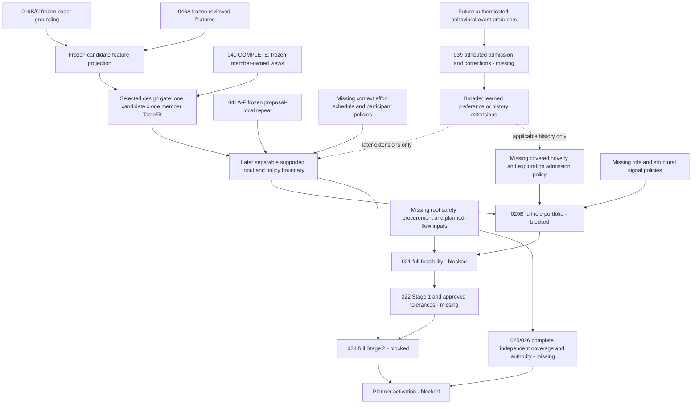

# Post-Candidate Feature Projection — Next-Gate Dependency Review

Status: **DEPENDENCY REVIEW ONLY — RECOMMENDATION, NOT DESIGN OR IMPLEMENTATION APPROVAL**.
Reviewed 2026-10-28 against canonical main `5530da00df9f6c9d8510cb02ac5b5e5a04ba52dc`.

Subsequent gate: the user approved this selection at PR #114 head
`1452e72621f45d06d191a069c63785c00571eaee` ([formal PASS](https://github.com/thedusk4203/Menuto/pull/114#issuecomment-6460614980)).
It merged at `622c108d2e8fe150ada521c645a643a362baa520`; complete tree equals that head,
five Markdown files only. Exact push [CI40632359346](https://github.com/thedusk4203/Menuto/actions/runs/40632359346)
SUCCESS, python/web green;3,104 tests; exports362; schema0015 /85. Only then did the separately
authorized [detailed design](CANDIDATE_MEMBER_TASTEFIT_FOUNDATION_DESIGN.md) begin. It is
DESIGN READY FOR ARCHITECTURE REVIEW, not implementation-authorized. Findings below retain
their original baseline and review-stage authorization wording; no frozen semantics are changed.

## 1. Single recommended next gate

```text
NEXT RECOMMENDED GATE:
Candidate × Member TasteFit Foundation — source-backed, one candidate × one member

STATUS:
READY FOR DETAILED DESIGN
```

This recommends the next **dedicated design gate**, not an implementation slice ready to start.
It assigns no MTR suffix and does not start MTR-024. The bounded question is how to interpret
already-canonical candidate facts against one member's existing preference views, with explicit
versioned fit semantics and observable unavailable evidence. It is not household aggregation,
history-based personalization or planner utility.

**Finding:** the previously missing candidate feature ingress is now frozen. MTR-040 supplies
member-owned exact-target views; the projection supplies exact candidate-bound reviewed features.
No additional member-facing publication/source primitive was found mandatory before this bounded
design. The missing seam is their authorized interpretation and coordinate-to-fit policy, not a
new behavioral-event producer. No TasteFit contract, formula, weight, reducer or policy value is
approved here. A source-ready design frontier is not populated production data or runtime readiness.

## 2. Exact entry gate and canonical baseline

| Item | Independently verified receipt |
| --- | --- |
| Repository / reviewed main | `thedusk4203/Menuto`, `5530da00df9f6c9d8510cb02ac5b5e5a04ba52dc` |
| Status synchronization | [PR #113](https://github.com/thedusk4203/Menuto/pull/113), reviewed head `7a7621e7bf625843c196f8f37b16e591adfb379b`, reviewed base `8fffd634cd6a9be809defa7e41c911c6dd1c254c` |
| Pre-merge gate | OPEN / MERGEABLE, one commit, exactly six Markdown files; no unresolved threads or blocking review; exact-head CI40519137882 SUCCESS |
| Actual status merge | `5530da00df9f6c9d8510cb02ac5b5e5a04ba52dc`; parents are the reviewed base/head; complete tree equals reviewed head; delta is exactly those six documents |
| Exact post-merge push CI | [40627254429](https://github.com/thedusk4203/Menuto/actions/runs/40627254429), event=push, exact actual merge SHA, SUCCESS; python/web SUCCESS |
| Post-merge verification | **3,104 passed, 0 skips**; SCRAM/TLS16/16; benchmark22/22; client10/10; architecture/import/export/contract/typecheck/build checks SUCCESS |
| Exports / schema | **362 / 0015 / 85 domain tables**; no migration0016 |
| Frozen implementation | [PR #112](https://github.com/thedusk4203/Menuto/pull/112), reviewed head `bb6da9fa9f1ba3213b9a55edbd830fc547c80898`, actual merge `8fffd634cd6a9be809defa7e41c911c6dd1c254c`; [canonical freeze receipt](CANDIDATE_BOUND_REVIEWED_CULINARY_FEATURE_PROJECTION_FREEZE_RECEIPT.md) |

Main was fetched after merge and checked after CI. Phase 2 began only after that push run
succeeded. PR #113 introduces no runtime, contracts, tests, tooling, migrations, data or production
defaults. Its status synchronization preserves zero new persistence/cache and every frozen boundary.
The implementation freeze SHA and the later documentation baseline SHA are distinct identities.

## 3. Requirements and evidence inspected

Requirements: [Development Spec V1.3](../MENUTO_DEVELOPMENT_SPEC_V1_3.md) §8.4, §9,
§10.2–10.8, §14.10, §19.1–19.8, §21 and §23; all
[INV-001..030](../ARCHITECTURE_INVARIANTS.md); accepted ADRs, particularly
[ADR-011](../adr/ADR-011-behavioral-learning-loop.md),
[ADR-004](../adr/ADR-004-household-first-model.md),
[ADR-001](../adr/ADR-001-band-first-planner.md) and
[ADR-010](../adr/ADR-010-independent-validator.md).
Current headers/relevant sections in [BACKLOG](BACKLOG.md), [FOUNDATION_STATUS](FOUNDATION_STATUS.md),
[entry blueprint](IMPLEMENTATION_BLUEPRINT.md) and [M0/M1 blueprint](IMPLEMENTATION_BLUEPRINT_M0_M1.md)
were distinguished from historical delivery-stage wording.

Dependency lineage: the approved ordering correction in
[post-020A](POST_MTR_020A_DEPENDENCY_REVIEW.md),
[post-040 selection](POST_MTR_040_NEXT_MILESTONE_DEPENDENCY_REVIEW.md),
[040 completion review](POST_MTR_040C_PARENT_MTR_040_COMPLETION_REVIEW.md),
[post-046A](POST_MTR_046A_DEPENDENCY_REVIEW.md), [041F design](MTR_041F_FEATURE_REPEAT_POLICY_DESIGN.md),
[046A design](MTR_046A_CULINARY_FEATURE_ASSIGNMENT_DESIGN.md), and the projection
[design](CANDIDATE_BOUND_REVIEWED_CULINARY_FEATURE_PROJECTION_DESIGN.md) /
[implementation evidence](CANDIDATE_BOUND_REVIEWED_CULINARY_FEATURE_PROJECTION_EVIDENCE.md).
Current GitHub issues inspected: [039/#40](https://github.com/thedusk4203/Menuto/issues/40),
[041/#42](https://github.com/thedusk4203/Menuto/issues/42),
[046/#47](https://github.com/thedusk4203/Menuto/issues/47),
[020/#21](https://github.com/thedusk4203/Menuto/issues/21),
[021/#22](https://github.com/thedusk4203/Menuto/issues/22),
[024/#25](https://github.com/thedusk4203/Menuto/issues/25),
[040/#41](https://github.com/thedusk4203/Menuto/issues/41), and supporting 006/#5, 008/#7, 023/#24.
All these remaining parent issues are OPEN except completed #41; OPEN does not erase frozen subsets.

The existing 484-node graphify index was queried using its own candidate/member/preference/
attribution/exposure/policy vocabulary. It predates the latest capabilities and served only as
navigation. No graph rebuild or semantic extraction was performed: **0 extraction tokens**.
The following current code and exact receipts, rather than graph labels, establish readiness.

## 4. Capability inventory and layer separation

| Layer | Existing canonical evidence | Missing capability / boundary |
| --- | --- | --- |
| Candidate factual culinary features | Frozen 019B/C grounding and [projection capture](../../apps/backend/app/modules/planning/candidate_feature_capture.py) / [pure projection](../../apps/backend/app/modules/planning/candidate_feature_projection.py); stable Recipe ID, exact RecipeVersion/source/path; frozen 046A discovery and support | Not member liking, exposure, fit, role, safety certification or utility. Partial/unknown discovery is retained. |
| Member preference/evidence | [040B capture](../../apps/backend/app/modules/preferences/profile_capture.py), [Preferences public surface](../../apps/backend/app/modules/preferences/public.py), exact-target [prior compatibility/shrinkage contracts](../../apps/backend/app/modules/preferences/prior_affinity_contracts.py), [040C consumer](../../apps/backend/app/modules/preferences/hierarchical_affinity.py) | No candidate-wide TasteFit, participant reducer, learned-event admission or globally comparable scalar. Raw explicit, mapped/prior-backed and inherited coordinates remain distinct. |
| Reviewed prior/hierarchy source truth | Existing [prior capture](../../apps/backend/app/modules/preferences/reference_priors.py) and [hierarchy capture](../../apps/backend/app/modules/preferences/hierarchy_sources.py), protected publication, complete histories/frontiers and pure resolvers | Schema/source authority does not certify a populated provider corpus or production numeric policy. Shared reference publication is not member authorship. |
| History / repeat / novelty | Frozen 041A–F [Learning public API](../../apps/backend/app/modules/learning/public.py): proposal-local Recipe-ID and reviewed-feature exposure/cooldown/decay/penalty | No accepted/confirmed/global consumption history, cross-horizon model, family history or novelty policy. 041F cannot be repurposed as those sources. |
| Policy / safety / procurement | Member restrictions, exact supported grounding and current retail/inventory facts; [coverage contract](../../apps/backend/app/modules/policy/contracts.py) explicitly FOUNDATION_NO_CLINICAL_POLICY; [validation contract](../../apps/backend/app/modules/validation/contracts.py) explicitly FOUNDATION_ONLY | Root guideline/goal/resolved policy, complete allergen/diet classification, enabled quantity/scenario economics and planned flow remain independent blockers. A feature or fit score cannot substitute. |
| TasteFit | The candidate side and member side now exist separately | No implementation or approved fit policy yet. This is the selected bounded design frontier. |
| Utility / ranking | Spec §14.10 defines separate behavioral dimensions; frozen 020A supplies a conservative frontier | No Stage-2 composition, role scores, participant aggregation or meaningful complete three-role portfolio. Scoped preference equality is not ranking comparability. |
| Planner activation | Exact source/replay and partial independent checks exist | Full required coverage, trusted authority/atomic rechecks and production authorization remain absent; PRECOMMIT is fail-closed. |

In particular, `REVIEWED_NONE` is finite classification absence, not never-exposed, neutral liking
or a zero repeat penalty. `UNRESOLVED` is not zero fit. Member `UNDECLARED`, declared `NEUTRAL`,
`RETRACTED` and available numeric zero remain distinct. A prior-only cold start is not learned
member evidence. EvidenceStrength is ordinal policy metadata, not probability or confidence.

## 5. Prerequisite DAG

Arrows below mean required input/semantics for the named bounded node, not numerical milestone
order. The separable-input branch is distinct from **full Stage-2 execution**; treating both as
one MTR-024 node would create a false dependency cycle with shortlist and feasibility.



The event branch is **not** a prerequisite of the selected source-backed TasteFit gate. Accepted
schedule history also needs its own real Planning activation source; confirmed/consumed history
needs actual Execution/member attribution; cross-horizon history needs 017/023/applicable036 →038
and causal deduplication. None can be inferred from a proposal date or existing revision row.
The diagram does not require all global history before initial utility design: supported
exploration admission/coverage must be designed separately, without inventing cold-start novelty.
020B →021 is the canonical production-pipeline edge, not a claim that every isolated feasibility
check needs portfolio ranking.

## 6. Candidate comparison matrix

READY FOR DETAILED DESIGN means inputs are identifiable and missing interpretation can be scoped;
it is not detailed-design approval, production data readiness or implementation authorization.

| Candidate | Already-frozen / existing prerequisites | Missing prerequisites; another source first? | What it unlocks / critical path | Decision |
| --- | --- | --- | --- | --- |
| **Candidate × Member TasteFit Foundation**, one candidate/member | 019B/C, 046A and frozen candidate projection; 040A/B/C, prior source and compatibility/shrinkage; canonical member access and owner target identities | Exact target admission/join, coordinate-to-fit policy, coverage/missingness, lineage precedence and coherent capture/replay contract. **No additional truth source found mandatory first** for the bounded existing-preference path. | Supplies the missing taste-input branch toward separable inputs and meaningful EXPLOIT; does not itself unlock full024/020B/021. | **SELECTED — READY FOR DETAILED DESIGN**. |
| MTR-039 admission/routing foundation | ADR-011 semantics and typed explicit preference sources | Authenticated event identity/producer provenance, causal correction/retraction, classification and destination effects; operational routes additionally need real producers. A bounded pure admission design is possible before Execution. | Needed for broader learned/contextual/retail behavior and applicable confirmed-history paths; not a dependency of interpreting existing explicit views. | **DEFER as next**, not globally design-blocked on Execution. |
| Remaining MTR-041 history/novelty | A–F frozen local evidence and exact policies; reviewed features | Source-specific accepted/confirmed/reconciled/bridge coverage, family identity where used, history dedup and novelty semantics. Those source seams must precede claims using them. | Required for history-backed repeat and honest EXPLORE; no local preview can establish never-exposed. | Full model **BLOCKED**; scoped source/lifecycle design remains possible. Another proposal-local wrapper is not next. |
| Remaining MTR-046 coverage/role/effort/family/safety | 046A three reviewed dimensions, canonical ingredient/recipe identities | Additional source semantics and reviewed applicability/coverage; publication/readiness policy and content QA. MAIN_PROTEIN feature is not meal-role taxonomy; ingredient nutrition is not allergen classification. | Independent branches support role portfolio, effort, safety, family history and catalog launch. | Bounded source designs are viable; **DEFER** full coverage completion. No missing such source is required to connect already-supported exact preference targets. |
| MTR-024 separable vector / full utility | 040 complete; frozen local repeat and candidate projection | TasteFit boundary above; other context/participant/novelty policies as enabled; full execution additionally needs Stage-1 results/tolerances and complete safety/feasibility. | Supported input definitions feed020B; full composition comes later in Stage2. | **BLOCKED as a full milestone; NOT STARTED**. Selected bounded prerequisite is not permission to start024. |
| MTR-020B | Frozen020A, exact candidate identities | Meaningful EXPLOIT fit, honest EXPLORE coverage/admission, structural/role signals and versioned quota/reserve/overlap/availability policy | Production shortlist input to021; buckets alone do not satisfy role semantics. | **BLOCKED**. TasteFit would remove one blocker, not the whole gate. |
| MTR-021 | Grounded possibilities, physical inventory, member/participant identity and current exclusion guards | Root nutrition/goal/resolved policy, complete applicable safety, procurement quantities/scenarios/budget context, role portfolio and planned material/batch allocation | Hard-feasibility input to global solve; missing data must not become infeasible or safe. | **BLOCKED**, not next. |
| 006/007/008 and 005 safety branch | Nutrition/reference/member facts, neutral units, draft orthogonal policy axes | Guideline/eligibility/goal and temporal roots, resolution/plan binding; reviewed allergen/diet vocab/classification and coverage. COUNT needs an item-specific source when enabled. | Independent hard blockers to021/validation/activation; they do not define culinary liking. | Separate bounded source/root designs are possible; **DEFER as next**, mandatory before affected production paths. |
| 011/012/013 economics/scenarios | Frozen retail mapping/quote/reference/package primitives | Quantity-specific purchase-cost evidence, required deterministic stress-set policy, budget binding and later revision sunk-spend sources | Independent SPEND_LIMIT/structural economics blocker; quote is not basket cost. | **DEFER as next**; cannot replace taste or novelty. |
| 019D inventory witness; 023 planned flow; 025/026 capture/enforcement | Confirmed lot possibilities, planned batches/allocations and partial independent validation | Appropriate match/urgency policies; exact input/output allocations and historical materialization/source manifests; full issuer authority only after coverage | Useful structural/hard-input branches. No inventory-match witness supplies EXPLOIT or EXPLORE. | Narrow designs can be scoped, but **DEFER** under the accepted preference/exposure critical-path correction; do not start Execution or an issuer. |

## 7. Why this gate is next, and why history/router are not first

This is a topological recommendation with explicit tie-breakers, not a measured longest-duration
schedule: there are no comparable duration estimates. Prefer removing a missing edge on the
approved 040/041 → separable utility inputs →020B →021 path, reuse frozen truth before adding a
new truth class, and keep the boundary independently testable without new persistence or authority.
The selected gate now meets those criteria. The preceding post-040 review deferred this member
join specifically because candidate feature capture/binding was missing; PR #112 removed that edge.

For example, a member's current explicit METHOD declaration and the exact candidate's reviewed
METHOD assignment can be joined as evidence without any cooked/consumed event. That does **not**
yet determine a fit number: an approved interpretation policy is still missing. Conversely, a
cooked event does not establish liking, and completing a router would not supply the absent fit
mapping over today's declared evidence. Adding more proposal-local repeat also cannot supply it.

For this bounded design, broader learned/contextual/passive inputs remain unavailable, rather than
blocking use of separately valid explicit inputs. Exposure/novelty stays a separate vector branch.
This is not a waiver of full041 or039 requirements, nor a claim that every future TasteFit policy
can ignore them. A design that admits those event/history inputs must prove their actual source
dependencies and return for a separate scope gate.

Independent root-policy/safety/procurement branches remain necessary for eventual production
activation. Deferring them here means selecting one bounded frontier, not declaring those P0
requirements optional or globally less important. No full downstream milestone becomes ready
merely because one taste-input branch becomes designable.

## 8. Exact prerequisites and scope for the future design review

The prerequisites available now are frozen canonical grounding/projection, 046A source-owned
finite classification, member-owned declarations and authenticated capture, 040B explicit
interpretation, published prior/hierarchy source lifecycle, PR #100 coordinate compatibility and
040C one-hop views. Source interfaces exist even when no eligible publication/declaration exists.
Unpopulated production priors, policies or feature coverage must remain observably unavailable.
No onboarding UI, production corpus seed or learned profile aggregate is assumed.

The proposed design boundary is **one exact supported candidate and one explicitly identified
member in the same household**, retaining dimensions and source lineage. Existing stable Recipe,
selected ingredient and reviewed feature identities supply possible exact targets; the design
must settle the admitted set and term-kind/context checks. Shared-meal aggregation, cross-member
copying, cross-candidate ranking and a universal scalar are outside this recommendation.

The dedicated design still needs to answer, rather than this review deciding:

1. Which exact targets/dimensions are admitted, and how candidate binding, member/actor access,
   identity, finite coverage and complete primitive replay are proven across the owner inputs.
2. How explicit, compatible prior-backed and optional one-hop evidence retain distinct modes,
   suppression/retraction and precedence. 040C transfers mapped explicit evidence only; a
   destination prior-only value and inheritance may coexist without an existing chooser or blend.
3. What versioned, explicitly authored policy gives the result its fit meaning, coordinate scope,
   compatibility and missingness behavior. Neither equal rational amounts nor a provenance label
   authorizes cross-kind/policy/target arithmetic. No weights, coefficients or reduction are chosen here.
4. How capture coherence, independent child clocks/frontiers, immutable-fact conflicts, correction
   invalidation and historical replay work. Self-consistency must not certify database origin,
   current access or a common real MVCC cut.
5. How the new boundary remains additive, non-persistent and non-authorizing, with future checks
   for exact joins, missingness, descriptor mismatch, corrections, tamper resistance, zero-I/O pure
   replay and frozen compatibility. These are review concerns, not an approved acceptance matrix.

Ownership starting point: Planning coordinates candidate/member consumption; Preferences retains
member truth and affinity interpretation; Recipes/Catalog retain culinary identities/classification;
Learning retains exposure and attributed-event interpretation. The precise new contract/module
seam is for detailed design. No service, schema, endpoint, formula or source authority is introduced.

**Persistence expectation: no migration or new persistence is expected** for consuming these
existing sources. No0016, policy registry, profile cache or production values are reserved.
If detailed design discovers genuinely missing durable truth/publication authority, stop that scope
and request a separate source-design decision; do not mint it from a hash, reviewer label or member
SELF/AUTHORIZED_REPRESENTATIVE authorship.

## 9. Semantic traps and remaining authority

- Frozen040B keeps its own unavailable prior/shrinkage fields. PR #100 and040C are separate additive
  consumers; no frozen contract is widened to carry TasteFit.
- Full target identity remains outside the numeric descriptor where frozen contracts specify it.
  Same descriptor and same rational means scoped numeric equality only, not equal targets,
  cross-target transfer, cross-target aggregation or planner comparability.
- Raw explicit, mapped/prior-backed and inherited coordinates must not be assumed to share one
  scale; frozen PR #100 compatibility is what permits its explicit/prior operands to share a
  scoped descriptor. Never strip a descriptor,
  choose the largest raw amount or infer LIKE/DISLIKE from its sign. Shrinkage provenance is not
  coordinate identity; an inherited result does not mint EvidenceStrength or a recursively usable parent.
- Current explicit heads determine explicit strength; retries/history length do not add evidence.
  No caller strength, fake probability, zero prior, neutral fallback or inferred preference is allowed.
- REVIEWED_NONE is not never-exposed; UNRESOLVED is not zero repeat. Proposal preview is neither
  accepted exposure nor confirmed/consumed history. 041B/C/D remain Recipe-ID-specific;041F stays
  proposal-local and dimension/term-specific.
- Cooked is not liked; operational friction and forced tradeoffs do not update voluntary taste.
  This future read-only consumer must not emit durable learning or backfill missing behavioral events.
- TasteFit is a soft preference dimension, not hard feasibility/safety. Shared-meal utility must
  preserve every member's hard constraints before aggregation; this gate approves no such reducer.
  Role/equipment/nutrition/procurement scores cannot be smuggled into taste.

| Work | Unchanged canonical status |
| --- | --- |
| Candidate-bound Reviewed Culinary Feature Projection Foundation | **FROZEN**, exact implementation/freeze identity unchanged |
| MTR-040 / issue #41 | **COMPLETE / CLOSED — COMPLETED**, final; no reopening |
| Recommended TasteFit gate | **READY FOR DETAILED DESIGN**, recommendation only; no suffix or design/implementation authorization |
| MTR-039 | OPEN |
| Full MTR-041 / MTR-046 | PARTIAL / PARTIAL; frozen041A–F and046A unchanged |
| MTR-024 / MTR-020B / MTR-021 | BLOCKED / NOT STARTED |
| Execution | NOT STARTED |
| PRECOMMIT / planner activation | FAIL-CLOSED / NOT AUTHORIZED |

This review authorizes no detailed design or implementation of TasteFit, member aggregation,
039, remaining041/046,024/020B/021, policy engines, Execution or PRECOMMIT. No frozen semantics,
runtime, contracts, tests, tooling, migrations, source policies or production data are changed.
No parent issue is closed. **Open the docs-only dependency-review PR and stop; do not merge it.**

Validation on this documentation branch: 51 existing architecture/baseline tests passed; lint,
architecture/import boundaries, OpenAPI/domain export checks, synthetic fixtures and client
contract generation passed. Local Markdown link targets were checked and the illustrated DAG
was checked for cycles. The PR delivery record carries the exact review-head CI result; these
documentation checks are not implementation evidence for the recommended gate.
