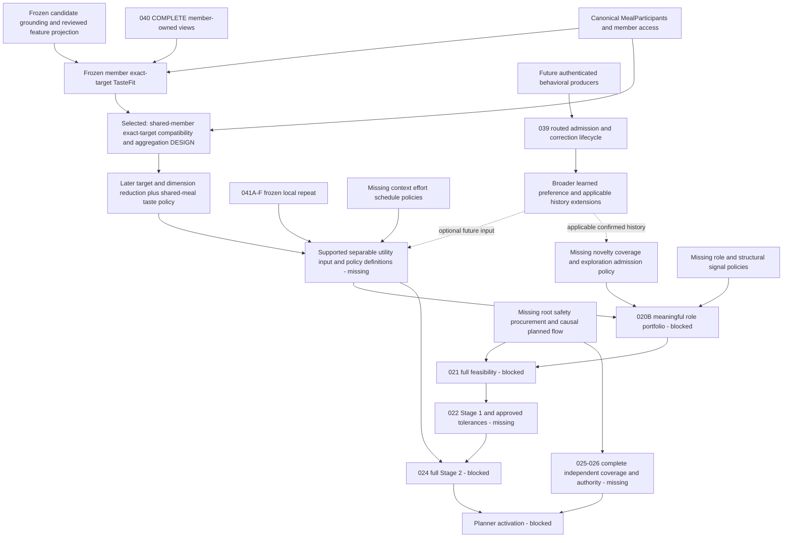

# Post-Candidate × Member TasteFit — Next-Gate Dependency Review

Status: **DEPENDENCY REVIEW ONLY — RECOMMENDATION, NOT DETAILED DESIGN OR IMPLEMENTATION AUTHORIZATION**.
Reviewed on 2026-10-28 against canonical main
`4e660d18ce636fa0bd4556141f3cc3aa358d3670`, after the exact post-merge CI gate below passed.

## 1. Single recommended next gate

```text
NEXT RECOMMENDED GATE: Candidate-bound Shared-member Exact-target TasteFit Compatibility & Aggregation Foundation

STATUS: READY FOR DETAILED DESIGN
```

The proposed boundary is **one exact canonical candidate × one exact typed preference target ×
the candidate's exact participating member set**, under an explicit, versioned, body-pinned
conditional consumer policy. It is not an overall shared-meal score, a member profile aggregate,
cross-target reduction, candidate comparison or a production/default policy service.

**Finding:** the existing foundation can capture and replay the same proven target for each
participating member, including SHARED members. The missing participant-level interpretation
can now be designed without inventing a new preference/event producer. This is design readiness,
not permission to add the arithmetic today. Individual values remain incomparable under their
frozen descriptors until a separately approved compatibility/reduction policy authorizes a new
operation and defines its own result scope.

No MTR suffix, formula, reducer, weight, numeric default, contract or new authority is assigned
by this review. A dedicated design requires separate authorization after review of this recommendation.

## 2. Verified entry gate and canonical baseline

| Receipt | Verified value |
| --- | --- |
| Repository | `thedusk4203/Menuto` |
| Status-sync PR | [PR #117](https://github.com/thedusk4203/Menuto/pull/117), reviewed head `5f42486127e6f0bf053a32c914bd3c3c773a66ab` |
| Reviewed base | `7ac0547b3df621fb19c614c27edaca268a901169` |
| Immediate pre-merge check | OPEN, MERGEABLE/CLEAN; same one commit and six Markdown files; no unresolved technical review blocker; exact-head [CI40681879476](https://github.com/thedusk4203/Menuto/actions/runs/40681879476) SUCCESS |
| Actual status merge / reviewed main | `4e660d18ce636fa0bd4556141f3cc3aa358d3670` |
| Complete merged tree | `413be02e6646f9e731c56ffd0c944f0cc736dd50`, identical to reviewed head; parents are the reviewed base/head |
| Exact post-merge push CI | [40684417297](https://github.com/thedusk4203/Menuto/actions/runs/40684417297), event=push, exact main SHA above; completed SUCCESS, python/web and every required step SUCCESS |
| Post-merge verification | **3,396 passed / 0 skips**; SCRAM/TLS16/16; benchmark22/22; client10/10; architecture/import/lint, OpenAPI/domain export, fixtures, contracts/typecheck/build green |
| Contracts / schema | **384 exports; 0015 / 85 domain tables**; no0016; ZERO NEW PERSISTENCE |
| Status-sync verification | [Formal receipt6468976312](https://github.com/thedusk4203/Menuto/pull/117#issuecomment-6468976312); main re-fetched after CI and unchanged |
| Frozen implementation | [PR #116](https://github.com/thedusk4203/Menuto/pull/116), reviewed head `152dbe8a365790956d2f7bac1b40a09b7dbd9134`, implementation merge `7ac0547b3df621fb19c614c27edaca268a901169`; [freeze receipt](CANDIDATE_MEMBER_TASTEFIT_FOUNDATION_FREEZE_RECEIPT.md) |

PR #117 merged with an exact-head guard and no auto-merge. Its delta is exactly the six reviewed
documents, with no runtime/contracts/tests/tooling/migrations/data change. The implementation
freeze and later documentation baseline are different identities. Phase 2 began only after the
status merge's exact push run succeeded. Earlier instructions to leave the status PR open were
superseded by the separate exact-head merge authorization, not by automatic milestone progression.

The frozen capability retains **TF01–TF132** and **42 real PostgreSQL cases covering35 required
PG obligations**. Registered metadata/export inspection reconfirms85 tables/384 definitions;
migrations remain0001–0015. No production database inspection or production-row certification
is claimed; repository/test evidence establishes no new persistence, seed or default introduced.

## 3. Canonical evidence inspected

- [Development Spec V1.3](../MENUTO_DEVELOPMENT_SPEC_V1_3.md) §8.4 seam4, §9.2–9.5,
  §10.5–10.8, §14.10, §19.1–19.8 and §21; all [INV-001..030](../ARCHITECTURE_INVARIANTS.md).
- [ADR-011](../adr/ADR-011-behavioral-learning-loop.md), [ADR-004](../adr/ADR-004-household-first-model.md),
  [ADR-001](../adr/ADR-001-band-first-planner.md), [ADR-003](../adr/ADR-003-plan-policy-resolution.md),
  [ADR-009](../adr/ADR-009-execution-state-machine.md), [ADR-010](../adr/ADR-010-independent-validator.md).
- Current sections of [BACKLOG](BACKLOG.md), [FOUNDATION_STATUS](FOUNDATION_STATUS.md),
  [blueprint](IMPLEMENTATION_BLUEPRINT.md) and [M0/M1 blueprint](IMPLEMENTATION_BLUEPRINT_M0_M1.md),
  distinguished from historical implementation-stage wording.
- [Post-020A ordering correction](POST_MTR_020A_DEPENDENCY_REVIEW.md),
  [post-040 selection](POST_MTR_040_NEXT_MILESTONE_DEPENDENCY_REVIEW.md),
  [040 completion review](POST_MTR_040C_PARENT_MTR_040_COMPLETION_REVIEW.md),
  [post-projection review](POST_CANDIDATE_FEATURE_PROJECTION_NEXT_GATE_REVIEW.md),
  [TasteFit design](CANDIDATE_MEMBER_TASTEFIT_FOUNDATION_DESIGN.md) §5–11,13–20 and
  [implementation evidence](CANDIDATE_MEMBER_TASTEFIT_FOUNDATION_EVIDENCE.md),
  [041F design](MTR_041F_FEATURE_REPEAT_POLICY_DESIGN.md) and
  [046A design](MTR_046A_CULINARY_FEATURE_ASSIGNMENT_DESIGN.md).
- Current GitHub issues: [039/#40](https://github.com/thedusk4203/Menuto/issues/40),
  [041/#42](https://github.com/thedusk4203/Menuto/issues/42),
  [046/#47](https://github.com/thedusk4203/Menuto/issues/47),
  [024/#25](https://github.com/thedusk4203/Menuto/issues/25),
  [020/#21](https://github.com/thedusk4203/Menuto/issues/21),
  [021/#22](https://github.com/thedusk4203/Menuto/issues/22), supporting006/#5,008/#7,023/#24;
  all remain OPEN. [040/#41](https://github.com/thedusk4203/Menuto/issues/41) remains CLOSED/completed.

The existing4,130-node graphify index was queried with its actual tastefit/shared/member/
aggregation/policy/authority/exposure/novelty/attribution/coverage/portfolio/feasibility vocabulary.
It supplies navigation, not current readiness or authority. No rebuild/extraction was performed:
**0 extraction tokens**. Existing graph-output workspace changes are outside this PR.
The current canonical files and public interfaces below establish the findings.

## 4. Capability inventory: preserve the layers

| Layer | Current capability / exact source | Missing boundary |
| --- | --- | --- |
| Candidate factual culinary features | Frozen019B/C and [candidate projection](../../apps/backend/app/modules/planning/candidate_feature_projection.py);046A finite METHOD/MAIN_PROTEIN/FLAVOR support | No member preference, exposure, nutrition-role taxonomy, universal classification completeness or utility |
| Member preference/evidence |040 COMPLETE:040A/B/C, reviewed priors/hierarchy and exact shrinkage; [Preferences companion](../../apps/backend/app/modules/preferences/tastefit_public.py) | No learned-event intake, copied household preferences or global scalar comparability |
| Conditional member TasteFit | [Three public operations](../../apps/backend/app/modules/planning/tastefit_public.py), [contracts](../../apps/backend/app/modules/planning/tastefit_contracts.py), [pure interpreter](../../apps/backend/app/modules/planning/tastefit.py) | Per-target rows only; aggregate/shared_member_aggregation/candidate_comparison=NOT_PERFORMED; no household taste result |
| Participant truth | [MealParticipants](../../apps/backend/app/modules/households/contracts.py); fresh [TasteFit capture](../../apps/backend/app/modules/planning/tastefit_capture.py) and canonical grounding | Member set/roles/portions exist; portions are quantity context, not taste weights or priority. SHARED does not mean tracked-member preference copy |
| History / novelty / repeat | [Learning public API](../../apps/backend/app/modules/learning/public.py): frozen041A–F proposal-local recipe and reviewed-feature chains | No accepted/confirmed/global history, cross-horizon history, family source, novelty policy or shared RepeatPenalty reducer |
| Policy / safety / procurement | Existing immutable source guards; [coverage policy](../../apps/backend/app/modules/policy/contracts.py) says FOUNDATION_NO_CLINICAL_POLICY; [validator](../../apps/backend/app/modules/validation/contracts.py) retains deferred capabilities | Root policy, complete allergen/diet classification, quantity/scenario economics, planned causal flow and production authority remain independent gaps |
| Utility / ranking | Spec defines separable dimensions; [020A](../../apps/backend/app/modules/planning/shortlist.py) preserves a conservative source-coverage frontier | No taste reduction/comparability, complete EXPLOIT/EXPLORE/structural signals, Stage-2 composition or portfolio policy |
| Planner activation | Source capture/replay and partial independent validation exist | No completed production gates; planner_ready=False, activation_ready=False; PRECOMMIT fail-closed |

### What the freeze actually unlocked

The shared participant is no longer a missing member-source ingress: TF02's real PostgreSQL case
captures a SHARED subject independently of a tracked member with LIKE and proves no preference copy.
TF01/TF03 establish canonical capture and denied-actor behavior. Each member's direct signal,
suppression, selected/unselected evidence, exact target, policy descriptor and missingness survive
replay. A future consumer can therefore ask about **the same proven target across actual diners**.
It cannot yet answer that question numerically by summing frozen amounts.

`TasteFitCoordinate` binds household, member, candidate grounding/projection, typed target and full
policy fingerprint. Equal rationals, equal kind, equal policy ID/version or even equal policy body
do not remove the member/candidate scope. `scoped_numeric_equal` rejects descriptor mismatch.
Cross-member aggregation must be a new, explicitly specified operation, not descriptor stripping.

## 5. Prerequisite DAG and critical-path interpretation

Solid arrows identify required evidence/semantics. The selected box is this review's proposed
decomposition, not a newly discovered mandatory scalar intermediate in the canonical spec.



This advances the explicit-preference taste branch of the corrected020A→supported-input→020B→021
dependency route. It removes one unresolved participant boundary before a full shared taste input;
it does **not** make full024/020B/021 ready. Full024 execution additionally follows feasibility,
Stage1 and approved tolerances; its earlier separable input/policy definitions are a distinct node,
so the graph does not manufacture a024↔020B cycle.

There is no timing model proving a unique project-wide longest path. Selection is a topology and
scope judgment: reuse frozen sources to settle one missing shared-taste operation, without adding
event producers, durable policy truth, unrelated dimensions or solver authority. Independent P0
safety/policy/economics work remains mandatory for eventual activation, not waived by this choice.

## 6. Candidate comparison and source-authority assessment

READY means ready to specify a bounded design, not that its missing policy already exists.

| Candidate | Frozen prerequisites | Missing prerequisite / source or authority | Unlock / critical path | Readiness and disposition |
| --- | --- | --- | --- | --- |
| **Shared-member exact-target TasteFit compatibility/aggregation** | Frozen target rows for TRACKED/SHARED subjects, full member provenance, canonical target/candidate and MealParticipants | New explicit consumer-policy semantics: compatible operands, participant coverage, direct dislike, missingness, reduction/result coordinate and multi-child coherence. No new evidence producer or durable publication authority required for a conditional design | First bounded shared-taste interpretation toward full shared input,024-input and020B EXPLOIT | **SELECTED: READY FOR DETAILED DESIGN**, one candidate/one typed target only |
| Full shared-meal TasteFit aggregation | Same sources | All selected gate questions plus cross-target/kind semantics, double-count prevention, complete candidate reduction and any overall shared result policy | Full taste input for future utility/portfolio | Broad design is discussable but **DEFER**: combines participant aggregation with target/dimension reduction; no existing full reducer |
| Within-member cross-target reduction first | Frozen per-target member rows | Explicit target/kind compatibility, target-set coverage, direct-recipe versus feature contribution semantics and output coordinate | Another taste-input prerequisite | Bounded conditional design is viable; **DEFER as next**. Canonical spec does not require a per-member scalar first; exact-target participant aggregation avoids inventing that hard dependency or cross-kind scale |
| Canonical/default TasteFit policy publication and selection source | Frozen conditional policy body/pins and retained replay | Actual publisher/reviewer/selector authority, scope/applicability, lifecycle/currentness, coherent capture and retained historical decisions; prior/hierarchy capabilities cannot confer this authority | Required before claiming reviewed global/current/default/production-selected policy | Separate source design is viable, but **NOT required first** for the selected explicit-input-only consumer. No production selection is unlocked |
| MTR-039 bounded admission/router | ADR-011 classification semantics; frozen explicit sources | Authenticated event/actor/subject identity, producer provenance, correction/retraction, classification and destination effects; each operational route needs its real producer | Broader learned taste/context/retail behavior and applicable confirmed history | A pure bounded design may precede Execution; **DEFER**. It neither licenses arithmetic on today's TasteFit rows nor is required by their existing explicit lineage |
| Remaining041 history/novelty | Frozen041A–F and reviewed features | Accepted schedule source; confirmed/reconciled producer and attribution where applicable; coverage/dedup, horizon bridge, authored family identity and novelty policy as enabled | History-backed repeat and honest EXPLORE | Full model **BLOCKED** on source-specific prerequisites. Scoped source designs are possible; another proposal-local wrapper does not settle shared taste |
| Remaining046 role/effort/family/safety/launch coverage | Frozen046A and canonical ingredient/recipe identities | Additional reviewed descriptors, applicability/finite coverage, QA/readiness policy; slot role is not meal-role taxonomy; MAIN_PROTEIN is not a structural nutrition score | Independent role, effort, classification, family-history and launch branches | Bounded source designs viable; **DEFER full completion**. No new classification source is needed to interpret an already proven supported exact target |
|024 supported vector / full Stage2 | Frozen taste rows and local repeat | Shared/target taste interpretation; context/schedule and enabled novelty policies; full solve additionally needs Stage1 output/tolerances and feasibility | Supported definitions feed020B; full optimizer later | Full024 **BLOCKED / NOT STARTED**. This prerequisite review does not start024 or compile the behavior vector |
|020B role portfolio | Frozen020A, grounding/projection and typed evidence | Meaningful comparable EXPLOIT input; honest EXPLORE coverage/admission; role/structural signals and versioned quota/overlap/reserve policy | Production shortlist input to021 | **BLOCKED**. Equal target-fit rationals or empty role buckets do not satisfy acceptance |
|021 feasibility | Canonical grounded candidates, household/member facts and physical inventory foundation |020B production input plus independent root nutrition/goal/resolved policy, allergen/diet classification, procurement scenarios and causal planned allocations/batch flow | Full feasible planning input to Stage1/Stage2 | **BLOCKED**; unavailable data is not infeasibility and favorable taste is not safety |
| Other policy/flow/validation prerequisites | Existing nutrition/policy primitives, retail/inventory and planned cooking foundations | Guideline/goal policy and validated resolution, actual scenario economics,017/023/036/038 source semantics as used,025/026 coverage and production enforcement | Independent hard branches needed for021 and activation | Remain mandatory. Their bounded designs can be reviewed separately; they are not hidden inputs to this taste-only conditional gate |

### Why neither global policy truth nor behavioral events must come first

Frozen design §10 explicitly distinguishes a body-pinned conditional interpretation argument from
published reference truth. Its `policy_authority=EXPLICIT_INTERPRETATION_INPUT_ONLY` is a limitation,
not evidence of an existing registry. A new pure consumer may be designed with the same limitation;
this review does not require a registry merely to make a conditional interpretation replayable.
Conversely, a production/default selector cannot be invented by this consumer: if the future
design needs one, stop and separate source-authority design before making that claim. Hashes,
REVIEWED_REFERENCE, reviewer IDs, member SELF/AUTHORIZED_REPRESENTATIVE, and prior/hierarchy
publication grants do not authorize global TasteFit policy publication.

Likewise, cooking, rejection, friction, passive assumptions and forced tradeoffs remain outside
the admitted source set. MTR-039 remains OPEN but cannot be made a prerequisite merely because
the selected consumer concerns taste. An extension admitting learned evidence would have a
different DAG and require separate authorization.

Accepted-schedule history needs a real Planning commitment source, not automatically the039 router.
Confirmed/consumed history needs actual Execution evidence and applicable attribution; cross-horizon
history needs real future commitments and the applicable036/038 bridge. Proposal dates, revision
rows or stable Recipe IDs cannot substitute for those sources or an authored variant-family mapping.

## 7. Exact boundary for a later dedicated design

These are unresolved review obligations, not answers, approved models or an acceptance matrix:

1. Keep one canonical candidate/path/context and one proven exact typed target. Bind the exact
   MealParticipants set, preserve every member identity/role and define complete/partial coverage.
   No arbitrary subset, duplicate member, tracked-only substitution or copying preferences.
   Positive contribution must retain canonical BASE/PRESENT proof and child policy admission;
   diagnostic probes or parent-only lineage cannot become new positive targets. Existing member
   access checks remain mandatory; participant membership does not grant additional read rights.
2. Define an explicit compatibility operation over fully scoped child descriptors **before any
   arithmetic**. Same target, policy ID/body, amount or [-1,1] range does not itself authorize
   comparison. Decide permitted policies/modes and the new result's units, scope and version.
3. Settle participant reduction and member influence without treating portion_factor,
   AttendanceScale, EvidenceStrength, source-history length or tracked status as implicit weights.
   No formula, coefficient, priority or reducer is chosen in this review.
4. Preserve current direct dislike separately from low affinity, prior/inherited unfavorable fit,
   dietary restrictions and retraction. A strong soft dislike policy is not a hard safety veto.
   The existing foundation has no EXPLICIT_AVOID enum; this gate does not add one by renaming dislike.
5. Preserve unavailable/unmapped/suppressed/unknown versus genuine available neutral zero. Spec's
   future UNKNOWN prior/neutral behavior requires actual explicit policy and eligible source;
   absent evidence cannot silently contribute0, disappear from a denominator or become a new prior.
   Mapping-unavailable direct dislike remains observable rather than dropped with its numeric row.
6. Prove multi-member source/candidate coherence, authenticated capture and deterministic retained
   replay. Independent capture clocks/projection fingerprints are not automatically corrupt, but
   matching IDs are not proof of coherent cuts. Do not invent common MVCC, offline origin or current
   authorization from a hash. Keep frozen child recomputation and all-or-fail capture semantics.
7. Remain taste-only and non-authorizing. Preserve complete member/target lineage, diagnostics,
   correction-sensitive fingerprints and independent hard guards. The eventual production path
   must enforce every participant's hard safety before utility; this diagnostic consumer cannot
   certify that missing root/safety coverage exists or rescue failed grounding.

Ownership starting point: Planning owns additive participant/candidate integration; Preferences
retains member truth and frozen interpretation; Catalog/Recipes retain factual target ownership;
Learning retains repeat/history/event attribution. Exact contract/module design is not settled here.

**Persistence expectation:** no migration or new persistence is expected for this conditional
read-only/pure consumer. No0016, registry, cache, materialized member aggregate, production policy,
coefficient or seed is reserved. Discovering required durable publication truth is a stop boundary,
not permission to widen the slice.

Cross-target or cross-kind reduction, whole-candidate/shared-meal scalar, cross-candidate ranking,
shared RepeatPenalty, novelty, context/effort/schedule utility, source publication and planner calls
are non-goals. This proposed decomposition is one bounded next step, not a requirement to complete
all039/041/046 or construct a materialized/per-member scalar before any shared interpretation.

## 8. Preserved statuses and non-authorizations

| Work | Canonical status after this review |
| --- | --- |
| Candidate × Member TasteFit Foundation | FROZEN; exact PR116 implementation and PR117 synchronization receipts unchanged |
| MTR-040 /issue41 | COMPLETE /CLOSED—COMPLETED, final; no reopening or profile rewrite |
| MTR-039 | OPEN |
| Full MTR-041 /MTR-046 | PARTIAL /PARTIAL; frozen041A–F/046A unchanged |
| MTR-024 /MTR-020B /MTR-021 | BLOCKED /NOT STARTED |
| Execution | NOT STARTED |
| PRECOMMIT | FAIL-CLOSED |
| Selected exact-target shared design gate | READY FOR DETAILED DESIGN — recommendation only, not design authorization |
| Global/default policy selection, ranking, planner activation | NOT PROVIDED /NOT AUTHORIZED |

No frozen040A/B/C, prior/shrinkage, hierarchy SOURCE,041A–F,046A, candidate projection or TasteFit
contract/semantics change. No runtime, contracts, tests, tooling, migration or data change; no
parent-issue closure. planner_ready=False; activation_ready=False. No detailed design or
implementation of the selected gate,039,024,020B,021, policy engines, Execution or PRECOMMIT starts.

This review PR must remain OPEN for review. Do not auto-merge or begin the next gate.

## 9. Documentation verification

Existing architecture/baseline tests: **51 passed**. The baseline checker retains30 invariants,
11 ADRs and50 linked tasks. All new relative links resolve, the verdict is singular, and staged
scope is this one Markdown review only. Existing graph-output changes are excluded. No new test,
runtime, schema, migration or policy implementation is introduced. The review PR's exact-head CI
is reported separately from the already successful baseline push CI; it must not be substituted
for the verified PR117 merge receipt.
