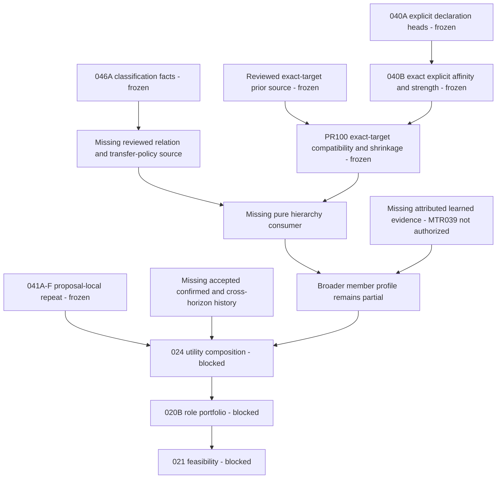

# Post Exact-target Prior Compatibility & Shrinkage — Dependency Review

Status: **DEPENDENCY SELECTION APPROVED — DEDICATED DESIGN AUTHORIZED; IMPLEMENTATION NOT AUTHORIZED**.

Reviewed on 2026-10-26 from exact canonical `main`:
`5728411ac12555f583f8df72ac71861998978aa4`.

## 1. Decision and readiness

The next selected design slice is **Hierarchical Preference Mapping & Derivation Foundation**.
This is a descriptive name, **not MTR-040C**. Repository inspection confirms that PR #100 has
closed the bounded exact-target compatibility/shrinkage edge; it has not supplied a relation
source, preference-transfer authority, hierarchy interpretation or cross-target coordinate policy.

**Ready for detailed DESIGN, with a recommended source-before-consumer split.** A hierarchy
consumer is not implementation-ready. The detailed design should first settle a canonical reviewed
relation/policy-source foundation, then a pure hierarchy consumer over approved immutable inputs.
These are design-stage decomposition recommendations, not newly authorized implementation milestones.
No additional proposal-local 041 layer or MTR-039 implementation must precede this bounded design.
Broader learned-profile derivation still requires separately reviewed attribution/evidence sources.

Preferred architectural direction is **D: classification facts + a separate Preferences-owned
transfer policy**, with **B's canonical reviewed publication/authority discipline** for production
shared relation/policy truth. A caller-supplied policy can express a test/pure input; it cannot
authenticate its own production authority. This recommendation does not settle schemas, coefficients,
approved transfer directions or the future output coordinate.

## 2. Canonical baseline and frozen dependencies

| Item | Verified baseline |
| --- | --- |
| Repository/base | `thedusk4203/Menuto` / `5728411ac12555f583f8df72ac71861998978aa4` |
| PR #100 freeze | [FROZEN / APPROVED receipt](EXACT_TARGET_PRIOR_SHRINKAGE_FREEZE_RECEIPT.md) at the same SHA |
| Exact post-merge CI | [40351934792](https://github.com/thedusk4203/Menuto/actions/runs/40351934792), push, SUCCESS; python/web SUCCESS |
| Python baseline | 2,597 passed = 2,377 retained + 220 additive; 918 real-PG tests, 120 authority/source cases |
| Exports/schema | 318 definitions; Alembic0014 /78 domain tables; no0015 |
| Frozen source/interpretation | 040A/B; reviewed exact-target reference-prior source; PR #100 consumer |
| Frozen exposure/classification | 041A/B/C/D/E/F;046A |
| Downstream | Full040/041/046 incomplete;024/020B/021 BLOCKED; Execution NOT STARTED; PRECOMMIT FAIL-CLOSED |

The freeze changes current status only. It does not widen any frozen runtime contract or permit
inherited affinity inside 040B/PR #100 result types. Existing foundation code in Execution does
not mean the operational Execution subsystem has started or PRECOMMIT is available.

## 3. Inspected repository evidence

These are actual source/design inspections, not deductions from milestone numbering.

| Sources inspected | Capability or limitation found |
| --- | --- |
| `docs/adr/ADR-011-behavioral-learning-loop.md`, `docs/ARCHITECTURE_INVARIANTS.md` INV-022–030 | Member ownership, separable affinities, attributed evidence, explicit-policy preservation and no passive durable learning remain requirements. Hierarchy is a requirement, not an implemented permission. |
| `preferences/contracts.py`: PreferenceTarget, declaration/head replay, ExplicitTargetAffinityPolicy, DerivedExplicitEvidenceStrength; `preferences/public.py`, `profile_capture.py`, `profile_derivation.py`;040A/B evidence | Five typed exact targets; current declaration only; strength derives from authored explicit policy. DIRECT_RECIPE holds stable recipe_id. Canonical recipe identity capture deliberately selects no RecipeVersion.040B prior/shrinkage remain unavailable. |
| `preferences/reference_prior_contracts.py`, `reference_priors.py`, `reference_prior_resolution.py`, prior-source design/evidence/freeze receipt | One reviewed exact-target provider, immutable authority/publication journal, coherent capture and pure source replay. Publication authority is checked separately from member authorship/provenance. There is no hierarchy relation publisher or hierarchy capability in these frozen contracts. |
| `preferences/prior_affinity_contracts.py`: ExactTargetPriorBackedAffinityInput/Draft, MemberProfileAffinityCoordinate; `prior_affinity.py`;PR #100 design/evidence/tests | Complete source/policy bindings; finite mapping, exact blend, primitive recomputation. One identical target in both sources. Outer target/member binding is retained; hierarchical/cross-target inference NOT_PERFORMED. |
| `catalog/contracts.py`: IngredientProteinReviewCommand/Fact/StreamFact; `catalog/feature_repository.py`, `feature_models.py` | Reviewed Ingredient→PROTEIN association, finite covered/positive terms, revisions/tombstones/frontier. Classification semantics, not preference-transfer policy; trusted internal curation is not the prior source's dedicated production authority model. |
| `recipes/contracts.py`: RecipeFact, RecipeVersionSnapshot, RecipeMethodContextKey, CulinaryFeaturePathKey, MainProteinSupport, discover_feature_input, resolve_feature_input; `recipes/feature_repository.py`, `feature_resolution.py`, `public.py` | Exact version/context/path classification and explicit support. SOURCE_CONFLICT rejects multiple active matches; missing/retracted/stale/out-of-universe remain distinct. No recipe-ID preference projection or transfer scale is defined. |
| `planning/feature_capture.py`, `feature_preview.py`, `feature_exposure_capture.py`;046A design/correction/evidence;041E/F evidence | Classification capture is bound to an explicit current proposal/batch/version and, where needed, a grounded culinary binding. That proposal-local orchestration is not a canonical context selector for a stable Recipe preference. |
| `learning/public.py`, `learning/contracts.py`, `learning/feature_repeat.py`;041A–F evidence | Proposal preview/recipe or feature cooldown/decay/repeat interpretation only. No global behavioral-history or hierarchy relation authority. |
| `planning/contracts.py`: ShortlistPolicyDraft/ParetoShortlistDraft; `planning/shortlist.py`; `execution/public.py`: PlanRevisionService | Existing shortlist compares exact supply-path coverage, not taste utility or role portfolio. Operational activation requires unavailable real PRECOMMIT authority/full prerequisites. |
| `BACKLOG.md`, `FOUNDATION_STATUS.md`, both implementation blueprints, invariant coverage, post041F/post-prior-source reviews, schema bundle and migration metadata | Historical status layers explain earlier blocked edges; no canonical hierarchy source/consumer currently closes the remaining edge.318 definitions,0014/78 verified directly. |

Graphify was used for orientation: its existing 484-node graph points to ADR-011 and spec§19.3/19.5,
but the broad query was truncated and does not establish post-PR100 runtime completeness. All
capability/absence conclusions above were checked against current owner contracts, entry points,
registered sources and canonical receipts. No exhaustive dependency claim is based on that graph.

The existing Learning helper `_inherited_result()` only carries proposal-local repeat diagnostics
from cooldown through decay/penalty. Its name does not denote preference inheritance or provide
the missing hierarchy relation/consumer seam.

## 4. Dependency graph and what PR #100 unlocked



The C→R arrow is a possible factual input to the recommended hybrid, **not authority flowing from
classification into member preference**. The graph shows material prerequisites, not an exhaustive
claim that satisfying hierarchy alone completes 024/020B/021.

| Edge | State after PR #100 |
| --- | --- |
| Exact explicit/prior source binding → same exact-target scoped coordinate | SATISFIED within the frozen authored compatibility policy |
| Compatible mapped operands → exact convex shrinkage and audited result | SATISFIED, including explicit-only, cold-start and retraction states |
| Source/policy primitives → deterministic independent replay | SATISFIED within VERSIONED_CONSUMER_POLICY_REPLAY; no live authority certificate |
| Exact target profile → a different target | MISSING authorized relation, source/destination identity, direction and semantic mapping |
| Classification association → preference-transfer authority | NOT SATISFIED; no such implication exists |
| Cross-kind/cross-policy value → destination preference scale | MISSING explicit transfer/coordinate semantics; attenuation alone cannot convert scales |
| Parent values → combined inherited value | MISSING precedence/conflict/aggregation/invalidation semantics |
| Hierarchy → full learned MemberBehaviorProfile | NOT SATISFIED; attributed observations, correction/reset and broader evidence policy remain missing |
| Local repeat → global history/novelty | NOT SATISFIED; proposal preview remains distinct from accepted/confirmed exposure |

PR #100 removes the exact-target source-coordinate/shrinkage blocker on the profile branch.
It supplies no generic parent relation or multi-target/profile assembly. There is no need to
implement another proposal-local 041 layer to investigate that missing relation seam.

## 5. Equality and identity are separate gates

The frozen coordinate identifies kind + full compatibility-policy fingerprint + family/version/
unit/scope. It does **not** contain target_id. Exact target/member belong to the outer PR #100 draft.

```text
same descriptor + same canonical rational = scoped numeric equality only
scoped numeric equality != same exact target
scoped numeric equality != inheritance or cross-target transfer
scoped numeric equality != aggregation, ranking or planner utility comparability
different kind/policy != a shared conversion scale
```

A future hierarchy input must retain and verify the outer member/typed target and full source/
policy derivation, not detach a ScopedMemberProfileAffinity. It must not relabel a source amount
as the destination descriptor or assume that multiplying by an attenuation coefficient makes
coordinates convertible. The dedicated design must prove any destination coordinate/mapping and
use new additive inherited-result semantics, preserving the frozen direct-result meaning.

## 6. Classification is evidence about food, not taste transfer

`classification fact != member preference transfer rule`.

| Existing fact | What it proves | What it does not authorize |
| --- | --- | --- |
| Ingredient→PROTEIN Catalog review | Exact reviewed association, finite universe and pinned review/history | Ingredient-like → protein-like; the reverse direction; fan-out to other ingredients |
| METHOD context review | One exact RecipeVersion cooking context, invariant across its valid paths | Stable Recipe preference → METHOD preference; code/string equality as term identity |
| FLAVOR path/scope review | Reviewed terms for the explicitly selected version/tier/slot/rule/preparation/adjustment applicability | Recipe-wide preference transfer or selecting a convenient matching variant |
| MAIN_PROTEIN review with MainProteinSupport | Explicit designation supported by ingredient/slot and exact Catalog review; may have co-main terms | A preference-target kind MAIN_PROTEIN, automatic PROTEIN transfer, or choosing a dominant protein by amount |
| REVIEWED_NONE / REVIEWED_ABSENT / UNRESOLVED | Different scoped classification coverage and resolution states | Member NEUTRAL, dislike, zero inherited affinity, never exposed or canonical global absence |

Preference target kind is **PROTEIN**; MAIN_PROTEIN is a classification/exposure dimension referencing
PROTEIN vocabulary. It does not add a sixth preference kind. Exact term IDs remain versioned identities;
no feature aliases or classification/code-name equivalence may silently reconcile them.

### DIRECT_RECIPE is not a RecipeVersion classification context

`RecipePreferenceTarget(recipe_id)` and `RecipeVersionSnapshot(id, recipe, version, ...)` are different
identities.040B's `recipe_identities()` path deliberately reads RecipeFact only.046A METHOD keys
require recipe_version_id; FLAVOR/MAIN_PROTEIN additionally need exact authored applicability.
The method being invariant across variants of one cooking context does not supply the missing
Recipe-ID→RecipeVersion binding or authorize cross-version inheritance.

`planning.feature_capture` selects context from an already explicit proposal batch and validates
its culinary binding. Reusing that selection for a member's stable Recipe preference would import
proposal-local context/availability into preference semantics. The future design must instead
define an explicit authorized relation/context seam if recipe affinity ever transfers to a term.
No latest version, current head, feature assignment, candidate fingerprint/path, proposal, review
revision, union or intersection across versions may be silently selected. If identity/context is
missing or conflicting, the future contract must expose that condition; this review chooses no
fallback or reconciliation rule and authorizes no RecipeVersion migration.

## 7. Mapping-source architecture options

| Option | Benefits and usable role | Missing trust/semantic requirements | Assessment |
| --- | --- | --- | --- |
| A. Caller-supplied versioned hierarchy policy | Small pure interface, explicit fixtures, deterministic offline replay; suitable as an immutable consumer input | Caller-controlled hash/UUID/provenance/version cannot establish approved production transfer rights, canonical publication, revocation or complete lineage | Valid representation/testing option; insufficient standalone shared-production source unless a separately verified canonical publisher supplies it |
| B. Canonical reviewed hierarchy relation/policy source | Durable publication/retraction/history, exact endpoints, explicit authority and coherent replay can be verified | No such source/capability exists; ownership, authentication, CAS/idempotency, revisions, completeness and persistence require design | Recommended trust prerequisite for production; do not clone prior tables/capabilities or treat its grants as hierarchy grants |
| C. Direct use of Catalog/Recipes classification | Reuses reviewed factual associations/context and source correction lineage | Classification is not preference permission; direction/scale/strength/precedence are absent; stable Recipe context is unresolved; trusted classification curation is not shared preference-publication authority | Reject as standalone preference-transfer architecture |
| D. Classification facts plus separate Preferences transfer policy | Keeps food truth with Catalog/Recipes, preference meaning with Preferences, member result ownership intact | Needs explicit context/endpoint bindings, distinct verified publication authority, pinned classification revisions, mapping/coordinate policy and correction semantics | Preferred design direction, using B's canonical source discipline; classifications are support/eligibility evidence only |

Catalog/Recipes may establish relation facts; Preferences owns whether/how those facts authorize
preference transfer. Member ownership, declaration SELF/AUTHORIZED_REPRESENTATIVE authority,
classification curator identity, prior provider principal and hierarchy-policy publication authority
must remain distinct. Existing prior REVIEW_PUBLISH/RETRACT/CAPTURE rights are scoped to that source,
not universal permission to publish new relation kinds. A hash, UUID, reviewer ID, provenance label,
REVIEWED_REFERENCE string or structurally valid policy cannot mint production authority.

**Persistence inference, not authorization:** stable shared reviewed relations/policies with correction,
retraction and historical replay appear to require a durable canonical publication source. The current
repository has no hierarchy-owned source meeting that need. Dedicated design must prove whether a
new database source or another verifiable immutable publication mechanism is appropriate. New durable
relations would likely need a forward migration after0014. No table/schema, number0015, generic graph
store, permission enum change or reuse of frozen source storage is reserved/authorized here.

## 8. Exact unresolved design gates

| Gate | What the dedicated design must settle before implementation |
| --- | --- |
| Ownership and publication | Preferences semantic owner; member result owner; source publisher/reviewer/retractor; actual authorization verification and revocation/capture semantics separate from member authorship and classification curation |
| Relation endpoints | Source and destination exact PreferenceTarget IDs/kinds, same-member scope, canonical existence/review requirements, exact classification support/context identities when used |
| Direction and matrix | Closed, versioned five-by-five target-kind permission matrix; allowed edge direction and explicit disallowed cases; same-kind different IDs are not implicit aliases or permissions |
| Lifecycle | Immutable relation/policy versions/revisions, replacement/correction/retraction, explicit predecessor/frontier/CAS/idempotency and historical capture/replay boundary |
| Source eligibility | Which PR #100 modes may act as parents: explicit-only, blended or prior-only; prior-only is not direct member-authored evidence and retains strength NONE |
| Coordinate and attenuation | Exact meaning/unit/descriptor of inherited amounts; authorized source→destination mapping across kinds/policies; attenuation ordering/sign/bounds if any; exact rational arithmetic/resource bounds; no coefficient defaults or silent reuse of PR #100's prior-influence weights as hierarchy attenuation |
| Direct versus inherited | Precedence for active LIKE/DISLIKE/NEUTRAL, absence and retraction; no silent override of explicit correction or immediate re-inference after removal; frozen MEMBER_RETRACTED output remains unchanged |
| Multiple parents | Whether aggregation is permitted at all; default no implied aggregation. If approved, deterministic conflicts, incompatible coordinates, duplicate/diamond lineage and no double counting must be resolved explicitly |
| Missingness | No relation versus retracted/unauthorized/ambiguous/inapplicable relation; unresolved classification versus reviewed absence; no fake zero/neutral or completeness from partial capture |
| Invalidation | Changed declaration head, member correction/reset, prior revision, relation/policy correction/retraction, term/version or classification support change; recompute fresh results while preserving old immutable replay |
| Graph constraints | Self-edge meaning, same-kind cycles, cross-kind cycles, transitivity, traversal limits, complete relevant relation frontier and deterministic cycle detection; five kinds alone do not prove an acyclic relation graph |
| Replay | Exact source/relation/classification/policy cuts, completeness manifests, fingerprints and recursive recomputation; historical replay is not current permission or simultaneous liveness |
| EvidenceStrength | Inherited interpretation is not a DIRECT declaration. Default **NO minting, upgrade or mutation** of frozen explicit strength; retain source ordinal metadata separately, never multiply/average it into a probability or count parents as independent evidence |
| Result separation | New additive inherited result/trace, relation ID/revision, source/destination identities, owner, eligibility/mapping/attenuation decisions, unresolved reasons; never insert inherited values into frozen 040B/PR #100 direct contracts |
| Downstream authority | Soft member preference information only; no ranking/aggregation/planner utility, safety eligibility or activation capability inferred from the existence of hierarchy |

This is a requirements/gate list, not a new hierarchy policy. No transfer direction, coefficient,
precedence algorithm, aggregation formula or new EvidenceStrength category is adopted here.

### Stable target-kind matrix requirement

The current frozen runtime permits **exact identity interpretation only**, not hierarchy. The next
design must publish a stable permission matrix over precisely these existing kinds:

| Source → destination | INGREDIENT | DIRECT_RECIPE | PROTEIN | METHOD | FLAVOR |
| --- | --- | --- | --- | --- | --- |
| INGREDIENT | E / D | D | D | D | D |
| DIRECT_RECIPE | D | E / D | D | D | D |
| PROTEIN | D | D | E / D | D | D |
| METHOD | D | D | D | E / D | D |
| FLAVOR | D | D | D | D | E / D |

E means already-frozen interpretation for the **same exact target**, not a hierarchy edge.
D means a cross-target permission must be explicitly decided in the dedicated design and is
**currently NOT AUTHORIZED**, including different IDs on a diagonal. Classification supports a
few factual associations; that does not populate this preference-transfer matrix automatically.

## 9. Proposed design decomposition and contract seam

1. **Relation/policy-source design first.** Define canonical reviewed publication truth, authority,
   typed endpoints, context support, lifecycle and coherent capture/replay. Prove the persistence
   expectation and minimal semantic scope. Return for approval before any new source implementation.
2. **Pure hierarchy-consumer design second.** Only after the source interface is proved, define how
   a verified outer PR #100 member/target draft plus a coherent relation/policy cut can produce
   a separately identified inherited result. Preserve primitive recomputation, coordinate and owner
   bindings, all missingness states, explicit strength and frozen child contracts.

Both topics can be analyzed in one dedicated architecture review, but a production consumer may
not ship first with caller-invented relation authority. The smallest independently testable first
implementation candidate appears to be the relation/policy-source foundation; that selection must
be confirmed by the detailed design and **is not implementation authorization**.

A bounded explicit/prior hierarchy design does not need to start MTR-039: its parent evidence is
already frozen. It must not generalize into learned/contextual/passive event processing, claim
that inherited interpretation is newly observed evidence, or complete MemberBehaviorProfile.

## 10. Future acceptance-test categories

These are design requirements for a later separately approved implementation, not new tests here.

- permission matrix and exact endpoint/owner/context identity; stable Recipe ID versus version/path;
- verified publish/review/retract/capture authority, untrusted caller labels/IDs and revoked principals;
- immutable revision/CAS/idempotency/correction/retraction and coherent source completeness;
- classification REVIEWED_NONE/UNRESOLVED/stale/partial/out-of-universe and source conflicts;
- source-mode eligibility, member NEUTRAL/retraction/correction and direct/inherited separation;
- scoped equality across different exact IDs, mismatched coordinate/policy, and no descriptor relabeling;
- exact attenuation if approved, canonical arithmetic/resource bounds and no invented coefficients;
- multi-parent rejection or approved conflict/aggregation policy, duplicate/diamond support and cycles;
- changed declaration/prior/relation/classification/policy invalidation and deterministic old-cut replay;
- no EvidenceStrength minting/upgrades or probability claims; no learned observations from inheritance;
- recursive primitive recomputation and re-hashed forgery rejection;
- pure consumer zero IO/writes; frozen contracts/318 definitions/migrations retained; no planner authority.

## 11. Status, non-goals and authorization

| Work | Current decision |
| --- | --- |
| PR #100 exact-target compatibility/shrinkage | FROZEN / APPROVED at5728411 |
| Hierarchical Preference Mapping & Derivation Foundation | Dependency selection APPROVED; dedicated design AUTHORIZED; source-before-consumer decomposition recommended |
| Hierarchy runtime / new relation source implementation | NOT AUTHORIZED; source/authority/identity/coordinate/lifecycle gates unresolved |
| MTR-040C | NOT ASSIGNED / NOT AUTHORIZED; later design must first prove final scope |
| Full MTR-040 | PARTIAL: frozen exact-target branch available; hierarchy and broader attributed learned profile incomplete |
| Full MTR-041 | PARTIAL: A–F frozen proposal-local only; accepted/confirmed/cross-horizon/family/global history incomplete |
| Full MTR-046 | PARTIAL: A frozen classification only; broader catalog/role/effort/coverage readiness incomplete |
| MTR-039 | NOT AUTHORIZED by this review; broader evidence routing remains missing |
| MTR-024 | BLOCKED: separable utility source/policy, candidate projection/aggregation and broader profile/history prerequisites not proved |
| MTR-020B | BLOCKED:024 plus role/exploration prerequisites; exact supply-coverage shortlist is insufficient |
| MTR-021 | BLOCKED:020B plus remaining feasibility/source/validation prerequisites |
| Execution / PRECOMMIT | NOT STARTED / FAIL-CLOSED; no capability granted |
| Migration0015 | NOT AUTHORIZED; no number/schema/table reserved |

The future dedicated design may reason over the five exact preference target kinds and frozen
PR #100 outer results only within this bounded hierarchy question. No learned/contextual/passive
evidence, MTR-039 routing implementation, proposal/repeat penalties, global novelty, TasteFit,
candidate ranking, household aggregation, planner utility, safety eligibility, Execution, PRECOMMIT,
production prior corpus, production hierarchy coefficients, automatic feature aliases, automatic
RecipeVersion reconciliation or arbitrary cross-member transfer belongs to that scope.

No production coefficient values or new hard-safety semantics are defined. Inherited evidence
strength must default to **no minting or modification** unless a later dedicated review justifies
and approves a distinct semantic model; this review grants no such exception.

## 12. Documentation-only receipt

Reviewed base: `5728411ac12555f583f8df72ac71861998978aa4`. Current schema/exports:0014 /78 /318.
This PR changes only these ten Markdown files:

- `docs/product/EXACT_TARGET_PRIOR_SHRINKAGE_FREEZE_RECEIPT.md`
- `docs/product/POST_EXACT_TARGET_PRIOR_SHRINKAGE_DEPENDENCY_REVIEW.md`
- `docs/product/EXACT_TARGET_PRIOR_COMPATIBILITY_SHRINKAGE_DESIGN.md`
- `docs/product/EXACT_TARGET_PRIOR_COMPATIBILITY_SHRINKAGE_EVIDENCE.md`
- `docs/product/BACKLOG.md`
- `docs/product/FOUNDATION_STATUS.md`
- `docs/product/IMPLEMENTATION_BLUEPRINT.md`
- `docs/product/IMPLEMENTATION_BLUEPRINT_M0_M1.md`
- `docs/product/INVARIANT_COVERAGE.md`
- `README.md`

Runtime, contracts, tests, schemas/exports, migrations, fixtures and production policies are unchanged.
Canonical ADR/invariant wording and all frozen semantics are unchanged. Current-document links
point to the freeze receipt; historical delivery status is retained as such. Exact documentation
PR head/CI are recorded in the PR delivery receipt, separately from the canonical implementation
freeze SHA, to avoid conflating a later documentation commit with runtime implementation identity.

Documentation delivery follows the user's standing commit/merge authorization after required
checks pass. Merging this docs-only review does not authorize runtime or start the next detailed
hierarchy design. Dedicated architecture/design is the only next authorized activity.

**READY FOR HIERARCHICAL PREFERENCE FOUNDATION DESIGN REVIEW — IMPLEMENTATION NOT AUTHORIZED**
