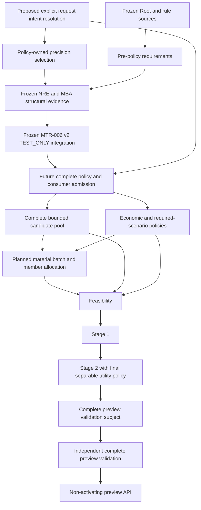

# Post-MTR-006 v2 Freeze Dependency and Readiness Review

**RESEARCH / DOCUMENTATION ONLY — INDEPENDENT ARCHITECTURE AND SCOPE REVIEW PENDING**

This review identifies remaining dependencies after the bounded MTR-006 v2 structural freeze.
Recommendations are proposals: the independent architect selects the next implementation scope
and finalizes its technical design. No new architecture, contract, API, precedence rule, source
authority, detailed design or implementation is established by this document.

## 1. Canonical baseline and method

- Repository: thedusk4203/Menuto.
- Reviewed main: **4b1decc67124eafddb1626dfc6e796a8a77de943**.
- Main/docs tree: **8425dc9ecf6f1325ac16835f9122a06e7a1d262b**.
- Frozen implementation merge: **45bb2677d3eb657dcf36aaf9fc5b9e146e8bf8fa**.
- Frozen implementation tree: **19c97149aeaaf108894e7a3d01afd0db4558e9e9**.
- [PR #138](https://github.com/thedusk4203/Menuto/pull/138): structurally frozen / TEST_ONLY.
- [PR #139 completion](https://github.com/thedusk4203/Menuto/pull/139#issuecomment-6715812674): docs sync complete.
- Owner-verified baseline [push CI 42432677783](https://github.com/thedusk4203/Menuto/actions/runs/42432677783):
  SUCCESS; **4,369 passed / 0 skips**, SCRAM/TLS 16/16, benchmark 22/22, client 10/10.

The completed PR #139 verification is not repeated. Its receipt is retained baseline evidence,
not a new execution claim. This review PR requires its own exact-head CI. Documentation commits
never replace the frozen implementation merge/tree.

Evidence classifications:

- **Direct inspection:** canonical source/contracts, migration inventory, compatibility pins,
  current main identity and live V1.3 acceptance text/state for issues #5/#6/#7.
- **Retained execution evidence:** frozen test mappings and completed review/freeze/CI receipts.
  Earlier NOT FROZEN statements remain historical records.
- **Assessment/proposal:** critical-path choice, future scope cuts, proof obligations and
  persistence expectations. These are not accepted design decisions or executed future tests.

Read: [BACKLOG](BACKLOG.md), [FOUNDATION_STATUS](FOUNDATION_STATUS.md),
[blueprint](IMPLEMENTATION_BLUEPRINT.md), [M0/M1 blueprint](IMPLEMENTATION_BLUEPRINT_M0_M1.md),
[Development Spec V1.3](../MENUTO_DEVELOPMENT_SPEC_V1_3.md) sections 7.3, 8.1, 8.3, 10.3-10.11 and 21,
[INV-001..030](../ARCHITECTURE_INVARIANTS.md), [ADR-001](../adr/ADR-001-band-first-planner.md),
[ADR-002](../adr/ADR-002-nutrition-policy-engine.md), [ADR-003](../adr/ADR-003-plan-policy-resolution.md),
[ADR-007](../adr/ADR-007-spend-limit-robustness.md) and [ADR-010](../adr/ADR-010-independent-validator.md).
The [convergence](POST_PR_120_PLANNER_CONVERGENCE_REVIEW.md),
[post-synthesis](POST_MTR_006_SYNTHESIS_RESOLUTION_PLAN_POLICY_DEPENDENCY_REVIEW.md),
[post-NRE](POST_MTR_007_MEASUREMENT_BASIS_POLICY_V2_DEPENDENCY_REVIEW.md) and
[post-MBA](POST_MBA_POLICY_INTEGRATION_V2_DEPENDENCY_REVIEW.md) reviews were reconciled with current code.
The existing 484-node graph was queried for navigation only; its truncated scaffold-era output
does not prove readiness. No graph rebuild/extraction: **zero extraction tokens**.

## 2. Capability matrix

COMPLETE applies only to cited bounded frozen acceptance. PARTIAL means useful implementation
exists but parent acceptance remains open. MISSING means absent capability/source. BLOCKED means
unavailable under current prerequisites or authorization. None means production-ready by itself.

| Capability | Evidence / actual implementation | Classification and remaining boundary |
| --- | --- | --- |
| Nutrition Root source | [Evidence](NUTRITION_ROOT_CONTRACT_SUPPORTED_ELIGIBILITY_EVIDENCE.md), [freeze](NUTRITION_ROOT_CONTRACT_SUPPORTED_ELIGIBILITY_FREEZE_RECEIPT.md); append-only authority, observations, eligibility/goals, capture/replay and independent checks; migration0016 | **COMPLETE, bounded / FROZEN**; structural authority does not supply approved production content/qualifications |
| MTR-006 v1 | [Evidence](MTR_006_SOURCE_BOUND_NUTRITION_POLICY_SYNTHESIS_CONTAINMENT_EVIDENCE.md), [synthesis](../../apps/backend/app/modules/nutrition/synthesis.py); rule authority and finite exact synthesis with independent checker; migration0017 | **COMPLETE, bounded / FROZEN**; v1 fixture-only resolution is not reinterpreted as NRE evidence |
| MTR-007 estimator | [Evidence](MTR_007_SOURCE_BOUND_NUTRITION_RESOLUTION_ESTIMATOR_EVIDENCE.md), [estimator](../../apps/backend/app/modules/nutrition/resolution_estimator.py), [capture](../../apps/backend/app/modules/planning/nutrition_resolution_capture.py); coherent canonical reads, authored tiers/adjustments, complete declared scope, joint vectors/witnesses | **COMPLETE, bounded / FROZEN**; whole-tier single-tracked-member offered-food attribution is not consumption, physiological intake or shared allocation |
| MBA | [Freeze](MEASUREMENT_BASIS_APPLICABILITY_INDEPENDENT_EVIDENCE_CONTAINMENT_FREEZE_RECEIPT.md), [applicability](../../apps/backend/app/modules/nutrition/basis_applicability.py); original-source same-meaning applicability and independent reconstruction | **COMPLETE, bounded / FROZEN / TEST_ONLY**; fixture authority is not scientific production applicability |
| MTR-006 v2 | [Freeze](MTR_006_POLICY_INTEGRATION_V2_FREEZE_RECEIPT.md), [evidence](MTR_006_POLICY_INTEGRATION_V2_IMPLEMENTATION_EVIDENCE.md), [producer](../../apps/backend/app/modules/nutrition/policy_v2.py); DAY/WEEK joint support, hard/goal/comfort containment and one-shot lifecycle | **COMPLETE, bounded / FROZEN / TEST_ONLY**; no general planner-consumer numerical admission |
| Full MTR-006 | [Issue #5](https://github.com/thedusk4203/Menuto/issues/5): guideline/goal/comfort/weekly policy, versioned roots and appropriate business verification | **PARTIAL / INCOMPLETE**; production content/applicability admission remains **BLOCKED** |
| Full MTR-007 | [Issue #6](https://github.com/thedusk4203/Menuto/issues/6): catalog/portion resolution reporting without silent unbounded widening | **PARTIAL / INCOMPLETE**; production integration and parent acceptance remain open; broader serving/coverage is scope-dependent |
| Policy intent / resolver | [Policy contracts](../../apps/backend/app/modules/policy/contracts.py) contain only ValidationCoveragePolicySnapshot; [draft request](../../apps/backend/app/domain/snapshots.py) separates four axes and BudgetContract | **MISSING** actual resolver and complete resolved policy; draft carriers are not implementation or authenticated truth |
| Defaults/week/override sources | [Household models](../../apps/backend/app/modules/households/models.py) supply identities/membership, not a complete Policy source lifecycle | **MISSING**; household identity does not establish authored defaults or approved precedence |
| Independent Validation | [v2 checker](../../apps/backend/app/modules/validation/nutrition_policy_v2.py), Root/NPS/NRE/MBA companions, grounding/material checks | **COMPLETE** bounded companions; **MISSING** plan-policy resolution and complete preview coverage |
| Planner outcome | Grounding/020A and conditional TasteFit exist; [foundation report](../../apps/backend/app/modules/validation/contracts.py) has REJECTED/BLOCKED_UNSUPPORTED/DIAGNOSTIC only | **PARTIAL** foundations; economics/scenarios, planned flow, feasibility/solve and complete successful preview remain **MISSING/BLOCKED** |
| Production Nutrition admission | Structural publication/enrollment machinery exists; approved installed content/defaults do not | **BLOCKED — GATE CLOSED**; fixtures or software cannot substitute for approval |

## 3. Remaining parent acceptance and stale blockers

**MTR-006:** Root identity, rule authority, finite layer synthesis, containment and independent
v2 reconstruction already exist. Calling the engine entirely unimplemented is stale. TEST_ONLY
policy consistency is not scientific validity, whole-plan safety or parent completion. Existing
authority machinery and actual approved content/qualified actors are different prerequisites.

**MTR-007:** Authored portion tiers, discrete ingredient adjustments, grounded composition,
exact vectors/gaps and witnesses already exist. Do not rebuild them or replace joint evidence
with maximum-gap summaries. Capture remains real canonical PostgreSQL capture even when used
through a TEST_ONLY harness. Package size is not a nutrition-resolution input; arbitrary retail
package resolution is not a prerequisite to invent for #6. Planned ingredient input, offered-food
attribution, consumption and physiological intake remain different meanings. Broader shared-serving
scope and advisor/product orchestration need separate acceptance analysis; neither is proven
mandatory before the next intent work. Existing coarseness diagnostics are not a full advisor.

**MTR-008:** ADR-003 requires independent NutritionPrecision, CostPreference, KitchenEffort and
explicit budget semantics. Policy-owned precision selection precedes nutrition synthesis;
complete resolved policy composition follows it. Requiring complete policy before precision
would create an artificial cycle. Resolver, default/override source lifecycle, complete
economic/kitchen policies and independent resolution checking are missing. Existing
NutritionPrecisionSelection supports REQUEST_EXPLICIT only; it is not complete MTR-008 precedence.

Issue wording about namespace-only delivery is historical baseline language, not the current
006/007 inventory. No parent is closed by this reconciliation. Full #5/#6/#7 remain OPEN.

## 4. Established ownership / authority boundaries

| Boundary | Established capability | What cannot be inferred |
| --- | --- | --- |
| Member/Household -> Nutrition | Exact member physiology/goal authorship; bounded membership-based planning-intent access | OWNER/EDITOR is not another member's goal-authoring authority or guideline publication authority |
| Policy -> Nutrition | Explicit precision bound through NRE/PIV capture to actor, subject and retained evidence | No default/week source, precedence or authentication follows from a UUID/hash |
| Nutrition/Planning -> future consumer | Retained handoff plus Planning-owned trusted capture/one-shot use for its frozen purpose | AVAILABLE_TEST_ONLY and CONSISTENT labels do not transfer planner admission |
| Validation -> consumer | Fresh independent reconstruction establishes retained semantic consistency | Reports/fingerprints/faithful negatives do not establish DB origin, present authorization or positive use |
| Economics -> Policy/Planning | BudgetPressure must remain separate from CostPreference and BudgetContract | Intent labels do not implement reference feasible cost, tolerances, coefficients or feasibility |

Frozen [PolicyV2Use](../../apps/backend/app/modules/nutrition/policy_v2_contracts.py) admits purpose
STRUCTURAL_TEST_ONLY_INSPECTION only. The [consumer](../../apps/backend/app/modules/planning/policy_v2_capture.py)
rechecks/consumes a private lease; serialized output remains UNVERIFIED_TRANSPORT. The
[facade](../../apps/backend/app/modules/nutrition/policy_v2_public.py) grants no consumer admission.
A future numerical consumer requires separate admission design and fresh independent checking;
no implicit extension of the existing purpose is recommended.

INV-001 protects physiology; INV-002 separates pressure/preference/constraint; INV-016..020
require independent primitive/root reconstruction. INV-028 forbids learned observations silently
rewriting explicit user policy. Activated-snapshot stability is a separate specification rule,
not a replacement definition of INV-028. INV-010 forbids inheriting a hard-feasible label after
relaxation; procurement-scenario requirements also use ADR-007.

## 5. Capability ordering toward a validated preview

This is a dependency assessment, not a new implementation architecture. Future boxes represent
missing capabilities; current typed boundaries and ownership remain unchanged.

Precision selection and downstream composition are different stages, not Policy/Nutrition
recursion. Defaults/week/override evidence, economic/kitchen authority and any enabled pressure
computation are additional inputs to future stages, not fabricated values completing this graph.

The accepted [convergence review](POST_PR_120_PLANNER_CONVERGENCE_REVIEW.md) permits future design
to retain all canonical 020A survivors in a finite complete pool: explicit limits/overflow,
no truncation, no infeasibility beyond that pool. This does not complete 020B. MTR-021 is
feasibility, 022 is Stage1, and 024 owns final separable utility/Stage2; none is interchangeable
with 020B. TasteFit is one dimension, not overall utility. Full039/041/046 are not promoted
onto the critical path without a concrete acceptance need.

A TEST_ONLY structural path can advance with production closed. A production-positive
physiological preview still needs separately approved content/applicability, source authority
and complete validation coverage. No production route around those gates is claimed.

## 6. Blocker register

| ID | Kind | Missing prerequisite / disposition |
| --- | --- | --- |
| ENG-01 | Implementation | Explicit orthogonal intent resolution and independent checking: candidate small engineering scope, pending architect selection/design |
| ENG-02 | Source authority | Durable defaults/week/override authorship, lifecycle/versioning/selection absent; defer from minimal explicit-request scope |
| ENG-03 | Consumer authority | PIV purpose/lease does not authorize a new planner consumer; separate admission/integration review required |
| ENG-04 | Policy semantics | Economic/kitchen numerical policies, scenario selection, tolerances and pressure evidence incomplete; labels cannot mint values |
| ENG-05 | Validation/orchestration | Complete policy, flow, subject and successful preview coverage/report missing; another payload wrapper does not supply them |
| ENG-06 | Compatibility governance | Exact export counts/name sets and historical files are pinned; new exports need separately approved metadata scope, not inherited old exceptions |
| SCI-01 | Production content | Approved production nutrition/clinical content/defaults unavailable; BLOCKED, gate CLOSED |
| SCI-02 | Scientific applicability | Planned input is not physiological intake; separate evidence/approval required outside reviewed original-source meaning, not necessarily a universal conversion engine |
| SCI-03 | Qualification/publication | Structural grants/enrollment do not create actual qualified production reviewers/publishers/assessors; BLOCKED pending approval |

Resolved findings are retained, not reopened: R-127-01 rejects reports as proof; MBA-R133-01 and
PIV-R136-01 preserve publication-time authorization and faithful-negative versus forged-positive
handling; PIV-R138-01 checks complete per-original-root period vectors. See the
[freeze history/differential evidence](MTR_006_POLICY_INTEGRATION_V2_FREEZE_RECEIPT.md).

## 7. Candidate comparison and recommendation

| Candidate | Prerequisites / value | Assessment |
| --- | --- | --- |
| MTR-008 explicit-request orthogonal plan-intent resolution | ADR-003, draft axes/budget and explicit precision boundary exist; resolves real missing intent semantics without scientific content | **Recommended smallest candidate for architecture/scope review** |
| Complete MTR-008 with defaults/numerical binding | ENG-02/03/04 plus independent checking; source/persistence strategy and precedence not approved | Too broad as the next implementation slice |
| Another nutrition admission/compatibility layer | Needs actual approved consumer purpose and source authority | Defer; do not extend inspection lease or add an adapter merely to pass a payload |
| Broader MTR-007 serving/catalog work | Needs scope-specific source and serving requirements/evidence | Not proven necessary before explicit intent; preserve bounded estimator |
| Production scientific publication | SCI-01/02/03 approval | BLOCKED; engineering fixtures cannot replace approval |
| Economics/feasibility/solver/preview API | Remaining policy/source/flow/coverage inputs | Separate downstream gates, not unlocked merely by v2 freeze |
| MTR-039, full041/046, further TasteFit | Concrete enabled history/behavior/coverage need | Not selected; no evidence makes them next prerequisites |

**Recommended candidate: MTR-008 explicit-request orthogonal plan-intent resolution
(STRUCTURAL / TEST_ONLY), subject to independent architect selection and subsequent design.**

The smallest proposed capability interprets/checks fully explicit request intent without
inferred defaults, pressure, kitchen duration or economic weights. It is not complete
ResolvedPlanPolicy, authenticated DB origin, numerical consumer admission or a ready planner.
Pure-only versus authenticated-capture scope is an unresolved architect decision. This review
defines no new types, signatures, status vocabulary, modules or precedence hierarchy.

Pure request interpretation does not inherently need persistence. This is conditional, not a
ZERO NEW PERSISTENCE guarantee for broader MTR-008. Selecting durable defaults/new authority
requires separate source/migration approval; no migration0018 is assumed or reserved.

## 8. Proposed future proof obligations

These categories are recommendations, not executable tests or approved contract design.
Concrete IDs, schemas and execution counts belong to a later approved design.

| Category | Required proof |
| --- | --- |
| Orthogonality | Changing one declared axis does not change another value/budget; provenance changes are distinguished from semantic changes |
| Explicitness | Missing intent does not become STANDARD/NORMAL/MAINTAIN, zero or unrestricted |
| Budget meaning | NONE/TARGET/SPEND_LIMIT distinct; explicit zero preserved; exact money/currency semantics |
| No hidden numerical policy | Labels do not mint time limits, tolerances, pressure, clinical targets or solver weights |
| Identity/time | Exact request/actor/subject/horizon/version binding and replay; offline consistency is not authentication |
| Independence | Checker reconstructs from retained primitives without producer resolver oracle |
| Adversarial claims | Fully rehashed tamper, forged CONSISTENT reports, invalid constructed models and environment stripping cannot mint authority |
| Non-success | Missing/unsupported inputs remain non-authorizing, distinct from hard conflicts or solver infeasibility |
| Frozen admission | Carriers/reports cannot obtain PIV leases or extend STRUCTURAL_TEST_ONLY_INSPECTION |
| Source selection | No unreviewed profile/week fallback or precedence; unsupported sources fail closed |
| Resource bounds | Server-owned pre-processing limits, deterministic overflow and no favorable truncation |
| Compatibility | All 528 baseline bodies, historical pins/files, test identities and behavior retained; independently authored exact additive-name manifest if exports added |
| Closed gates | No clinical content, planner/activation permission, issue closure or downstream behavior |

**PostgreSQL:** a pure-only interpretation/checking slice needs no new PG authority claim or PG
test merely for enumeration/serialization. Existing real-PG regression remains mandatory.
If authenticated capture is selected, separately designed real-PG cases must prove principal/actor
binding, membership/cross-household access, coherent transaction/absence evidence, revocation,
source completeness and no privilege widening. Mocks cannot satisfy these. Scope/case counts
must be reviewed before implementation, not invented by this document.

Future implementation must retain all 4,369 baseline tests with zero skips, add focused adversarial
proof, and pass real PostgreSQL where applicable, SCRAM/TLS, benchmark, client/web and all guards.
Separate focused runs must not be summed into one full-suite PASS.

## 9. Documentation verification and authorization boundary

Scope: this review plus minimal notices in four status documents. Historical design/evidence and
frozen implementation remain unchanged. Local checks cover links, identical notices, docs-only
diff, historical-tail preservation, compatibility and original19 preservation, plus existing
repository guards. Exact-head CI and direct log results are recorded in the PR verification receipt.

An isolated worktree starts at the exact main baseline. The already open same-purpose PR is reused
instead of duplicated; the original and other PR worktrees are not edited. No source, test, contract,
tooling, CI, migration, data or privilege change is included. No new architecture design is delivered.

Preserved: **528 exports; 503 historical hashes; 53 historical frozen files** (59 complete v2 pins),
**0017/108**, no0018. Full **MTR-006/007/008 INCOMPLETE**; **issues#5/#6/#7 OPEN**;
production gate **CLOSED**; planner_ready=False; activation_ready=False;
**Execution NOT STARTED; PRECOMMIT FAIL-CLOSED**.

NEXT RECOMMENDED CANDIDATE: MTR-008 explicit-request orthogonal plan-intent resolution (STRUCTURAL / TEST_ONLY)

STATUS: READY FOR INDEPENDENT ARCHITECTURE AND SCOPE REVIEW — NOT SELECTED OR AUTHORIZED FOR IMPLEMENTATION

Independent architect scope selection/technical design and separate owner execution authorization
are required before code. Do not self-approve, merge, close parent issues, begin detailed design or
implementation, publish content or activate the planner under this research authorization.

**POST-MTR-006 V2 FREEZE DEPENDENCY REVIEW — READY FOR INDEPENDENT REVIEW / NO IMPLEMENTATION AUTHORIZED / PRODUCTION GATE CLOSED**
