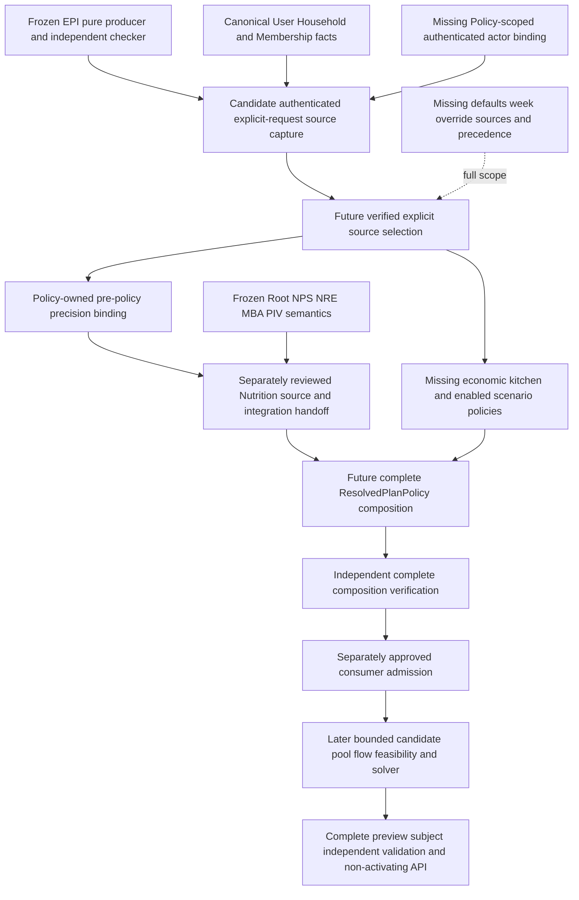

# Post-MTR-008 pure-only freeze — remaining PlanPolicyResolver dependency/readiness review

**RESEARCH / DOCUMENTATION ONLY — INDEPENDENT ARCHITECTURE AND SCOPE REVIEW PENDING**

This review recommends one next bounded detailed-design candidate. It does not establish a new
architecture, exported schema, source credential, permission matrix, precedence rule or consumer
admission contract. Proposed records and tests below are design inputs, not approved implementation
obligations or completed tests. Do not repeat or reinterpret the frozen pure-only implementation.

## 1. Verified baseline and evidence method

- Repository: `thedusk4203/Menuto`.
- Exact reviewed main: **`fddb1a665f438ad2cc8ccf04521a93b8172af16d`**.
- Main/docs tree: **`1c3ba1666fbd5e68b74933ca9e0c3630a9eb0a79`**.
- [PR #144](https://github.com/thedusk4203/Menuto/pull/144) is merged; reviewed head
  `8b3c89af1d08159054609f40aa3def8a944d9472`; exactly five reviewed Markdown files.
- [Independent docs PASS 6724664128](https://github.com/thedusk4203/Menuto/pull/144#issuecomment-6724664128)
  and [read-back-verified completion 6725291583](https://github.com/thedusk4203/Menuto/pull/144#issuecomment-6725291583).
- Exact merged-main **push** [CI 42505294416](https://github.com/thedusk4203/Menuto/actions/runs/42505294416):
  **SUCCESS**, Python/web/every step; direct logs **4,611 passed / 0 skips**, six retained warnings,
  SCRAM/TLS16/16, benchmark22/22, client10/10. This is not a substitute PR run.
- No main drift was found before this research branch; original local19 remain protected.

Evidence labels used here:

- **Verified:** inspected current source, contracts, SQL, tests, exact Git identities and live issue bodies.
- **Retained execution:** frozen acceptance manifests/receipts and completed CI logs. Future tests below
  are not execution evidence. Completed PR #139 verification was not repeated.
- **Assessment/proposal:** ordering, contract roles, design questions and future test groups. The independent
  architect must select the scope and approve its design before separate owner implementation authorization.

Read the current [BACKLOG](BACKLOG.md), [FOUNDATION_STATUS](FOUNDATION_STATUS.md),
[blueprint](IMPLEMENTATION_BLUEPRINT.md), [M0/M1 blueprint](IMPLEMENTATION_BLUEPRINT_M0_M1.md),
[V1.3](../MENUTO_DEVELOPMENT_SPEC_V1_3.md) §§8.1–8.3, 10.3–10.4, 10.8–10.11 and21,
[ADR-002](../adr/ADR-002-nutrition-policy-engine.md), [ADR-003](../adr/ADR-003-plan-policy-resolution.md),
[ADR-010](../adr/ADR-010-independent-validator.md) and [INV-001..030](../ARCHITECTURE_INVARIANTS.md).
Reconciled the [post-v2 review](POST_MTR_006_POLICY_INTEGRATION_V2_DEPENDENCY_REVIEW.md),
[approved EPI design](MTR_008_EXPLICIT_REQUEST_PLAN_INTENT_BOUNDED_DESIGN.md),
[EPI implementation evidence](MTR_008_EXPLICIT_REQUEST_PLAN_INTENT_IMPLEMENTATION_EVIDENCE.md)
and [bounded EPI freeze](MTR_008_EXPLICIT_REQUEST_PLAN_INTENT_FREEZE_RECEIPT.md).
The existing 484-node graph was queried for navigation (policy/precision/planning/validation/
household/member/budget/source/capture/context); its scaffold-era nodes do not prove current readiness.
No graph rebuild or extraction: **zero extraction tokens**; code inspection overrides stale navigation.

## 2. Immutable foundation inventory

These are implementation identities, not the current docs tree. COMPLETE below always means bounded
structural acceptance, never production scientific approval or parent issue completion.

| Foundation | Frozen merge | Frozen tree |
|---|---|---|
| Nutrition Root | `6a77575fcb0ecf7a02493dae935fab88e94d09f1` | `3b2f7a210ebd75bc8e81555cab3d0e55a8b05ccf` |
| MTR-006 v1 / NPS | `45ed430ff3306939366bf82e232d02054475b360` | `6245a39ecd020499f62e6c01bed8588d9e537778` |
| MTR-007 / NRE | `82b4a7c631acbc04ffbd522702bf3529d7e2e2d2` | `504dcad192131f5e3bc99271f2cb6fcc88284d20` |
| MBA | `9d3b580ce2a2d111223b37814612a4072dbfe6a2` | `3a68035f9c33de152b3899a083d534a537c647e1` |
| MTR-006 v2 / PIV | `45bb2677d3eb657dcf36aaf9fc5b9e146e8bf8fa` | `19c97149aeaaf108894e7a3d01afd0db4558e9e9` |
| MTR-008 pure-only / EPI | `40875d95f81390f3985cc0e2ad4600b1e494dacb` | `a6f53925857898ce0d63c30f4da5b55890e7d374` |

## 3. Actual capability matrix and active acceptance

| Capability / acceptance | Current evidence | State / genuinely missing work |
|---|---|---|
| Root authority, member facts/goals, eligibility, capture/replay | Root source implementation and [freeze](NUTRITION_ROOT_CONTRACT_SUPPORTED_ELIGIBILITY_FREEZE_RECEIPT.md) | **COMPLETE bounded / FROZEN**; no approved production publications, population protocols or qualified actors |
| Nutrition guideline/goal/comfort/weekly synthesis, versioned roots (#5 / MTR-006) | NPS plus [PIV freeze](MTR_006_POLICY_INTEGRATION_V2_FREEZE_RECEIPT.md); exact source-bound synthesis and independent containment | **PARTIAL parent / INCOMPLETE**; bounded structural semantics implemented; production scientific/content admission **BLOCKED** |
| Catalog/portion resolution without unbounded widening (#6 / MTR-007) | NRE capture, exact joint vectors/witnesses and [evidence](MTR_007_SOURCE_BOUND_NUTRITION_RESOLUTION_ESTIMATOR_EVIDENCE.md) | **PARTIAL parent / INCOMPLETE**; bounded estimator FROZEN; offered ingredient input is not intake or shared allocation |
| Four explicit axes compiled independently (#7 / MTR-008) | `resolve_explicit_plan_intent_v1`, `check_explicit_plan_intent_v1`, nine versioned contracts, EPI001–064 | **COMPLETE bounded / FROZEN** symbolic explicit interpretation; **PARTIAL** full resolver acceptance |
| Source-authenticated four-axis request | EPI context UUIDs/horizon/revision are caller declarations; outputs fix UNAUTHENTICATED_DECLARATION / NOT_ADMITTED | **MISSING** independent actor-to-request/household/member source binding, canonical capture and trusted origin verification |
| Household identity/access primitives (#3 / MTR-004) | `User`, `Household`, `Membership`; internal actor readers; NRE bounded member witness | **PARTIAL** supporting capability; not a general credential/session/request-authentication system; no need to close #3 before using valid primitives |
| Authenticated precision within Nutrition | `NutritionPrecisionSelection`; protected synthesis capture checks reader user and OWNER/EDITOR household membership | **COMPLETE bounded seam**, not all-axis authority or full MTR-008; do not rebuild or broaden it silently |
| User defaults, current week, override provenance/lifecycle | Required by ADR-003/V1.3; no concrete source models/resolvers found for UserPolicyDefaults / CurrentWeekContext / PlanIntentOverride | **MISSING** authorship, persistence strategy, effective/revision history and approved precedence |
| Economic / kitchen compilation | EPI retains exact budget and effort/cost labels; retail facts are not EconomicPolicyResolver or KitchenPolicyResolver | **MISSING** enabled versioned numerical policies, availability source, required scenarios and independent enforcement; no invented coefficients |
| Complete ResolvedPlanPolicy and independent composition checking | No concrete ResolvedPlanPolicy implementation; PlannerRequestDraft is a draft carrier | **MISSING** complete selected-source/policy composition, version/provenance snapshot and independent verifier |
| Numerical consumer admission | PIV has a private one-shot lease for STRUCTURAL_TEST_ONLY_INSPECTION only; EPI has none | **MISSING** separately approved downstream purpose and fresh source/semantic checks; serialization cannot supply it |
| Production physiological policy / preview | Structural engines and sources exist; actual scientific applicability/content authority remains closed | **BLOCKED** production authority/content and downstream engineering; TEST_ONLY intent work can advance without opening this gate |

Live issues [#5](https://github.com/thedusk4203/Menuto/issues/5),
[#6](https://github.com/thedusk4203/Menuto/issues/6) and
[#7](https://github.com/thedusk4203/Menuto/issues/7) were re-fetched and remain **OPEN**.
Their active V1.3 acceptance supersedes V1.2 text under historical details. Namespace-only baseline
wording is stale as a capability inventory; adjacent frozen primitives do not automatically satisfy
full business acceptance or justify issue closure. The user defaults/week sources in ADR-003 remain
full-scope obligations even though they can be omitted from a separately bounded fully explicit route.

## 4. Directly verified trust-boundary findings

1. `policy/explicit_intent_contracts.py` fixes both producer/checker non-authority fields.
   Context actor/member/household IDs and request_revision do not prove authorship, current membership,
   CAS, idempotency or a stored request revision. EPI049 rejects a report as proof; EPI050 intentionally
   permits coherent source+claim replacement to be offline-consistent but unauthenticated.
2. `identity/models.py` explicitly implements an identity anchor only. `households/public.py`
   accepts an already authenticated internal actor; read_household_actor/lock_household_actor do not
   authenticate their UUID argument. `main.py` exposes health only; no production request-auth endpoint exists.
3. `households/resolution_public.py::capture_resolution_member` proves an exact household/member
   relationship and OWNER/EDITOR access for bounded NRE planning intent. It does not grant member goal,
   physiology, scientific publication, general all-axis Policy source or future financial-use authority.
4. `0017_nutrition_synthesis_sources.py::capture` (lines743–748) binds precision to the actual enrolled
   reader user and exact household. `synthesis_journal.py` independently replays that witness.
   `planning/nutrition_resolution_capture.py` additionally checks the enrolled human, member and one
   actual clean read-only repeatable snapshot. These are reusable architectural patterns, **not reusable
   capabilities**. A new Policy capture must not demand unrelated Nutrition provider/content merely to
   authenticate explicit cost/effort/budget intent, or pretend a Nutrition read grant already authorizes it.
5. Membership currently stores identity, role and created_at, not an append-only historical policy
   authorization journal or row_version. A future design must use facts actually available at the cut;
   it cannot claim historical current authorization, expiry, CAS or valid-time history from invented fields.
6. `planning/policy_v2_capture.py::expected_policy_v2_use` explicitly returns an unverified selector;
   consume_test_policy_v2 requires an issued private lease and fresh checking. Its sole purpose is
   inspection. EPI output or a new source wrapper cannot acquire/extend that lease by matching hashes.

Key inspected implementation/test evidence:
[EPI contracts](../../apps/backend/app/modules/policy/explicit_intent_contracts.py),
[pure producer](../../apps/backend/app/modules/policy/explicit_intent.py),
[independent EPI checker](../../apps/backend/app/modules/validation/explicit_plan_intent.py),
[identity anchor](../../apps/backend/app/modules/identity/models.py),
[Household models](../../apps/backend/app/modules/households/models.py),
[internal actor access](../../apps/backend/app/modules/households/public.py),
[NRE member witness](../../apps/backend/app/modules/households/resolution_public.py),
[NRE capture](../../apps/backend/app/modules/planning/nutrition_resolution_capture.py),
[protected synthesis SQL](../../apps/backend/migrations/versions/0017_nutrition_synthesis_sources.py),
[synthesis replay](../../apps/backend/app/modules/nutrition/synthesis_journal.py),
[PIV capture/use](../../apps/backend/app/modules/planning/policy_v2_capture.py),
[PIV contracts](../../apps/backend/app/modules/nutrition/policy_v2_contracts.py),
[NRE real-PG tests](../../apps/backend/tests/test_postgres_nutrition_resolution.py),
[EPI adversarial tests](../../apps/backend/tests/test_explicit_plan_intent.py),
[EPI compatibility proof](../../apps/backend/tests/fixtures/explicit_plan_intent_compatibility.json).

These findings identify missing scope, not defects in the frozen implementations.

## 5. Dependency graph and shortest bounded path

Solid arrows are required data/proof dependencies; the dotted optional branch is necessary for full
V1.3 behavior but deferrable for a future explicitly scoped all-inputs-present path. Missing boxes
are capabilities, not accepted new contract names or an implementation plan.

The candidate removes the next concrete source-authentication gap; it does not by itself finish
S/P/N/R/V/U. Frozen NRE/PIV retain their existing precision path and inspection purpose unchanged.
No dependency from full ResolvedPlanPolicy back to its own precision input is introduced.
Existing source capture is not reimplemented merely to route an EPI label into another adapter.

For a bounded explicit route, defaults/week/override are not a prerequisite to know four values
already explicitly supplied. Authenticated origin and exact subject/scope are necessary before
those values can later be relied on as user policy. For full V1.3 defaults/overrides, their sources,
precedence and independent selection proof remain required; this review does not remove acceptance.
Production credentials/HTTP authentication are separate from an internally bounded TEST_ONLY proof
of DB-authenticated actor/source binding. Neither a full public identity product nor clinical content
must be assumed ready to design that bounded seam; a credible trust root must still be proved.

## 6. Competing gates and ordering

| Candidate | Frozen prerequisites / unlock | Missing prerequisite / authority | Ordering assessment |
|---|---|---|---|
| **Authenticated explicit-request plan-intent source capture and independent source verification — STRUCTURAL / TEST_ONLY** | EPI interpretation/checking, exact request scope, Household facts and frozen capture patterns; unlocks trusted source binding for later selection/composition | Policy-scoped authenticated actor binding, operation-specific access, coherent retained witness and lifecycle must be designed | **Recommended one next bounded detailed-design candidate**; no scientific values needed; not implementation-ready until design approval |
| Defaults/week/context/override source lifecycle | ADR-003 and independent axes; would unlock omitted-field resolution and full situational policy | Authorship/subject authority, durable source strategy, correction/effective time and precedence | Legitimate later gate, but broader and not needed before an explicit authenticated path; cannot invent fallback order now |
| Complete four-axis numerical composition / ResolvedPlanPolicy | EPI plus frozen Nutrition engines; would join selected policy dimensions | Authenticated inputs, approved numerical economic/kitchen sources, exact Nutrition handoff and independent checking | Defer full composition; a symbolic four-axis aggregate alone would duplicate EPI and not prove source authority |
| Consumer admission alone / another generic adapter | PIV lifecycle pattern; would eventually authorize a particular reviewed consumer | Exact consumer purpose, source origin/freshness, complete policy and independent semantic coverage | Defer; accepting serialized CONSISTENT labels or changing the frozen purpose cannot fill these gaps |
| General public login/session/consent product | User identity anchor and Household structure | Separate identity/security/API authority design | Needed before public production ingress; not shown necessary as a whole before a bounded internal TEST_ONLY source design |
| More Nutrition/MBA/NRE/preference refinement | Existing bounded engines and evidence | Any broader serving/basis/scientific or learned-source requirements | Not proven necessary for this next source seam; preserve freezes rather than repeat completed work |
| Production content/qualification/publication | Structural journals only | Independent scientific evidence, qualified actors and explicit owner content authorization | **BLOCKED / CLOSED**, not an engineering substitute or next implicit gate |

The recommendation is one combined **source binding/capture proof boundary**, not a new generic
authentication framework, numerical policy engine or lifecycle for stored user defaults.
If its trust root cannot be isolated without changing frozen permissions or requiring a broader
identity/source-authority primitive, the designer must report that prerequisite and return for scope
approval; readiness for design is not a claim that authority already exists.

## 7. Proposed contract and ownership obligations for later design

These are logical immutable record roles and minimum proof content, **not final types, exact fields,
signatures, export counts, permission grants or a new architecture design**.

| Proposed record role | Minimum retained binding / responsibility |
|---|---|
| Explicit request preimage | Exact original typed EPI primitive request, full four-axis values, request/revision, actor/household/member/horizon; retain child interpretation versions unchanged |
| Authenticated source frame | Actual endpoint/database and login identities/OIDs, authentication evidence, server-owned environment/trust-context identity, connection/transaction/read-only/isolation/MVCC, capture interval and relevant authority generation where it actually exists |
| Exact actor/subject access witness | Verified principal-to-User binding, exact Household/Membership/member facts and approved operation scope; canonical absence/denial evidence without unrelated member disclosure |
| Source-bound companion input/result | Bind complete request preimage and access frame; retain frozen EPI result unchanged as a child. Outer evidence never relabels UNAUTHENTICATED_DECLARATION inside that child |
| Independent source/intent check | Validation reconstructs exact source/scope/access consistency and freshly invokes/reconstructs frozen child semantics from primitives; no producer capture/resolver as oracle and no caller report as proof |
| Trusted origin boundary | Distinguish a live server-issued capture context from serialized retained transport. A copied snapshot/check/hash cannot prove DB origin, current authorization or numerical admission |

Policy owns explicit plan-intent semantics and future source-selection rules. Identity owns verified
principal-to-user truth; Households owns membership/member facts. Planning may orchestrate capture,
not mint these authorities. Validation owns independent checking. Nutrition owns its roots/rules and the approved numerical effect of precision, not precision source
selection or authorship; Economics and Kitchen own their later numerical policies. Household
participation does not imply another member's goal authorship or guideline publication authority.

The detailed design must decide the exact operation matrix, principal enrollment/trust source,
request binding, one-snapshot support, freshness/expiry/revocation and transaction/cancellation
lifecycle. Do not repurpose unrelated root/prior/hierarchy/Nutrition grants. A trusted test-only
binding may be evaluated, but must be independently evidenced and cannot be sold as production
identity/authentication. No signed token, private lease or durable journal is preselected here. Authorization at actual
capture/use time must be distinguished from declared_at and the requested planning horizon.
If the later design introduces expiring authority, expiry without REVOKE must be checked at the
relevant operation time; backdated renewal cannot repair an unauthorized earlier capture. A retained
membership cut does not promise unchanged permission throughout a future horizon.

**Persistence:** a request may be transient and retained with a captured input; this does not prove
that a new canonical credential/delegation source can be transient. Existing Membership facts do not
supply arbitrary authorization history. The design must prove reuse of an appropriate existing trust
root or propose separately authorized durable authority. This review adds none, promises no future
ZERO NEW PERSISTENCE result and reserves no migration0018, table count or roles. Any such need
requires explicit design/implementation/migration approval before code.

## 8. Proposed acceptance and adversarial obligations

The following 16 groups are research proposals to refine at detailed design, not a frozen acceptance
namespace or tests already implemented. Preserve all EPI001–EPI064; do not change their expected
UNAUTHENTICATED_DECLARATION outcomes merely because a future outer companion has stronger evidence.

| Group | Future proof | Test class |
|---|---|---|
| A01 | Exact request body binds authenticated principal, actor, household, member and horizon; arbitrary UUID equality is insufficient | PG + pure |
| A02 | Approved operation/role matrix, absent membership, foreign household/member and service-vs-human distinctions fail closed | PG |
| A03 | Real DB/login OID/name, SCRAM/verified TLS; reject trust/shared-login spoofing, SET ROLE and unsafe owner/superuser identities | PG / dedicated smoke |
| A04 | One actual clean read-only RR/SERIALIZABLE cut; no dirty cache, flush, multi-engine or fabricated common snapshot | PG |
| A05 | Removal/change/revocation is observed by fresh capture; retained historical consistency does not certify current authorization | PG + pure |
| A06 | Request revision/declared_at not mistaken for DB sequence, effective authorization, CAS or uniqueness; any designed future-use lifetime tested explicitly | PG + pure |
| A07 | No source truncation, favorable row selection, irrelevant member leakage or missing-witness positive result | PG + pure |
| A08 | Faithful source/access negatives remain non-authorizing and distinct from forged favorable claims, hard nutrition conflicts and solver infeasibility | Pure + PG |
| A09 | Rehashed actor/body/household/horizon substitutions and forged CONSISTENT labels cannot obtain trusted origin; coherent offline replacement remains untrusted transport | Adversarial + PG binding |
| A10 | Independent checker reconstructs from primitive evidence; no capture/producer oracle, cached report or reusable bearer proof | Pure + static |
| A11 | Frozen four-axis orthogonality, money/currency/zero, NONE/TARGET/SPEND_LIMIT and missingness unchanged; no BudgetPressure division, coefficients or implicit default | Retained EPI + focused |
| A12 | Bounds apply before parse/canonicalization and source work; bounded rows/history/int sizes/deadlines, cancellation/restoration/all-or-error behavior | PG + adversarial |
| A13 | TEST_ONLY cannot be stripped/promoted; no new numerical, production, planner or activation authority and no PIV purpose expansion | Pure + static + PG setup |
| A14 | Least privileges, fixed trusted SQL resolution where SQL is used, no direct DML/enrollment escalation, no unrelated grant reuse or broad read permissions | PG |
| A15 | Exact frozen bodies/files/import boundaries plus independently pinned additive manifest if new exports are later approved | Compatibility + static |
| A16 | Full retained 4,611 regression with zero skips; complete mapping and final exact-head CI, no summing focused runs into a full-suite result | Full CI |

**Real PostgreSQL is required for source-authentication claims.** A01–A09/A12–A14 have live-source
aspects; mocks/collection alone cannot satisfy them. The approved design must enumerate actual
protected-path cases, parameter expansions and execution counts. This proposal does not assign a
fictional completed PG count or force one table/function per group. Real cases must cover endpoint/
role recreation, credential/capability isolation, concurrent membership changes at coherent cuts,
privilege/shadowing bypass, timeout/rollback and fixture-only installation. Existing NRE002–007 and
retained source tests are patterns/regressions, not tests of the missing new Policy capture.

Server-owned structural limits are needed for any new source boundary. Existing caller declarations
or semantic budgets are not hostile-ingress protection. Public HTTP body, participant, integer,
nesting, encoded-policy size and execution limits remain the separate Planner API/production ingress
obligation; this candidate creates no public endpoint.

## 9. Blocker and deferred-dependency register

| ID | Class | Disposition |
|---|---|---|
| ENG-01 | Authenticated Policy actor/request binding absent | **READY for bounded detailed-design investigation**, mandatory unresolved design gate; not implementation authority |
| ENG-02 | Canonical authorization scope/freshness/source strategy | Must be settled within candidate design or returned as a narrower missing prerequisite; no fabricated membership history or reused Nutrition privilege |
| ENG-03 | Defaults/week/override truth and precedence | **DEFERRED** for explicit-only path; **MISSING** for full MTR-008 |
| ENG-04 | Numeric economic/kitchen sources, availability/scenarios | **DEFERRED / MISSING** for complete composition; no authored production coefficients here |
| ENG-05 | Source-bound precision integration and complete Nutrition handoff | **DEFERRED** separately reviewed seam; preserve frozen precision/PIV behavior and original measurement meaning |
| ENG-06 | Complete ResolvedPlanPolicy, independent validation and consumer purpose | **DEFERRED / MISSING**; origin, semantic consistency and admission remain different proofs |
| SCI-01 | Actual Nutrition/clinical content and qualified production actors | **BLOCKED — GATE CLOSED**, engineering structural success is not scientific approval |
| SCI-02 | Planned-input/offered/consumed/physiological applicability | **BLOCKED** outside exact frozen meaning unless separately reviewed scientific evidence authorizes it; no implicit conversion |
| OUT-01 | Solver, MTR-008 implementation, activation, Execution/PRECOMMIT or issue closure | **OUT OF SCOPE / NOT AUTHORIZED** |

Historical R-127-01, MBA-R133-01/PIV-R136-01 and PIV-R138-01 stay resolved. Their lessons are
retained: reports/hashes are not authority; publication-time authorization cannot be repaired by
later renewal; faithful negatives differ from positive forgeries; complete joint per-root temporal
witnesses cannot be replaced by gap summaries. See [PIV freeze history](MTR_006_POLICY_INTEGRATION_V2_FREEZE_RECEIPT.md).
No new source seam may bypass those boundaries or silently convert planned ingredient input to intake.

## 10. Verification inventory and governance

This PR contains this research document plus minimal discovery links in four status documents.
No source/contracts/tests/fixtures/tooling/CI/migration/schema/data or privilege change. All earlier
status/freeze/design evidence is preserved. Checks cover links, exact identities, docs-only diff,
unchanged historical tails, 537 definitions and historical pins, original19 status/HEAD/SHA-256,
Ruff, architecture/import guards, OpenAPI/domain exports and fixtures. Its own exact-head full CI
must succeed; run ID/head/log results are recorded in the PR verification receipt after execution.

Compatibility retained: **537 exports, 515 legacy hashes, 503 historical hashes, 53 historical frozen
files, 59 complete PIV pins**, 528 unchanged pre-EPI bodies plus9 existing EPI additions; **0017/108**,
no0018, no new persistence/SQL/roles/privileges. Root/NPS/NRE/MBA/PIV/EPI identities above stay fixed.
All original19 local files remain untouched in the original worktree; research uses an isolated
branch based on the verified docs merge. No implementation branch is reset or published.

**NEXT RECOMMENDED GATE: MTR-008 Authenticated Explicit-Request Plan-Intent Source Capture & Independent Source Verification — Bounded Detailed Design (STRUCTURAL / TEST_ONLY)**

**STATUS: READY FOR INDEPENDENT ARCHITECTURE/SCOPE REVIEW AS THE NEXT DETAILED-DESIGN CANDIDATE**

No detailed design or implementation is started by this verdict. Independent scope selection,
separate owner design authorization, approved design and separate implementation authorization
remain required. Stop if frozen semantics/permissions must change, unsupported authority is assumed,
scientific content is needed or source/migration scope cannot be kept within a separately approved gate.

Full **MTR-006/007/008 INCOMPLETE**; issues **#5/#6/#7 OPEN**; production Nutrition/clinical gate
**CLOSED**; `planner_ready=False`, `activation_ready=False`; Execution **NOT STARTED**;
PRECOMMIT **FAIL-CLOSED**. No solver, production content or planner activation is authorized.

**MTR-008 PURE-ONLY DOCS SYNC COMPLETE / NEXT DEPENDENCY REVIEW SUBMITTED / IMPLEMENTATION NOT AUTHORIZED / PRODUCTION GATE CLOSED**
