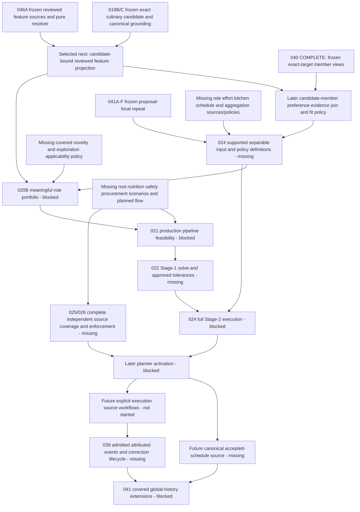

# Post-MTR-040 — Next-Milestone Dependency Review

Status: **REVIEW / DOCUMENTATION ONLY — NO IMPLEMENTATION AUTHORIZED**.
Reviewed 2026-10-27 at `b42abd13226c983b9f131f0b15671e134292fcfb`.

Subsequent approved gate: [PR #110](https://github.com/thedusk4203/Menuto/pull/110) merged reviewed
head `e8989e41e237a81b330adc6387dee44881b67e99` at actual main
`623218e2713faf950dd01325436c9a6e3969f638`; tree equals the approved head. Exact post-merge push
[CI 40499400731](https://github.com/thedusk4203/Menuto/actions/runs/40499400731) SUCCESS, python/web SUCCESS;
2,978 tests, 358 exports, schema 0015 / 85. Dependency selection is approved and dedicated design
was separately authorized. The [resulting design](CANDIDATE_BOUND_REVIEWED_CULINARY_FEATURE_PROJECTION_DESIGN.md)
is **DESIGN READY FOR ARCHITECTURE REVIEW — IMPLEMENTATION NOT AUTHORIZED**. The findings below
retain their exact reviewed baseline; this receipt grants no implementation or downstream authority.

## 1. Selected next gate

```text
NEXT RECOMMENDED GATE:
Candidate-bound Reviewed Culinary Feature Projection Foundation

STATUS:
READY FOR DETAILED DESIGN
```

This is one additive **candidate-input integration slice using frozen MTR-046A and MTR-019B/C**,
supporting the feature-based input branch toward MTR-024/020B. The descriptive name identifies
the proposed boundary; this review assigns no new MTR suffix, approves no detailed contract and
does not start MTR-024. It does not recommend finishing the whole Catalog coverage matrix next.

The missing seam is specific: canonical pre-selection candidates do not yet have a captured,
replayable binding to reviewed METHOD / MAIN_PROTEIN / FLAVOR discovery. Existing feature
capture requires a current proposal and batch. Source-owned classification can already evaluate
an exact authored path independently of a proposal. Design that additive bridge before designing
feature-backed candidate preference/utility composition, rather than inventing new classifications
or treating a proposal preview as global history.

**MTR-040 remains COMPLETE; issue #41 remains CLOSED / COMPLETED.** Its final closure and all
frozen semantics are inputs to this review, not questions reopened by it. Implementation of the
recommended slice is **not safe to authorize from this document alone**: the dedicated design
must settle the capture/binding/replay decisions in §8 and receive separate approval.

## 2. Exact canonical baseline

| Item | Verified receipt |
| --- | --- |
| Repository / fetched main | `thedusk4203/Menuto`, `b42abd13226c983b9f131f0b15671e134292fcfb`; clean checkout before the review branch |
| MTR-040 closure | [Accepted completion review / closure receipt](POST_MTR_040C_PARENT_MTR_040_COMPLETION_REVIEW.md#12-approved-closure-receipt); PR #108 merge `959e7fa3488e0c379ab37044c25da74292c2d76b`, followed by status-only PR #109 at this baseline |
| Exact baseline push CI | [40489256381](https://github.com/thedusk4203/Menuto/actions/runs/40489256381), event=push, exact baseline SHA, SUCCESS; python/web SUCCESS |
| Baseline checks | 2,978 pytest cases passed; SCRAM/TLS 16/16; benchmark 22/22; contract/export/typecheck/client/build checks succeeded |
| Exports / schema | 358 domain definitions; Alembic 0015 / 85 domain tables; no migration 0016 |
| Current roots | MTR-039 OPEN; 041 PARTIAL, A–F frozen; 046 PARTIAL, A frozen; 020B/021/024 BLOCKED; Execution NOT STARTED; PRECOMMIT FAIL-CLOSED |

Live issue bodies inspected: [039/#40](https://github.com/thedusk4203/Menuto/issues/40),
[041/#42](https://github.com/thedusk4203/Menuto/issues/42),
[046/#47](https://github.com/thedusk4203/Menuto/issues/47),
[020/#21](https://github.com/thedusk4203/Menuto/issues/21),
[021/#22](https://github.com/thedusk4203/Menuto/issues/22),
[024/#25](https://github.com/thedusk4203/Menuto/issues/25), and supporting
[006/#5](https://github.com/thedusk4203/Menuto/issues/5),
[008/#7](https://github.com/thedusk4203/Menuto/issues/7),
[019/#20](https://github.com/thedusk4203/Menuto/issues/20),
[023/#24](https://github.com/thedusk4203/Menuto/issues/24),
[026/#27](https://github.com/thedusk4203/Menuto/issues/27).
OPEN baseline wording is not proof that a later frozen sub-capability is absent.

## 3. Evidence and current capability inventory

Canonical requirements inspected: [Spec V1.3](../MENUTO_DEVELOPMENT_SPEC_V1_3.md) §9,
§10.2–10.8, §11.1, §14.4–14.10, §18–21 and §23; all
[INV-001..030](../ARCHITECTURE_INVARIANTS.md) and [ADR-001..011](../adr/).
Current [BACKLOG](BACKLOG.md), [FOUNDATION_STATUS](FOUNDATION_STATUS.md),
[entry checklist](IMPLEMENTATION_BLUEPRINT.md), [detailed blueprint](IMPLEMENTATION_BLUEPRINT_M0_M1.md)
and [invariant coverage](INVARIANT_COVERAGE.md) distinguish current headers from historical stages.

Prior dependency findings were re-evaluated, particularly
[post-020A](POST_MTR_020A_DEPENDENCY_REVIEW.md), [026](MTR_026_DEPENDENCY_REVIEW.md),
[post-046A](POST_MTR_046A_DEPENDENCY_REVIEW.md),
[post-041F](POST_MTR_041F_DEPENDENCY_REVIEW.md),
[post exact-target shrinkage](POST_EXACT_TARGET_PRIOR_SHRINKAGE_DEPENDENCY_REVIEW.md) and
[post hierarchy SOURCE](POST_HIERARCHY_SOURCE_FREEZE_DEPENDENCY_REVIEW.md).
Their then-missing 040 prior/hierarchy edges are now satisfied; their warnings about global history,
candidate utility and production authority remain applicable. They are not new acceptance criteria.

| Capability | Actual current implementation / limit |
| --- | --- |
| Culinary candidate and grounding | Frozen 019B/C; [grounding capture](../../apps/backend/app/modules/planning/grounding_capture.py) and [pure grounding](../../apps/backend/app/modules/planning/grounding.py) capture/recompute exact recipe, selected ingredients, compatible nutrition, supply possibilities and member restrictions. `GroundedDishCandidate` is not global feasibility or authority. Current generated selections use authored zero adjustments. |
| Candidate ingress / shortlist | [Shortlist capture](../../apps/backend/app/modules/planning/shortlist_capture.py) uses canonical grounding requests, not arbitrary serialized ready candidates. Frozen 020A applies exact supply-path containment/resource limits, not role, preference, novelty or nutrition-fit ranking. |
| Reviewed feature source | Frozen 046A; [Recipes contracts](../../apps/backend/app/modules/recipes/contracts.py), `CulinaryFeatureEvaluationInput`, `FeatureSelectedPath`, `discover_feature_input` and `resolve_feature_input`; [source APIs](../../apps/backend/app/modules/recipes/public.py). Finite reviewed METHOD/FLAVOR and context-supported MAIN_PROTEIN exist, without title/mass inference. |
| Existing feature capture boundary | [Planning feature capture](../../apps/backend/app/modules/planning/feature_capture.py), `CulinaryFeatureCaptureRequest` / `CapturedCulinaryFeatureSubjectDraft` in [contracts](../../apps/backend/app/modules/planning/contracts.py): requires current plan/proposal/hash/batch; path-sensitive capture independently grounds the whole proposal. This is not standalone candidate ingress. |
| MTR-040 | Frozen member-owned explicit affinity/strength, exact-target prior compatibility/shrinkage and one-hop hierarchy. Scoped preference coordinates remain domain facts, not candidate TasteFit or planner utility; no member/profile rewrite is needed. |
| 041A–F | [Learning public API](../../apps/backend/app/modules/learning/public.py), [feature policy chain](../../apps/backend/app/modules/learning/feature_repeat.py) and [contracts](../../apps/backend/app/modules/learning/contracts.py): selected-proposal recipe/feature exposure, cooldown, decay and repeat penalty. No global history or novelty. |
| MTR-039 | [Learning namespace](../../apps/backend/app/modules/learning/__init__.py) / [scope](../../apps/backend/app/modules/learning/README.md) and source inspection: no general EvidenceClassifier/SignalAttributionRouter or canonical behavioral-event admission pipeline. Explicit declaration ownership is already handled by Preferences. |
| Policy / nutrition | [Coverage policy](../../apps/backend/app/modules/policy/contracts.py) explicitly says `FOUNDATION_NO_CLINICAL_POLICY`; [nutrition resolution](../../apps/backend/app/modules/nutrition/resolution.py) resolves exact reference arithmetic, not guideline/goal/comfort synthesis or a resolved PlanPolicy. |
| Planned versus actual flow | [Cooking public surface](../../apps/backend/app/modules/cooking/public.py) stores intent; current physical ledger and revision/capture seams do not establish cooked/member-consumed events, operational assumptions or a horizon bridge. |
| Independent validation | [Validator](../../apps/backend/app/modules/validation/public.py) and [contracts](../../apps/backend/app/modules/validation/contracts.py) retain deferred capabilities, canonical exclusions and supported arithmetic/replay. Allergen/diet/root-policy gaps stay fail-closed; no production PRECOMMIT issuer exists. |

The existing 484-node Graphify index was queried for navigation only. Its older requirement edges
are not current capability evidence. No rebuild or semantic extraction was performed: **0 extraction
tokens**. Current source inspection and exact baseline receipts determine the findings above.

## 4. Dependency DAG and edge meanings

This is a prerequisite DAG, not a schedule inferred from milestone numbers. Solid dependencies
below identify data/contract inputs; optional event-driven extensions are separated. In particular,
**024 input/policy definitions are not the full Stage-2 optimizer**. Combining those into one node
would create a misleading cycle with shortlist → feasibility → Stage 1 → Stage 2.



Additional edges deliberately outside that already-bounded main chain:

- Accepted schedule capture needs real activation/validation authority; draft revision rows are
  insufficient. That direct Planning source does not inherently require the general 039 router.
  Confirmed/reconciled behavioral history needs its actual producer and applicable attribution.
- 017/023 planning projections and applicable 036 assumptions feed 038 bridge inputs; bridge
  output can later supply cross-horizon provisional exposure with causal deduplication. None exists
  merely because scheduled proposal dates cross a week boundary.
- Authored variant-family identity is a separate missing source for family-level repetition;
  stable Recipe ID is not an implicit family mapping.
- Broader learned inputs from 039/global history may extend future utility policies. There is
  **no dependency from those future extensions back into completed MTR-040**.

The graph does not require a complete future Execution loop before any bounded utility-input
design. Such a requirement would make initial activation circular. Initial policies must explicitly
handle unavailable history/novelty; this review supplies no cold-start novelty value or fallback.
The 020B→021 edge is the reviewed production pipeline's portfolio input, not a theorem that every
possible fixed-candidate feasibility sub-check needs portfolio ranking.

## 5. Dependency matrix and candidate comparison

DESIGN-READY means a bounded seam has identifiable source primitives and can be specified now;
it is not detailed-design approval or implementation authority. BLOCKED below describes the full
capability where noted, not a ban on discussing its future source contracts.

| Candidate | Frozen / existing prerequisites | Missing prerequisites | Unlock / critical-path relationship | Design readiness / decision |
| --- | --- | --- | --- | --- |
| **Selected candidate-bound feature projection** | 019B/C exact path/grounding; 046A source-owned finite classification; owner read/frontier APIs | New additive canonical candidate capture, binding and replay contract | Supplies feature-backed candidate/member join and candidate semantic-diversity inputs; removes a concrete input seam before 024/020B | **READY FOR DETAILED DESIGN; NEXT**. No new classification truth or event producer required. |
| 039 classification/routing foundation | ADR-011 rules, member ownership, explicit declarations | Admitted event identity/provenance/actor-target contract; source authenticity; causal correction/retraction; destination-specific effects; producers for operational routes | Required for broader behavioral/context/retail inputs and confirmed-history extensions | Bounded pure routing/admission design is possible now; production event paths are not source-ready. **DEFER**: it does not bind existing feature truth to pre-selection candidates. Do not call all 039 design blocked on Execution. |
| Remaining 041 full history/novelty | A–F local sources and exact policies; reviewed features | Accepted/confirmed/reconciled producers; source-specific coverage; bridge/dedup; family identity; separately authored novelty semantics | Necessary for meaningful history-backed EXPLORE and cross-week repeat | Full model **BLOCKED**; source/lifecycle design needs separate scope. Another local repeat wrapper supplies no missing history. |
| Remaining 046 role/effort/safety/family/coverage | 046A three reviewed dimensions; existing ingredient/recipe identity/nutrition | New role/effort/equipment/family/safety source semantics, coverage denominators and publication/readiness policy | Supports 024 context, 020B roles, 021 safety/coverage and eventual catalog launch | Separate bounded source designs are viable; whole 046 not ready to complete. **DEFER the new-source branches**; selected slice first connects already-reviewed facts. MAIN_PROTEIN feature is not meal-role taxonomy. |
| 024 candidate preference/vector or utility policy | 040 complete; local repeat A–F; raw candidate primitives | Candidate feature binding; member/target evidence join; scoped coordinate-to-fit policy; participant aggregation; context/effort/schedule sources and missingness policy; Stage-1 tolerances for full Stage 2 | Input/policy definitions feed 020B; full composition is later Stage 2 | **Full 024 BLOCKED**. A bounded evidence-join/fit design is downstream of selected source integration; no naked affinity or repeat scalar is already utility. |
| 020B role portfolio | 020A conservative frontier; exact candidate IDs | Supported EXPLOIT fit, bounded novelty/EXPLORE rules, role-specific structural signals; explicit quota/reserve/overlap/availability policy | Removes a production-pipeline input blocker to 021 | **BLOCKED for implementation**; quota-shell design alone cannot provide meaningful role semantics. Not next. |
| 021 full feasibility | Grounded possibilities; physical inventory; participant/exclusion guards | Applicable root nutrition/goal policy; complete safety source; required procurement scenarios/cost context; role/portfolio coverage; planned material/batch allocation | Hard-feasibility gate before global solve | **BLOCKED**. Data insufficiency is not infeasibility; standalone partial checks do not close the parent. |
| 006/007/008 policy branch | Exact nutrition/member sources, neutral units, orthogonal draft axes | Guideline/goal eligibility evidence and versioned roots; resolution/temporal policy; default/override sources and resolved policy binding | Independent hard blocker to 021, validation and final activation; context policies also feed 024 | Bounded source/root or policy-contract designs can be scoped now, but no numeric/clinical readiness is established here. **DEFER as next**, not optional before activation. |
| 005 + ingredient safety / COUNT support | Canonical member restrictions; exact ingredient path; mass nutrition | Reviewed allergen/diet vocab/classification and unknown coverage; item-specific COUNT nutrient/conversion source where enabled | Required before admitting affected cases into hard-safety/nutrition paths | Independent source-design branches. **DEFER here**; selected capture must retain current fail-closed grounding, not bypass these gaps. |
| 011/012/013 economics/scenarios | Frozen retail quote/reference, mapping, package and coverage primitives | Quantity-specific purchase cost and evidence policy; required deterministic stress sets; budget binding; revision sunk-spend sources where used | Hard SPEND_LIMIT/feasibility and structural economics | Separate source/policy design needed; **DEFER as next**, still required for enabled budget paths. Reference price is not basket/marginal cost. |
| 019D inventory-match evidence | Confirmed lots and candidate supply possibilities | Candidate-match witness and optional use-time/urgency policy; allocation for actual rescue | Supports one STRUCTURAL_CHAMPION branch | **DEFER**. Still useful, but does not supply preference/feature-fit or novelty. The approved post-020A ordering correction rejected making this optional branch next. |
| 023 planned flow / 025–026 boundary checks | Exact culinary bindings; frozen physical ledger/revision foundation; partial validator | Exact source allocations, input/output/serving links; complete captured materialization boundaries; later policy/scenario/assumption inputs | Independent hard branch to 021 and production PRECOMMIT | Narrow planned-flow or existing-link capture design can be scoped; **DEFER**. Do not start actual execution or issuer authority. |

### Why this one is next

This choice is an architectural recommendation from the inspected dependency frontier, not a
measured longest-duration critical path: no duration estimates exist for the missing branches.
It uses three explicit tie-breakers: remove an actual missing input edge on the already-approved
040/041 → 024-inputs → 020B route; reuse frozen truth before admitting a new truth class; and keep
the result independently testable without new persistence or authority.

The selected slice meets all three. It exposes existing feature semantics to **pre-selection
candidates**, where EXPLOIT/feature-fit and diversity decisions will eventually need them.
Another inventory witness or proposal-local repeat number does not fix that seam. A general router
introduces new event/lifecycle questions while the existing explicit-profile path still lacks this
join input. Completing catalog launch coverage or building policy/solver workflows at once would
expand the boundary unnecessarily.

This does **not** prove that every hypothetical direct-recipe-only consumer must wait for feature
projection. That would be a different limited design. The recommendation targets the canonical
feature-backed candidate vector/diversity branch, not a forced global serialization of all work.
After this slice, fit/aggregation, novelty/history and the hard-feasibility branches above remain
real gates; it does not by itself unblock any full downstream milestone.

## 6. Exact proposed scope and ownership

Dedicated design should cover **one exact canonical candidate at a time**:

```text
canonical 019C request + owner-source capture / source recomputation
    + exact 019B authored RecipeVersion / tier / rule selection
    + frozen 046A Recipes sources and conditional Catalog support
        -> candidate-bound reviewed METHOD / MAIN_PROTEIN / FLAVOR discovery
        -> complete support, finite coverage/diagnostics and replay identity
```

Planning owns the cross-context candidate capture/coordinator and its additive binding result.
Recipes continues to own authored paths, applicability and pure feature interpretation. Catalog
owns term identity and reviewed ingredient/protein support. Preferences retains member-owned
affinity semantics; Learning retains exposure/repeat/attribution semantics. The selected slice
needs neither a preference write nor an exposure write, and it is not another MTR-040 sub-slice.

- Reuse owner resolvers and public source APIs; add a separate companion surface rather than
  weakening 046A's current-proposal/batch or whole-proposal validation requirements.
- Preserve exact RecipeVersion, selected tier/rules and the current generated zero-adjustment
  boundary. Do not infer latest/current version, create an artificial proposal/batch or admit
  arbitrary recipe deltas to obtain feature results.
- Bind classification to the actual selected path and retained ingredient requirements. A
  candidate fingerprint binds the outer result; it does not replace the source-owned path key.
- Keep capture dimension-only, with authoritative source manifests; a caller's desired term
  filters or supplied positive rows must not define coverage. Query interpretation follows capture.
- Preserve positive support, REVIEWED_NONE, PARTIAL and UNRESOLVED diagnostics and finite reviewed
  universes. MAIN_PROTEIN requires actual reviewed Catalog support; METHOD/FLAVOR must not gain
  Catalog dependencies. Ingredient mass/name never determines a feature.
- Retain full source and frontier identity and coherent capture. Recompute candidate/path and
  feature outputs from primitives rather than trusting cached `ready` flags or supplied hashes.
  Pure replay must perform no database/network/filesystem I/O.

**No migration or new persistence is expected for this proposed read-only integration.** Its
source truth already exists. No migration 0016, table count, publication policy or production
content is reserved. A newly discovered need for durable truth is a separate scope/design gate.

Non-goals: candidate-member affinity join; preference aggregation/transfer; TasteFit or coordinate
conversion; EvidenceStrength derivation/propagation; priors/shrinkage changes; exposure event
generation or new repeat semantics; novelty; new role/family/effort/safety classification; catalog
coverage certification; ranking/utility/portfolio/solver; accepted/confirmed/global history;
clinical defaults; Execution; production PRECOMMIT. `planner_ready=False` and
`activation_ready=False` remain required authority limits, not values changed in frozen contracts.

## 7. Proposed acceptance-test categories for the later slice

These are future design acceptance categories, **not new tests or implemented behavior**.

| Category | Required observation |
| --- | --- |
| Canonical ingress | Caller candidate/hash/ready claims cannot mint source authority; canonical capture and full primitive replay agree; failed grounding stays failed. |
| Exact path | Stable Recipe ID, another RecipeVersion, tier, selected rule or unsupported delta cannot borrow another candidate's classification. No fake proposal adapter. |
| Frozen classification parity | Every supported 046A result/reason is preserved for the same recipe/path/source cut; no second matcher or new interpretation weights. |
| Coverage and absence | REVIEWED_NONE is finite reviewed classification absence, never unknown-history novelty or zero preference; partial/unknown evidence is retained without fabricated completeness. |
| Conditional ownership | MAIN_PROTEIN validates pinned Catalog associations; Catalog-only changes do not acquire semantic influence over METHOD/FLAVOR. |
| Coherence and corrections | Real-PG source replacement/retraction/concurrent edits yield a coherent old capture or a fresh retry/result, not mixed cuts. Historical replay remains historical. |
| Tamper/replay | Edited candidate children, cached classifications, manifests/frontiers, contexts or fingerprints are rejected/recomputed; deterministic serialization preserves authored order. |
| Isolation and effects | Pure derivation has zero I/O; capture is clean read-only RR/SERIALIZABLE with explicit access checks; no writes, reservations, learning or preference changes. |
| Compatibility and limits | Frozen 019A/B/C, 020A, 040, 041A–F and 046A schemas/hashes/semantics remain intact; unsupported safety/COUNT inputs are not promoted; no planner/activation authority. |

Existing evidence inspected includes [candidate grounding tests](../../apps/backend/tests/test_candidate_grounding.py)
(`test_forged_culinary_claims_rejected_after_source_recompute`,
`test_primitive_member_safety_cannot_be_overridden_by_caller`),
[classification tests](../../apps/backend/tests/test_culinary_features.py)
(`test_path_key_not_candidate_hash_and_tier_scope_is_explicit`,
`test_no_source_not_reviewed_none_or_inferred_method`), and
[real-PG feature capture tests](../../apps/backend/tests/test_postgres_culinary_features.py).
These verify existing primitives, not the missing candidate projection.

## 8. Detailed-design decisions still requiring approval

1. Exact candidate request/identity and output scope, supported generated paths and whole-candidate
   failure versus dimension-specific unresolved diagnostics; no silent eligibility downgrade.
2. Canonical capture ingress, actor/member access and owner-source selection. Serialized candidate
   equality is replay identity, not proof that it came from the database.
3. Capture clock/cutoff/frontier semantics across grounding and feature sources; child wall clocks
   need not be equal. Define immutable repeated-fact conflict checks and historical replay limits.
4. Additive contract/module boundary, primitive reconstruction and compatibility tests. Do not
   widen frozen proposal capture or bypass current source-owned applicability validation.
5. Explicit absence/coverage, correction/retraction and deterministic fingerprint behavior; no
   inferred preference, novelty, comparability or availability defaults.

Those are design gates, not approval to implement the proposed contract names or algorithms.
Once the dedicated design is reviewed, implementation may be considered separately; this review
cannot authorize it automatically.

A later member-evidence join must retain exact target identity outside the coordinate descriptor.
Equal scoped rationals do not imply equal targets, cross-target transfer, aggregation or planner
comparability. That frozen 040 boundary is another reason this factual projection is not TasteFit.

## 9. Invariants, remaining status and stop boundary

INV-001/002/003/004: no physiology/policy synthesis, hard-safety relaxation or owner transfer.
INV-005/006: authored paths only. INV-007/008/009/010: no price certainty, calibrated risk or
hard-feasible label. INV-011/012/013/014: no physical/assumed execution or repair. INV-015–021:
capture/replay is not independent full correctness coverage or a PRECOMMIT issuer. INV-022–029:
no behavioral-event admission, durable learning, friction-to-taste, cooked-to-liked, forced-trade
preference or scalar behavior score. INV-030: selected candidate evidence is not a horizon bridge.
All 30 invariants and all accepted ADR wording stay unchanged; no new enforcement is claimed.

| Work | Final status of this review |
| --- | --- |
| MTR-040 / issue #41 | **COMPLETE / CLOSED — COMPLETED**, final; frozen semantics unchanged |
| Selected candidate-bound feature projection | **READY FOR DETAILED DESIGN**, recommendation only; suffix unassigned; not implemented |
| MTR-039 | OPEN; broader attribution independent and not authorized |
| MTR-041 | PARTIAL; A–F frozen; full history/model/novelty not completed |
| MTR-046 | PARTIAL; A frozen; selected integration does not complete coverage matrix |
| MTR-020B / MTR-021 / MTR-024 | BLOCKED for their full runtime capabilities; no start authorization |
| Execution / PRECOMMIT / planner activation | NOT STARTED / FAIL-CLOSED / NOT AUTHORIZED |

This PR changes documentation only. Its existing architecture/documentation/export checks and
exact-head Foundation CI receipt are recorded in the PR delivery record. No runtime, contracts,
tests, migrations, production data or source policies change, and no parent issue is closed.
Local checks passed: 51 existing architecture/baseline tests, architecture/import checks, Ruff,
OpenAPI/domain/client-contract exports and 22 synthetic fixtures. All 35 local evidence links and
four explicitly named test references were checked. These checks do not implement the proposed slice.
**Open the docs-only review PR and stop; do not merge it automatically.**
