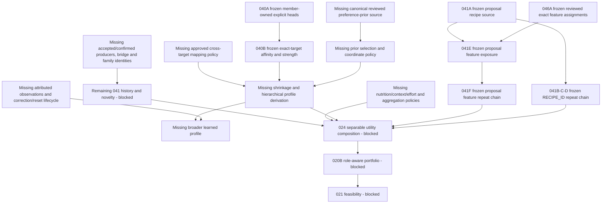

# Post-MTR-041F dependency review

Status: **DESIGN / DEPENDENCY REVIEW ONLY — implementation NOT AUTHORIZED**.
Reviewed on 2026-10-26. This document recommends a dependency-enabling implementation target;
it does not approve its detailed contracts, production policy values or implementation.

## 1. Decision and canonical baseline

**The next implementation target should be a canonical reviewed exact-target preference-prior
source foundation, ahead of prior-backed profile derivation.** This is a proposed source slice
supporting remaining MTR-040 and the cold-start requirement of MTR-028. Its milestone suffix is
intentionally unassigned: it is not permission to begin the previously deferred MTR-040C design
or hierarchical shrinkage implementation. First approve the source's publication authority,
coordinate semantics, applicability and correction contract in a dedicated design review.

There is **no additional proposal-local MTR-041 prerequisite** to this branch. Conversely,
041F does **not** make prior-backed, hierarchical or broadly learned profile derivation ready.
Another explicit-profile wrapper would duplicate 040B rather than remove the missing source.

| Baseline item | Verified basis |
| --- | --- |
| Repository | `thedusk4203/Menuto` |
| Exact reviewed `main` | `63e6b9f7dff3f061657fa96680a69cfc6fd1ae06` |
| Remote/local identity | `HEAD` and freshly fetched `origin/main` both equal the reviewed SHA before this documentation branch |
| Exact push CI | [40257089579](https://github.com/thedusk4203/Menuto/actions/runs/40257089579), SUCCESS on that SHA; `python` and `web` both SUCCESS, independently re-read |
| Implementation delivery | [PR #93](https://github.com/thedusk4203/Menuto/pull/93), followed by the test-only correction in [PR #94](https://github.com/thedusk4203/Menuto/pull/94) |
| Schema / contracts | Alembic head `0013`; 71 registered domain tables; 276 exported domain definitions, checked from current sources |
| Frozen relevant slices | User-approved 040A/B, 041A/B/C/D/E/F, 046A; 041F approval applies to this exact baseline |
| Authority | Execution NOT STARTED; PRECOMMIT FAIL-CLOSED; no next implementation authorization |

The 041F evidence's earlier NOT FROZEN delivery statements describe its pre-review history.
The user's current FROZEN / APPROVED decision supersedes that status, not its scope or contracts.
The existing exact-baseline CI receipt is regression evidence, not evidence that any proposed
prior source, learned profile, full RecentExposureModel or planner already exists.

## 2. Capability inventory from code, not namespace names

| Capability | Actual implementation and limit |
| --- | --- |
| Member ownership and raw explicit declarations — 040A | Preferences records a subject HouseholdMember, independently audited actor/authorship, exact typed targets, revision/CAS/idempotency and corrective/retracted heads. No caller-supplied EvidenceStrength. Authorship correction 0012 preserves history. |
| Explicit affinity and evidence strength — 040B | `preferences/profile_capture.py` captures the full declaration source and canonical target identities; `profile_derivation.py` purely replays it. `ExplicitTargetAffinityPolicy` covers INGREDIENT / PROTEIN / METHOD / FLAVOR / DIRECT_RECIPE with authored versioned rational coordinates and head-only strength rules. This already is a useful explicit-source profile draft. |
| Remaining profile inputs | `ExplicitTargetAffinityPolicy` fixes prior/shrinkage to `UNAVAILABLE_ONLY`; `UnavailablePreferencePrior` names the missing canonical source. Learned/contextual/passive evidence is unavailable, cross-target inference/candidate aggregation not performed, planner/activation false. No prior registry, prior publisher, hierarchical mapping or broader learned-observation engine was found. |
| Proposal recipe exposure — 041A | Canonical read-only source capture plus pure latest-selected-proposal preview/deduplication. Positive member allocation is a proposed exposure witness, not proof of acceptance, cooking, consumption or liking. |
| Recipe repeat interpretation — 041B/C/D | RECIPE_ID-specific cooldown, exact AS_OF_CAPTURE decay and proposal-local RepeatPenalty. No conversion to global history or generalized feature policy. |
| Reviewed culinary source — 046A | Canonical reviewed finite METHOD / MAIN_PROTEIN / FLAVOR assignments; MAIN_PROTEIN binds reviewed Catalog protein context, METHOD is context/path invariant. Source completeness is scoped and explicit. No preference priors, family exposure, culinary role/effort policy or full catalog coverage completion. |
| Feature exposure — 041E | Full 041A source plus 046A classification capture yields deduplicated member/meal/dimension/term events, exact support and scoped coverage diagnostics. REVIEWED_NONE and UNRESOLVED remain distinct. |
| Feature repeat interpretation — 041F | `assess_feature_cooldown` → `trace_feature_decay` → `interpret_feature_repeat_penalty`, one member/target/dimension/term in one selected proposal. Full source is revalidated; explicit per-term policy versions, exact arithmetic, contained lookback and consumed-child clocks are enforced. No new source, store or history producer. |
| Onboarding and policy namespaces | `households.create_default_household` creates ownership/membership only; it has no cold-start answers or priors. `policy.ValidationCoveragePolicySnapshot` describes validation coverage, not preference or NutritionPolicyEngine synthesis. MTR-028's broader onboarding remains open. |
| Candidate and shortlist foundations | Grounding resolves compatible reviewed nutrition and supported explicit ingredient restrictions, preserving unsupported/unknown failures. Frozen 020A shortlisting compares exact supply-path coverage under resource bounds; it has no EXPLOIT / STRUCTURAL_CHAMPION / EXPLORE role semantics or separable utility. |
| Validation / Execution | Existing source facts and revision/guard seams do not supply full independent production validation. `PlanRevisionService` explicitly cannot mint production PRECOMMIT authorizations; no cooking execution state machine is implemented there. |

Evidence-strength naming: the request's **MED** denotes the middle category. The current V1.3
§19.2 specification and frozen `preferences.contracts.EvidenceStrength` encode it as
**`NONE / LOW / MEDIUM / HIGH`**. Preserve that literal; do not silently rename it or treat
MED/MEDIUM as a numeric probability. No incompatibility requiring a frozen-contract change
was discovered in this review.

## 3. Dependency graph and readiness of each edge

Solid arrows show a dependency, not blanket implementation readiness. Nodes explicitly marked
missing still require their own source/policy design and approval.

This is a partial order: several independent foundations can be pursued in parallel after their
own reviews. Numbering does not prove that one must precede another. The source-first choice
minimizes new authority and removes the nearest missing primitive on the member-profile branch;
it is not a claim that full 040 alone will unblock every downstream task.

| Dependency edge | State after 041F | What remains |
| --- | --- | --- |
| 041E reviewed feature exposure → feature cooldown witnesses | SATISFIED for one exact query in one proposal | Global/scheduled/confirmed sources are outside this edge. |
| Feature cooldown → exact decay → feature RepeatPenalty | SATISFIED within frozen F scope | Production policy selection/calibration and cross-term/dimension composition are not supplied by accepting a versioned policy input. |
| 046A finite classification → feature presence/coverage | SATISFIED for the frozen three dimensions | Scoped completeness does not prove never exposed, preference, or full catalog readiness. |
| Recipe and feature repeat → a future separable utility input | PARTIALLY SATISFIED | Available local coordinates exist; aggregation, missingness treatment, candidate projection, source selection and the other utility dimensions do not. |
| 041F → 040 prior or evidence-strength source | NO SUCH SOURCE EDGE | Repetition neither declares taste nor supplies a prior or learned strength. 040B's head-only explicit strength is already available independently. |
| Canonical onboarding/catalog priors → weak-evidence shrinkage | MISSING | Reviewed numeric source, semantic coordinate basis, applicability/selection and shrinkage policy. No default neutral/zero substitute. |
| Exact affinity → hierarchical/generalized profile | MISSING beyond exact targets | Parent/mapping ownership, direction, versions, attenuation, conflict/precedence and invalidation. 046A assignments alone do not define preference transfer. |
| Observations → broader learned member profile | MISSING | Canonical producers, 039 attribution, independent evidence identity, contextual/conflict quarantine and reset/correction invalidation. Explicit declarations can remain DIRECT without waiting for a general router. |
| Accepted/confirmed/operational events → full 041 history | MISSING | Real authorized activation/acceptance producer; cooking/member exposure evidence; reversible assumptions; source-specific time/identity and correction rules. Revision rows or inventory CONSUME are insufficient. |
| Prior horizons / variant family → cross-week repeat and novelty | MISSING | 038 bridge and double-count rules, canonical family identity/mapping, bounded complete history and separately authored novelty semantics. |
| 024 → 020B → 021 | BLOCKED | Separable utility inputs/policies first; then role policies and grounded portfolio; then full feasibility/model/validation dependencies. F resolves one input sub-edge, not this chain. |

## 4. Is remaining MTR-040 profile derivation ready?

**PARTIALLY READY overall; the explicit exact-target branch is implemented and frozen. The
remaining prior-backed/hierarchical/learned derivation is still BLOCKED.** Distinguish these
branches rather than repeating an outdated claim that all affinity or strength derivation is absent.

1. Exact-target explicit derivation, canonical identity and deterministic replay are already
   satisfied by 040A/B. A new member-profile container adds no missing prior semantics.
2. Weak-evidence shrinkage lacks a canonical prior source, coordinate compatibility, applicability
   and explicit versioned influence policy. A full source snapshot or a reviewed feature tag
   is not a prior. No source corpus with approved preference-prior values was found.
3. Hierarchical inference additionally lacks approved exact mappings and conflict/invalidation
   rules. A recipe-to-feature culinary assignment proves a feature, not transfer of a member's
   recipe preference to that feature or another target.
4. Broader learned derivation additionally needs distinct DIRECT / CONTEXTUAL / INFERRED /
   PASSIVE routing, canonical causal sources, correction/reset invalidation and member ownership.
   It must not infer taste from cooking, repeated proposals, operational friction or forced trades.

**No further proposal-local 041 work must precede this profile branch.** F is already the
feature analogue of the frozen recipe chain. A local novelty complement, recipe-plus-feature
scalar or general repeat-vector wrapper would not fix the source deficit. Full history/novelty
is a different branch with missing acceptance/confirmed/bridge/family dependencies. It must
not be fabricated from local no-match, REVIEWED_NONE or zero retention.

## 5. Recommended next slice and alternatives

Proposed descriptive name: **Canonical Reviewed Exact-target Preference Prior Source Foundation**.
This recommendation is a next implementation **target**, pending its own detailed design review;
it does not assign or start MTR-040C. Select a curated reviewed reference source first, rather
than making a new onboarding UI or waiting for future Execution events.

| Candidate next work | Decision and reason |
| --- | --- |
| Canonical prior source foundation | RECOMMENDED: supplies an absent prerequisite using existing exact target identities; isolated persistence/capture semantics can be tested before any shrinkage or ranking. |
| Full 040C hierarchical priors/shrinkage now | NOT READY: consumes the very source and policy decisions that are missing. |
| Additional explicit-profile assembly | Not the best slice: 040B already resolves requested exact targets and derives explicit strength. Avoid a wrapper presented as profile completion. |
| Exact-target candidate affinity/support join | A plausible separate additive design: 040B and 046A provide relevant primitives. It still needs candidate coverage/missingness and projection rules; a diagnostic join supplies neither priors nor shrinkage. It is not a prerequisite for member-profile derivation, so the missing prior source takes precedence on this branch. No claim that all such source joins require Execution. |
| More proposal-local 041 repeat interpretation | No prerequisite gap identified after F; optional extensions do not unblock prior-backed profile. |
| Global 041 history/novelty | Not ready: missing authoritative source workflows, bridge/family identity and novelty policy. A local number cannot stand in for them. |
| Full 039 router / Execution | Needed later for broader evidence, not a prerequisite for publishing reviewed reference priors; would introduce unrelated workflow and authority work now. |
| 046 coverage or other source foundations | Independently useful, but feature assignments do not replace a preference prior. Role/effort/safety completeness remains a separate downstream prerequisite. |
| 024 / 020B / 021 | Remain blocked; F alone supplies neither full separable utility nor portfolio roles nor feasibility. |

### Exact proposed scope

- Publish genuinely reviewed reference prior facts for **exact** INGREDIENT, PROTEIN, METHOD,
  FLAVOR or DIRECT_RECIPE identities. Support the existing typed kinds without manufacturing
  a complete catalog or a default row for each target. Only explicitly published targets exist.
  Ingredient and stable Recipe identities remain owner facts; a RecipeVersion or feature label
  is not an interchangeable target ID. No implicit term equivalence or cross-target transfer.
- Each publication must have an authenticated authorized publisher/reviewer, actual source
  provenance, an immutable identity/revision, a recorded time and a named versioned coordinate
  basis/applicability. Exact rational amounts have meaning only under that approved basis.
  This document deliberately specifies no production numeric values or pseudo-counts.
- Represent revision, replacement/retraction, conflict and absent coverage explicitly. Retain
  audit/source history and deterministic replay. Do not silently select a provider or synthesize
  a current target value when applicability is ambiguous.
- Provide canonical read-only capture and immutable source contracts through the owning context;
  full capture/frontier identity must survive replay, with the same origin/authentication limits
  as other offline snapshots. Source publication and consumer prior selection are separate decisions.
- Ship a real publisher/capture boundary, with an empty initial source remaining unavailable.
  Synthetic test references are test fixtures; they are not approved production prior data.

### Non-goals

No hierarchical fallback, cohort inference, onboarding question/UI design, generalization,
shrinkage formula, learned affinity/EvidenceStrength derivation, candidate scoring, shared utility,
planner weights, novelty, history, attribution router, MTR-024 composition, role portfolio,
Execution or PRECOMMIT. No changes to frozen 040A/B, 041A–F or 046A contracts or their semantics.
In particular 040B v1 must continue returning prior/shrinkage UNAVAILABLE even if a future
separate source exists; a later approved additive consumer must opt into that source.

### Proposed ownership and contract boundary

Preferences owns preference-prior semantics/publication and a future member-specific profile
consumer. Catalog owns ingredient/feature term identities; Recipes owns stable recipe identity.
They supply canonical immutable owner facts; neither classification owner synthesizes member taste.
A reviewed reference may be shared, but any later **MemberBehaviorProfile belongs to the member**,
not the household, recipe, publisher or executing actor. No preference fan-out across members.

Learning remains the owner of attribution/learned observation semantics and proposal-local repeat
interpretation. It reads only immutable cross-context contracts; it cannot use a publication
facade or ORM to manufacture evidence. A prior record is reference policy/source data, not a
DIRECT declaration, CONTEXTUAL event, INFERRED observation or PASSIVE evidence item. Prior
availability alone must never mint EvidenceStrength. A caller-supplied numeric prior cannot be
accepted merely because it carries a hash, `REVIEWED_REFERENCE` label or claimed reviewer ID.

Coordinate compatibility is an explicit future gate: 040B affinity is a versioned **policy
coordinate**, not a probability or calibrated utility. Similar rational bounds do not establish
that a prior and an affinity can be combined. Do not reuse a Recipe-ID repeat weight, a neutral
declaration or an invented zero to avoid defining this policy.

### Persistence and migration expectation

**No migration in this review.** The recommended canonical publication source is expected to
need durable storage and a **new forward migration after 0013**, once its design is approved.
Immutable versions, corrections, authorization and capture frontiers cannot be supplied by an
unpersisted numeric placeholder. The exact DDL/table count and migration identifier are not
reserved or approved here; existing migrations stay byte-identical. No automatic zero/backfill,
no rewriting declarations and no profile materialization table merely to name the milestone.

A later pure profile derivation may require no new storage itself. That is distinct from the
source publication persistence proposed here. Approved real prior content remains a separate
publication decision; building an empty capable source does not make priors AVAILABLE.

### Before implementation can safely be authorized

The source slice has no dependency on additional proposal-local repeat, accepted history or
Execution, so it is **topologically eligible for detailed design next**. It is **not yet ready
for unconditional implementation authorization**. Review must settle:

1. Who may publish/review reference priors and how that authority is authenticated; household
   preference authorship does not automatically confer global reference publication authority.
   A bounded trusted internal curation seam, following 046A's explicit trust limits, is a possible
   design; this recommendation does not require a new public curation UI or authorization platform.
2. What the amount means, coordinate/policy identity, target applicability and the consumer's
   exact reference binding; no inferred universal prior or fallback.
3. Revision/retraction/effective-time, conflict/selection, correction and capture/replay semantics,
   including how later consumers detect supersession without changing historical replay.
4. Additive contract/persistence design, provenance validation and the independent acceptance
   matrix below. No need to settle hierarchy or shrinkage merely to implement the source.

Approval of this dependency review or merge of its documentation does not satisfy those gates
and must not dispatch implementation. Full hierarchical 040C remains NOT READY independently.

## 6. Acceptance-test categories for that future source slice

These are proposed independent acceptance categories, **not tests added or executed for an
unimplemented feature**. The dedicated design must make their expected results exact.

| Category | Required observable behavior |
| --- | --- |
| Identity and ownership | Reject wrong target kind, missing/noncanonical target, wrong source owner and unauthorized publisher; no cross-member or cross-target transfer. |
| Publication authority | Claimed reviewer/provenance/hash alone cannot create a canonical reviewed record; real authorization and permitted source provenance are enforced. |
| Numeric semantics | Exact reduced rational and approved coordinate/version binding; no default prior, automatic neutral/zero, probability label, pseudo-count or caller EvidenceStrength. An actually reviewed zero stays distinct from no source. |
| Coverage/applicability | Missing, retracted, ambiguous or inapplicable reference stays explicitly unavailable; no silent fallback, fake completeness or implicit provider selection. |
| Immutable lifecycle | Revision/CAS, idempotent retries, corrective replacement/retraction and append-only audit preserve prior versions; retries do not create evidence or strengthen a member profile. |
| Source cutoff and concurrency | Canonical read-only coherent capture; reject invalid transaction/cutoff and stale/conflicting publication as designed. Test concurrent writers and database enforcement, not only ORM behavior. |
| Independent replay | Recompute source identities/values/frontiers, reject missing/forged/duplicated/rehashed primitives; deterministic order and replay, full-source fingerprint distinct from visible target-row hashing. Offline consistency still is not database-origin proof. |
| Evidence isolation | Reference priors cannot turn cooked/friction/forced/passive events into taste; cannot clear correction/reset barriers or increase 040B's head-only explicit strength. Onboarding declarations are not counted again as independent prior evidence. |
| Frozen compatibility | Old 040B still returns UNAVAILABLE prior/shrinkage; old contracts, migration bytes, hashes, recipe repeat semantics, feature diagnostics and scope flags remain unchanged. |
| Persistence and migration | Real PostgreSQL empty/populated upgrade/downgrade/upgrade, direct-SQL guards, rollback and data preservation, with no guessed production prior backfill. |
| Authority | No learned policy changes, hard-safety effect, planner readiness, activation, production PRECOMMIT issuer, history or scalar behavior score. |
| Regression | Existing required architecture/import/export/fixtures, full Python/real-PG, benchmark and client/web checks remain green. |

## 7. Semantic traps and risks

- **False source readiness:** 041F policy inputs, 046A reviews and a module named onboarding do
  not provide preference-prior data. A new empty registry solves source capability, not content
  approval or prior-backed profile completeness.
- **Loss of missingness:** UNDECLARED != NEUTRAL; RETRACTED != NEUTRAL. AVAILABLE explicit zero
  differs from absence. Local no-match is not global no-repeat, REVIEWED_NONE is not never
  exposed, and UNRESOLVED is not zero repeat. Nonempty zero-retention traces remain distinct.
- **Evidence inflation or mixing:** only the current explicit declaration head determines
  040B affinity/strength; history/retries/support counts do not strengthen it. Keep DIRECT,
  CONTEXTUAL, INFERRED and PASSIVE distinct. Passive assumptions never create durable learning.
- **Causal errors:** cooked != liked; operational friction != taste; forced conflict resolution
  != voluntary preference. Corrections must invalidate dependent inference and prevent immediate
  re-inference from the same invalidated evidence, once that future learning path exists.
- **Hierarchy by accident:** culinary assignment is not taste transfer. Exact identity only
  until a separately approved mapping policy exists. Keep ingredient/protein/method/flavor/direct
  recipe affinity distinct; no giant behavior score or hidden household preference aggregate.
- **Policy as statistics:** EvidenceStrength is explicit policy metadata, never statistical
  confidence. Affinity is not calibrated utility/probability. No silent reuse of Recipe-ID
  weights for METHOD / MAIN_PROTEIN / FLAVOR; their explicit policy choices remain separable.
- **History or authority laundering:** proposal preview != accepted exposure != confirmed
  exposure. Full-source fingerprint identifies capture/replay, not merely visible rows;
  diagnostic evidence-cut digests are neither current-source certificates nor PRECOMMIT tokens.
- **Downstream overclaim:** learned data may eventually affect soft ranking only, never hard
  safety. A soft negative preference cannot become an exclusion; 024/020B/021 still need their
  own inputs, policies, coverage and validation.

## 8. Full milestone and authorization status

| Milestone / branch | Status after this review |
| --- | --- |
| MTR-040 | PARTIAL. A/B FROZEN; explicit exact-target affinity/strength ready. Prior-backed, hierarchical and broader learned profile remain incomplete/blocked as above. No 040C authorization. |
| MTR-041 | PARTIAL. A–F FROZEN; proposal-local recipe/three-feature repeat available. Full accepted/confirmed/operational/cross-horizon/family history, novelty and global repeat remain incomplete. |
| MTR-046 | PARTIAL. A FROZEN; reviewed culinary feature assignment foundation ready. Full catalog/planner coverage, family identity and other policies remain incomplete. |
| MTR-024 | BLOCKED. Needs prior-backed/profile and candidate projection/aggregation policies, relevant exposure/novelty inputs, nutrition/context/effort and missingness handling. No full separable utility composition. |
| MTR-020B | BLOCKED. Needs 024 utility/vector semantics, explicit role/diversity/exploration policies and relevant grounded source coverage. Frozen exact-coverage 020A is insufficient. |
| MTR-021 | BLOCKED. Needs role-aware portfolio plus full feasibility constraints/model, scenario/coverage and independent validation. |
| MTR-028 / 039 / 038 | Broader onboarding priors / attribution router / horizon bridge remain open; existing foundations do not complete these milestones. |
| Execution / PRECOMMIT | NOT STARTED / FAIL-CLOSED. No new source, issuer or authority created. |
| Recommended source slice | PROPOSED; eligible for dedicated design, not approved for implementation. No milestone number assigned. |

## 9. Inspection trail and documentation-only verification

Normative sources inspected: [ADR-011](../adr/ADR-011-behavioral-learning-loop.md),
[V1.3 §19 and milestone requirements](../MENUTO_DEVELOPMENT_SPEC_V1_3.md),
[Architecture Invariants](../ARCHITECTURE_INVARIANTS.md), [contribution gates](../../CONTRIBUTING.md),
[backlog](BACKLOG.md), [foundation status](FOUNDATION_STATUS.md),
[implementation blueprint](IMPLEMENTATION_BLUEPRINT_M0_M1.md), [invariant coverage](INVARIANT_COVERAGE.md),
[post-020A review](POST_MTR_020A_DEPENDENCY_REVIEW.md) and
[post-041E review](POST_MTR_041E_DEPENDENCY_REVIEW.md). Earlier reviews are historical evidence;
their missing-capability statements were rechecked against current code before reuse.

Frozen slice design/evidence inspected:

- [040A review](MTR_040A_EXPLICIT_MEMBER_PREFERENCE_REVIEW.md),
  [evidence](MTR_040A_EXPLICIT_MEMBER_PREFERENCE_EVIDENCE.md),
  [authorship correction](MTR_040A_AUTHORSHIP_CORRECTION_EVIDENCE.md).
- [040B design](MTR_040B_EXPLICIT_TARGET_AFFINITY_DESIGN.md) and
  [freeze/evidence](MTR_040B_EXPLICIT_TARGET_AFFINITY_EVIDENCE.md).
- [041A review](MTR_041A_RECENT_EXPOSURE_DOMAIN_REVIEW.md) and
  [evidence](MTR_041A_RECENT_EXPOSURE_EVIDENCE.md).
- [041B review](MTR_041B_RECIPE_COOLDOWN_REVIEW.md) and
  [evidence](MTR_041B_RECIPE_COOLDOWN_EVIDENCE.md).
- [041C review](MTR_041C_DECAY_TRACE_REVIEW.md) and
  [evidence](MTR_041C_DECAY_TRACE_EVIDENCE.md).
- [041D review](MTR_041D_REPEAT_PENALTY_REVIEW.md) and
  [evidence](MTR_041D_REPEAT_PENALTY_EVIDENCE.md).
- [041E design/authorization](POST_MTR_046A_DEPENDENCY_REVIEW.md) and
  [evidence/source and coverage semantics](MTR_041E_FEATURE_EXPOSURE_EVIDENCE.md).
- [041F design](MTR_041F_FEATURE_REPEAT_POLICY_DESIGN.md) and
  [implementation/correction evidence](MTR_041F_FEATURE_REPEAT_POLICY_EVIDENCE.md).
- [046A design](MTR_046A_CULINARY_FEATURE_ASSIGNMENT_DESIGN.md),
  [design corrections](MTR_046A_DESIGN_CORRECTIONS.md) and
  [implementation evidence](MTR_046A_IMPLEMENTATION_EVIDENCE.md).
- [020A shortlist review](MTR_020A_PARETO_SHORTLIST_REVIEW.md) for downstream portfolio boundaries.

Runtime/source inspection under `apps/backend/app/` covered
`modules/preferences/{contracts,profile_capture,profile_derivation}.py`,
`modules/learning/{contracts,feature_repeat,public}.py` and its README,
`modules/households/{contracts,public}.py`, `modules/policy/contracts.py`,
`modules/planning/{contracts,grounding,shortlist}.py`,
`modules/nutrition/{public,resolution}.py`, `modules/validation/README.md`,
`modules/execution/public.py`, `persistence/models.py` and `shared/db.py`.
Repository-wide backend/tool source searches for prior/onboarding/shrinkage/profile/novelty/family
were cross-checked against persistence registration, export inventory and the above actual APIs.
Alembic head was read from the migration graph; no claim that an active production database was
inspected. Exported schemas and `.github/workflows/ci.yml` supplied compatibility/check inventory.

This change adds this review and aligns current 041F status/pointers in Markdown documents only.
No runtime, contract, migration, test, generated schema or policy value is changed. Historical
delivery notes remain historical; no canonical invariant wording is changed. Required CI results
for this documentation PR and its exact merge will be recorded in the GitHub delivery receipt,
separately from the already verified baseline CI. Passing those checks does not implement or
authorize the recommendation.

Fresh local verification on 2026-10-26, after the documentation edits:

| Gate | Actual result |
| --- | --- |
| Full Python with isolated PostgreSQL18.4 | **2237 passed**, 0 failures/errors/skips, 423.60s; one existing Starlette/httpx deprecation warning |
| Regression identities | **2237/2237 retained**, 0 added/removed; JUnit identities compared with the canonical 041F correction run |
| Real database checks | All **798** existing PostgreSQL-marked tests included/passed; marker inventory checked separately. Existing migration/drift/direct-SQL/concurrency coverage retained; no test or database behavior modified |
| Ruff / architecture / imports | PASS; 30 invariants, 11 ADRs, 50 linked tasks, 16 contexts |
| OpenAPI / domain exports / synthetic fixtures | PASS; unchanged HTTP snapshot and all 276 domain definitions; 22 fixtures verified |
| Synthetic benchmark | **22/22**, HARNESS_SMOKE_NOT_PLANNER_V4 |
| Client contracts/typecheck/tests / web build | PASS; client **10/10** |
| Documentation scope / local links / whitespace | PASS; 10 Markdown files only, all local links resolve, no code/contracts/tests/migrations/schema exports changed |

Full test invocation used the existing suite with an isolated loopback PostgreSQL test URL,
`--basetemp=.local/post041f-review-tests --junitxml=.local/post041f-review.xml`.
The test-only server was stopped afterward. Logs/XML and regression comparison receipts under
ignored `.local/` are verification artifacts, not canonical data or implementation outputs.
Other gates follow `.github/workflows/ci.yml`. This verification tests the existing baseline;
it provides no acceptance evidence for the proposed, unimplemented prior source.

**READY FOR POST-MTR-041F DEPENDENCY REVIEW**
