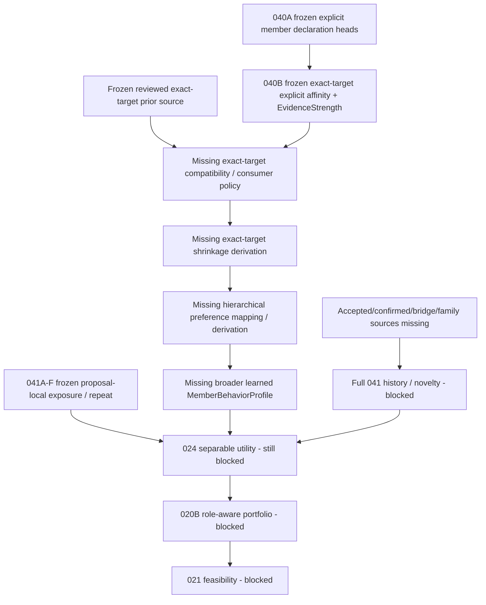

# Post Preference-Prior Source Dependency Review

Status: **DEPENDENCY REVIEW — DESIGN AUTHORIZATION ONLY**

Reviewed on 2026-10-26 against canonical repository state:

- repository: `thedusk4203/Menuto`
- canonical reviewed `main`: `fce85327cc8c3f4444847522d8ef474ef8d4e670`
- reviewed source implementation: PR #97
- schema: Alembic `0014`, 78 domain tables
- exported definitions: 299 = 276 prior definitions retained + 23 additive reference-prior definitions
- exact post-merge CI: run `40293195051`, SUCCESS on the canonical SHA above

## 1. Freeze receipt carried forward

The Canonical Reviewed Exact-target Preference Prior Source Foundation is **FROZEN / APPROVED** at:

`fce85327cc8c3f4444847522d8ef474ef8d4e670`

The frozen source capability provides:

- reviewed shared exact-target reference prior publication/retraction;
- provider-scoped PostgreSQL-authenticated authority;
- immutable typed revision/history/frontier primitives;
- complete coherent source capture;
- pure exact-target replay;
- explicit distinction between `NO_PUBLICATION`, `RETRACTED`, and `AVAILABLE 0/1`;
- one closed v1 reference coordinate, `CURATED_REFERENCE_PREFERENCE / v1`.

It does **not** provide production prior content, member-specific prior selection, coordinate conversion, shrinkage, hierarchy, learned preference, TasteFit, planner utility, Execution, or PRECOMMIT authority.

Historical `IMPLEMENTED / NOT FROZEN` wording in the source design/evidence/status documents describes the pre-freeze delivery state. This review records the later architecture decision and supersedes only that status wording, not the frozen contracts or implementation semantics.

## 2. Current capability graph



The canonical prior source removes the nearest source prerequisite on the MemberBehaviorProfile branch. No additional proposal-local MTR-041 slice is required before the next exact-target profile-consumer design.

## 3. Dependency decision

**Recommended next design slice:**

> **Exact-target Prior Compatibility & Shrinkage Foundation**

This is a descriptive slice name only. It is intentionally **not assigned `MTR-040C` yet** because historical references to `040C` cover a broader prior-backed/hierarchical profile scope. The detailed design must first prove the exact boundary before milestone numbering is chosen.

Decision:

- dependency selection: **APPROVED**;
- dedicated architecture/design work: **AUTHORIZED**;
- runtime implementation: **NOT AUTHORIZED**;
- migration `0015`: **NOT AUTHORIZED / NOT EXPECTED for the pure derivation scope**;
- hierarchical preference inference: **NOT AUTHORIZED**;
- MTR-024 / MTR-020B / MTR-021: remain **BLOCKED**;
- Execution: **NOT STARTED**;
- PRECOMMIT: **FAIL-CLOSED**.

## 4. Why this is the next seam

040B already provides a deterministic exact-target explicit interpretation from current member declaration heads. It deliberately freezes:

- `prior_mode = UNAVAILABLE_ONLY`;
- `shrinkage_mode = UNAVAILABLE_ONLY`;
- `UNDECLARED != NEUTRAL != RETRACTED`;
- `EvidenceStrength = NONE / LOW / MEDIUM / HIGH` as policy metadata rather than statistical probability.

The new reference source now provides canonical exact-target reference rows but deliberately freezes:

- `coordinate_conversion = NOT_PERFORMED`;
- `shrinkage = UNAVAILABLE`;
- `provider_aggregation = NOT_PERFORMED`;
- `cross_target_inference = NOT_PERFORMED`.

Therefore the missing primitive is no longer source publication. It is a consumer-side, explicitly versioned semantic bridge between two independently frozen coordinate systems plus a deterministic exact-target shrinkage policy.

## 5. Critical coordinate boundary

The following values are not interchangeable merely because both are exact rationals in `[-1,1]`:

```text
ExplicitAffinityAmount
  unit = POLICY_EXPLICIT_AFFINITY_UNITS

ReferencePriorAmount
  coordinate = CURATED_REFERENCE_PREFERENCE / v1
  unit = REVIEWED_REFERENCE_ANCHOR_UNITS
```

A numeric equality such as `1/2 == 1/2` does not prove semantic convertibility.

The next design must define an explicit, versioned compatibility policy that names at least:

- the exact 040B explicit interpretation policy identity/version/fingerprint;
- reference coordinate ID/version;
- exact provider selection/binding;
- output coordinate identity/version;
- mapping semantics for both inputs into that output coordinate;
- missingness behavior;
- exact shrinkage influence rules by EvidenceStrength/member state.

No hidden identity mapping is allowed.

## 6. Recommended output boundary

Prefer a distinct consumer/output coordinate instead of converting a reference prior into `ExplicitAffinityAmount`.

Conceptually:

```text
ReferencePriorAmount
        |
        | compatibility mapping
        v
MemberProfileAffinityAmount
        ^
        | compatibility mapping
        |
ExplicitAffinityAmount
```

This prevents a reviewed shared reference anchor from being mislabeled as a member's explicit declaration and prevents prior availability from minting EvidenceStrength.

The exact model names are design work, not authorized contracts in this review.

## 7. Exact proposed scope

The next design may cover only:

1. one household/member;
2. one exact `PreferenceTarget`;
3. one frozen 040B explicit source + explicit interpretation policy;
4. one explicitly selected reviewed-reference provider/source for the same exact target;
5. one explicit compatibility policy;
6. one explicit shrinkage policy;
7. pure deterministic derivation of exact-target prior-backed affinity with complete provenance/fingerprints.

Supported target kinds remain exactly:

- `INGREDIENT`;
- `DIRECT_RECIPE`;
- `PROTEIN`;
- `METHOD`;
- `FLAVOR`.

No cross-target transfer is in scope.

## 8. Required state matrix

The design must make these cases explicit rather than using nullable numbers/default zero:

| Explicit source state | Reference source state | Required design decision |
| --- | --- | --- |
| DECLARED | AVAILABLE | compatibility + EvidenceStrength-driven shrinkage may apply |
| DECLARED | NO_PUBLICATION | no synthetic prior or zero |
| DECLARED | RETRACTED | no historical amount used implicitly |
| UNDECLARED | AVAILABLE | explicit cold-start/prior-only semantics required |
| UNDECLARED | unavailable | no implicit neutral baseline |
| RETRACTED | AVAILABLE | explicit policy decision required; must not collapse to UNDECLARED |
| RETRACTED | unavailable | preserve retracted member state |
| any | AVAILABLE `0/1` | real available zero, not missingness |

In particular:

`UNDECLARED != NEUTRAL != RETRACTED`.

This review does not pre-decide whether a RETRACTED member target is allowed to consume a reference prior. The detailed design must choose and justify that behavior explicitly.

## 9. EvidenceStrength and shrinkage

`EvidenceStrength` remains the frozen literal set:

`NONE / LOW / MEDIUM / HIGH`.

It is not a calibrated probability or sample-size estimate.

The design may define a versioned mapping from EvidenceStrength/state to shrinkage influence, but any coefficient must be an explicit policy value. Architecture must not silently imply values such as LOW=0.25, MEDIUM=0.5, HIGH=0.9.

A desirable monotonic policy invariant is:

```text
prior_influence(LOW) >= prior_influence(MEDIUM) >= prior_influence(HIGH)
```

if the policy chooses to shrink active declarations. Exact fractions remain authored policy values, not architecture constants.

No retry count, historical declaration count, source support count, recipe exposure count, or proposal repetition may increase EvidenceStrength.

## 10. Capture/cut semantics

The explicit member source and global reference source use different authority/capture seams. The design must **not weaken either source** merely to force one database transaction or one timestamp.

A valid pure consumer may combine immutable inputs captured at different cuts, for example:

```text
Explicit source snapshot @ cut A
Reference prior snapshot  @ cut B
Compatibility policy      @ version C
Shrinkage policy           @ version S
```

The derived result must preserve all source/policy fingerprints and exact capture provenance. It may claim deterministic interpretation of those immutable inputs; it must not claim simultaneous liveness, current authorization, or PRECOMMIT validity.

## 11. Recompute, do not trust cached child results

The detailed design should consume/revalidate primitive frozen inputs and invoke/reproduce the frozen pure algorithms rather than trust caller-supplied cached output rows.

Expected flow:

```text
ExplicitTargetAffinityInput
  -> frozen 040B derivation/revalidation

ReferencePriorSourceSnapshotDraft
  -> frozen reference-prior resolution/revalidation

+ compatibility policy
+ shrinkage policy

-> exact-target prior-backed profile result
```

Forged/rehashed cached explicit affinity, EvidenceStrength, prior rows, converted values, shrink weights, totals or output fingerprints must not become authority.

The pure derivation path must perform zero DB IO and zero writes.

## 12. Hierarchical inference remains a separate slice

This design must not infer:

- Recipe preference -> Flavor preference;
- Recipe preference -> Method preference;
- Ingredient preference -> Protein preference;
- Protein prior -> Ingredient prior;
- any feature-term alias/version reconciliation.

046A reviewed culinary classification proves classification facts; it does not define transfer of member taste.

A later hierarchical slice still needs separately approved mapping ownership, direction, versioning, attenuation, precedence, conflicts, missingness and invalidation semantics.

## 13. Explicit non-goals

Do not include:

- production prior publication/content;
- provider fallback or provider aggregation;
- cohort/locale inference;
- hierarchical or cross-target transfer;
- learned/contextual/passive evidence;
- MTR-039 attribution;
- candidate TasteFit;
- household preference aggregation;
- proposal/global novelty;
- accepted/confirmed execution history;
- MTR-024 utility composition;
- MTR-020B portfolio roles;
- MTR-021 feasibility;
- Execution;
- PRECOMMIT;
- safety eligibility/exclusion effects;
- a persisted profile/materialized score table.

The output remains soft preference/profile information only and must not override allergy/diet/safety constraints.

## 14. Persistence expectation

The recommended next slice should be designed as a **pure additive consumer** over immutable captured inputs and versioned policies.

Expected persistence result:

- no new domain tables;
- no Alembic `0015` merely for derived affinity;
- no persisted member score/profile cache;
- schema remains `0014 / 78 domain tables` unless the later detailed design proves an independently necessary source primitive.

If the design discovers a real persistence prerequisite, it must stop and return for architecture review rather than silently add storage.

## 15. Minimum adversarial acceptance categories for the detailed design

The detailed design must specify exact outcomes for at least:

1. same rational value in different coordinates does not auto-convert;
2. wrong explicit-policy identity/version/fingerprint;
3. wrong reference coordinate/version;
4. wrong/missing provider;
5. multiple providers cannot be averaged/fallback-selected;
6. `NO_PUBLICATION` does not synthesize zero;
7. `RETRACTED` reference does not use historical amount;
8. actual `AVAILABLE 0/1` remains a real prior;
9. explicit `UNDECLARED` does not become NEUTRAL;
10. explicit `RETRACTED` does not collapse into UNDECLARED;
11. LOW/MEDIUM/HIGH are not probabilities;
12. stronger evidence cannot receive more prior influence under a monotonic policy;
13. invalid/noncanonical rational coefficients reject;
14. exact arithmetic without float;
15. forged converted value rejected/recomputed;
16. forged shrinkage value rejected/recomputed;
17. forged child output/hash rejected through source revalidation;
18. independent capture times remain deterministic without liveness claim;
19. same UUID under wrong target kind rejects;
20. new feature-term/version ID remains independent exact identity;
21. 041 repeat evidence cannot alter member affinity;
22. cooking/out-of-stock/time/equipment/friction cannot alter taste affinity;
23. forced conflict resolution cannot alter voluntary preference;
24. no production prior records => prior-backed result remains unavailable as designed;
25. zero IO/write pure derivation;
26. no migration/schema drift;
27. frozen 040A/B, 041A-F, 046A, prior-source contracts remain byte/semantic compatible;
28. `planner_ready=False`;
29. `activation_ready=False`;
30. no safety/PRECOMMIT authority is minted.

## 16. Milestone/readiness status

| Branch | Status after this review |
| --- | --- |
| MTR-040 | PARTIAL. 040A/B FROZEN; exact-target explicit branch ready; prior-backed/hierarchical/learned branches incomplete. |
| Reviewed exact-target prior source | **FROZEN / APPROVED** at `fce85327cc8c3f4444847522d8ef474ef8d4e670`. |
| Exact-target Prior Compatibility & Shrinkage Foundation | **DESIGN AUTHORIZED ONLY**. Implementation NOT AUTHORIZED. |
| Hierarchical preference | NOT implementation-ready; separate design after exact-target consumer semantics. |
| Broader learned profile | BLOCKED on canonical attributed evidence/correction lifecycle. |
| MTR-041 | PARTIAL. A-F frozen proposal-local primitives; full history/novelty missing. |
| MTR-046 | PARTIAL. A frozen; broader catalog/planner coverage incomplete. |
| MTR-024 | BLOCKED. |
| MTR-020B | BLOCKED. |
| MTR-021 | BLOCKED. |
| Execution | NOT STARTED. |
| PRECOMMIT | FAIL-CLOSED. |

## 17. Next authorized action

Create a **docs-only detailed architecture/design** for:

> `Exact-target Prior Compatibility & Shrinkage Foundation`

The design must settle the output coordinate, exact compatibility mapping, provider binding, state matrix, EvidenceStrength-to-influence policy semantics, exact rational shrinkage algebra, capture-cut provenance, recursive tamper resistance, and complete acceptance matrix.

Do not implement runtime/contracts/tests/migrations yet.
Do not assign `MTR-040C` until the design review confirms the scope matches that milestone suffix.

Stop at:

`READY FOR PRIOR COMPATIBILITY/SHRINKAGE DESIGN REVIEW — IMPLEMENTATION NOT AUTHORIZED`
