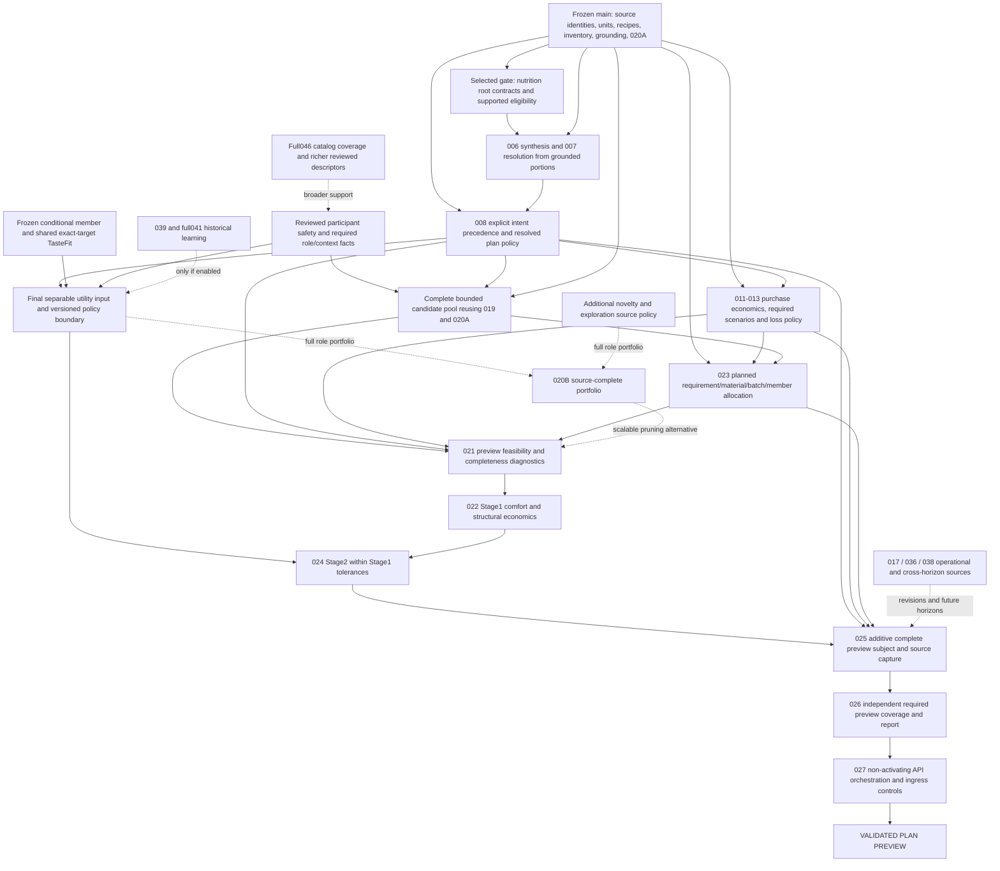

# Post-PR #120 Planner Convergence dependency review

Review date: 2026-10-29. **REVIEW / DOCUMENTATION ONLY — awaiting architecture review.**
The sequencing objective is the shortest credible path to **Validated Plan Preview**,
not another preference abstraction and not numerical milestone order.

## 1. Verified frozen baseline

| Identity / evidence | Verified value |
| --- | --- |
| Repository | `thedusk4203/Menuto` |
| Exact main reviewed | `dc7a964c4acecb0ee8995f1705f176b164e50221` |
| PR #120 reviewed implementation head | `ea77d0476ce95db1c349c652312de9883ec00824` |
| Implementation base | `f16508270ac159d07cc01757b3459aa4e4764f62` |
| Implementation review | [6484121354 — PASS](https://github.com/thedusk4203/Menuto/pull/120#issuecomment-6484121354) |
| Actual merge | [PR #120](https://github.com/thedusk4203/Menuto/pull/120), `dc7a964c4acecb0ee8995f1705f176b164e50221`; parents are the exact base and reviewed head |
| Tree / scope | `4e4b020c2f2912bae32df6cbdf1c6406b95d1d82`, identical to reviewed implementation tree; 24 files / 3 implementation commits |
| Exact post-merge push CI | [40800756796](https://github.com/thedusk4203/Menuto/actions/runs/40800756796), event `push`, exact merge SHA above, **SUCCESS**, Python/web and every workflow step SUCCESS |
| Executed tests | **3,638 passed / 0 skips**, 5 warnings, 1792.91s; 3,396 retained + 242 additive |
| Acceptance | SMTF01–SMTF120; 44 actual PostgreSQL executions / 36 required PG obligations |
| Other checks | SCRAM/TLS 16/16; benchmark 22/22; client 10/10; architecture/import/export/fixtures/contracts/typecheck/build green |
| Compatibility | 403 exports = 384 unchanged + 19 additive; 384 definition hashes and 120 frozen runtime/migration file hashes retained |
| Persistence | **0015 / 85 domain tables; no 0016; ZERO NEW PERSISTENCE** |
| Formal freeze | [6485815770 — FROZEN](https://github.com/thedusk4203/Menuto/pull/120#issuecomment-6485815770); [repository receipt](CANDIDATE_SHARED_MEMBER_EXACT_TARGET_TASTEFIT_AGGREGATION_FREEZE_RECEIPT.md) |

Phase 1 was already completed under the preceding exact-head authorization. This review
re-fetched MERGED state, actual main, the exact successful push run and the freeze receipt;
it did not attempt to merge an already merged PR again. Policy authority remains
`EXPLICIT_INTERPRETATION_INPUT_ONLY`; `planner_ready=False`, `activation_ready=False`.
No production database inspection is claimed: schema/no-row-drift evidence comes from
the reviewed implementation and its real PostgreSQL tests, not a production row census.

## 2. Evidence and method

Requirements: [Development Spec V1.3](../MENUTO_DEVELOPMENT_SPEC_V1_3.md) §9.2–9.5,
§10.1–10.11, §11.1, §12.5–12.9, §14.4–14.10, §18, §19, §21, §23.1 and §24.3;
all [INV-001..030](../ARCHITECTURE_INVARIANTS.md); particularly
[ADR-001](../adr/ADR-001-band-first-planner.md), [002](../adr/ADR-002-nutrition-policy-engine.md),
[003](../adr/ADR-003-plan-policy-resolution.md), [004](../adr/ADR-004-household-first-model.md),
[005](../adr/ADR-005-grounded-recipe-variants.md), [006](../adr/ADR-006-retail-procurement-abstraction.md),
[007](../adr/ADR-007-spend-limit-robustness.md), [008](../adr/ADR-008-no-silent-relaxation.md),
[009](../adr/ADR-009-execution-state-machine.md), [010](../adr/ADR-010-independent-validator.md)
and [011](../adr/ADR-011-behavioral-learning-loop.md).

Tracking: [BACKLOG](BACKLOG.md), [FOUNDATION_STATUS](FOUNDATION_STATUS.md),
[IMPLEMENTATION_BLUEPRINT](IMPLEMENTATION_BLUEPRINT.md),
[IMPLEMENTATION_BLUEPRINT_M0_M1](IMPLEMENTATION_BLUEPRINT_M0_M1.md),
[INVARIANT_COVERAGE](INVARIANT_COVERAGE.md). Historical delivery wording is distinguished
from later accepted/frozen sub-capabilities; parent issue completion is not inferred.

Live issue bodies/states inspected: 006/#5, 007/#6, 008/#7, 009/#8, 010/#9,
011/#10, 012/#11, 013/#12, 014/#13, 015/#14, 017/#18, 018/#19, 019/#20,
020/#21, 021/#22, 022/#23, 023/#24, 024/#25, 025/#26, 026/#27, 027/#28,
039/#40, 041/#42, 046/#47. These remain OPEN; their active V1.3 criteria supersede
collapsed historical criteria. This PR changes no issue state or acceptance criterion.

Prior findings re-evaluated: [post-020A](POST_MTR_020A_DEPENDENCY_REVIEW.md),
[026](MTR_026_DEPENDENCY_REVIEW.md), [post-040](POST_MTR_040_NEXT_MILESTONE_DEPENDENCY_REVIEW.md),
[post-projection](POST_CANDIDATE_FEATURE_PROJECTION_NEXT_GATE_REVIEW.md),
[post-member-TasteFit](POST_CANDIDATE_MEMBER_TASTEFIT_NEXT_GATE_REVIEW.md),
and the frozen projection, TasteFit, shared-target, 041F and 046A design/evidence.
The older proposed shared-meal/target-reduction sequence is not an instruction to keep
building it: this review supersedes sequencing recommendations only.

The existing 4,130-node graphify index was queried using its own nutrition/policy/resolver/
candidate/feasibility/optimizer/utility/validation/snapshot/validator/planner/preview vocabulary.
Its truncated navigation result is not a complete DAG or proof of current readiness.
Current source inspection establishes the edges below. No rebuild/extraction: **0 extraction
tokens**; existing graph-output workspace edits are excluded from this PR.

## 3. Current product-capability inventory

| Layer | Actual capability on the reviewed main | Missing capability / implication |
| --- | --- | --- |
| User/household/participants | [Households contracts/public](../../apps/backend/app/modules/households/public.py); canonical identities, actor checks, MealParticipants, portions and single tracked nutrition member | Production authentication/onboarding, complete goal/eligibility inputs and kitchen/availability sources are not supplied by these identities |
| Nutrition facts and safety sources | [Nutrition contracts](../../apps/backend/app/modules/nutrition/contracts.py), [models](../../apps/backend/app/modules/nutrition/models.py), [resolution](../../apps/backend/app/modules/nutrition/resolution.py): mass/height; member restrictions; exact reviewed input-composition arithmetic | No guideline/goal root contract, supported-population eligibility, clinical boundary, comfort/weekly synthesis or portion-resolution estimator. Known ingredient exclusion works; ALLERGEN/DIET_RULE currently yields `SAFETY_CLASSIFICATION_UNAVAILABLE` |
| Plan policy | [Draft request](../../apps/backend/app/domain/snapshots.py) separates precision/cost/kitchen/budget axes; [Policy contracts](../../apps/backend/app/modules/policy/contracts.py) has `ValidationCoveragePolicySnapshot` only | `FOUNDATION_NO_CLINICAL_POLICY` is coverage metadata, not NutritionPolicyEngine, PlanPolicyResolver or trusted publication/selection of their numeric policies |
| Candidate pool | Frozen 019A/B/C: authored culinary binding, demand expansion, [canonical grounding](../../apps/backend/app/modules/planning/grounding.py), immutable composition/supply/inventory facts | Global allocation, goal fit, meal-role coverage, freshness/fragility interpretation and solver feasibility are separate; current generated candidates are authored selections, not arbitrary solver quantities |
| Candidate coverage | Frozen046A + [candidate projection](../../apps/backend/app/modules/planning/candidate_feature_projection.py): reviewed METHOD / MAIN_PROTEIN / FLAVOR and exact supporting path | No recipe meal-role taxonomy, time/equipment descriptors, complete safety classification or launch coverage matrix. MAIN_PROTEIN feature is not automatically a meal role |
| Member/shared TasteFit | 040 COMPLETE; frozen candidate/member interpretation and [shared exact-target public seam](../../apps/backend/app/modules/planning/shared_target_tastefit_public.py) | Conditional exact-target evidence only; no candidate utility, cross-target order, production policy authority, hard safety or planner permission |
| Exposure | [Learning public surface](../../apps/backend/app/modules/learning/public.py), frozen041A–F | Proposal-local recipe/feature repeat only. No confirmed/global/cross-week history, novelty model or behavioral router; preview exposure is not accepted/consumed history |
| Shortlist | Frozen020A [pure frontier](../../apps/backend/app/modules/planning/shortlist.py) and canonical capture | Exact supply-path containment only; no quality score, EXPLOIT/STRUCTURAL_CHAMPION/EXPLORE policy, novelty admission or role quotas |
| Economics | [Retail contracts/public](../../apps/backend/app/modules/retail/public.py) and grounding: packages, provenance, quote reference pairs, calibration inputs and supply coefficients | No full production freshness/outlier policy, purchase-quantity checkout evaluator, marginal basket loss, robust scenario builder or ReferenceFeasibleCost pressure computation. Quote pair is not recipe cost |
| Physical/planned flow | Frozen Inventory physical ledger; [Cooking contracts](../../apps/backend/app/modules/cooking/contracts.py) and Shopping intents; frozen plan/revision graph | No complete requirement→lot/planned-acquisition→batch→participant allocation, future causal plan replay or projected opening state. Existing stock is real; planned shopping is not |
| Validation | Frozen025 source capture/subject; [independent validator](../../apps/backend/app/modules/validation/public.py), material replay and independent RecipeGroundingValidator | Current subject says `validation_ready=False`; current report has no successful preview decision. Root policy, procurement scenarios and planned-flow coverage remain deferred; all reports non-authorizing |
| Solver / product | [Synthetic benchmark](../../benchmark/README.md), health API and generated client/web shell | Micro-model is not Planner V4. No production Feasibility V2, Stage1, Stage2, preview orchestrator or planner endpoint; [main.py](../../apps/backend/app/main.py) exposes health only |

These are reusable implementations, not evidence that their broad OPEN parent issues have
been completed. Especially, do not rebuild culinary binding, source capture, physical
inventory or exact member preference because a baseline issue still says OPEN.

## 4. Target definition: a validated preview, not an active plan

The proposed first convergence target is an explicitly bounded **initial-generation preview**:
one household, one tracked nutrition member, exact participants, a declared finite horizon
and candidate universe, supported nutrition/safety policy, immutable facts, real planned
procurement/material/batch decisions, Stage1 then Stage2, followed by independent verification.
It returns the proposed plan, policy/source/scenario identities, coverage, structured findings
and exact subject/report hashes. It performs no activation, reservation, acquisition, cooking,
consumption or durable behavioral learning.

`VALIDATED PLAN PREVIEW` must mean that every check required by its explicitly approved
preview scope passed with zero FATAL/ERROR. It must not mean merely “solver found a result”,
“hash is valid”, “no finding from the supported subset”, or “PRECOMMIT report was renamed”.
The frozen `ValidationReport` decision set is `REJECTED | BLOCKED_UNSUPPORTED | DIAGNOSTIC`:
it cannot currently certify this target. A future additive preview coverage/report boundary
is needed; do not change old literals or mint production authorization from a preview pass.

Proposed scope cuts requiring later design approval, not new product authorization here:

- Initial horizon starts from a captured confirmed opening state. Requests with an active
  overlapping horizon, outstanding future commitments, materialized past or unresolved
  operational assumptions remain unsupported until their bridge/revision sources exist.
  “Initial” is verified from captured sources, not a client checkbox.
- No actual CookingBatch execution is needed to validate **planned** production/allocation
  and causal predicted material flow. Planned acquisitions stay predicted and are never
  inserted into physical inventory. Existing reservations still reduce usable stock.
- Hard nutrition, participant safety, budget and conservation are never optional. Missing
  required source truth returns BLOCKED/DATA_INSUFFICIENT, not a degraded “validated” label.
  A narrowly supported restriction set may reject unknown allergen/diet cases; it may not
  interpret their absence from classification as safety. Broader support needs reviewed
  classification first. The preview's supported population and restriction set must be explicit.
- A bounded pool can retain all020A survivors without heuristic role pruning. This does not
  claim full020B acceptance. Overflow must fail explicitly, never truncate cheapest-first.
  Search infeasibility is scoped to the complete declared pool, not every possible recipe.
- Full history, learned events and novelty need not be required by the first preview policy.
  Disabled/unsupported dimensions must remain explicit, never zero-imputed or described as
  “never exposed”. Proposal-local repeat may be used only under its frozen scope.

These cuts separate preview from full V1/launch acceptance; they do not weaken ADRs, close
parents or waive required checks. A design that chooses broader scope inherits its extra edges.

## 5. Dependency DAG

Solid arrows are required capability inputs for the bounded preview; dotted arrows are
optional richer-scope branches. Boxes describe missing capabilities, not authorized projects.
024's **input/policy definitions** precede consuming optimizers; its **Stage2 execution** follows
Stage1. This distinction removes an artificial 024→020B→021→022→024 cycle.

The existing foundation sources also feed Q directly; Q must capture primitive truth rather
than trust solver summaries. The drawing's Z→Q is orchestration/data handoff, not permission
for Validation to import Planning implementation. Independent calculators enforce ADR-010.

### Node register: ownership, readiness and persistence

Types: **S** source authority, **C** semantic contract/policy, **I** implementation,
**O** orchestration, **A** product/API. “Design-ready” does not authorize implementation.

| Node / type | Existing prerequisites | Genuinely missing / authority owner | Persistence expectation | Readiness and next node unlocked |
| --- | --- | --- | --- | --- |
| R: Nutrition roots / S+C | Member identity, mass/height, unit/provenance primitives; ADR002/INV001/020 | Reviewed applicable guideline/supported-scope truth; member-owned goal declaration and authorized authorship; root direction/containment/eligibility semantics. Nutrition owns interpretation, member owns physiology/goal; internal reviewed policy publication is separate authority | Durable source/version truth needed; member-goal/schema extension likely. Design must settle DB-owned publication versus reviewed versioned artifacts; no migration reserved | **Ready for dedicated design now**; implementation requires approved authority/evidence/model. Unlocks N and independent root guards |
| N: 006/007 synthesis / C+I | R; grounded composition and authored portion steps | Four-layer synthesis, hard versus comfort/weekly distinction, supported estimation/warnings and quantization. Nutrition owns derivation; selected-plan tracked-member allocation is supplied later by F, not a prerequisite for defining the root/comfort policy | Pure derived snapshots need no new persistence by themselves; root sources are R | Detailed engine design follows R contract; not ready to invent numeric defaults. Unlocks P, V, O, I |
| P: 008 resolved policy / C+I | Draft orthogonal axes and budget intent; R/N input boundary | Defaults/override authority and precedence, availability/kitchen context, tolerances, required-capability/scenario selection and independently pinned version. Policy owns compilation; Household/member keep source ownership | Pure resolution can be zero new persistence; durable defaults/override audit/source capture are separate design decisions | Orthogonal intent contract can be designed now; complete nutrition-bound policy waits R/N. Unlocks C/E/U/V |
| S: Required safety/role/context facts / S+C | Explicit excluded ingredients;046A culinary classifications; identities | Allergen/diet mapping where supported; recipe meal-role truth and enabled effort/equipment/availability descriptors. Catalog/Recipes own reviewed facts; Nutrition enforces participant safety; Household owns kitchen context | Existing classification cannot masquerade as these facts; durable new facts likely need additive storage if enabled | Source-boundary design ready; broad classification/content not implementation-ready. Unlocks safe C and supported U; full coverage matrix not required |
| C: Finite candidate universe / O | Frozen019A/B/C,020A and canonical capture | Request-bound coverage/composition, root safety integration, declared completeness/resource semantics; Planning orchestrates | No new durable candidate cache required | Orchestration design follows P/S; reuse sources. Unlocks F/V; no mandatory020B heuristic pruning for an all-survivor bounded preview |
| E: Economics/scenarios / C+I | Package/mapping/quote/calibration/supply facts; physical stock | Quantity-specific checkout, evidence eligibility/freshness, integer/step costs, waste/carryover/fragility policy; required scenario set. Retail owns quotes, Policy budget/scenario policy, Planning basket decisions | Pure resolution/snapshots need no new persistence intrinsically; new reviewed policy content must have authority | Bounded quantity/cost design possible now; full spending/scenario integration waits P. Unlocks F/V/O/I |
| F: Planned material/batch/member flow / C+I | Plan graph, batch/allocation intents, exact requirements, physical ledger | Explicit requirement→source identity, shopping time, predicted acquisitions/transforms, participant servings, loss and chronological conservation; Planning/Cooking own intent, Inventory owns physical truth | Immutable in-memory preview can avoid execution persistence; durable planned-flow storage is design-dependent | Planned-flow contract design ready from frozen facts, integration waits C/E. Unlocks V/O/Q/I without Execution |
| U: Final utility inputs/policy / C | Frozen member/shared exact-target TasteFit; recipe quantities; optional041 local evidence | Final supported dimensions, missingness, target selection/reduction semantics inside utility composition, reviewed context facts and utility authority; Policy defines versioned composition, Planning applies it | No persisted adherence/utility scalar; policy artifact authority still required | Boundary design possible; complete supported policy waits selected source/intent gates. Unlocks Z; optionally full020B |
| V: 021 preview feasibility / I | C/E/F/P once complete | Hard constraint model, participant/goal/stock/scenario/material checks, evidence-completeness and timeout/status semantics; Planning owns search | No new persistence required for pure preview solving | Full implementation blocked by inputs; diagnostic contract can be designed. Unlocks O |
| O: 022 Stage1 / I | V plus N/E/F | Joint candidate/package/inventory/batch/shopping variables; normalized comfort optimum, structural economics, derived bounds/tolerances and benchmark. Planning owns optimization | No new persistence required | Blocked implementation; synthetic CP-SAT adapter is not replacement. Unlocks Z |
| Z: 024 Stage2 / I | O plus U/P/S | Separable objective composition, permitted tolerances, center/stability and supported context/variety terms; no safety relaxation | No canonical scalar persistence required | Blocked implementation until upstream complete. Unlocks Q |
| Q: 025 preview subject / C+O | Frozen subject/capture,019A independent binding; all selected plan primitives | Additive complete primitive/policy/scenario/planned-flow snapshot, coherent source manifest and scoped coverage. Capture adapters remain source readers | No mandatory new persistence for returned immutable preview; retention policy separate | Companion/version boundary design ready, complete capture waits inputs. Unlocks I; frozen v1 untouched |
| I: 026 preview verifier / C+I | Existing independent exclusion/grounding/nutrition-input/material checks | Independent root containment, supported classification, exact member nutrition, scenario checkout, planned causal flow, complete scope coverage and non-authorizing preview result. Validation owns verdict | No production authorization row/issuer required for preview | Incremental design ready; successful complete preview verdict blocked by source/coverage gaps. Unlocks A |
| A: 027 preview endpoint / A+O | Health API, OpenAPI/client shell; Q/I when complete | Actor/source authorization, server-owned limits, request/response/status contract, orchestrator and immutable report binding; API boundary never mints safety/activation authority | New run storage optional; production auth/operational controls remain required before exposure | Integration design can be scoped; endpoint implementation not ready. Unlocks END with activation disabled |

## 6. Backlog reconciliation and candidate comparison

| Item / backlog state | Already satisfied in part | Still missing / decomposition and next-choice assessment |
| --- | --- | --- |
| MTR-006 / OPEN | Member source records, provenance and exact ingredient arithmetic | No root policy, goal declaration/eligibility or four-layer synthesis. Decompose R before N; **selected bounded root gate**, not whole engine implementation |
| MTR-007 / OPEN | Grounded quantities and authored steps provide estimator inputs | No catalog/portion resolution report or policy-bound warning behavior. Follows root/comfort semantics; package size must not set nutrition precision |
| MTR-008 / OPEN | Draft orthogonal request axes, BudgetContract | No actual resolver or default/override/availability/tolerance authority. High-value parallel contract work; not first because a resolved preference payload alone cannot supply independent physiological roots |
| MTR-020B / parent020 PARTIAL |020A frontier/capture; taste-source blockers now substantially satisfied by040/projection/116/120 | Full role/three-portfolio policy, source-complete novelty, context and structural witnesses still absent. Full020B not ready to implement. Defer full portfolio; all-survivor020A pool is a bounded preview option, not completion of020B |
| MTR-021 / BLOCKED | Grounded possibilities, exact source facts and draft status vocabulary | No root/budget/flow-bound feasibility model. The blanket “must finish full020B first” is stale for an unpruned bounded pool; genuine missing hard inputs remain. Does not become ready because taste froze |
| MTR-022 / OPEN | Synthetic two-phase optimizer/reference can inform tests and performance experiments | No domain global model, batch/material economics or production benchmark acceptance. Decompose input completeness/feasibility before joint Stage1; never promote the micro-model as Planner V4 |
| MTR-024 / BLOCKED | Exact member and conditional shared-target taste; proposal-local repeat; some primitive counts | Final utility vector/policy, context facts, comparability at utility boundary and Stage1 tolerances absent. Define U once, implement Z after O; not another TasteFit foundation |
| MTR-025 / OPEN, foundation frozen | Immutable source subject/capture/hash and culinary companion already work | Full primitive coverage remains deferred. Additive preview subject needed; do not recreate or mutate frozen v1, or close parent from namespace/hash presence |
| MTR-026 / OPEN, supported subset accepted | Actual independent arithmetic, exclusions, physical replay and RecipeGroundingValidator | Full preview-specific root/scenario/planned-flow guards and success semantics missing; activation/issuer/revision/assumption/bridge extensions remain outside first preview. Reuse checks, add coverage; no PRECOMMIT bypass |
| MTR-027 / OPEN | Health endpoint, generated schema/client/web and draft request/status contracts | No planner API. Needs complete preview service plus public-ingress security and auth; distinguish preview pass from activation authorization |
| MTR-009/011/012/013 / OPEN | Retail/calibration/package quote primitives and budget vocabulary | Pressure baseline, production eligibility, checkout quantity costs and scenarios not complete. Keep pressure separate from preference; missing pressure cannot be invented as zero. Any policy requiring it must block until supplied |
| MTR-014/015/018/019/023 / OPEN or PARTIAL parents | Extensive frozen yield, inventory, authored recipe, binding/generation/grounding and planned intents | Parent statuses lag sub-capabilities; planned causal allocations/member demand remain missing. Separate planned023 from actual execution. No rebuild or blanket parent closure |
| MTR-039 / OPEN | Explicit declarations and capture already do not need behavioral router | Learned event attribution remains unimplemented; not required for a first policy that admits no learned input |
| Full041 / PARTIAL |041A–F frozen proposal-local chains | Global/confirmed/cross-week history and novelty remain missing. Not mandatory for preview with explicit no-history scope; not “zero repeat” or “never exposed” |
| Full046 / PARTIAL |046A and candidate feature projection frozen | Reviewed roles/context/safety and launch completeness differ from culinary feature facts. Enable only necessary supported sources; completing the entire catalog matrix is not a prerequisite for a bounded declared pool |

Stale wording to correct conceptually, without rewriting history: “validation/learning are
namespaces only”; “no preference/TasteFit source”; universal full020B-before-any021; and an
automatic next shared-meal/coordinate-reduction foundation. Conversely, claims that the
policy engine, procurement scenario evaluation, full validator or Planner V4 remain absent
are still accurate. No adjacent primitive is promoted to complete business acceptance.

## 7. Stable utility boundary and architecture-treadmill assessment

The frozen chain has legitimate ownership boundaries: declaration → member affinity →
explicit prior compatibility/shrinkage → one-hop inheritance → candidate/member evidence →
conditional same-target participant aggregation. Distinct coordinate descriptors, target
binding and source replay prevent false arithmetic and authority. Preserve them.

The treadmill risk is treating each unresolved planner meaning as another generic coordinate
or adapter project. In particular, the prior review's proposed “target and dimension reduction
plus shared-meal taste policy” is **not a mandatory standalone foundation** on this route.

The chain should terminate at **the final planner utility-input boundary under MTR-024**.
At review level, its minimum obligations are:

- Bind the exact candidate/meal/participants, resolved policy and retained source identities.
- Preserve separate `taste_fit`, `time_fit`, `equipment_fit`, `complexity_fit`,
  `repeat_penalty`, `novelty_value` and any enabled stability/batch dimensions, with explicit
  availability/applicability and provenance. This is a vector, not another taste coordinate.
- Retain frozen exact-target rows and descriptors as taste evidence. If an approved utility
  policy needs to select/reduce them, settle that operation **inside final utility semantics**
  with explicit target scope, coverage, sign/direct-dislike and weights; no implicit aggregation,
  stripping of descriptors or universal cross-target comparability follows from #120.
- Establish an explicit supported objective set. Missing required dimensions block; excluded
  optional dimensions are declared unused by the reviewed policy, not assigned fake zeros.
  Required hard safety/feasibility is never subject to optional-dimension handling.
- Compile final utility once with a versioned, authorized policy and Stage1 tolerance binding.
  No new persisted adherence score, intermediate household TasteFit v2 or generic adapter is
  needed merely to get there. Conditional authored policy input is not global production authority.

The smallest credible first input set therefore retains the frozen taste evidence bundle,
exact authored ingredient/serving facts, reviewed recipe effort/equipment requirements and
explicit household availability/equipment context. Recipe count is a primitive, not a fit score;
the final policy defines its complexity interpretation. Time/equipment sources are genuinely
missing and belong to S, not a preference adapter. Historical repeat/novelty may be explicitly
unused in that first supported policy; any later required history dimension adds its source edge.
This identifies a finite final handoff rather than proposing new generic conversion machinery.

`candidate_utility = shared_tastefit` is forbidden. The shared result is one exact-target taste
input with participant scope, not a whole-candidate ranking unit. A final utility contract is
necessary, but is downstream of the currently missing root/policy/operational input seams.
This section states dependency obligations, not a detailed schema, algorithm, weight set or design.

## 8. Shortest credible path and selection

The following is a partial order; independent source branches can converge in parallel.
There is no effort estimate proving a unique calendar critical path. This is the shortest
credible **capability** route supported by the inspected facts and the bounded target above:

1. **R: nutrition roots and supported eligibility**, then N: supported synthesis/resolution;
   in parallel settle P's orthogonal intent contract and necessary S/E/F source/flow contracts.
2. Complete **ResolvedPlanPolicy**, required safety/role/context facts, purchase economics and
   planned causal allocations; reuse019/020A as a complete bounded candidate pool.
3. **Feasibility V2 preview subset → Stage1 joint solve → Stage2 under an explicit final
   utility vector/policy and preserved Stage1 tolerances**.
4. **Complete additive preview subject → independent required-scope verification →
   non-activating Planner API → Validated Plan Preview**.

Full020B is an alternative scalability/quality branch once meaningful source-complete portfolio
signals exist; not a compulsory detour for an all-survivor bounded preview. If detailed design
requires full three-role pruning, then novelty/role policy becomes a hard dependency before that
version can ship. Likewise, if history, a cross-horizon request, clinical population or hard
budget mode is admitted, its matching source/validator obligations cannot be waived.

### Selected next bounded gate

**Nutrition Root Contract & Supported-Eligibility Foundation** — bounded entry to MTR-006,
with a defined handoff into MTR-008 and independent MTR-026 root guards. No new MTR suffix assigned.

Why first: every safe nutrition-optimizing preview and independent validator needs an applicable
root floor/envelope, goal direction and supported-scope decision. Neither taste, member mass/height,
synthetic bands nor `FOUNDATION_NO_CLINICAL_POLICY` supplies that truth. This gate removes a
common upstream blocker for policy, feasibility, both solver stages and independent validation.
Another preference adapter removes none of those blockers. MTR008 alone would resolve user axes
without an independently enforceable nutrition root; complete Stage2/020B cannot substitute for it.

Exact design questions and bounded scope:

- Nutrition-owned immutable root semantics: supported eligibility, reviewed guideline reference,
  member-owned explicit goal/direction, applicability, containment and source/version identity.
  Distinguish physiological/guideline constraints, goal protection, comfort and user precision.
- Separate member declaration/authorship from internal reviewed guideline publication/selection.
  Identify verified source ownership and authority; provenance/hash/reviewer labels alone are not
  policy authority. Mass/height or arbitrary request bands cannot mint a safe root contract.
- Define required member inputs and unsupported/unknown handling before introducing any numerical
  policy. Evidence and review of guideline/goal values are a separate content gate; no clinical
  guidance, constants, fallback values or healthy-adult eligibility is invented by this review.
- Define immutable capture/replay/lifecycle and an independent containment/identity handoff,
  without making Validation call NutritionPolicyEngine synthesis or planner objective helpers.
- Settle durable source strategy: existing member profile is insufficient for goals/eligibility.
  Additional source persistence is likely if DB-owned; versioned reviewed artifacts may supply
  reference policy truth if their authority/lifecycle is proved. Reserve no migration/table count.

Acceptance categories for that future design/implementation: ownership/authenticated author;
supported/unknown/ineligible population; root direction/containment; precision/cost/kitchen cannot
weaken roots; missing/ambiguous/stale source rejection; deterministic replay/version/effective-time;
independent root mutation detection; frozen source/contract compatibility; no numeric default authority.

Non-goals: full four-layer engine, full PlanPolicyResolver, optimizer, utility reducer, new
preference source, clinical policy content approval, public endpoint or activation. The design
can settle its own source boundary now; implementation is **not** safe to authorize from this
review alone. It requires a separately approved design, source-authority and numerical-evidence gates.

## 9. Resource limits: semantic budgets are not an ingress security boundary

**Non-blocking architectural/security follow-up for MTR-027 public/production ingress.**
Current TasteFit/shared-TasteFit limits are caller-authored semantic interpretation budgets.
Parsing/canonicalization can precede those limits; payload authors also choose their values.
They are not sufficient hostile-ingress DoS protection. Current health-only HTTP surface does
not expose these structures, so this finding does not reopen #120 or modify its frozen code.

Before any public/production planner endpoint accepts them, require server-owned absolute
HTTP/body bytes, participant count, encoded policy/source size, nesting/structure bounds,
integer size and execution timeout/budget. Enforce appropriate limits before expensive parsing,
canonicalization, capture or arithmetic; test oversized/deep/large-integer inputs and aggregate
request cost. Authentication alone does not replace limits. Track this at A/MTR027, with an
explicit ingress threat model and operational configuration owner, not as another taste foundation.

## 10. CI feedback-loop recommendation — tooling design only

The [current workflow](../../.github/workflows/ci.yml) runs one serial Python job containing
architecture/import checks, real SCRAM/TLS, the full corpus, exports/fixtures and benchmark,
alongside web. The actual post-merge pytest took **29m52s**; the reviewed head took about32m.
This is measured test execution, not evidence of a production solver's performance.

The repository separates many pure and `test_postgres_*` modules and has exact contract guards,
so a two-level feedback arrangement is plausible, but filename-only affected-test selection is
not a correctness proof: shared fixtures, migrations, exports, SQL authority and baseline pins
cross module boundaries. Test collection and selection completeness need their own tooling review.

| Layer | Proposed feedback scope | Governance requirement |
| --- | --- | --- |
| Fast PR feedback | Unit/pure tests; architecture/import guards; conservatively affected real PG tests; contracts/exports/fixtures; client/typecheck/build | Additional early signal. Dependency-aware selection with fail-safe full selection for uncertain/shared changes; never rename a subset “full success” |
| Full foundation/merge/freeze gate | Complete pytest corpus, all PostgreSQL integration, SCRAM/TLS, migrations/frozen compatibility, full benchmark and client/web | Still required on exact reviewed head before merge and exact merge/main push before freeze; evidence tied to actual SHA/event/run, no stale reuse |

A separate fast job or splitting independent full-suite work into deterministic shards could
shorten feedback without deleting coverage. Initially retain mandatory full merge checks; fast
feedback supplements them. Replacing mandatory full checks with affected-only merging would
change governance and is not recommended without a separate approved policy and equivalence proof.
Any sharding must prove collected/executed union equals the full baseline, zero skips caused by
missing DB setup, fixture isolation, migrations and frozen-hash checks, and an aggregate required
gate that fails on missing/cancelled shards. No workflow/tool/test change is authorized in this PR.

## 11. Explicit non-authorizations and retained status

This PR records #120's already completed freeze and a convergence recommendation only.
It neither designs nor implements R or any downstream node; it closes no parent issue and
approves no numeric policy, production data, migration or policy publication authority.

MTR-040 remains COMPLETE; 040A/B/C and all earlier frozen semantics unchanged. Shared-member
exact-target TasteFit is the end of this preference-abstraction branch. No cross-target/whole-
candidate TasteFit, household TasteFit v2, generic compatibility adapters, preference ranking v3
or new shared/member preference foundation is selected or authorized.

MTR-039 OPEN; full041/046 PARTIAL; full024/020B/021 remain BLOCKED pending their applicable
source/policy/integration gates. MTR006/008/022/025/026/027 parents are not declared complete.
Execution NOT STARTED; PRECOMMIT FAIL-CLOSED; planner activation disabled. Preview success must
remain a separate non-activating claim, never an authorization to publish or execute a plan.

## 12. Review verdict

NEXT RECOMMENDED GATE: Nutrition Root Contract & Supported-Eligibility Foundation

STATUS: READY FOR DETAILED DESIGN
