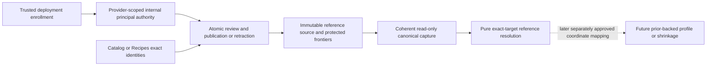

# Canonical Reviewed Exact-target Preference Prior Source Foundation

Current decision: **ARCHITECTURE APPROVED / IMPLEMENTATION AUTHORIZED** by the user from
canonical main `577f32a302cca56c7b6ac9dfb65ce2d663ae8a30` (design PR #96).
Implementation delivery is **NOT FROZEN**; see the [implementation review/evidence](PREFERENCE_PRIOR_SOURCE_FOUNDATION_EVIDENCE.md).
Milestone number remains **UNASSIGNED**. This is not MTR-040C; production prior content,
coordinate mapping, shrinkage and the next milestone remain unauthorized.

Sections1–14 preserve the original design review record and its then-current baseline,
authorization wording and regression receipt. Their statements about absent implementation
describe the documentation-only PR #96. The current user decision above supersedes that
historical authorization status; migration0014 is accounted for in the implementation evidence.

The user approved the dependency selection in [PR #95](https://github.com/thedusk4203/Menuto/pull/95)
and authorized this dedicated design, with an explicit distinction between domain semantics,
member authorship and global reference publication authority. The decisions below are concrete
proposals for architecture review, not already implemented controls or approved contracts.

## 1. Baseline, problem and scope

| Item | Canonical basis |
| --- | --- |
| Repository / exact reviewed main | `thedusk4203/Menuto` / `0a6abb4b004e9a1fa82e3aac8905a2a0fc9d3e47` |
| Exact post-merge CI | [40263357354](https://github.com/thedusk4203/Menuto/actions/runs/40263357354), SUCCESS on that SHA, python/web SUCCESS |
| Current storage / exports | Alembic `0013`, 71 domain tables, 276 exported domain definitions |
| Frozen relevant work | 040A/B, 041A/B/C/D/E/F, 046A; no semantic changes proposed |
| Approval | Dependency selection APPROVED; this source DESIGN authorized; implementation and MTR-040C NOT AUTHORIZED |

040B already derives exact-target explicit affinity and EvidenceStrength from canonical member
declaration heads. It intentionally cannot supply a preference prior. 046A supplies reviewed
culinary classification, not preference priors. 041F interprets proposal-local repeat, not taste
or global behavioral history. A canonical reviewed reference publication source is missing.

The proposed module publishes/corrects/retracts **shared reviewed reference priors**, captures
their complete source and independently resolves requested exact targets. It does not consume
member evidence or derive a MemberBehaviorProfile. An empty source remains empty/unavailable;
no numeric catalog defaults are installed to make a later profile appear ready.



## 2. Ownership and the selected interface

**Preferences owns the meaning and lifecycle of reference preference priors**, because their
consumer semantics are preference semantics. This is a separate global source module within
that context, not an extension of member preference authorship:

```text
Preferences domain semantics
    != HouseholdMember authorship authority
    != global/internal reference publication authority
```

Catalog owns Ingredient and reviewed AffinityFeatureTerm identity; Recipes owns stable Recipe
identity. Neither source's feature assignments imply a prior. The reference publisher owns no
ingredient/recipe/term vocabulary and modifies none of those owner tables. Learning may later
read immutable source contracts; it cannot call the publisher or access its persistence.

A reference provider is shared source identity, not a household or member. The publishing actor
is an internal authenticated principal, not a declaration subject. A later MemberBehaviorProfile
still belongs to HouseholdMember. No household/member/participant IDs or SELF /
AUTHORIZED_REPRESENTATIVE fields occur in these publication commands or reference facts.

Proposed small interface, all names/versions additive and subject to review:

| Operation | Responsibility / result |
| --- | --- |
| `review_and_publish_reference_prior(session, command)` | Authenticate the connection principal and provider grant; attest review of a full replacement reference; enforce CAS/idempotency and atomically append a canonical revision/receipt. |
| `review_and_retract_reference_prior(session, command)` | Authenticate a provider retractor; attest withdrawal reason; append a tombstone, never erase history or set amount to zero. |
| `capture_reference_prior_sources(session, request)` | Provider-authorized, clean read-only coherent capture of the complete provider source plus exact identity manifests. No commit/new connection. |
| `resolve_reference_priors(source)` | Pure closed-contract revalidation, authority-at-publication replay, head resolution and exact target results. No IO or authorization token. |

Administration is a separately privileged **deployment enrollment interface**, not an application
publication method or a household-management feature. It registers provider/principal identities
and appends provider-scoped grants/revocations. No web endpoint, role-management UI, generic
permission framework, automated inference/import pipeline or profile cache is proposed.

## 3. Publication authority — actual credential, not a label

### 3.1 Selected credential and trust root

Use a dedicated PostgreSQL-authenticated internal login for reference curation, with a protected
canonical enrollment binding `(database OID/name, role OID/name) -> principal_id`. Capture
the OID and name from PostgreSQL catalogs, not command fields. An ordinary application reader
may have a separate CAPTURE grant; it must not possess publishing credentials. A connection pool
must preserve the authenticated login identity; switching a shared login with `SET ROLE` is
not per-principal authentication and is not the chosen implementation.

Select **SCRAM-SHA-256 authentication** for all enrolled source sessions in v1. The protected
interfaces must check server-reported `system_user`: authentication must be non-null, use that
method and identify exactly the enrolled session login. Reject trust/unauthenticated sessions,
different authenticated identity, and unsupported authentication methods rather than treating a
claimed username as a credential. Role binding plus this authentication check is necessary;
neither replaces provider capability verification. Remote connections also require authenticated
TLS with server verification; credentials stay in deployment configuration, not commands/logs.

PostgreSQL's [trust authentication](https://www.postgresql.org/docs/18/auth-trust.html) accepts a
client-specified database username without a password check; it is not the credential boundary
chosen here. The [system_user authentication identity](https://www.postgresql.org/docs/18/functions-info.html)
and [password authentication](https://www.postgresql.org/docs/18/auth-password.html) documentation
inform this proposed guard. Existing loopback-trust regression fixtures do not prove SCRAM or
curator credential isolation. Future dedicated tests must authenticate separate roles with
ephemeral credentials, reject missing/wrong passwords and prove trust connections are denied.

The deployment operator provisions these credentials and enrollment through a privileged,
audited administrative path. Only an independently provisioned enrollment-admin database role
may call that path; ordinary publisher/reader roles cannot inherit/SET ROLE to it. Enrollment
functions resolve existing role/database identities themselves and stamp their actual admin
session identity. They cannot accept a caller-claimed operator. Enrollment is empty by default, provider-scoped and
not inferred from database role names. A principal binding is immutable; renaming/dropping and
recreating a login does not silently transfer it. Rotation uses a new binding plus explicit
revocation/grants. Logical restore requires enrollment verification before enabling writes.

This design does not assume the existing application database credentials already meet these
conditions. A publication attempt through a superuser, source-owner or other unsafe administrative
connection must be rejected by the supported interface. No operator credentials or roles are
created by this docs PR. Deployment enrollment is a required future acceptance case.

The PostgreSQL distinction matters: `session_user` follows the connection identity, while
`current_user` changes during a SECURITY DEFINER call. An ordinary authenticated non-superuser
cannot use SET SESSION AUTHORIZATION to become another login. These are PostgreSQL mechanics,
not an application-authentication claim. See [session information](https://www.postgresql.org/docs/18/functions-info.html)
and [SET SESSION AUTHORIZATION](https://www.postgresql.org/docs/18/sql-set-session-authorization.html).

### 3.2 Provider-scoped permissions and review action

| Capability | Who receives it | Effect |
| --- | --- | --- |
| `REVIEW_PUBLISH` | Explicitly enrolled internal curator for this provider | May attest review and publish a new/replacement exact-target reference. |
| `RETRACT` | Explicitly enrolled internal retractor for this provider | May attest withdrawal of an active head. Does not grant publication. |
| `CAPTURE` | Explicitly enrolled internal reader for this provider | May capture shared reference source for that provider. Does not authorize member-data access or publication. |
| Enrollment administration | Trusted deployment operator, outside the ordinary application | Registers immutable bindings/providers and appends grants/revocations. Not a publication credential. |

The provider's authority ledger records GRANT/REVOKE with a contiguous provider authority
sequence, operator connection identity, principal, capability, reason and DB-recorded timestamp.
Latest event for `(provider, principal, capability)` determines current permission. No event
means denied. One capability/provider never grants another. Database privileges to call a
function are necessary but insufficient: the current canonical provider grant is also required.

Enrollment must reject unsafe publisher/reader privilege graphs (including superuser/database
owner, role-administration or reachable source-owner/admin privileges). Administration checks
the authenticated session's actual membership in the separately provisioned enrollment-admin
role and its function EXECUTE permission; it does not use the provider grants it creates as
its own root authorization. Provider registration and principal enrollment are immutable,
idempotent on explicit administrator operation keys; conflicting reuse is rejected. Grant/revoke
commands require expected_authority_generation and an administrator idempotency key scoped to
provider/admin session identity. Exact authorized retry returns its old receipt before CAS;
changed payload conflicts. New effective grant/revoke appends one authority and mutation event
atomically, never edits an earlier grant. No-op repeated grant/revoke with a fresh key is rejected.

`REVIEW_PUBLISH` means an authenticated curator explicitly attests review of the exact submitted
amount, target, provenance and rationale in the same atomic publication action. There is no
unreviewed draft converted by a caller's status flag. This narrow source does **not** require
two people: a single authorized curator may publish their reviewed reference. It does not claim
independent second-person review. A later two-person workflow would require separate design.
The database proves authorized attestation, not the curator's diligence, the truth of a cited
reference or empirical calibration. Service credentials identify the service principal, not an
invented human reviewer. No command-authored reviewer/actor ID is accepted.

Publication/administration audit and the capture reader proof include the server-derived
authentication method and authenticated identity alongside session/principal identity. They
contain no password, token or credential verifier. Pure replay checks the fixed method and
identity/binding consistency; those recorded strings alone still cannot authenticate origin.

A revoked grant denies new publication/retraction and even a retry through that now-unauthorized
principal. Revocation is prospective; it does not retroactively erase a previously authorized
publication or turn an old snapshot into a different history. If a reference must be withdrawn,
an authorized retractor appends an explicit retraction. Credential compromise requires revocation
plus reviewed source corrections, not silent deletion or bulk neutralization.

### 3.3 Authoritative database enforcement and limits

Future mutation functions must verify authenticated system_user, derive `session_user` and its enrolled binding internally, lock
the provider frontier, verify the current grant and stamp principal/grant identity themselves.
They must not trust a GUC, JSON actor field, source hash, reviewer UUID, USER/REVIEWED_REFERENCE
label, SELF/AUTHORIZED_REPRESENTATIVE mode, or household OWNER/EDITOR membership as permission.

Use a non-login function owner with rights limited to the new private source relations and
read-only owner identity facts. The publisher/reader cannot inherit or SET ROLE to that owner,
alter functions, grant capabilities, change source rows directly, truncate tables, bypass guards
or create objects in the trusted schema. Publication functions must use fully qualified names,
a protected search_path, no caller-controlled dynamic SQL, and selective EXECUTE grants after
revoking default PUBLIC execution. Apply creation and privilege changes atomically, following
the [PostgreSQL SECURITY DEFINER guidance](https://www.postgresql.org/docs/18/sql-createfunction.html).

The writer lock is also used by grant revocation, so a write racing revocation is ordered by
the shared provider frontier; stale RR/SERIALIZABLE attempts must abort/retry, not use old grants.
Raw calls to the protected function enforce the same checks as the Python interface. Direct
INSERT/UPDATE/DELETE/TRUNCATE and head/frontier manipulation by publisher/reader roles fail.
The exact privilege graph, function-owner isolation and pool identity behavior must be proven
with real separate PostgreSQL connections in future tests, not only a mocked actor object.

Database superusers/owners and the credential provisioning operator remain trusted roots;
this is not tamper-proof storage against them. A superuser can impersonate a login using
SET SESSION AUTHORIZATION; inspecting session_user does not authenticate such an adversarial
trusted-root action. Tests must use real non-superuser connections, not superuser impersonation
as proof of credential isolation. Bootstrap/migration-owner connections are not
evidence of ordinary caller enforcement. No existing frozen table/function/role is weakened.

## 4. Coordinate semantics — reference policy, not statistical evidence

Select one closed v1 coordinate:

```text
coordinate_id      = CURATED_REFERENCE_PREFERENCE
coordinate_version = 1
unit               = REVIEWED_REFERENCE_ANCHOR_UNITS
applicability      = GLOBAL_REFERENCE_ONLY
```

`ReferencePriorAmount` is a signed exact rational in `[-1, 1]`. It means **the provider's
reviewed normative preference anchor for an unspecified member and this exact target**, under
this fixed global reference applicability. It is not an observed population average, personal
declaration, probability of liking, utility estimate, prevalence or statistical prior distribution.
Publication must cite the actual reviewed reference/curation artifact and rationale supporting
the assigned anchor; data quality is a curation responsibility, not inferred from arithmetic.

| Coordinate | Defined interpretation |
| --- | --- |
| `-1/1` | Negative endpoint: strongest negative reference anchor in this coordinate. |
| `0/1` | Explicitly reviewed balance point of the reference scale. AVAILABLE only when actually published; never synthesized for absence. |
| `1/1` | Positive endpoint: strongest positive reference anchor in this coordinate. |
| Intermediate rational | Ordered reference anchor between the endpoints; arithmetic representation is exact, without claiming calibrated differences or ratios. |

These are semantic endpoint definitions, **not production prior records or default mappings**.
No actual ingredient/recipe/feature receives a value in this design or its future migration.
Providers may disagree; the source never averages or treats them as independent votes.

040B's `ExplicitAffinityAmount` uses `POLICY_EXPLICIT_AFFINITY_UNITS`, selected by a complete
explicit interpretation policy and the current member declaration. This source uses a distinct
type/coordinate/version. Equal fractions or equal bounds do not establish convertibility.
**No identity conversion, scale reuse or shrinkage is defined.** A later independently approved
consumer needs an explicit compatibility/mapping policy naming both coordinate versions and
the explicit interpretation policy. Different target kinds also must not be aggregated merely
because they share a representational coordinate.

Strict arithmetic: numerator and denominator are JSON integers, never bool/string/float;
`-2147483647 <= numerator <= 2147483647`, `1 <= denominator <= 2147483647`,
`abs(numerator) <= denominator`, `gcd(abs(numerator), denominator)=1`; zero requires denominator1.
Reject noncanonical fractions rather than normalize input silently. Store integer components,
not floating/rounded NUMERIC amounts. No pseudo-count, precision/confidence, EvidenceStrength,
shrinkage coefficient, planner weight or production numeric default is part of the source.

Future coordinate semantics must use a new closed version and reviewed consumer compatibility;
no mutable provider label may redefine v1. The present design does not introduce an extensible
coordinate registry or an expression/mapping engine for hypothetical versions.

## 5. Exact applicability, provider selection and missingness

### 5.1 Target identity

Reuse only the frozen `PreferenceTarget` **identity union**, not its member commands or authorship
rules: INGREDIENT -> canonical Ingredient ID; DIRECT_RECIPE -> stable Recipe ID; PROTEIN /
METHOD / FLAVOR -> exact REVIEWED AffinityFeatureTerm ID of the matching kind. Term code,
display name, RecipeVersion ID, family identity and classification assignment are not aliases.
No parent, synonym, ingredient-to-protein transfer, recipe-to-feature inference or cross-member
transfer is performed. Classification and provenance do not establish dietary/safety eligibility.

The owner identity must exist. Reviewed term rows are already immutable in frozen0011; verify
the reviewed state/kind on publication and capture without changing those guards. Typed FKs
protect referenced identities against deletion. Ingredient/Recipe identity alone does not claim
recipe executability, classification or nutrition completeness.

### 5.2 Provider identity and one-provider selection

An immutable registered provider has UUID, stable code/version, exact provenance source_system,
description/curation remit, registration audit, the fixed coordinate and applicability above.
Changing its meaning/source_system creates a new provider identity; no mutable alias points old
requests at a new source. It is not a region, cohort, household or inferred member segment.

`ReferencePriorCaptureRequest` names **one provider_id** and a unique exact requested-target set.
The coordinate/version/applicability are closed v1 literals. No optional provider, best-provider
search, priority list, wildcard, fallback provider or household default exists. Multiple providers
can publish for the same target, but the consumer must explicitly bind one in a separate request.
Unsupported cohort/locale/time-range selectors are rejected, not silently ignored.

The source provider's provenance `source_system` must match its registry fact. Publications
require REVIEWED_REFERENCE, nonblank external record/version, observed_at, and a content hash
of the reviewed reference/curation artifact; optional URI must meet existing no-credentials
rules. This extends the new reference-source contract only, not frozen Provenance. A URI/hash
identifies what the curator attests to; capture performs no network fetch and cannot authenticate
external content. A retirement/correction artifact may be cited for a retraction.

### 5.3 Result/error matrix

| Input / captured fact | Exact proposed outcome |
| --- | --- |
| Known provider, canonical target, active REPLACE head | AVAILABLE, exact amount plus full provider/coordinate/revision/reviewer/provenance support. |
| Known provider, canonical target, no stream/publication | UNAVAILABLE / NO_PUBLICATION. No numeric field. Publication generation0 is an actual empty source, not a prior value; authority/mutation generations may already be positive for reader enrollment. |
| Current stream head is RETRACT | UNAVAILABLE / RETRACTED, with tombstone identity; prior amounts remain historical only. |
| Actually published `0/1` | AVAILABLE zero, distinct from both missing and retracted. |
| Unknown provider / missing provider / several provider selectors | Reject request: PROVIDER_UNRESOLVED / EXPLICIT_SINGLE_PROVIDER_REQUIRED. No fallback. |
| Random/missing target, wrong term kind, DRAFT term | Reject whole capture/publication: TARGET_IDENTITY_UNRESOLVED / TARGET_NOT_REVIEWED. Do not emit a fake no-prior row. |
| Two source heads, duplicate stream, bad authority proof or conflicting primitives | Reject whole source: SOURCE_INCONSISTENT. Do not choose a latest timestamp, minimum UUID or average. |
| Unsupported coordinate/applicability | Reject contract; no automatic conversion or silent provider substitution. |
| Empty requested-target set | Empty resolved row set; full provider capture still identifies its source. No claim of global member neutrality. |

One result per requested exact target, deterministic order. Unrequested publications remain in
the full source, not in the resolved rows. There is no member-specific affinity/strength result
and no reinterpretation of UNDECLARED, NEUTRAL or RETRACTED declarations.

## 6. Immutable lifecycle, effective time, CAS and idempotency

### 6.1 Revision rules

One stream is `(provider_id, exact typed target)` under the fixed v1 coordinate/applicability.
It has a DB-controlled current head and contiguous revision numbers starting at0. Full provider
publication sequence starts at1, independent of authority sequence. Both kinds of change also
share one contiguous **provider mutation sequence** and hash-linked journal, under the same
frontier lock. Registration creates an
actual canonical empty provider frontier; it creates no target streams, grants or prior values.

- Initial REPLACE requires expected_revision=-1 and predecessor_id=None; no prior exists before it.
- Replacement requires the exact current head/revision; it replaces the entire amount/provenance/
  review rationale. Prior revisions are immutable. A reviewed correction is a new revision.
- RETRACT requires an active REPLACE head, exact predecessor and withdrawal reason/provenance;
  no amount is allowed. Repeated fresh retraction of an already retracted head is rejected.
- REPLACE after RETRACT explicitly references that tombstone; it is a new reviewed publication,
  not an automatic reinstatement. Reusing an amount does not increase any evidence strength.
- Streams exist only after a successful initial publication. No placeholder stream/value is
  created by reading or by an unauthorized/failed initial write.

Publication is the review action. Every revision includes principal/grant identity derived by
the database, provider authority generation used for the check, shared mutation identity, review rationale, canonical
provenance, DB publication sequence, exact predecessor, command identity and server timestamps.
It is not possible to insert a usable source by passing `status=REVIEWED`.

### 6.2 Effective time and historical meaning

Choose **immediate, committed-source semantics only**. Server `recorded_at` is finite DB time;
`effective_at = recorded_at`. A mutation header and its typed child share one server-assigned
recorded_at value. Both times are server-owned. No caller backdating, future scheduled
effectivity, retroactive withdrawal, validity ranges, expiration defaults or time-based provider
switching exists in v1. Source observed_at must be no later than recorded_at. Detect clock
regression against the previous provider mutation and fail CLOCK_ORDER_UNRESOLVED; do not invent
ticks to conceal it. Equal timestamps are ordered by mutation sequence, never UUID.

An event becomes visible to a canonical capture only through its committed transaction and
RR/SERIALIZABLE source cut. Its timestamp is not a commit-time certificate. There is no live
`resolve(as_of=past_timestamp)` query: historical replay consumes the exact old immutable
snapshot/frontiers, not today's database filtered by old timestamps. A later correction changes
new captures, not old capture contents or their replayed result.

Retraction/replacement changes the provider source frontier/head so future consumers can detect
supersession. This source does not invalidate or rewrite member declarations, derive learned
rules, or implement a profile cache invalidation engine. A future consumer must bind source
identity and implement its own approved correction/invalidation policy, rather than silently
re-inferring from invalidated evidence. Old replay consistency never proves current applicability.

### 6.3 Atomic write protocol

Caller owns transaction/commit/rollback; the interface may use a savepoint to avoid partial
state after a caught error. No internal commit or hidden second connection. Proposed ordering:

1. Reject unsupported/unsafe connection identities. Derive the enrolled principal from actual
   session identity; lock this provider's frontier FOR UPDATE, shared with its authority admin path.
2. Verify the current provider capability. Revoked/missing grant fails **before** receipt lookup.
3. Reparse command and recompute its canonical semantic hash. Look up `(provider_id, principal_id,
   idempotency_key)`: exact same command returns the original receipt without new row/frontier;
   changed command is IDEMPOTENCY_CONFLICT. This retry precedes CAS checks, since the original
   expected frontier/head necessarily became stale after its successful write.
4. For a new command, compare required expected_provider_generation, expected_revision and
   predecessor_id with current canonical facts; mismatch is SOURCE_STALE/HEAD_STALE. Verify
   provider source_system, exact owner identity/kind and complete numeric/provenance constraints.
5. Lock existing stream; allocate initial stream only for a valid initial REPLACE. Append the
   immutable revision/review attestation and its mutation journal entry, advance stream head and provider source frontier,
   bind authority generation/grant event, then return the immutable receipt.
6. All rows/frontier changes commit or roll back together. Failed permission, CAS, arithmetic,
   provenance, identity, constraint or serialization checks leave no partial publication.

The returned write receipt is transaction-local until the caller successfully commits. It is
not proof that commit already happened. Rolled-back receipts cannot be captured/retried as
persisted history; after commit the stored operation supplies the identical retry receipt.

The semantic command hash includes operation, provider/target, coordinate/applicability, amount
when allowed, review rationale, provenance, expected CAS fields and idempotency key. It excludes
DB-assigned actor/time/IDs/generation. A changed expected head is a changed command. A retry after
another target publication returns its original receipt if still authorized; it is not a fresh
current-head certificate or a new reviewed vote.

Writes serialize coarsely per provider; different providers need not share a writer lock. This
small reference foundation favors a clear atomic source frontier over throughput sharding.
READ COMMITTED writes observe the grant after acquiring the provider lock. RR/SERIALIZABLE
writes encountering changed protected rows must propagate serialization failure and retry the
whole command transaction. Lock order is provider frontier -> stream; immutable owner identity
reads and typed FK checks do not mutate Catalog/Recipes or use 046A association fences. Admin
grant/revoke locks the same provider frontier before appending its authority event and shared
mutation entry. Source generation counts publications; authority generation counts grant events;
mutation generation counts both. These are server-owned, and the merged mutation journal must
reconstruct both component counters and the exact permission immediately before each write.
It is insufficient to pin an arbitrary older authority generation at which a grant was valid.
No advisory lock or ordinary-application GUC is accepted as proof of authority.

Source/authority/mutation generations are strict integers in `[0, 2^63-1]`; actual event sequences
are positive. Stream revision is `[0, 2^31-1]`, with `-1` allowed only in the initial expected-revision
command. Exhaustion fails without mutation, never wraps. Rationale is nonblank text of1–4000
characters. Persist full original command components as typed columns so replay can recompute
the command hash; a hash-only receipt or opaque JSON source payload is insufficient.

### 6.4 Worked authority/source trace

The symbols `q1` and `q2` below are independently chosen valid test rationals, not production
priors, defaults or policy values. Curator C, reader R and retractor X are real distinct test
connection principals for provider P; this is not a requirement for three human operators.

| Mutation | Operation | Source generation | Authority generation | Target T outcome in a fresh authorized capture |
| --- | --- | --- | --- | --- |
|1 | Admin GRANT C REVIEW_PUBLISH |0 |1 | Not yet readable by R; no publication |
|2 | Admin GRANT R CAPTURE |0 |2 | NO_PUBLICATION |
|3 | Admin GRANT X RETRACT |0 |3 | NO_PUBLICATION; changed authority/source-capture identity |
|4 | C publishes T=q1, expected source0 / revision-1 |1 |3 | AVAILABLE q1, stream revision0 |
|5 | C corrects T=q2, expected source1 / revision0 |2 |3 | AVAILABLE q2, stream revision1 |
|6 | Admin REVOKE C REVIEW_PUBLISH |2 |4 | Still AVAILABLE q2; revocation is not source retraction |
| none | C tries a fresh publication or original idempotent retry |2 |4 | Permission denied; no row/counter changes |
|7 | X retracts T, expected source2 / revision1 |3 |4 | RETRACTED, stream revision2; no numeric amount |

A fabricated mutation7 publication by C pinning authority_generation3 fails replay against the
complete mutation order: the actual preceding authority state is4 and denies C. A complete
self-consistent fabricated origin remains unauthenticated offline, per§8. A saved capture after4
still replays q1; one after5 replays q2; a fresh capture after7 resolves RETRACTED. None of the
extra review/history rows increases member EvidenceStrength or alters an explicit declaration.

## 7. Proposed contracts and logical persistence model

All following names are **design-only**, immutable/extra-forbid, new versions. Existing wire
models, bundle identifier and frozen hashes stay unchanged. No exported contracts are added now.

| Proposed contract | Required content / invariants |
| --- | --- |
| `ReferencePriorCoordinate` / `reference-prior-coordinate.v1` | Fixed coordinate/version/unit/applicability from§4; no registry-selected substitute. |
| `ReferencePriorAmount` | Strict canonical rational and limits from§4; distinct from ExplicitAffinityAmount. |
| `ReferencePriorProviderFact` | Immutable provider UUID/code/version/source_system/remit, coordinate, operator registration audit/time. |
| `ReferencePriorPrincipalFact` | Immutable binding UUID, database identity, authenticated login name/OID, enrollment audit/time. No household authorship or credential material. |
| `ReferencePriorAuthorityEvent` | Provider/principal/capability, GRANT/REVOKE, authority sequence/predecessor, shared mutation identity, operator identity, reason/time. Contiguous ordered history, protected write path. |
| `ReferencePriorMutationFact` | Provider, contiguous mutation sequence, kind PUBLICATION/AUTHORITY, exact typed child identity, predecessor/hash and recorded time. Exactly one matching child; no generic payload. |
| `ReferencePriorPublishCommand` / `reference-prior-publish.v1` | operation=REPLACE, provider, PreferenceTarget identity union, coordinate/applicability, amount, REVIEWED_REFERENCE provenance, review rationale, expected provider generation/revision/predecessor, idempotency key. No actor/status/EvidenceStrength/time override. |
| `ReferencePriorRetractCommand` / `reference-prior-retract.v1` | Same identity/CAS/provenance/reason fields; operation RETRACT, amount forbidden. |
| `ReferencePriorRevisionFact` / `reference-prior-revision.v1` | DB-created ID, stream/provider/target, revision/source/mutation sequences, operation, typed amount or tombstone, principal/grant/authority cut, provenance/reason, recorded/effective time, canonical command content/hash, stream/provider predecessor identities/hashes. Enough original command content to independently recompute its hash. |
| `ReferencePriorStreamFact` | Exact stream identity and cached current head/revision. Cache must equal replayed history; it is never independent truth. |
| `ReferencePriorWriteReceipt` | Exact recorded-operation identity/revision/frontier/hash/time, or identical retry receipt. Transaction-local until caller commit; does not claim commit, activation or future publication rights. |
| `ReferencePriorCaptureRequest` | One explicit provider, closed coordinate/applicability, unique sorted exact targets; no historical time, cohort or fallback selectors. |
| `ReferencePriorSourceSnapshotDraft` / `reference-prior-source.v1-draft` | Request, provider, full revisions/streams/authority ledger/mutation journal, consumed principal bindings, reader grant proof, source/authority/mutation frontiers and exact owner identity manifest, capture clocks/mode and recomputed identity. |
| `AvailableReviewedReferencePrior` | AVAILABLE, amount, exact provider/coordinate/target/head revision, publication review/provenance support. Not a member-affinity result. |
| `UnavailableReviewedReferencePrior` | UNAVAILABLE / NO_PUBLICATION or RETRACTED, tombstone support if applicable; no numeric field. |
| `ReviewedReferencePriorDraft` / `reviewed-reference-prior.v1-draft` | Full source, exactly requested resolved rows, recomputed source/manifest/result fingerprints and fixed scope flags from§9. |

Proposed logical relations below express required constraints, **not reserved physical DDL or
an approved table count**. A future approved forward migration must specify exact names/types/
privileges and match ORM registration without importing mutable runtime into frozen migration SQL.

| Logical relation | Required persistence / authority |
| --- | --- |
| Provider registry | Immutable provider descriptor and operator registration audit; protected enrollment only. Unique code/version, stable ID, exact source_system binding. |
| Internal principal registry | Immutable login/database/OID/name binding and enrollment audit. No passwords/tokens, no member FK, no implicit household role inheritance. |
| Provider authority ledger | Append-only capability GRANT/REVOKE history; unique provider authority sequence. Actor/cut/reason protected by administration interface; no application grant editing. |
| Provider mutation journal | Typed PUBLICATION/AUTHORITY headers in one contiguous provider order, each with exactly one matching immutable child, enforced by composite FKs/deferred completeness guards. No JSON/generic event payload. |
| Provider frontier | Protected source, authority and mutation generations/head identities/hashes, initialized only with real provider registration. Generation0 requires no corresponding head; positive generation requires exact final event. Counts are audit order, not evidence counts. |
| Typed prior streams | Provider + exact kind and exactly one ingredient/recipe/term FK, unique per provider/target. Composite term FK `(id,kind)` reuses existing Catalog key; no untyped polymorphic target UUID. Head FK matches stream and revision. |
| Prior revision/review ledger | Append-only REPLACE/RETRACT, strict rational checks, provenance/source-system/review audit, predecessor/composite FK lineage, source sequence, idempotency uniqueness and DB-controlled actor/time/head updates. |

Enforce update/delete/truncate rejection and complete stream/revision/head consistency through
privileges plus new owned-table guards/constraints. Initial stream cannot commit without its
first complete revision. Referenced Catalog/Recipe rows remain untouched; existing FKs and
immutable term semantics are sufficient. No general event store, JSONB source-of-truth payload,
member profile table, materialized preference score, catalog tagging or SQL selection heuristic.

## 8. Canonical capture, completeness and independent replay

Choose **one provider's complete history** rather than query-filtered visible target rows.
This intentionally favors audit completeness for a small curated source. A future resource
limit must fail the whole capture explicitly; it may not truncate and advertise completeness.
Pagination/distributed capture are outside v1 and require a separately reviewed completeness protocol.

Canonical capture protocol:

1. Require one caller-owned clean read-only REPEATABLE READ or SERIALIZABLE transaction; reject
   dirty/writable sessions and READ COMMITTED. No writes, commits, new connection or write locks.
2. Through the protected provider read function, derive the real reader principal and verify
   its CAPTURE permission at the same committed source cut. Read actual provider registry and
   source/authority frontiers. Unknown provider is an error, not an invented generation0.
3. Capture all provider revisions, streams, mutation journal and full authority ledger through those frontiers,
   plus all principal bindings used by the ledger/revisions/reader. Capture registry/operator
   audit facts, not secret credentials. Preserve both source and authority identities.
4. Capture canonical owner identities for the union of every source stream target and every
   requested target via existing Catalog/Recipes identity facades in that same session. Require
   exact coverage/kind/review state. Do not use the member-bound 040B capture envelope to fake
   household ownership of shared reference facts.
5. Record DB capture-start/completion clocks and coherent source mode. Revalidate finite times,
   visible publication bounds, sequences, full manifests and frontiers. Return immutable source;
   do not persist captures or derived results. Reject clock-order inconsistency explicitly.

Grant revocation after the reader's snapshot does not turn this capture into a live authorization
certificate. The read permission and visible data describe that snapshot. Future consumers must
recapture as required by their own policy; no current DB liveness/commit authority is implied.

Pure replay reparses every primitive; checks provider bindings, exact targets, complete sequences,
revision/head/hash-chain consistency and canonical command hashes; replays the merged mutation
journal and authority ledger; verifies the publication's pinned cut equals the actual preceding
authority generation and the selected GRANT was current then, with the enrolled publication principal; and independently
derives heads and requested-target outcomes. Later revocation does not retroactively change
authorization at an earlier publication. Reader proof is checked at the captured authority cut.
Any unsupported, duplicate, missing or conflicting primitive, or cached result not entailed by
the primitives, rejects the whole input. Recomputing cached hashes does not conceal a broken
lineage, authority cut or derivation. Wholly self-consistent fabricated origin remains outside
what offline replay can authenticate, as stated below.

Use an additive canonical identity domain such as `preference-prior-source.v1`, with existing
neutral canonical primitives, sorted exact sets and UTC microsecond timestamps. The full source
fingerprint includes capture identity/clocks, request, coordinate/provider registry, complete
publication and authority ledgers/mutation order, principal proofs, frontiers, heads and owner manifest. A new
unrequested target publication or relevant grant event changes full-source identity even when
requested visible rows are unchanged. A projected result-row digest is not a substitute.
Input tuple order is not history: normalize unique facts by their exact identities/sequences.
Permuting the same input set preserves replay identity; changing an event's actual sequence,
predecessor or typed content must satisfy the entire reconstructed history or fail.

Hashing must be acyclic: assign DB identities/sequences first, hash each typed publication or
authority payload including its mutation sequence and earlier lineage, then hash its journal
header including that child content hash and the preceding mutation hash. A child references
the current journal by identity/sequence, **not its own enclosing journal hash**. The first
journal predecessor is None; generation0 has no journal head. Receipt/frontier may then name
the completed journal hash. Deferred typed-child completeness guards enforce one matching
PUBLICATION or AUTHORITY child per journal header, with no orphan or cross-provider references.

Offline structural consistency **cannot prove canonical database origin**, actual role ownership,
review quality, present permission or present source freshness. Even a fully self-consistent
forged history with fabricated enrollment cannot be authenticated by pure replay alone. The
canonical database adapter plus connection privilege boundary provides origin/authorization
assurance at capture; snapshot hashes do not become signatures or PRECOMMIT capabilities.

## 9. Fixed exclusions, frozen compatibility and dependency impact

Every proposed resolved result carries closed scope indicators:

```text
scope                    = ONE_EXPLICIT_PROVIDER_EXACT_TARGET_REFERENCE_ONLY
interpretation_mode      = AS_OF_CAPTURE
member_preference_data   = NOT_MODIFIED
evidence_strength        = NOT_DERIVED
learned_evidence          = UNAVAILABLE
contextual_evidence       = UNAVAILABLE
passive_evidence          = UNAVAILABLE
cross_target_inference    = NOT_PERFORMED
provider_aggregation      = NOT_PERFORMED
coordinate_conversion     = NOT_PERFORMED
shrinkage                 = UNAVAILABLE
candidate_aggregation     = NOT_PERFORMED
taste_fit                 = UNAVAILABLE
planner_ready             = False
activation_ready          = False
```

Do not add these fields to frozen result types. Frozen040B must continue reporting its prior
and shrinkage UNAVAILABLE even if this separate source is later implemented and populated.
No caller may promote a reference prior into EvidenceStrength or a member's explicit declaration.
Existing strength literals remain NONE / LOW / MEDIUM / HIGH, policy metadata rather than
probabilities. No learned/contextual/passive evidence is routed or persisted by this source.
REVIEWED_REFERENCE is a provenance category, not the Learning evidence class DIRECT; an internal
curator's reference publication is never recast as a member's voluntary declaration.

Preserve UNDECLARED != NEUTRAL, RETRACTED != NEUTRAL, explicit AVAILABLE zero versus absence,
current declaration head-only strength and no history/retry inflation. Source retractions also
do not mean neutral. Cooked != liked, friction != taste and forced tradeoffs != voluntary
preference. Passive assumptions cannot create durable learning. Reference data may eventually
inform soft ranking only through an approved consumer; it cannot change hard safety.

Out of scope: MTR-040C, hierarchy/generalization/shrinkage, MemberBehaviorProfile derivation,
onboarding UI/answers, cohort priors, MTR-039 routing, learned correction/reset workflow, all
novelty/global/accepted/confirmed/cross-horizon/family history, 024 composition, 020B roles,
021 feasibility, Execution and PRECOMMIT authority. No silent Recipe-ID penalty weight reuse,
feature aggregation, zero priors, inferred preferences, synthetic production source records or
policy weights. Source publication authority is not plan approval or execution authority.

Implementing this source would remove **source capability** as one missing primitive. It would
not supply approved production prior content, compatibility mappings, shrinkage policy or full
profile readiness. Full040/041/046 remain incomplete;024/020B/021 BLOCKED; Execution NOT STARTED;
PRECOMMIT FAIL-CLOSED. Frozen040A/B,041A–F,046A contracts/hashes/semantics remain unchanged.

## 10. Migration, deployment and data preservation proposal

Expect a **new forward migration after0013 only after this design is approved and implementation
separately authorized**. No identifier, physical table count or final schema is reserved here.
No migration file or database role/grant is added now. Existing0001–0013 remain byte-identical.

The future migration creates only approved source storage/guards/functions and safe empty
registries; it adds no production provider, principal, capability grant or prior amount. Deployment
provisioning/enrollment is separately explicit and audited. It must prove ordinary application
credentials have no publication/enrollment/owner rights before enabling the publisher. Missing
permissions/enrollment or an unsafe privilege graph cause fail-closed writes, not a permissive
fallback to trusted caller IDs. No new authentication platform is required for this internal
database credential design, but the least-privilege deployment seam is a real deliverable.

Existing member data, vocabulary, plan history and frozen semantics are neither backfilled nor
rewritten. Empty source is NO_PUBLICATION, never a default zero/neutral prior. Future populated
downgrade must refuse destructive loss of the new durable source unless an independently approved
export/preservation process exists; the ordinary supported downgrade is empty-source only.
Even registry/enrollment/authority audit data counts as populated; absence of prior amounts
alone does not permit deleting those records.
Migration acceptance must test empty upgrade/downgrade/upgrade, populated data-preserving failure
of downgrade, and a clean continuation forward with identical existing data/guard definitions.
No production credential secret or PostgreSQL cluster-wide login lifecycle belongs in a destructive
Alembic downgrade. New domain tables and deployment roles must be accounted for separately.

## 11. Adversarial acceptance matrix for future implementation

These are **planned tests**, not added/passing tests. Public interface, immutable contracts and
real PostgreSQL constraints must independently satisfy them; generated expected values are not
an independent oracle. Use deliberately different DB logins/privileges and data-bearing histories.

| Case | Required proof / failure behavior |
| --- | --- |
| A01 No authority | Household OWNER/EDITOR, SELF/AUTHORIZED_REPRESENTATIVE, claimed reviewer UUID/hash/provenance cannot publish or retract. |
| A02 Real principal | Enrolled login succeeds only for its granted provider/capability; command actor/status fields are rejected. Stored actor/grant/time are server-derived. |
| A03 Session identity | SET ROLE, session GUC, shared pool user or forged role name does not impersonate another enrolled session; dropped/recreated or renamed login fails stale binding. |
| A04 Role isolation | Real ordinary reader/publisher cannot enroll/grant, inherit owner, replace functions, create shadow objects, insert/update/delete/truncate source rows or manipulate heads/frontiers. Test unsafe admin connection rejection separately from trusted DBA powers. |
| A05 Capabilities | CAPTURE cannot publish; REVIEW_PUBLISH cannot retract without RETRACT; provider A grant does not authorize B. Missing/revoked grant fails before idempotent receipt reuse. |
| A06 Revocation race | Two real transactions order grant revocation and write on the provider frontier; stale RR/SERIALIZABLE aborts, no stale-grant success or partial rows. Past approved facts remain historically replayable. |
| A07 Honest review claim | Exactly authenticated attestation/rationale/provenance is stored; no fabricated human identity or claim of second-person approval. Empty rationale/provenance rejected. |
| A08 Administration protocol | Only real enrollment-admin credentials may register/bind/grant/revoke; registration and grant idempotency, stale authority CAS and competing admin writes preserve one contiguous authority/mutation history. No-op fresh grants/revokes do not create extra audit events. |
| A09 Authentication | Separate real SCRAM login connections succeed with their own ephemeral credentials and fail with missing/wrong passwords. Trust, null/different system_user authentication identity and unsupported methods are rejected by protected interfaces. Existing trust-based fixtures and superuser SET SESSION AUTHORIZATION are not proof of this boundary; test HBA/authentication in isolation without changing old regression semantics. |
| C01 Coordinate separation | ReferencePriorAmount cannot stand in for ExplicitAffinityAmount; equal fractions do not authorize conversion or shrinkage. Closed coordinate/version/applicability enforced in Python and SQL. |
| C02 Arithmetic | Reject bool/string/float, denominator0/negative, out-of-range/overflow and unreduced fractions; preserve exact negative/fractional/zero values without rounding. |
| C03 No defaults | Empty registry and canonical target with no publication yield unavailable/no numeric field. Actual reviewed0/1 is AVAILABLE, distinct from missing/retracted. |
| T01 Five typed identities | All five exact kinds resolve canonical IDs; wrong kind, DRAFT term, random UUID, code/name/version alias or RecipeVersion-as-Recipe rejected. No owner-table mutations. |
| T02 Provider binding | Unknown/multiple/missing provider selector rejects; wrong provenance source_system or unsupported cohort/locale selector rejects. No provider or target fallback. |
| T03 Conflicts | Different providers' amounts stay separate; duplicate streams/heads or conflicting primitives reject even if numbers agree. No averaging/latest-time/UUID tie-break. |
| L01 Lifecycle | Initial REPLACE, corrective replacement, RETRACT and explicit replacement after tombstone produce exact contiguous lineage; retraction has no amount and never rewrites old values. |
| L02 CAS/concurrency | Stale head/provider generation rejected; competing initial writes and competing updates produce one valid next head or whole transaction failure. Rollback leaves all frontiers/rows unchanged. |
| L03 Idempotency | Same authorized command returns byte-identical receipt, no new sequence/row. Changed key payload/CAS/operation conflicts. Retry after unrelated publication or revocation follows§6 ordering. |
| L04 Effective time | Caller backdate/future timestamps forbidden; DB recorded/effective identity enforced, observed-after-publication and clock regression rejected; equal times ordered by sequence. |
| L05 Historical replay | Capture A, correct/retract, capture B: A replays unchanged, B resolves new/tombstone head. No current-database past-time filtering masquerades as historical capture. |
| S01 Capture transaction | Dirty/writable/READ COMMITTED rejected; one read-only RR/SERIALIZABLE session returns coherent provider/source/authority/identity cut, no writes/commits/hidden connection. |
| S02 Complete provider source | Include all published targets/history and authority events even for a single target query. Real registered empty frontier0 accepted; invented missing-provider frontier rejected; no pagination/truncation under success. |
| S03 Replay forgery | Drop/duplicate/alter facts or their sequence/predecessor fields, forge grant cuts or cached heads/results; rehash caches; missing/conflicting primitives still rejected. In particular, a publication after REVOKE cannot pin an older GRANT cut: the complete shared mutation order reveals the actual preceding authority state. Recompute canonical command hash from actual attached content. |
| S04 Identity | Unrequested publication, relevant grant/revoke or capture identity change affects full-source fingerprint while visible requested rows may stay the same. Explicitly test offline self-consistent fake origin is not authenticated. |
| S05 Negative distinctions | NO_PUBLICATION != RETRACTED != AVAILABLE0; empty target set is not global neutrality; unknown target/provider is not a valid empty source. |
| S06 Determinism | Permutations of the same complete fact sets resolve to identical canonical identities/results; event order follows actual sequence fields, not tuple position or timestamps. |
| F01 Frozen regression | All276 existing definitions and frozen algorithms/hashes/migration bytes unchanged;040B prior/shrinkage stay UNAVAILABLE;041F remains proposal-local with its existing missingness/policy semantics. |
| F02 Semantic isolation | No evidence strength, learned data, passive learning, cross-target inference, TasteFit/planner weights, hard-safety changes, history or authority; fixed result scope flags enforced. |
| M01 Migration/deployment | Empty and populated paths from§10, real direct-SQL guard/privilege tests, credential enrollment/restore/rotation denial paths, no default production rows or secrets. |
| R01 Existing CI | Full Python and real-PG, architecture/import boundaries, schemas/fixtures, benchmark and client/web all pass; new source acceptance evidence is reported separately from old regression. |

## 12. Alternatives, trade-offs and review decisions

| Alternative | Decision |
| --- | --- |
| Reuse member SELF/representative or household permissions | Reject: global reference authority and member ownership are different facts. |
| Trust REVIEWED_REFERENCE/reviewer ID/hash or arbitrary GUC | Reject: they describe payload, not the authenticated publisher or canonical grant. |
| Reuse 046A trusted actor argument alone | Too weak for this chosen design's independent publication-authority requirement; use explicit enrolled session identity and scoped grants. Do not change frozen046A or claim its internal seam is a defect. |
| Signed offline reference package/import platform | Defer: new signing/key-rotation/distribution/import completeness machinery is unnecessary for the current single database source. |
| Single shared database login plus per-request asserted actor | Reject for publication identity; cannot distinguish principals using untrusted request fields. A separate authenticated curation connection is intentional. |
| Two-person draft/approval workflow | Defer: not needed for the selected single-curator attestation boundary; do not imply it exists. |
| Reuse explicit-affinity coordinate or all-zero catalog prior | Reject: equal bounds are not semantic compatibility; fake content would conceal missing data. |
| Automatic provider precedence / hierarchy / fallback | Reject: introduces unapproved transfer/selection policy; exact provider/target selection keeps conflicts explicit. |
| Future/backdated validity windows | Defer: creates bitemporal selection complexity not needed for immediate committed publication and old-snapshot replay. |
| Query-filtered capture / generic event bus | Reject for this slice: loses provider audit completeness or adds infrastructure without a source requirement. |

The selected design costs a dedicated credential/enrollment seam and complete provider-history
capture, and serializes provider writes. Those are deliberate costs for independently testable
authority and deterministic replay. It supplies no new public consumer workflow or generic
authorization framework. If deployment cannot meet that privilege seam, implementation cannot
silently downgrade to caller-supplied curator identity; return to design review.

Requested architecture decisions are the proposed authority/trust root, single-curator review
attestation, fixed reference coordinate, exact one-provider applicability, immediate committed
lifecycle and full-provider capture. Approval of those decisions still does not itself authorize
implementation, production prior publication, a migration identifier or MTR-040C.

## 13. Inspection and verification scope of this design PR

Re-read [ADR-011](../adr/ADR-011-behavioral-learning-loop.md),
[invariants](../ARCHITECTURE_INVARIANTS.md), [approved dependency review](POST_MTR_041F_DEPENDENCY_REVIEW.md),
[040A review](MTR_040A_EXPLICIT_MEMBER_PREFERENCE_REVIEW.md),
[040B design](MTR_040B_EXPLICIT_TARGET_AFFINITY_DESIGN.md),
[046A ownership/curation design](MTR_046A_CULINARY_FEATURE_ASSIGNMENT_DESIGN.md) and
[046A corrections](MTR_046A_DESIGN_CORRECTIONS.md), plus current backlog/status/blueprint/glossary.
Source checks covered Preferences contracts/models/capture, Catalog contracts/models, neutral
Provenance/DB primitives, frozen0011/0012/0013 source guards, import rules and required CI workflow.
Existing code has no prior publication/grant/enrollment module; this design does not claim otherwise.

This PR changes Markdown only. No runtime code, contracts, tests, exported schemas, database
roles, migrations, production source rows or numeric policies are added. Schema0013 /71 and276
definitions remain the baseline. Existing regression checks verify documentation/baseline integrity;
they do not prove the planned authority, source schema or acceptance cases. Fresh check receipts
and exact PR/merge CI will be reported in the delivery record without predicting their results.

## 14. Fresh documentation-only regression evidence

Local checks on2026-10-26 after the design/status edits:

| Gate | Actual result |
| --- | --- |
| Full Python with isolated PostgreSQL18.4 | **2237 passed**,0 failures/errors/skips,584.20s; one existing Starlette/httpx deprecation warning |
| Regression identity retention | **2237/2237 retained**,0 added/removed; JUnit identity comparison with the canonical PR #95 review run |
| Existing PostgreSQL cases | All **798** existing real-PG cases included/passed, including migration/direct-SQL/concurrency coverage; no test changes |
| Ruff / architecture / imports | PASS;30 invariants,11 ADRs,50 linked tasks,16 contexts |
| OpenAPI / domain export / fixtures | PASS; existing HTTP snapshot and all276 definitions unchanged;22 synthetic fixtures verified |
| Synthetic benchmark | **22/22**, HARNESS_SMOKE_NOT_PLANNER_V4 |
| Client contracts/typecheck/tests / web build | PASS; client **10/10** |
| Diff scope / local links / whitespace |8 Markdown files only; links resolve and whitespace check passes; no runtime/contracts/tests/migrations/roles/schema exports changed |

The full test run used `--basetemp=.local/prior-source-design-tests
--junitxml=.local/prior-source-design.xml` and the existing isolated loopback PostgreSQL test
server, which was stopped afterward. Ignored `.local/` logs/XML/comparison receipts are test
artifacts. These results do not test the proposed30 acceptance categories, SCRAM/authority model,
publication persistence or source resolver; none exists yet. New-authentication isolation is
explicitly future acceptance A09, not a claim based on existing trust-authenticated fixtures.
Exact documentation PR/merge SHAs and remote CI receipts are recorded in its GitHub delivery
record after completion. Merge/regression success is not architecture approval or implementation
authorization, and no production source values have been approved or published.

Changed documents:

- This new source design.
- [README](../../README.md).
- [Backlog](BACKLOG.md).
- [Foundation status](FOUNDATION_STATUS.md).
- [Implementation blueprint](IMPLEMENTATION_BLUEPRINT_M0_M1.md).
- [Invariant coverage](INVARIANT_COVERAGE.md).
- [Glossary](GLOSSARY.md).
- [Approved dependency review status/pointer](POST_MTR_041F_DEPENDENCY_REVIEW.md).

**READY FOR PREFERENCE-PRIOR SOURCE ARCHITECTURE/DESIGN REVIEW — IMPLEMENTATION NOT AUTHORIZED**
